# Managio

**Run every business you own from one place.** Managio is a multi-business operations platform for gyms, salons, coaching centres, schools, clinics and shops: customers and memberships, invoices and payments, expenses and payroll, the daily cash count, tasks and approvals, a customer portal, and one view across all your businesses.


---

## Contents

1. [Why Managio](#why-managio)
2. [Who it is for](#who-it-is-for)
3. [Use cases](#use-cases)
4. [Features](#features)
5. [Architecture](#architecture)
6. [Key flows](#key-flows)
7. [Data model](#data-model)
8. [Security and privacy](#security-and-privacy)
9. [Tech stack](#tech-stack)
10. [Repository layout](#repository-layout)
11. [Getting started](#getting-started)
12. [Testing](#testing)
13. [API at a glance](#api-at-a-glance)
14. [Deployment](#deployment)
15. [Documentation](#documentation)
16. [Project status](#project-status)
17. [License and author](#license-and-author)

---

## Why Managio

Small service businesses lose money in the same places. Managio is built around those leaks:

| Problem | What Managio does |
|---|---|
| Cash leaks at the counter | Every payment gets a receipt number and the name of whoever took it. The day book compares expected and counted cash. |
| Customers lapse unnoticed | Renewal lists, a 30-day renewal runway and automatic reminder emails show who ends soon and who has lapsed. |
| Untracked dues | Invoices with due dates, part payments and instalments give every customer a balance. |
| Approvals over WhatsApp | Requests (leave, expense claims, purchases, discounts) with an approver, a decision and an audit trail. Approved claims become expenses. |
| No idea of profit | Expenses and payroll are recorded, so each business has a cash-basis profit and loss. |
| Staff overstepping | Per-business roles with a fixed permission catalogue, enforced by the API, not just hidden buttons. |

---

## Who it is for

One engine, seven business templates. A template sets the words people see, the modules switched on, the starting roles and the expense categories.

| Business type | Customers are | Groups are | Plans are | Modules on by default |
|---|---|---|---|---|
| Gym, yoga or dance studio | Members | Batches | Membership plans | Memberships, Attendance, Payroll |
| Salon or spa | Clients | Groups | Packages | Products and services, Stock, Memberships, Payroll |
| Coaching centre | Students | Batches | Courses | Memberships, Groups, Attendance, Payroll |
| School or academy | Students | Classes | Fee plans | Memberships, Groups, Attendance, Payroll |
| Clinic | Patients | Groups | Packages | Products and services, Memberships, Payroll |
| Shop | Customers | Groups | Plans | Products and services, Stock, Payroll |
| Other | Customers | Groups | Plans | Memberships, Products and services, Payroll |

Always on: customers, billing, expenses, team, tasks, requests, day book, reports and the activity log.

### The people who use it

| Person | What they do in Managio |
|---|---|
| **Owner** | Sees every business at a glance, approves requests, decides who can do what, knows the profit of each business. |
| **Manager, front desk, cashier** | Finds customers fast, collects payments, renews plans, records expenses, closes the day with a cash count. |
| **Trainer, teacher, stylist** | Works their tasks, sees their customers, marks attendance, raises leave or expense requests. |
| **Accountant** | Invoices, dues, payments, refunds, expenses, payroll and reports. |
| **Customer** (member, student, client, patient) | Signs in to the portal to see their plan, what they owe and their receipts. |
| **Platform administrator** (Managio's own team) | Watches growth, activity and adoption across all businesses, spots businesses that went quiet and people stuck at sign-up, and checks the service's health. |

---

## Use cases

**A gym on a Monday morning.** The front desk searches "rav", opens Ravi's panel, sees his membership ends on Friday and renews it from the day after it ends. Managio issues invoice `INV-0042`; Ravi pays by UPI and gets receipt `RCT-0108`. The renewal drops off the runway. At 9 pm the desk counts the cash drawer and closes the day; from then on nobody can record or void cash for that date.

**A coaching centre's batches.** Students are grouped into the "Morning JEE" batch; the teacher takes the roll call for the batch in one screen. Course fees run as three instalment invoices due a month apart, so each student has a clear balance and upcoming dues.

**A salon's counter.** A walk-in client buys a hair-care product and a service in one sale; stock goes down by one and comes back if the invoice is voided.

**Approvals without WhatsApp.** A trainer raises an expense claim for cleaning supplies with the amount and category. The owner approves it on their phone; Managio records the expense dated today, paid to the trainer, and notifies them.

**An owner with three businesses.** Signing in shows the portfolio: this month's revenue, expenses and profit for each business, memberships ending this week, overdue dues and requests waiting, each figure shown only where the owner's role allows it.

**A member at home.** She signs in to the portal with her gym's business code and her phone number, sees her plan runs until 18 November, her paid invoices and her receipts. Nothing of anyone else's.

**Managio's own team.** The platform administrator opens the console and sees how many businesses signed up this month and how many recorded anything this week, what share of new businesses got as far as their first payment, which people signed up but never created a business, which businesses went quiet, and whether this server is really sending email.

---

## Features

| Area | Highlights |
|---|---|
| **Accounts** | Email and password or Google sign-in; email verification; password reset; one message for unknown email and wrong password; lockout after 5 failures; 15-minute access tokens with rotating 30-day refresh sessions and reuse detection. |
| **Businesses and team** | Create several businesses from templates; a business code for the portal; invitations by email with a role; custom roles from a permission catalogue; nobody can grant access they don't hold; suspend or remove people. |
| **Customers** | Sequential customer numbers, duplicate-phone warning, search by name, email, phone digits or `#number`, archive instead of delete, CSV import with a per-row report and formula-safe CSV export. |
| **Plans, services and products** | Plans with a duration and instalments, services and products with tax rates, stock tracking for products. |
| **Memberships** | Start, renew early (continues from the end date) or late (starts today), cancel (voids unpaid future invoices); states Upcoming, Active, Ending soon, Expired, Cancelled; reminder emails three days before the end. |
| **Billing** | Invoices with lines, discount and tax; part payments; instalments; refunds against payments; voiding with a reason; receipts; walk-in sales paid in full; overdue and balance worked out from dates and payments. |
| **Expenses and payroll** | Categories per business; expenses voided, never deleted; monthly payroll entries paid in parts as Salaries expenses. |
| **Day book** | Opening, cash in, cash out, expected and counted cash for each day; closing a day locks its cash records. |
| **Tasks** | Assigned, prioritised, due-dated tasks with daily, weekly or monthly repeats. |
| **Requests** | Expense claims, purchases, leave, discounts; approve or reject with a reason; notifications both ways. |
| **Attendance and groups** | One check-in per customer per day; batches and classes with a roll call. |
| **Reports** | Today view per role, renewal runway, cash-basis profit and loss, portfolio across businesses, activity log. |
| **Customer portal** | Sign-in with business code and email or phone; invitation or (where the business allows it) self sign-up; own memberships, invoices and payments only. |
| **Platform console** | For Managio's administrators: growth, activity, activation, business types, modules and feature use, a business directory, a people directory and system health. Read-only. Managio is free in v2, so there is no pricing or subscription billing. |

Every rule has an ID (for example `MEM-3`, `BIL-7`) and, once built, the test that proves it: see [docs/PRODUCT.md](docs/PRODUCT.md).

---

## Architecture

### System

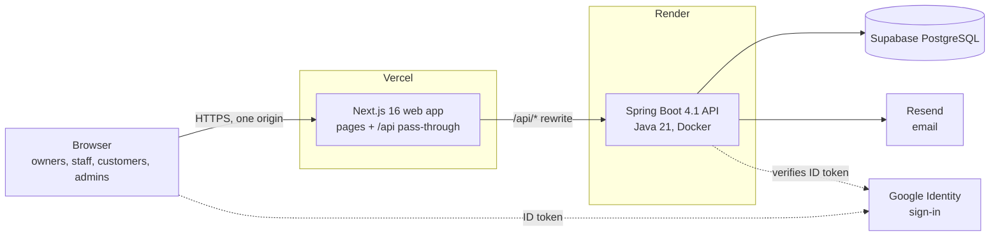

* The browser only ever talks to the web app's origin. `/api/*` is passed through to the API, so the refresh-token cookies are first-party and no CORS is needed.
* One API deployable: a modular monolith. The data is tightly connected (a payment touches an invoice, a membership, the day book and reports), so separate services would only add network hops and distributed transactions.
* Both apps ship as Docker images; `docker-compose.yml` runs the whole stack on one machine.

### Backend modules

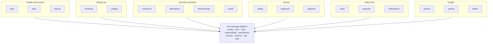

All modules live under `com.managio.modules`; the platform package never depends on them.

Each module has only the layers it needs, and an architecture test keeps them honest:

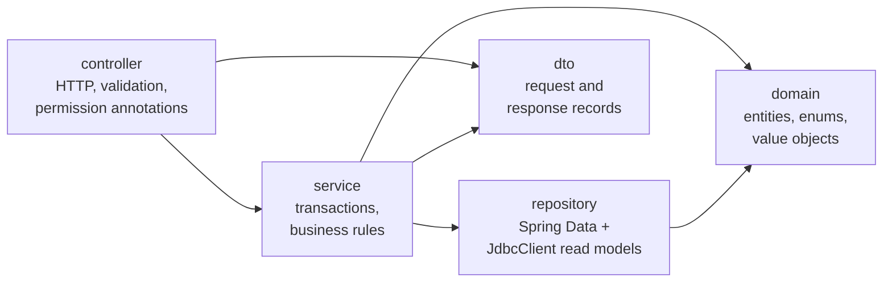

Controllers are used by nothing; services only by controllers and services; repositories only by services; domain classes depend on no other layer; platform code never depends on a feature (ArchUnit, `ArchitectureTest`).

### Web app

`src/app` holds routes only. Each page renders a component from `src/features/<area>`, which owns that area's typed API hooks (TanStack Query over a client generated from the OpenAPI document), pages and dialogs. Shared primitives live in `src/components/ui`, the signed-in frame in `src/components/shell`. Public pages are prerendered; signed-in screens render in the browser behind a session gate, because the access token never leaves browser memory.

---

## Key flows

### 1. An owner gets started

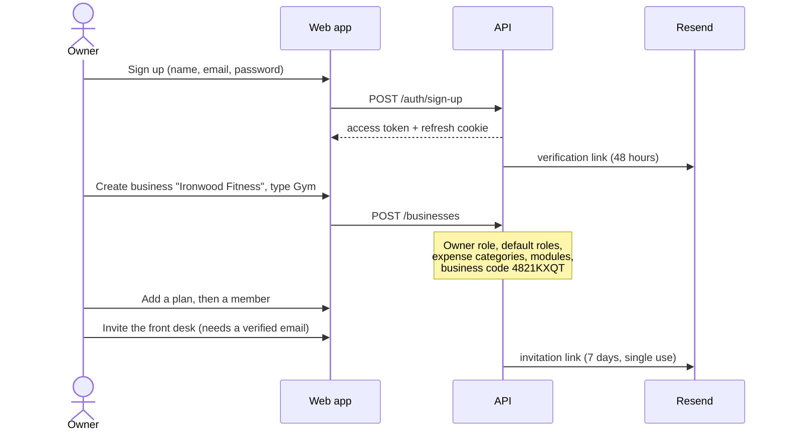

### 2. Selling a membership, from invoice to cash count

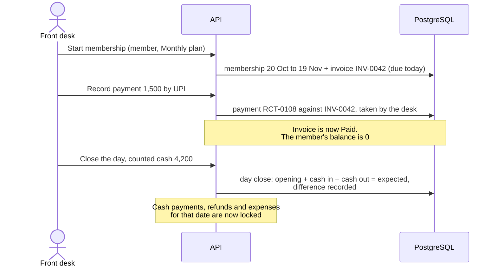

### 3. Every request to a business is checked

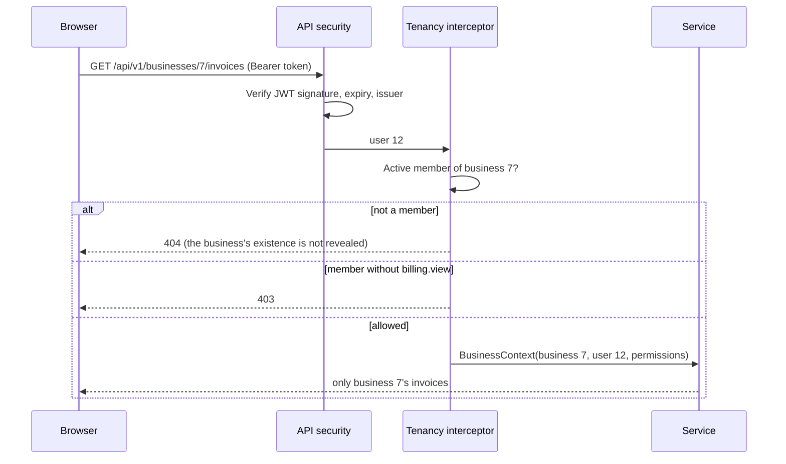

### 4. Sessions that stay safe

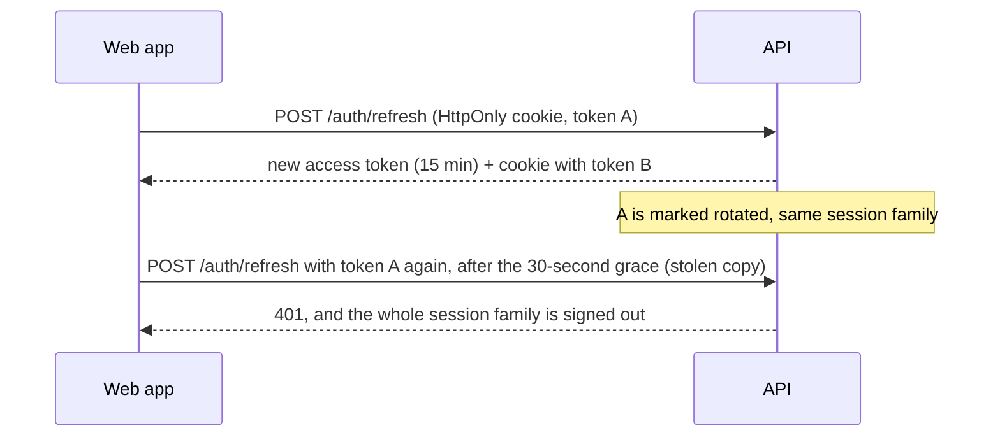

### 5. A request becomes an expense

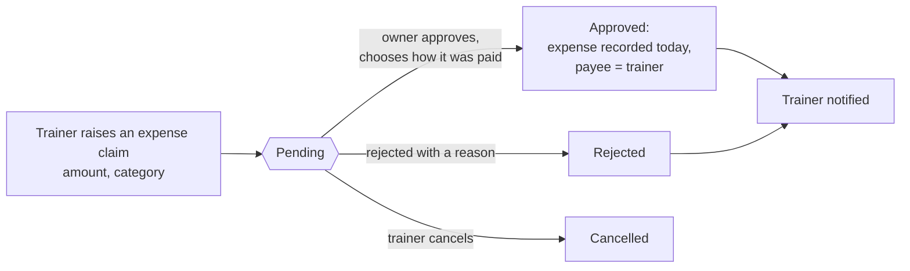

### 6. The platform console

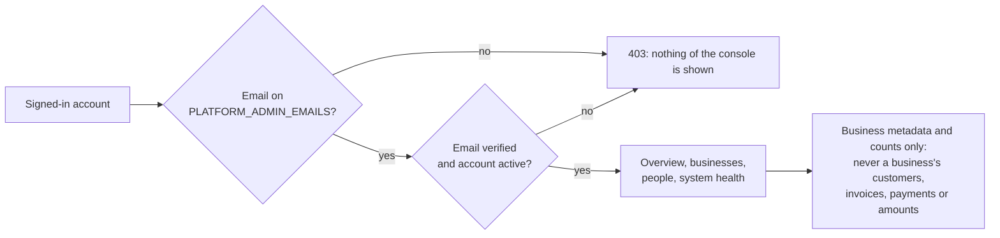

---

## Data model

The main tables (26 in total; full list in [docs/DATA_MODEL.md](docs/DATA_MODEL.md)). Every business table carries `business_id`, and every query filters by it.

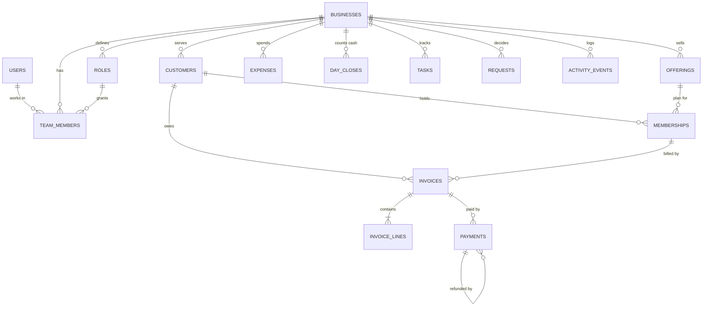

* Money is `numeric(12,2)`, rounded half-up. Business dates are dates in the business's time zone (India by default).
* Nothing with money or history attached is deleted: customers are archived; invoices, payments and expenses are voided with a reason.
* Membership expiry and invoice status are worked out from dates and payments, never stored, so they can't go stale.
* Schema changes are Flyway migrations that carry data forward.

---

## Security and privacy

* **Tenant isolation.** Every business-scoped request passes the tenancy interceptor; a record from another business answers 404. Tested for every role, and end to end with two real tenants.
* **Tokens.** Access tokens live only in browser memory. Refresh tokens are random 256-bit values stored as SHA-256 hashes, sent as `HttpOnly; Secure; SameSite=Lax` cookies, rotated on every use with reuse detection.
* **Accounts.** BCrypt passwords, lockout after 5 failures (for Google sign-in too), the same answer for unknown email and wrong password, single-use expiring links. Google ID tokens are checked for signature, issuer, audience and expiry; linking Google to an unverified account removes the password someone else may have set.
* **Rate limits that can't be dodged.** `X-Forwarded-For` is ignored; only the web app, proven by a shared secret, may name the visitor's address. Limits per address (IPv6 per /64), per email recipient and per account.
* **Money actions happen once.** Payments, refunds, sales, expenses, payroll and memberships accept an `Idempotency-Key`; retries and double submits replay the first result instead of recording twice.
* **Permissions.** Enforced by the API; the UI only follows them. Nobody can grant a permission they don't hold or change their own role.
* **Customer portal.** Customer and business always come from the customer's token, never from the request.
* **Platform console.** Allowlist plus verified email, checked on every request; read-only; tenants appear as metadata and counts only.
* **Privacy and search engines.** Plain-language [privacy policy](https://managio.me/privacy), [terms](https://managio.me/terms), [security](https://managio.me/security) and [contact](https://managio.me/contact) pages; only necessary cookies, no analytics or advertising. Private areas and the API are never indexed.
* **Safe defaults.** API docs off in production; a Content Security Policy that allows only this site and Google sign-in, HSTS, `X-Frame-Options: DENY`, `nosniff`, referrer and permissions policies; cross-site requests refused by CORS; no stack traces in error responses, no secrets or query strings in logs, non-root containers, secrets only in environment variables. Shipped dependencies are checked against the OSV vulnerability database.

---

## Tech stack

| Layer | Technology |
|---|---|
| API | Java 21, Spring Boot 4.1, Spring Security (OAuth2 resource server, JWT), Spring Data JPA (Hibernate 7), JdbcClient read models, Flyway, springdoc OpenAPI 3.1, Caffeine, Resend |
| Web | Next.js 16.4 (App Router, Cache Components, React Compiler), React 19, TypeScript, Tailwind CSS 4, TanStack Query 5, openapi-fetch with generated types, React Hook Form and Zod, Radix UI, lucide icons, Sonner |
| Database | PostgreSQL (Supabase in production, PostgreSQL 17 locally and in tests) |
| Tests | JUnit 5, Testcontainers, MockMvc, ArchUnit, Vitest, Testing Library, Playwright, axe-core |
| Delivery | Docker (multi-stage, non-root), Docker Compose, Jenkins, Vercel, Render, Supabase |

---

## Repository layout

```
Mangaio/
├── managio_backend/          Spring Boot API
│   ├── src/main/java/com/managio/
│   │   ├── platform/         shared infrastructure (security, tenancy, errors, mail, ...)
│   │   └── modules/          one package per feature, split into layers
│   ├── src/main/resources/   application.yml, Flyway migrations
│   ├── src/test/java/        integration, contract and architecture tests
│   ├── Dockerfile
│   └── .env.example
├── managio_frontend/         Next.js web app
│   ├── src/app/              routes
│   ├── src/features/         product areas (billing, customers, admin, ...)
│   ├── src/components/       UI primitives and the signed-in shell
│   ├── src/lib/              API client, sessions, formatting
│   ├── e2e/                  Playwright specs
│   ├── Dockerfile
│   └── .env.example
├── deploy/oracle/            an always-on VM setup (PostgreSQL + API + Caddy), kept for later; not used now
├── docs/                     the source of truth: product, architecture, decisions, status
├── docker-compose.yml        PostgreSQL + API + web on one machine
├── .env.example              settings for Docker Compose
└── Jenkinsfile               test, build, push, release to Render and Vercel, smoke test
```

---

## Getting started

### Option A: everything in Docker

Needs Docker with Compose.

```bash
cp .env.example .env            # set MANAGIO_DB_PASSWORD and MANAGIO_JWT_SECRET
docker compose up --build -d
docker compose ps               # wait until db, api and web are healthy
```

Open http://localhost:3000 and create an account. Emails (verification, reset, invitations) are written to the API's log until a Resend key is set: `docker compose logs api`. Set `MANAGIO_MAIL_LOG_CONTENT=true` to see their links.

### Option B: develop locally

Needs Java 21, Node 20.9 or newer (22 recommended) and Docker (for the database and the API's tests).

```bash
# 1. Database: a local PostgreSQL in Docker (never the production database)
docker run -d --name managio-dev-db -e POSTGRES_PASSWORD=postgres -e POSTGRES_DB=managio -p 5433:5432 postgres:17

# 2. API on http://localhost:8081
cd managio_backend
cp .env.example .env            # DB_URL=jdbc:postgresql://localhost:5433/managio, a JWT_SECRET,
                                # SECURE_COOKIES=false, API_DOCS_ENABLED=true, MAIL_LOG_CONTENT=true
./mvnw spring-boot:run          # port 8081 (8080 is left to Jenkins)

# 3. Web app on http://localhost:3000
cd ../managio_frontend
cp .env.example .env.local      # API_ORIGIN=http://localhost:8081, NEXT_PUBLIC_GOOGLE_CLIENT_ID (optional)
npm install
npm run dev                     # restart after changing .env.local; the Google client ID is read at start-up
```

Swagger UI is at http://localhost:8081/swagger-ui.html when `API_DOCS_ENABLED=true`. After changing the API, regenerate the web app's types with `npm run api:types`. To open the platform console at `/admin`, put your account's email in the API's `PLATFORM_ADMIN_EMAILS` and verify it.

Every setting, its default and whether it is secret: [docs/ENVIRONMENT.md](docs/ENVIRONMENT.md).

---

## Testing

| Suite | Command | Latest result (22 Oct 2026) |
|---|---|---|
| API: unit, integration (PostgreSQL in Testcontainers), contract, architecture, access sweep | `cd managio_backend && ./mvnw verify` | 172 passed |
| Web: types | `npm run typecheck` | clean |
| Web: lint | `npm run lint` | clean |
| Web: unit and component | `npm test` | 52 passed |
| End to end, desktop and phone, against a production build | `E2E_API_LOG=<api log> npx playwright test` | 57 pass, 1 skipped (phone-only test on the desktop project); includes SEO, legal pages and a sweep at desktop, tablet and phone sizes |
| Docker images and Compose smoke test | `docker compose up --build` | images build, all services healthy, security, rate-limit, idempotency and isolation checks pass |
| Shipped dependencies against the OSV database | see docs/STATUS.md | 0 known vulnerabilities |

The end-to-end suite covers onboarding, payments and receipts, renewals, refunds and voids, attendance, payroll, team invitations and role limits, tasks, requests, the customer portal, isolation between two tenants, expired sessions, the platform console, and a sweep of every screen on desktop and phone that fails on console errors, failed API calls, sideways scrolling or serious accessibility violations (axe, WCAG 2.1 AA). How to run each: [docs/TESTING.md](docs/TESTING.md).

---

## API at a glance

Base path `/api/v1`. JSON in and out, RFC 9457 problem details with a stable `code` for errors, lists as `{ items, page, size, totalItems, totalPages }`.

| Area | Paths |
|---|---|
| Accounts | `/auth/sign-up`, `/auth/sign-in`, `/auth/google`, `/auth/refresh`, `/auth/sign-out`, `/auth/verify-email`, `/auth/password-reset`, `/me` |
| Businesses and team | `/businesses`, `/businesses/{id}/settings`, `/businesses/{id}/roles`, `/businesses/{id}/team`, `/businesses/{id}/invitations`, `/invitations/accept` |
| Customers | `/businesses/{id}/customers` (+ import, export, groups, attendance) |
| Selling | `/businesses/{id}/offerings`, `/memberships`, `/invoices`, `/payments`, `/sales` |
| Money out | `/businesses/{id}/expenses`, `/expense-categories`, `/payroll`, `/day-book` |
| Work | `/businesses/{id}/tasks`, `/requests`, `/notifications`, `/activity` |
| Reports | `/businesses/{id}/today`, `/reports/runway`, `/reports/profit-loss`, `/me/portfolio` |
| Customer portal | `/portal/auth/...`, `/portal/me`, `/portal/memberships`, `/portal/invoices`, `/portal/payments` |
| Platform console | `/admin/access`, `/admin/overview`, `/admin/businesses`, `/admin/people`, `/admin/health` |

Full catalogue with permissions and error codes: [docs/API.md](docs/API.md).

---

## Deployment

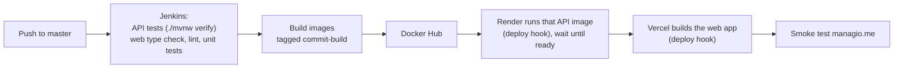

* **Production (₹0 a month, D-037):** web app on Vercel at `https://managio.me`, API on Render Free (the image Jenkins tested), database on Supabase Free, email through Resend. Render Free sleeps after 15 idle minutes and starts slowly on its tenth of a CPU, so a working-hours keep-alive and start-up JVM flags keep cold starts down.
* **One route to production:** Jenkins releases the API first and the web app second; pushes alone don't deploy production. Rollback: re-run with `ROLLBACK_TO_TAG` (or set the earlier tag in Render), and Vercel's Instant Rollback.
* **Images:** `managio_backend/Dockerfile` and `managio_frontend/Dockerfile`, both multi-stage, non-root, with health checks.
* **Step-by-step setup, measurements, backups, smoke test and rollback:** [docs/DEPLOYMENT_RUNBOOK.md](docs/DEPLOYMENT_RUNBOOK.md); short checklist in [docs/DEPLOYMENT.md](docs/DEPLOYMENT.md).

---

## Documentation

`docs/` is the single source of truth. Every rule and decision carries a status label (`[VERIFIED]`, `[DECIDED]`, `[PLANNED]`, `[OPEN]`, ...).

| Document | What it holds |
|---|---|
| [STATUS.md](docs/STATUS.md) | What is built and verified, open questions, next steps. Start here. |
| [PRODUCT.md](docs/PRODUCT.md) | Users, business types, permissions, every business rule with its test. |
| [ARCHITECTURE.md](docs/ARCHITECTURE.md) | System shape, backend and frontend structure, security, testing approach. |
| [DECISIONS.md](docs/DECISIONS.md) | Every significant decision with context and alternatives. |
| [DATA_MODEL.md](docs/DATA_MODEL.md) | Tables, conventions and migrations. |
| [API.md](docs/API.md) | Conventions, errors and the endpoint catalogue. |
| [ENVIRONMENT.md](docs/ENVIRONMENT.md) | Every setting and which are secret. |
| [DEPLOYMENT.md](docs/DEPLOYMENT.md) | Images, the Compose stack, the production plan, smoke test, rollback. |
| [LEGAL.md](docs/LEGAL.md) | What the legal pages say, the code behind each claim, and what needs confirming. |
| [TESTING.md](docs/TESTING.md) | The test suites and how to run them. |

---

## Project status

Version 2 is a rebuild of the original gym-only app as a multi-business platform. The API, the web app, the customer portal and the platform console are built and tested, and the production images build and pass a smoke test. Still to do (details in [docs/STATUS.md](docs/STATUS.md)):

* First production deployment to Render, Supabase and Vercel, step by step in docs/DEPLOYMENT_RUNBOOK.md (the owner performs it).
* A real Google sign-in and a real email from the verified `managio.me` domain in production.
* Optional later: an authenticator-app step for platform administrators, a nonce-based Content Security Policy, and paid plans if Managio stops being free.

---

## License and author

**Proprietary.** © 2026 Managio. All rights reserved.

Built by **Nitin**.

| | |
|---|---|
| LinkedIn | [linkedin.com/in/nitinr0306](https://www.linkedin.com/in/nitinr0306/) |
| GitHub | [github.com/Nitinr0306](https://github.com/Nitinr0306) |
| Portfolio | [nitinr0306-portfolio-business.vercel.app](https://nitinr0306-portfolio-business.vercel.app/) |
| Email | nitinr0306@gmail.com |

<p align="center"><sub>Built with Spring Boot and Next.js · Managio 2.0</sub></p>
