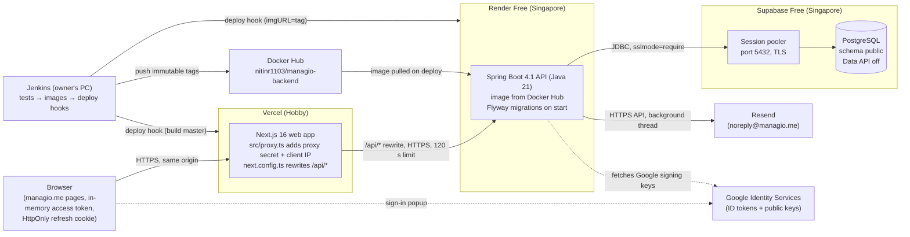

# Managio Deployment Runbook

A practical handbook for deploying, configuring, verifying, securing and maintaining Managio v2. It explains *why* each piece exists, not only *what to type*. It is a living document: every deployment step, configuration change and verification result is recorded here, most recent facts first in [section 13](#13-deployment-history-and-verification).

* Companion documents: [DEPLOYMENT.md](DEPLOYMENT.md) (the short checklist), [ENVIRONMENT.md](ENVIRONMENT.md) (every setting with its default), [ARCHITECTURE.md](ARCHITECTURE.md), [DECISIONS.md](DECISIONS.md), [TESTING.md](TESTING.md), and the code-level guide [FULL_STACK_LEARNING_GUIDE.md](FULL_STACK_LEARNING_GUIDE.md).
* Labels follow [README.md](README.md#status-labels): **`[VERIFIED date]`** observed with evidence on that date; **`[PLANNED]`** decided or written but not yet done or run; **`[OPEN]`** needs a decision, access, or proof. An explanation that hasn't been proven is marked *unconfirmed*.
* Never paste a secret into this file. Secrets are named here, never shown; their values live only in the places listed in [section 3](#3-environment-configuration).

**Current status (2026-10-22):** v2 is on GitHub (`master` = `6783a7d`) and fully tested locally. **It is not deployed.** `https://managio.me` currently serves the **old v1 frontend** from Vercel. The final production stack, chosen by the owner (D-037), is **Vercel Free** (web app), **Render Free** (API) and **Supabase Free** (PostgreSQL), all on free plans. The owner performs every deployment step; [section 5](#5-backend-deployment) and [section 6](#6-frontend-deployment) have them in order.

## Contents

1. [System architecture](#1-system-architecture)
2. [Deployment architecture and decisions](#2-deployment-architecture-and-decisions)
3. [Environment configuration](#3-environment-configuration)
4. [Database deployment](#4-database-deployment)
5. [Backend deployment](#5-backend-deployment)
6. [Frontend deployment](#6-frontend-deployment)
7. [Docker and Docker Compose](#7-docker-and-docker-compose)
8. [Jenkins CI/CD](#8-jenkins-cicd)
9. [Domain, HTTPS and networking](#9-domain-https-and-networking)
10. [Security and secrets](#10-security-and-secrets)
11. [Release and rollback procedure](#11-release-and-rollback-procedure)
12. [Troubleshooting reference](#12-troubleshooting-reference)
13. [Deployment history and verification](#13-deployment-history-and-verification)
14. [New-machine recovery guide](#14-new-machine-recovery-guide)

---

## 1. System architecture

### What runs where

| Layer | Technology | Where it runs | Status |
|---|---|---|---|
| Browser | The Next.js app's pages and JavaScript | The user's device | — |
| Frontend host | Next.js 16 web app ([`managio_frontend/`](../managio_frontend)) | **Vercel** (Hobby, free) | `[VERIFIED 2026-10-22]` the domain points to Vercel, which serves **v1**; v2 not deployed |
| Backend host | Spring Boot 4.1 API on Java 21 ([`managio_backend/`](../managio_backend)), as a Docker image | **Render** (Free web service, *Existing image*, Singapore) | `[PLANNED]` (D-037) |
| Database | PostgreSQL | **Supabase** (Free project, Singapore), reached through its session pooler | `[PLANNED]` (D-037) |
| Email | Resend HTTP API | Resend | `[VERIFIED 2026-10-22]` `managio.me` is verified for sending (a test email was accepted) |
| Sign-in with Google | Google Identity Services | Google | `[VERIFIED 2026-10-22]` works locally on `http://localhost:3000` with the owner's account |
| CI/CD | Jenkins ([`Jenkinsfile`](../Jenkinsfile)) | The owner's Windows PC (service on port 8080) | `[PLANNED]` pipeline written for Render and Vercel, never run; no Jenkins job yet |
| Image registry | Docker Hub, account `nitinr1103` | Docker Hub | `[VERIFIED 2026-10-22]` public repositories `managio-backend` and `managio-frontend` exist (v1 images from 2026-05-19); no v2 image pushed yet |
| Not used | Neon (an existing project) and the Oracle VM plan (D-036, superseded) | — | Neon is left untouched (nothing deleted); [`deploy/oracle/`](../deploy/oracle) is kept for a possible later move |

> **Term: image-backed service.** Render can either build your code from GitHub or run a Docker image that someone else built. Managio uses the second: the image is built (by Jenkins, or by hand at first) and pushed to Docker Hub, and Render runs that exact tag. What runs in production is then byte-for-byte what was tested, and Render spends no build (pipeline) minutes.

### How a request travels

When someone clicks **Record payment**:

1. **Browser** → `POST https://managio.me/api/v1/businesses/12/invoices/34/payments` with `Authorization: Bearer <access token>` and an `Idempotency-Key` header. The browser only ever talks to `managio.me` (same origin), so the session cookie is first-party (decision D-009).
2. **Vercel** runs the Next.js app. [`src/proxy.ts`](../managio_frontend/src/proxy.ts) (Next.js "proxy", formerly called middleware) removes any client-supplied `X-Managio-*` headers, then adds `X-Managio-Proxy-Secret` (the shared `API_PROXY_SECRET`) and `X-Managio-Client-Ip` (the visitor's address, which Vercel puts in `x-forwarded-for`).
3. The rewrite in [`next.config.ts`](../managio_frontend/next.config.ts) forwards `/api/*` to `API_ORIGIN`, the Render URL (`https://<service>.onrender.com`). **Vercel waits at most 120 seconds** for the answer.
4. **Render** passes the request to the API container (waking it first if it was asleep). Filters run in order: [`RequestIdFilter`](../managio_backend/src/main/java/com/managio/platform/web/RequestIdFilter.java) (request ID for logs), [`ClientAddressFilter`](../managio_backend/src/main/java/com/managio/platform/security/ClientAddressFilter.java) (trusts the client IP only with the right secret), then Spring Security ([`SecurityConfig`](../managio_backend/src/main/java/com/managio/platform/security/SecurityConfig.java): CORS check, JWT validation).
5. [`BusinessAccessInterceptor`](../managio_backend/src/main/java/com/managio/platform/tenancy/BusinessAccessInterceptor.java) checks the caller is an active member of business 12 and holds the route's permission; otherwise 404 or 403.
6. The controller and service run inside a database transaction against **Supabase** (JDBC over TLS to the session pooler).
7. The JSON response travels back the same way; the web app updates its cache and shows "Recorded ₹500 from …".

The full code-level trace of this request is in [FULL_STACK_LEARNING_GUIDE.md, section 2](FULL_STACK_LEARNING_GUIDE.md#2-architecture-and-request-lifecycle).



### Ports

| Context | Web app | API | Database |
|---|---|---|---|
| Local development | 3000 (`npm run dev` / `npm run start`) | **8081** (default in [`application.yml`](../managio_backend/src/main/resources/application.yml); 8080 is Jenkins) | 5433 (Docker container `managio-dev-db`) |
| Local Docker Compose ([`docker-compose.yml`](../docker-compose.yml)) | `MANAGIO_WEB_PORT` (default 3000) published; 3000 inside | 8080 inside the network, **not published** | 5432 inside the network, not published |
| Production | 443 via Vercel | 443 via Render; Render sets `PORT` (default 10000) inside the container | Supabase session pooler, port 5432 over TLS |

## 2. Deployment architecture and decisions

| Service | Responsibility | Why this choice | Decision |
|---|---|---|---|
| **Vercel** (Hobby) | Builds the Next.js app from GitHub and serves it at `managio.me` | First-class Next.js host, never sleeps, automatic HTTPS; the domain already points there | D-030, D-031, D-037 |
| **Render** (Free) | Runs the API image | Runs a Docker image with health checks and deploy hooks; no server to maintain; free | D-031, D-037 |
| **Supabase** (Free) | Production PostgreSQL | No monthly compute-hour cap (unlike Neon Free); pauses only after a week without activity | D-037 |
| **Resend** | Transactional email over HTTPS | Simple API, domain verification, send-only keys | D-017 |
| **Jenkins** | Tests, builds and pushes the images; deploys the API to Render, then the web app to Vercel | The owner already runs Jenkins; production only gets tested images, API before web | D-031 |
| **Docker Hub** | Stores immutable API images | Render runs exactly the tested tag; rollback picks an older one | D-031 |

### Free-tier limits that shape this setup `[VERIFIED 2026-10-22]` (providers' documentation)

| Service | Limit | What it means for Managio |
|---|---|---|
| Render Free | 0.1 CPU, 512 MB; **sleeps after 15 minutes without inbound traffic**; waking takes "about one minute" plus the app's own start; 750 free instance hours per workspace a month, shared by all free services (when they run out, Render suspends all free web services until the next month); "might restart a Free web service at any time"; Render says not to use free instances for production | See *Cold starts* below. Sleeping saves hours, so 750 is enough without keep-alive. |
| Vercel Hobby | Waits at most **120 s** for a proxied (rewritten) request; 100 GB fast data transfer, 1,000,000 function invocations and 4 active-CPU hours a month; exceeding a limit pauses that feature for 30 days instead of charging; **personal, non-commercial use only** | A cold API that takes longer than 120 s makes the first request fail with a gateway error. |
| Supabase Free | 500 MB database per project, 5 GB egress, 2 free projects; projects **pause after 1 week of inactivity** (restored from the dashboard); no backups on the Free plan; the direct connection is IPv6-only, the session pooler is IPv4 | Use the session pooler. Make your own backups (section 4). |
| Docker Hub (free account) | Unauthenticated pulls are limited per IP address; authenticated: 200 pulls per 6 hours | Give Render a read-only token so its pulls are authenticated. |

### Cold starts and uptime: what is allowed, what helps

**Measured locally** with the production image, under a 512 MB limit and a hard 0.1-CPU quota (the same as Render Free): Spring started in **338 s**, or **218 s** with start-up JVM flags (`-XX:TieredStopAtLevel=1 -XX:+UseSerialGC -Xss512k`). With 0.5 CPU it was ready in 60 s, and with 2 CPUs in 18 s. Peak memory stayed between 406 and 455 MiB. Render's real CPU may behave differently from a local quota (*unconfirmed* until you see the start-up line in Render's log).

What that means, and what is done about it:

* **Keep-alive pings during working hours (the owner's decision, 2026-10-22).** A free external scheduler calls `https://<service>.onrender.com/actuator/health/liveness` every 10 minutes between 08:00 and 22:00 India time (section 5, step 5). That endpoint doesn't touch the database. **The risk was accepted knowingly:** Render's guidance calls keeping a free service awake artificially abuse of the free tier. Render may restart, throttle or suspend the service, and community reports describe pings timing out at random. Render's documentation doesn't list it as prohibited.
* **Hours:** 14 hours a day uses about 434 of the 750 free hours in a 31-day month. Pinging around the clock would need about 744, too close to the limit with another free service in the workspace. When the hours run out, Render suspends **all** free web services until the next month.
* **During active use the API stays awake by itself:** every real request resets the 15-minute timer.
* **Outside the pinged hours, the first request can fail.** If the API takes longer than Vercel's 120 s to wake, the first page load shows an error. Wait about 3–4 minutes and reload: the wake-up continues in the background.
* **`JAVA_TOOL_OPTIONS` with the start-up flags** is set on Render (section 5), because it cut the measured start-up by about a third. It slightly lowers peak throughput, which doesn't matter at 6–7 users.
* **Daily jobs:** the renewal reminders at 09:00 India time fall inside the pinged hours, so they run, unless Render restarted the service just then. The token clean-up at 03:30 runs only if someone is using Managio at night. Expired rows then just wait for a later run.
* **Render may restart the service at any time**, and each restart means a wake-up as above.
* **Possible later improvements (code changes, not made; need your approval):** a "starting up, please wait" screen in the web app that retries until the API answers, instead of showing an error; Spring's class-data-sharing archive to shorten start-up. The lasting fix is a host that doesn't sleep: Render Starter (paid, about $7 a month, 60 s start-up measured at 0.5 CPU) or the Oracle VM files in `deploy/oracle/`.

### Capacity for 6–7 people at a time

At 0.1 CPU, 450 requests (create a customer, search, list businesses) took 78.5 s in the local test, about 6 requests per second, with the slowest round at 3 s. Six or seven people working normally make far fewer requests than that, so the API keeps up, though pages are slower than on a bigger instance. The pool uses at most 5 database connections.

## 3. Environment configuration

### How the API reads its configuration

1. [`application.yml`](../managio_backend/src/main/resources/application.yml) holds every setting as `${ENV_VAR:default}`. The default is the safe production value (for example `SECURE_COOKIES` defaults to `true`, `API_DOCS_ENABLED` to `false`); [`ProductionDefaultsTest`](../managio_backend/src/test/java/com/managio/platform/config/ProductionDefaultsTest.java) fails the build if that ever changes.
2. `spring.config.import: optional:file:.env[.properties]` additionally loads a `.env` file **from the directory the API is started in**, if one exists. That is how `managio_backend/.env` reaches the API locally. On Render there is no such file: settings are Render environment variables.
3. **Precedence** (highest wins): real environment variables → the `.env` file → defaults in `application.yml`. Any Spring property can also be set from the environment by its upper-case name with dots as underscores and dashes removed, for example `SPRING_DATASOURCE_HIKARI_MINIMUMIDLE` for `spring.datasource.hikari.minimum-idle` (verified 2026-10-22).
4. **Profiles.** There is no production profile; production is "no profile + environment variables". The only profile is `test`, used by the test suite ([`application-test.yml`](../managio_backend/src/test/resources/application-test.yml), activated by `@ActiveProfiles("test")` in [`IntegrationTest`](../managio_backend/src/test/java/com/managio/support/IntegrationTest.java)).
5. Values are bound to the record [`ManagioProperties`](../managio_backend/src/main/java/com/managio/platform/config/ManagioProperties.java) with Bean Validation, so the API **refuses to start** with, for example, a `JWT_SECRET` shorter than 32 characters or an `API_PROXY_SECRET` that is neither empty nor at least 32 characters.

### How the web app reads its configuration

* **Build time** (compiled into the JavaScript): `API_ORIGIN` (the rewrite target) and `NEXT_PUBLIC_GOOGLE_CLIENT_ID`. Change them → rebuild/redeploy. Anything starting with `NEXT_PUBLIC_` is **visible to every visitor**, so it must never hold a secret (the Google client ID is public by design).
* **Run time** (server only, never sent to browsers): `API_PROXY_SECRET`, `CLIENT_IP_HEADER`. Verified on 2026-10-22 that the secret's value appears in no build output.
* Locally from `managio_frontend/.env.local`; on Vercel from **Project → Settings → Environment Variables**.

### Where every value belongs, and where to get it

| Variable | Read by | Required in production | Secret | Production value: where to get it |
|---|---|---|---|---|
| `DB_URL` | API | Yes | No* | Render. `jdbc:postgresql://<session pooler host>:5432/postgres?sslmode=require`. The host comes from Supabase → your project → **Connect** (top of the page) → **Session pooler**; it looks like `aws-<n>-ap-southeast-1.pooler.supabase.com`. |
| `DB_USERNAME` | API | Yes | No | Render. From the same Connect dialog: `postgres.<project-ref>`. |
| `DB_PASSWORD` | API | Yes | **Yes** | Render. The database password you set when creating the Supabase project (reset it under *Project Settings → Database* if lost). |
| `JWT_SECRET` | API | Yes | **Yes** | Render. Generate on your PC: `openssl rand -base64 48` (Git Bash has `openssl`). |
| `API_PROXY_SECRET` | API and web | Yes | **Yes** | Render **and** Vercel, the same value. Generate: `openssl rand -hex 32`. |
| `CORS_ALLOWED_ORIGINS` | API | Yes | No | Render: `https://managio.me` |
| `APP_URL` | API | Yes | No | Render: `https://managio.me` (no trailing slash; base of emailed links) |
| `RESEND_API_KEY` | API | Yes | **Yes** | Render. Resend → **API Keys** → *Create API key*, permission **Sending access**, domain `managio.me`. |
| `MAIL_FROM` | API | Yes | No | Render: `Managio <noreply@managio.me>` |
| `GOOGLE_CLIENT_ID` | API | For Google sign-in | No | Render. Google Cloud Console → *APIs & Services → Credentials* → the web OAuth client → Client ID (the same value as in your local `managio_backend/.env`). |
| `PLATFORM_ADMIN_EMAILS` | API | No | No | Render: your email, if you want the platform console |
| `JAVA_TOOL_OPTIONS` | the JVM | Recommended | No | Render: `-XX:TieredStopAtLevel=1 -XX:+UseSerialGC -Xss512k` (shorter start-up, section 2) |
| `API_ORIGIN` | web (build) | Yes | No | Vercel: the Render URL, e.g. `https://managio-api.onrender.com`, no trailing slash (shown at the top of the Render service page) |
| `NEXT_PUBLIC_GOOGLE_CLIENT_ID` | web (build) | For Google sign-in | No (public) | Vercel: the same value as `GOOGLE_CLIENT_ID` |
| `CLIENT_IP_HEADER` | web | No | No | Not needed on Vercel (uses `x-forwarded-for`) |
| `DB_POOL_SIZE` | API | No (5) | No | leave unset |
| `SECURE_COOKIES` | API | No (true) | No | leave unset |
| `RATE_LIMIT_MULTIPLIER` | API | No (1) | No | leave unset |
| `MAIL_LOG_CONTENT` | API | No (false) | No | leave unset (must stay false) |
| `PORT` | API | No | No | **leave unset**: Render sets it |
| `API_DOCS_ENABLED` | API | No (false) | No | leave unset |
| `SQL_LOG_LEVEL` | API | No (`warn`) | No | leave unset |
| `SPRING_DATASOURCE_HIKARI_MINIMUMIDLE` | API | No | No | leave unset (only useful for a database that sleeps when idle, such as Neon) |

\* A JDBC URL is not secret as long as it contains **no password**; keep the password in `DB_PASSWORD`. Local development values are in [`managio_backend/.env.example`](../managio_backend/.env.example) and [`managio_frontend/.env.example`](../managio_frontend/.env.example); the local Compose stack uses a `MANAGIO_` prefix ([`.env.example`](../.env.example)); Jenkins credentials and parameters are in [section 8](#8-jenkins-cicd). Full defaults: [ENVIRONMENT.md](ENVIRONMENT.md).

### Local PostgreSQL versus production

* **Local and tests never use a production database** (owner's rule, 2026-10-22). Local development uses the container `managio-dev-db` on 5433; the backend test suite starts its own throwaway PostgreSQL 17 with Testcontainers.
* H2 is not used: the schema relies on PostgreSQL-only SQL (`INSERT … ON CONFLICT`, `text[]`, `generate_series`).

## 4. Database deployment

* **Where:** a Supabase Free project in **Singapore** (the region where Render also runs), the `postgres` database, schema `public`. The API connects through Supabase's **session pooler** on port 5432. Session mode keeps a real session per connection, so Flyway and prepared statements work. The direct connection is IPv6-only on the Free plan, and transaction mode (port 6543) doesn't support prepared statements.
* **The Data API is turned off.** Supabase exposes tables in `public` to its auto-generated REST and GraphQL API by default ("These grants make new objects reachable through the Data API, even when you don't intend to expose them"). Managio never uses that API, so it is disabled before the first deploy (section 5, step 3). Otherwise anyone with the project's public key could read the tables.
* **Migration tool:** Flyway, run automatically by Spring Boot **when the API starts**. Migrations live in [`managio_backend/src/main/resources/db/migration/`](../managio_backend/src/main/resources/db/migration): [`V1__initial_schema.sql`](../managio_backend/src/main/resources/db/migration/V1__initial_schema.sql) (26 tables), [`V2__platform_console_indexes.sql`](../managio_backend/src/main/resources/db/migration/V2__platform_console_indexes.sql) (indexes), [`V3__idempotency_keys.sql`](../managio_backend/src/main/resources/db/migration/V3__idempotency_keys.sql) (one table). There is **no Flyway Maven plugin**: starting the API is how migrations run. On a new project the first start should log "Successfully applied 3 migrations to schema "public"". If Flyway instead reports that `public` is not empty, stop and investigate before changing anything (*unconfirmed* whether a new Supabase project's `public` schema is always empty).
* **Schema checking:** `spring.jpa.hibernate.ddl-auto: validate` means Hibernate never changes the schema; it only checks that entities match it, and the API fails to start if they don't.
* **Forward only:** migrations are never edited after release. To undo a change, write a new migration. Flyway ignores migrations newer than the code it runs with, so an older image can start on a newer schema as long as the change only *added* tables or columns (expand, then contract in a later release).
* **TLS:** `?sslmode=require` in `DB_URL` makes the PostgreSQL driver refuse unencrypted connections.
* **Connection pool:** HikariCP with at most 5 connections and 1 kept open (`minimum-idle: 1`), `max-lifetime` 5 minutes and `idle-timeout` 2 minutes ([`application.yml`](../managio_backend/src/main/resources/application.yml)). Supabase Free has no compute-hour cap, so keeping a connection open costs nothing.
* **A fresh start (D-021):** production starts empty. Nothing is copied from Neon or v1.
* **Pausing:** Supabase pauses Free projects after a week of inactivity; restore it from the Supabase dashboard (the project page offers *Restore*). With daily users this shouldn't happen; Supabase doesn't define exactly what counts as activity (*unconfirmed*).

### Backups `[PLANNED]` (Supabase Free includes none)

Weekly, and before every release with a migration, from your PC (Docker Desktop running; the password is asked for and never stored):

```bash
docker run --rm -it -v "$PWD:/backup" postgres:17 \
  pg_dump -h <session pooler host> -p 5432 -U postgres.<project-ref> -d postgres \
  --schema=public --format=custom --file=/backup/managio-$(date +%Y%m%d).dump
```

Keep the files private (they hold customer data; `*.dump` is git-ignored) and delete old ones. Check one now and then with `pg_restore --list`.

### Restore

Stop traffic first. Either suspend the Render service (*Settings → Suspend Web Service*), or accept errors for the minute it takes. Then:

```bash
docker run --rm -it -v "$PWD:/backup" postgres:17 \
  pg_restore -h <session pooler host> -p 5432 -U postgres.<project-ref> -d postgres \
  --clean --if-exists --no-owner /backup/managio-<date>.dump
```

Then resume the service. The same restore command was verified against a local PostgreSQL on 2026-10-22: after a backup a second account was added, and the restore brought the database back to the backup.

### Verify the production database (read-only)

1. Render → the service → **Logs**: `Successfully applied 3 migrations` (first start) or `Schema "public" is up to date`, then `Started ManagioApplication`.
2. `curl https://<service>.onrender.com/actuator/health` → `{"status":"UP"}` (the overall status includes the database check; `/actuator/health/readiness` only says the application finished starting).
3. Supabase → **Table Editor**: the 27 Managio tables and `flyway_schema_history` appear under `public`.

## 5. Backend deployment

**Build and test locally** (Docker Desktop must be running for Testcontainers):

```bash
cd managio_backend
./mvnw -B clean verify            # unit + integration + contract + architecture tests, then the jar
./mvnw -B -DskipTests package     # just the jar: target/managio-api-2.0.0-SNAPSHOT.jar
```

### First deployment, step by step `[PLANNED]` (you perform every step)

**Step 1. Commit and push** the current changes (section 13 lists them), so the image is built from a commit on GitHub.

**Step 2. Docker Hub tokens and the first image.**
1. <https://app.docker.com> → your avatar → **Account settings → Personal access tokens → Generate new token**. Make two:
   * `managio-push` with **Read & Write**: for your PC now, and Jenkins later.
   * `render-pull` with **Read-only**: for Render.
   Copy each when shown; Docker Hub shows it only once.
2. On your PC, in the repository folder (PowerShell or Git Bash), with Docker Desktop running:

   ```bash
   git rev-parse --short=8 HEAD                                     # e.g. 1a2b3c4d
   docker login -u nitinr1103                                       # paste the managio-push token as the password
   docker build -t nitinr1103/managio-backend:<commit>-manual1 ./managio_backend
   docker push nitinr1103/managio-backend:<commit>-manual1
   ```

**Step 3. Supabase project.**
1. <https://supabase.com/dashboard> → **New project**. Organization: yours (plan **Free**). Name: `managio`. **Database password**: click *Generate a password*, then copy it into your password manager; it is `DB_PASSWORD`. **Region**: **Southeast Asia (Singapore)**. If the form offers security options for the Data API, choose the option without it (connection string only). Create, and wait until the project shows as healthy.
2. **Turn off the Data API**: *Integrations → Data API* (`/dashboard/project/<project-ref>/integrations/data_api/overview`) → **Enable Data API: off**. Managio doesn't use it, and while it is on, tables in `public` are reachable through it.
3. **Connection details**: **Connect** at the top of the project page → **Session pooler**. Note the host (`aws-<n>-ap-southeast-1.pooler.supabase.com`), port `5432`, database `postgres` and user `postgres.<project-ref>`. Ignore the direct connection: it is IPv6-only on Free.

**Step 4. Render web service.**
1. <https://dashboard.render.com> → **New → Web Service** → **Existing Image**.
2. **Image URL**: `docker.io/nitinr1103/managio-backend:<commit>-manual1`. **Credential**: *Add credential* → registry **Docker Hub**, username `nitinr1103`, the `render-pull` token. Then click **Connect**.
3. **Name**: `managio-api` (this becomes `https://managio-api.onrender.com` if the name is free). **Region**: **Singapore**. **Instance type**: **Free**.
4. **Environment variables**: add those in [section 3](#where-every-value-belongs-and-where-to-get-it) marked *Render*: `DB_URL`, `DB_USERNAME`, `DB_PASSWORD`, `JWT_SECRET`, `API_PROXY_SECRET`, `CORS_ALLOWED_ORIGINS`, `APP_URL`, `RESEND_API_KEY`, `MAIL_FROM`, `GOOGLE_CLIENT_ID`, `PLATFORM_ADMIN_EMAILS`, `JAVA_TOOL_OPTIONS`. Do **not** add `PORT`. You can paste them all at once with **Add from .env**; type the values into Render only, never into a file you keep in the repository.
5. **Advanced**: **Health Check Path** `/actuator/health/readiness`. Leave **Pre-Deploy Command** empty, so no pipeline minutes are used, and leave Docker Command empty.
6. **Deploy Web Service**. The first start runs the migrations on Supabase and can take several minutes on the free CPU. Watch **Logs** for `Successfully applied 3 migrations` and `Started ManagioApplication in … seconds`, and note the seconds in section 13.
7. Check: `https://managio-api.onrender.com/actuator/health/readiness` → `{"status":"UP"}`; `/actuator/health` → `UP` (database reachable); `/v3/api-docs` → 404.
8. **Settings → Deploy Hook**: copy the URL into your password manager; Jenkins will use it as `render-deploy-hook`. It is a secret.
9. The other service in your Render workspace also draws on the 750 free hours while it is awake; suspend it if you don't need it.

**Step 5. Working-hours keep-alive (your decision; see the risk in [section 2](#cold-starts-and-uptime-what-is-allowed-what-helps)).**
1. In a free external scheduler (for example <https://cron-job.org>: sign up → **Create cronjob**), set the URL to `https://managio-api.onrender.com/actuator/health/liveness` and the method to GET.
2. Schedule: **every 10 minutes, from 08:00 to 21:50, every day**, in the time zone **Asia/Kolkata**. Set the request timeout to the maximum the service allows. The first call of the day may time out while the API wakes, which is expected.
3. Turn off failure notifications for single timeouts, or alert only after several failures in a row, so the morning wake-up doesn't email you.
4. Don't ping `/actuator/health` or any `/api/...` path: those touch the database or count as traffic for no reason.
5. Once a week, check Render → **Billing / Usage** for free instance hours.

**Step 6.** Continue with the web app in [section 6](#6-frontend-deployment).

### Running it

* **Health:** `/actuator/health/readiness` (the application finished starting and accepts traffic; used by Render's health check and Jenkins), `/actuator/health/liveness` (the process is alive) and `/actuator/health` (overall, including the database). Only `health` is exposed (`management.endpoints.web.exposure.include: health`), and Spring Security denies any path it doesn't list (`anyRequest().denyAll()`).
* **Logs:** Render → the service → **Logs**: one line per API request with method, path, status, duration and request ID (also returned in `X-Request-Id`). Passwords, tokens and email bodies are never logged (`MAIL_LOG_CONTENT` must stay false).
* **CORS:** `CORS_ALLOWED_ORIGINS=https://managio.me`. The rewrite forwards the browser's `Origin` header, so any other origin gets 403.
* **Trusted proxies:** `X-Forwarded-*` headers are ignored (`server.forward-headers-strategy: none`); only requests carrying the right `API_PROXY_SECRET` may name the client IP. Without the secret, every visitor shares the connecting address's rate limit, and the API logs a warning at start-up.
* **Sleeping and waking:** section 2, *Cold starts and uptime*.

**Troubleshooting the API**

| Symptom | Likely cause | How to check |
|---|---|---|
| Fails at start-up with `Binding to target ... failed` | A required variable missing or invalid (`JWT_SECRET` < 32 chars, bad `API_PROXY_SECRET`) | The first lines of the Render log name the property |
| `Connection refused` / timeout to the database | Wrong pooler host or port, or the Supabase project is paused | Render log; Supabase project page (restore it if paused) |
| `password authentication failed` | Wrong `DB_USERNAME` (must be `postgres.<project-ref>` for the pooler) or `DB_PASSWORD` | Supabase *Connect* dialog; reset the password in *Project Settings → Database* |
| `prepared statement … already exists` or similar | Connected to transaction mode (port 6543) | Use the session pooler, port 5432 |
| Flyway: `Found non-empty schema(s) "public"` | Something already exists in `public` | Stop and look in Supabase's Table Editor before changing anything |
| Health check fails, deploy cancelled after 15 minutes | The app didn't finish starting in time on the free CPU, or the database was unreachable | Render log; the `Started ManagioApplication in …` line |
| Browser shows a gateway error after a quiet spell | The API was asleep and took longer than Vercel's 120 s to wake | Reload after 3–4 minutes (section 2) |
| Browser gets 403 on every API call | `CORS_ALLOWED_ORIGINS` doesn't match the site's origin exactly | Response body `Invalid CORS request` |
| Everyone hits 429 at once | `API_PROXY_SECRET` missing or different on Render and Vercel | API start-up warning; values must match |

## 6. Frontend deployment

### Step by step `[PLANNED]` (you perform every step; this replaces the live v1 site)

1. <https://vercel.com/dashboard> → the existing `managio.me` project → **Settings → General** (*Build and Deployment*): **Root Directory** `managio_frontend`, **Framework Preset** Next.js, **Node.js Version** 22.x. Leave Build and Install commands at their defaults. Changing settings doesn't redeploy anything: v1 stays live until step 4.
2. **Settings → Environment Variables**, environment **Production** (add **Preview** too if you want previews to work):
   * `API_ORIGIN` = the Render URL from section 5 (e.g. `https://managio-api.onrender.com`, no trailing slash)
   * `API_PROXY_SECRET` = the same value as on Render
   * `NEXT_PUBLIC_GOOGLE_CLIENT_ID` = the Google client ID
   Check the existing v1 variables: remove any the v2 app doesn't use, after noting them in case you need to roll back.
3. **Settings → Domains**: keep `managio.me`; **Add** `www.managio.me` and set it to **redirect to `managio.me`** (Vercel then issues its certificate). **Settings → Git → Deploy Hooks**: create one named `jenkins-master` for branch `master`, and copy the URL into your password manager (`vercel-deploy-hook`; it is a secret).
4. **Deploy v2:** pushes to `master` don't deploy production ([`managio_frontend/vercel.json`](../managio_frontend/vercel.json)), so trigger the hook once: `curl -X POST "<deploy hook URL>"`. Watch **Deployments** until the build is *Ready*. Don't use *Redeploy* on an old deployment: that rebuilds the old (v1) commit.
5. **Google Cloud Console** → *APIs & Services → Credentials* → the web OAuth client → **Authorised JavaScript origins**: add `https://managio.me` (keep `http://localhost` and `http://localhost:3000`). No redirect URIs are used. After the legal pages answer 200 in production, set the consent screen's home, privacy (`/privacy`) and terms (`/terms`) links and publish the app.
6. Run the smoke test in [section 11](#post-deployment-smoke-test), and record the results in section 13.

**Rollback of the web app:** Vercel → **Deployments** → the last good production deployment → **Instant Rollback** (this also brings v1 back if v2 must be withdrawn).

**Verify a production build locally** (before releasing):

```bash
cd managio_frontend
npm ci
npm run typecheck && npm run lint && npm test
npm run build && npm run start     # http://localhost:3000, needs the API on 8081
```

## 7. Docker and Docker Compose

### [`managio_backend/Dockerfile`](../managio_backend/Dockerfile)

* **Stage 1 `build`** (`eclipse-temurin:21-jdk-alpine`, on the builder's platform: `FROM --platform=$BUILDPLATFORM`): copies the Maven wrapper and `pom.xml` first and runs `dependency:go-offline`, so dependency downloads are cached between builds; then copies `src` and runs `package -DskipTests` (tests run in CI, where Docker is available for Testcontainers).
* **Stage 2 runtime** (`eclipse-temurin:21-jre-alpine`): only the JRE and `app.jar`; runs as the non-root user `managio`; `ENV PORT=8080` (Render overrides `PORT`); a `HEALTHCHECK` calls `/actuator/health/readiness`; the JVM uses at most 75 % of the container's memory (384 MB of Render Free's 512 MB) and exits on out-of-memory so the host restarts it.
* A plain `docker build` makes an `amd64` image, which is what Render runs.

### [`managio_frontend/Dockerfile`](../managio_frontend/Dockerfile)

* **deps** (`node:22-alpine`): `npm ci` from the lock file.
* **build**: build arguments `API_ORIGIN` (default `http://api:8080`) and `NEXT_PUBLIC_GOOGLE_CLIENT_ID` are baked in; `npm run build` produces Next.js "standalone" output.
* **runtime**: non-root user, `node server.js` on port 3000, `HEALTHCHECK` on `/sign-in`. Vercel does not use this image; it is for self-hosting and the local Compose stack.

### Local: [`docker-compose.yml`](../docker-compose.yml)

| Service | Image / build | Ports | Health check | Notes |
|---|---|---|---|---|
| `db` | `postgres:17-alpine` | none published | `pg_isready` | Data in the named volume `db-data` (survives restarts; deleted only by `down -v`) |
| `api` | build `./managio_backend` | 8080 inside only | image HEALTHCHECK | Waits for `db` to be healthy; `SECURE_COOKIES=false` because Compose serves plain http |
| `web` | build `./managio_frontend` with `API_ORIGIN=http://api:8080` | `${MANAGIO_WEB_PORT:-3000}:3000` | image HEALTHCHECK | Waits for `api`; the only published port |

```bash
cp .env.example .env                     # then set MANAGIO_DB_PASSWORD and MANAGIO_JWT_SECRET
docker compose up --build -d             # build and start in the background
docker compose ps                        # db, api, web become "healthy" in turn
docker compose logs -f api               # follow the API log (Ctrl+C stops following, not the app)
docker compose down                      # stop and remove containers, KEEP the database volume
docker compose down -v                   # also DELETE the database volume (destructive)
```

Nothing in front of the local stack overwrites `X-Forwarded-For`, so it must not be exposed to the internet as is (see D-032).

### Not used now: [`deploy/oracle/`](../deploy/oracle)

A tested Compose stack (PostgreSQL, the API and Caddy, with `deploy.sh` and `backup.sh`) for an always-on VM, prepared for D-036 and verified locally on 2026-10-22. It is kept for a possible later move off Render Free; nothing in the current deployment uses it.

## 8. Jenkins CI/CD

### What the pipeline does (the real [`Jenkinsfile`](../Jenkinsfile))

| Stage | Runs when | What happens |
|---|---|---|
| Version | always | `TAG` = first 8 characters of the commit + build number (or `ROLLBACK_TO_TAG`) |
| Test API | not a rollback | `./mvnw -B verify` (or `mvnw.cmd` on Windows); test reports published |
| Check web app | not a rollback | `npm ci`, then `npm run typecheck && npm run lint && npm test` |
| Build images | not a rollback | `docker build` for `managio-backend:TAG` and `managio-frontend:TAG` |
| Push images | `master`, not a rollback | `docker login` with credential `dockerhub-token`, push `TAG` and `latest` |
| Deploy API (Render) | `master` | `POST` the Render deploy hook with `imgURL=docker.io/nitinr1103/managio-backend:TAG`, wait 60 s, poll `API_URL/actuator/health/readiness` up to 15 min |
| Deploy web app (Vercel) | `master`, not a rollback | `POST` the Vercel deploy hook, wait 90 s, poll `WEB_URL/sign-in` up to 15 min |
| Smoke test | `master` | `/sign-in` 200, `/api/v1/me` 401 through the web app, `/v3/api-docs` 404 on the API |
| post | always / failure | `docker logout`; on failure, email `NOTIFY_EMAIL` if mail is configured |

**CI versus CD.** On every branch the first four stages are *continuous integration*: they prove the change builds and passes tests. Only `master` continues into *deployment*.

**What happens after you push** (once the job exists): Jenkins polls GitHub every 5 minutes (`pollSCM('H/5 * * * *')`), because a Jenkins on a home PC can't receive GitHub webhooks. On a new commit on `master` it runs every stage in order, stopping at the first failure. The smoke test's call through the web app can take minutes if the API was asleep; Jenkins' readiness wait (15 minutes) covers that.

### This PC as the Jenkins agent `[VERIFIED 2026-10-22]`

* Jenkins 2.555.1 runs as the Windows service `jenkins` on port 8080 (home `C:\ProgramData\Jenkins\.jenkins`) under **LocalSystem**, which can use Docker: the Docker engine's pipe grants `NT AUTHORITY\SYSTEM` full control. Docker Desktop must be running.
* Tools on the system PATH, which the service uses: Java 21.0.8, Node 20.20.2, npm, Git, curl, Docker. Node 22 is the target; installing it is optional.
* Installed plugins include Pipeline, Git, GitHub, Credentials Binding, JUnit, Timestamper, Mailer, Email Extension, Workspace Cleanup.
* **No job builds this repository yet.**
* Free memory on this PC is often around 1 GB; close large applications before a pipeline run.

### Set it up `[PLANNED]` (after the first manual deployment works)

1. **Credentials** (Manage Jenkins → Credentials → System → Global → Add, kind *Secret text*): `dockerhub-token` (the `managio-push` token), `render-deploy-hook` (section 5, step 4.8), `vercel-deploy-hook` (section 6, step 3).
2. **Job:** New Item → *Pipeline* → name `managio` → Pipeline: *Pipeline script from SCM* → Git → repository `https://github.com/Nitinr0306/Managio-Business-Management-System-.git` → branch `*/master` → script path `Jenkinsfile` → Save.
3. **First run:** *Build Now* once; Jenkins then registers the poll trigger and the parameters. Then *Build with Parameters* and set `API_URL` to the Render URL as the default.
4. **Mail** (optional): Manage Jenkins → System → E-mail Notification.

### Reading and rerunning

* A build → *Console Output* shows every command with timestamps; *Test Result* shows failed tests by class.
* A failed stage shows red in the stage view. Fix the cause and push, or *Build Now* to rerun the same commit (safe: deploy stages run only for `master` and only after tests pass).
* `ROLLBACK_TO_TAG` skips tests and builds and redeploys an earlier API image (see [section 11](#11-release-and-rollback-procedure)).
* Jenkins masks credential values in logs; never `echo` a secret in a pipeline step.

The Jenkinsfile has not yet been executed by Jenkins, so its syntax has only been reviewed, not validated by Jenkins itself `[OPEN]`.

## 9. Domain, HTTPS and networking

### DNS today `[VERIFIED 2026-10-22, public DNS lookups]`

| Record | Value | Meaning |
|---|---|---|
| `managio.me` NS | `dns1/dns2.registrar-servers.com` | DNS is managed at Namecheap |
| `managio.me` A | `76.76.21.21` | Vercel |
| `www.managio.me` CNAME | `cname.vercel-dns.com` | Vercel, but **no certificate is issued for `www`** (HTTPS fails), so the domain is probably not added to the Vercel project |
| `send.managio.me` MX / TXT | Amazon SES feedback MX, `v=spf1 include:amazonses.com ~all` | Resend's sending records |
| `resend._domainkey.managio.me` TXT | DKIM public key | Resend signing |
| `_dmarc.managio.me` TXT | `v=DMARC1; p=none;` | DMARC in monitoring mode |
| `managio.me` MX | **none** | No mailbox can receive mail at `@managio.me` (why the public contact is `nitinr0306@gmail.com`) |

### Changes `[PLANNED]` (no DNS change is needed)

* Vercel → the project → Domains → add `www.managio.me` as a redirect to `managio.me` (Vercel issues the certificate). The app also redirects `www` to the apex itself (`next.config.ts`).
* The API needs no custom domain: the Render URL is used only by Vercel's rewrite and by Jenkins.
* **Do not change DNS or email records:** the Resend records above make email delivery work.

### HTTPS, CORS and sign-in URLs

* HTTPS is automatic on Vercel (`http://managio.me` already redirects to `https://`, verified) and on Render's `onrender.com` URL. The web app sends HSTS. The API connects to Supabase over TLS (`sslmode=require`).
* CORS: `CORS_ALLOWED_ORIGINS=https://managio.me`.
* Google OAuth: section 6, step 5. Emailed links use `APP_URL` = `https://managio.me`.

## 10. Security and secrets

* **Where secrets live:** Render environment variables (API), Vercel environment variables (web), Jenkins credentials (pipeline), your password manager (the Supabase database password, Docker Hub tokens, deploy hooks), and the untracked local `.env` files. Never in Git (`.env`, `*.env` and `*.dump` are ignored), never in `NEXT_PUBLIC_*`, never in documents or chat.
* **Supabase:** the Data API is off (section 5, step 3); the database is reached only with the database password, over TLS. Don't share the project's `anon` or `service_role` keys; Managio doesn't use them.
* **Least privilege:** Resend uses a **send-only** key (verified: it cannot list domains); Render gets a **read-only** Docker Hub token; the read/write token stays with you and Jenkins.
* **Deploy hooks are secrets:** anyone with the Render or Vercel hook URL can trigger a deploy. Regenerate a hook if it leaks.
* **Rotation:** generate the new value → set it in the provider → redeploy → confirm health → revoke the old value. Rotating `JWT_SECRET` signs everyone out; rotating `API_PROXY_SECRET` must happen on Render and Vercel together; rotating the database password needs `DB_PASSWORD` updated on Render right away.
* **Logs:** never log tokens, passwords or email bodies; the API's log was checked for them in the Compose smoke test (none found, 2026-10-22).
* **Historical secrets `[OPEN]`:** the public Git history contains v1 credentials: the Postgres and datasource passwords, two JWT secrets and a Resend key in the old `docker-compose.yml`, a Docker Hub token in an old `Jenkinsfile`, and a JWT secret in the old `application-dev.properties`. Verified 2026-10-22 that **none of them is used by today's local `.env` files** (compared by fingerprint). **Not verified:** that the old Docker Hub token and Resend key are revoked at the providers; do this in the Docker Hub and Resend dashboards.
* **Incident response:** if a secret leaks: revoke it at the provider first, rotate (above), check provider logs for use, then record it in [section 13](#13-deployment-history-and-verification).
* Application security controls (rate limits, lockout, tenant isolation, idempotency, headers) are described in [ARCHITECTURE.md](ARCHITECTURE.md#security-and-tenancy-decided) and `/security`.

## 11. Release and rollback procedure

### Pre-deployment checks

```bash
git status                                   # clean, on master, up to date with origin
cd managio_backend && ./mvnw -B clean verify # Docker running
cd ../managio_frontend && npm ci && npm run typecheck && npm run lint && npm test && npm run build
# optional, needs the API running locally: E2E_API_LOG=<api log> npx playwright test
```

Plus: a fresh `pg_dump` backup if the release has a migration (section 4); the release is backward compatible (old web app against new API for a few minutes).

### Release sequence

Push to `master` → Jenkins: tests → images → **API to Render** (deploy hook with the new tag) → wait for readiness → **web to Vercel** → smoke test. The API always goes first so the web app never calls endpoints that don't exist yet. Before the Jenkins job exists, do the same by hand: push the image, then in Render → **Settings → Image URL** set the new tag (or call the deploy hook with `&imgURL=docker.io/nitinr1103/managio-backend:<tag>`), wait for *Live*, then call the Vercel hook.

### Post-deployment smoke test

1. `https://<service>.onrender.com/actuator/health/readiness` and `/actuator/health` → `UP` (the second includes the database); `/v3/api-docs` → 404.
2. `https://managio.me/sign-in` loads with the security headers and the Google button, no console errors.
3. `/privacy`, `/terms`, `/security`, `/contact` → 200; `www` → redirects to the apex; `/robots.txt`, `/sitemap.xml` load.
4. Sign up → the verification email arrives from `noreply@managio.me` → the link works.
5. Create a business, add a customer and a plan, record a payment, open the receipt.
6. Sign out and back in; sign in with Google.
7. `mg_rt` cookie is `Secure; HttpOnly; SameSite=Lax`.
8. From one machine the 11th wrong sign-in within a minute gets 429.
9. After 20 minutes without use, open the site again and note how long the API takes to answer (record it in section 13).

**A deployment is healthy when** readiness is UP, the smoke test passes, the Render and Vercel logs show no errors, and response times look normal for 15–30 minutes.

### Rollback

* **API:** Jenkins → *Build with Parameters* → `ROLLBACK_TO_TAG` = the last good tag (Docker Hub lists them). By hand: Render → the service → **Settings → Image URL** → the previous tag → save and deploy (or the deploy hook with that `imgURL`).
* **Web:** Vercel → Deployments → the last good production deployment → *Instant Rollback*.
* **Database:** migrations only go forward. A rollback of the API works if the newer migration only added things. To undo a bad migration: restore the backup taken before the release ([section 4](#restore)), then roll back the API.

## 12. Troubleshooting reference

Fixes marked **verified** were observed working in this project; the others are marked unconfirmed.

| Symptom | Cause | Diagnose | Fix |
|---|---|---|---|
| Google button missing | Web build made before `NEXT_PUBLIC_GOOGLE_CLIENT_ID` was set | `grep -rl apps.googleusercontent.com .next/static` finds nothing | Rebuild / restart `npm run dev` (**verified**) |
| Google popup shows `origin_mismatch` | The page's origin isn't an authorised JavaScript origin | URL of the error page names the origin | Add it in Google Cloud Console (**verified** on an unregistered port) |
| `npm run typecheck` fails with `Cannot find name 'LayoutProps'` | Clean checkout: route types live in `.next/` | No `.next` folder | Script now runs `next typegen` first (**verified**) |
| `npm run api:types` fails on Windows | POSIX `${VAR:-default}` in an npm script | — | Now a Node script, `scripts/api-types.mjs` (**verified**) |
| API won't start: port 8080 in use | Jenkins owns 8080 | `netstat -ano | findstr :8080` | API defaults to 8081 (**verified**) |
| Backend tests fail to start containers | Docker Desktop not running | `docker info` | Start Docker Desktop (**verified**) |
| npm reports exit code 1 with no output under Git Bash | Git Bash + redirected npm output | Run the same command in PowerShell | Use PowerShell for npm scripts (**verified**) |
| CSP violation "eval" in DevTools Issues | Zod's `new Function` probe | `securitypolicyviolation` listener | `z.config({ jitless: true })` in `src/lib/zod-config.ts` (**verified**) |
| Every visitor rate-limited together | `API_PROXY_SECRET` missing or different | API start-up warning | Same secret on Render and Vercel (**verified** by test design) |
| 403 on API calls from the site | Origin not in `CORS_ALLOWED_ORIGINS` | Response `Invalid CORS request` | Set it exactly (**verified** for a foreign origin in tests) |
| Local servers stop by themselves | The PC ran out of memory and background shells were reaped | Free memory < 1 GB | Close unused apps; restart servers (**observed** 2026-10-22) |
| First page after a quiet spell shows a gateway error | Render Free slept; waking took longer than Vercel's 120 s | Render log: `Started ManagioApplication in …` | Reload after 3–4 minutes; check the keep-alive job ran; `JAVA_TOOL_OPTIONS` start-up flags (measured 338 s → 218 s locally) |
| All free services suspended mid-month | The 750 free instance hours ran out | Render → Billing / Usage | Narrow the keep-alive hours, or suspend other free services; they come back at the start of the month |
| Database unreachable after a quiet week | The Supabase project paused | Supabase project page | Restore it from the dashboard |
| A database that sleeps (Neon) runs out of compute hours | The pool keeps a connection open, so it never sleeps | Its usage page | `SPRING_DATASOURCE_HIKARI_MINIMUMIDLE=0` (**verified**: zero connections ~3 minutes after the last request) |

## 13. Deployment history and verification

Newest first. **Local** = this PC; **CI** = Jenkins; **Production** = Render, Supabase and Vercel.

| Date and time (IST) | Commit | What changed | Verified | Where |
|---|---|---|---|---|
| 2026-10-22 night | `6783a7d` + uncommitted changes | **Final stack chosen by the owner (D-037):** Vercel Free, Render Free, Supabase Free. Docs rewritten; privacy policy's provider list now names Render and Supabase; Neon and the Oracle plan dropped (Neon untouched, `deploy/oracle/` kept). Working-hours keep-alive pings to `/actuator/health/liveness`, by the owner's decision despite Render's guidance. | Providers' documentation (section 2) | Docs only |
| 2026-10-22 evening | `6783a7d` + uncommitted changes | Oracle VM plan (D-036, now superseded): `deploy/oracle/`, Dockerfile `--platform=$BUILDPLATFORM`, `.gitattributes`/`.gitignore` rules | Start-up and memory under CPU limits; pool drains to 0 with `SPRING_DATASOURCE_HIKARI_MINIMUMIDLE=0`; `amd64` and `arm64` builds; the VM stack locally including a backup and restore drill | Local |
| 2026-10-22 | — | Render workspace (owner's report): Hobby plan, 750 free instance hours, 500 pipeline minutes, 1 existing service, no card. Oracle tenancy home region Mumbai: no Arm capacity on the owner's attempt | Owner's report | Provider |
| 2026-10-22 | — | Docker Hub `nitinr1103/managio-backend` and `managio-frontend` exist and are public (v1 images, 2026-05-19) | Docker Hub public API | Provider (read-only) |
| 2026-10-22 | `6783a7d` + uncommitted docs | This runbook and FULL_STACK_LEARNING_GUIDE.md written; `.gitignore` private-notes section | `git check-ignore`; every relative link and line anchor in both documents checked by script | Local |
| 2026-10-22 | `6783a7d` on GitHub | Owner pushed the v2 commit and the merge | `origin/master` = `6783a7d` after `git fetch` | GitHub |
| 2026-10-22 | — | Public checks of production: `managio.me` serves the **v1** site from Vercel; `www` has no certificate; Resend DNS present; no apex MX | HTTP requests and DNS lookups | Production (read-only) |
| 2026-10-22 ~16:20 | `6783a7d` (merge) | Merged `origin/master`, kept the v2 README, removed the duplicate screenshot folder; tree identical to `c65ddbe` | type check, lint, 52 unit tests on the merged files | Local |
| 2026-10-22 ~15:45 | `c65ddbe` (pre-commit) | Final regression before the commit | Backend 172 tests 0 failures; web build; e2e 56 + 6 after a test fix; Vitest 52 | Local |
| 2026-10-22 | — | Resend: one test email from `noreply@managio.me` accepted (HTTP 200) | Resend API response | Provider |
| 2026-10-22 | — | Production images built and smoke-tested together on a throwaway database (security, rate limits, idempotency, isolation) | Compose smoke script, all checks passed | Local |
| 2026-10-21 | — | First production images and Compose smoke test | db/api/web healthy; sign-up, refresh, business creation | Local |

**CI:** no Jenkins run yet. **Production:** v2 never deployed.

**To commit** (your review, then your push): `managio_backend/Dockerfile`, `managio_backend/.env.example`, `deploy/oracle/*` (kept, unused), `.gitattributes`, `.gitignore`, `managio_frontend/src/app/privacy/page.tsx`, `README.md` and the documents in `docs/`.

### Current status and blockers

| Phase | Status |
|---|---|
| 1. Hosting audit and missing configuration | **Done** |
| 2. Final stack | **Done** (D-037): Vercel Free, Render Free, Supabase Free |
| 3. Commit and push the changes | `[OPEN]` you |
| 4. Docker Hub tokens and first image | `[OPEN]` you (section 5, step 2) |
| 5. Supabase project, Data API off | `[OPEN]` you (section 5, step 3) |
| 6. Render service | `[OPEN]` you (section 5, step 4) |
| 7. Vercel switch to v2 and Google origin | `[OPEN]` you (section 6); replaces the live v1 site |
| 8. Working-hours keep-alive | `[OPEN]` you (section 5, step 5) |
| 9. Smoke test and recording the measured wake-up time | `[OPEN]` you (section 11) |
| 10. Jenkins job | `[PLANNED]` after 4–9 work (section 8) |

Also open: revoke the historical Docker Hub token and Resend key; legal review items in [LEGAL.md](LEGAL.md).

## 14. New-machine recovery guide

1. **Install:** Git, JDK 21 (Temurin), Node.js 22, Docker Desktop. Keep port 8080 free for Jenkins if you run it.
2. **Clone:** `git clone https://github.com/Nitinr0306/Managio-Business-Management-System-.git` and `cd` into it.
3. **Database:** `docker run -d --name managio-dev-db -e POSTGRES_PASSWORD=<choose one> -e POSTGRES_DB=managio -p 5433:5432 postgres:17`.
4. **API:** `cd managio_backend`, `cp .env.example .env`, set `DB_URL=jdbc:postgresql://localhost:5433/managio`, `DB_USERNAME=postgres`, `DB_PASSWORD=<the one above>`, a random `JWT_SECRET`, `SECURE_COOKIES=false`, `API_DOCS_ENABLED=true`, `MAIL_LOG_CONTENT=true`, leave `RESEND_API_KEY` empty. Run `./mvnw spring-boot:run` → `http://localhost:8081/actuator/health/readiness`.
5. **Web app:** `cd managio_frontend`, `cp .env.example .env.local` (`API_ORIGIN=http://localhost:8081`, optionally the Google client ID), `npm ci`, `npm run dev` → `http://localhost:3000`.
6. **Tests:** [TESTING.md](TESTING.md).
7. **Never** point a development machine at the production database, and keep backups (`*.dump`) out of the repository.
