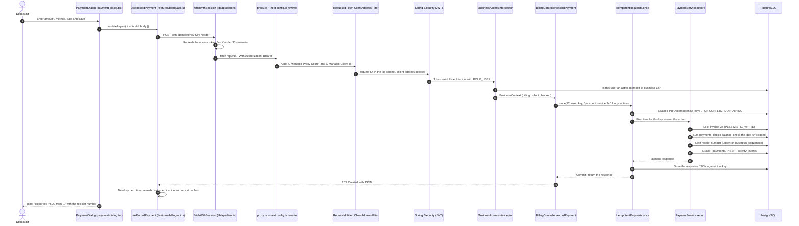

# Managio Full-Stack Learning Guide

A guide to how Managio is built, using its real code. It follows real requests from the browser to the database, explains why the code is shaped the way it is, and gives you exercises to try on the code. Every file path below is a link into this repository, and every class and method name was checked against the source when the guide was generated.

* **How to read the labels.** *Confirmed* means the reason is written down in the code, a test, or [DECISIONS.md](DECISIONS.md). *Inference* means it is my reading of the code, so treat it as a hypothesis to check.
* **Line numbers.** Links ending in `#L55` point at the code as it was on 2026-10-22 (commit `6783a7d` plus the hosting changes of D-036 and D-037). If the code has moved since, search for the class or method name.
* **Your progress is yours.** The [progress tracker](#9-progress-tracker) starts at *Not started* for every module. Change the status yourself as you work through it.
* **Keep it current.** This is a living document: when a feature changes, update its section here as part of the same piece of work (see [STATUS.md](STATUS.md) and [README.md](README.md)). Private notes belong in `private-learning/` (ignored by Git), not here.

Companion documents: [DEPLOYMENT_RUNBOOK.md](DEPLOYMENT_RUNBOOK.md) (how it runs in production), [ARCHITECTURE.md](ARCHITECTURE.md), [PRODUCT.md](PRODUCT.md) (business rules), [API.md](API.md), [DATA_MODEL.md](DATA_MODEL.md), [TESTING.md](TESTING.md).

## Contents

1. [Project orientation](#1-project-orientation)
2. [Architecture and request lifecycle](#2-architecture-and-request-lifecycle)
3. [Module catalogue](#3-module-catalogue)
4. [Feature deep dives](#4-feature-deep-dives)
5. [Java and Spring concepts in context](#5-java-and-spring-concepts-in-context)
6. [Frontend concepts in context](#6-frontend-concepts-in-context)
7. [Database and distributed-systems concepts](#7-database-and-distributed-systems-concepts)
8. [Testing and debugging handbook](#8-testing-and-debugging-handbook)
9. [Progress tracker](#9-progress-tracker)
10. [Glossary and interview preparation](#10-glossary-and-interview-preparation)

## 1. Project orientation

**What Managio is.** One place for small service businesses (gyms, salons, coaching centres, schools, clinics and shops) to run their customers, plans and renewals, billing, expenses, payroll, the daily cash count, tasks, approvals and a customer portal. One person can own or work in several businesses (D-002). Version 1 is free. The rules for each feature are in [PRODUCT.md](PRODUCT.md).

### Technology

| Layer | Technology | Declared in |
|---|---|---|
| API | Java 21, Spring Boot 4.1.1 (web MVC, Security with the OAuth2 resource server, Data JPA, Validation, Actuator), Flyway, PostgreSQL driver, Caffeine, springdoc-openapi 3.1.1, Lombok | [`pom.xml`](../managio_backend/pom.xml) |
| API tests | JUnit 5, Spring's `MockMvcTester`, Testcontainers (PostgreSQL 17), ArchUnit | [`pom.xml`](../managio_backend/pom.xml) |
| Web app | Next.js 16.4.2, React 19.3.0 with the React Compiler, TypeScript 5, Tailwind CSS 4, TanStack Query 5, openapi-fetch with types generated by openapi-typescript, React Hook Form 7 with Zod 4, sonner (toasts), lucide-react (icons) | [`package.json`](../managio_frontend/package.json) |
| Web tests | Vitest 4 and Testing Library; Playwright with axe-core | [`package.json`](../managio_frontend/package.json) |
| Delivery | Docker, Docker Compose, Jenkins, Docker Hub, Vercel, Render, Supabase (D-037), Resend, Google Identity Services | [DEPLOYMENT_RUNBOOK.md](DEPLOYMENT_RUNBOOK.md) |

### Repository map

| Path | What it holds |
|---|---|
| [`managio_backend/`](../managio_backend/) | The API: [`pom.xml`](../managio_backend/pom.xml), [`Dockerfile`](../managio_backend/Dockerfile), [`application.yml`](../managio_backend/src/main/resources/application.yml) (all settings), [`db/migration`](../managio_backend/src/main/resources/db/migration/) (Flyway SQL) and the tests in [`src/test`](../managio_backend/src/test/java/com/managio/) |
| [`com.managio.platform`](../managio_backend/src/main/java/com/managio/platform/) | Shared infrastructure: security, tenancy, errors, persistence helpers, mail, observability, web utilities |
| [`com.managio.modules`](../managio_backend/src/main/java/com/managio/modules/) | One package per feature, each split into `controller`, `service`, `repository`, `domain`, `dto` (and sometimes `web`) |
| [`managio_frontend/`](../managio_frontend/) | The web app: [`next.config.ts`](../managio_frontend/next.config.ts) (headers, rewrite, redirects), [`package.json`](../managio_frontend/package.json), [`Dockerfile`](../managio_frontend/Dockerfile), [`vercel.json`](../managio_frontend/vercel.json) |
| [`src/app`](../managio_frontend/src/app/) | Routes only. Each `page.tsx` is a few lines that render a feature screen (for example [`app/[businessId]/billing/page.tsx`](../managio_frontend/src/app/app/%5BbusinessId%5D/billing/page.tsx) renders [`BillingPage`](../managio_frontend/src/features/billing/billing-page.tsx#L28)) |
| [`src/features`](../managio_frontend/src/features/) | Screens, dialogs and each feature's `api.ts` (TanStack Query hooks that call the API) |
| [`src/components`](../managio_frontend/src/components/) | The app shell (sidebar, search, notifications), UI building blocks and the public-site frame |
| [`src/lib`](../managio_frontend/src/lib/) | The API client and session handling, formatting, form helpers, site constants |
| [`e2e`](../managio_frontend/e2e/) | Playwright end-to-end tests |
| [`Jenkinsfile`](../Jenkinsfile), [`docker-compose.yml`](../docker-compose.yml), [`.env.example`](../.env.example) | The release pipeline, the local three-container stack and its settings template |
| [docs/](README.md) | The project's source of truth: status, decisions, rules and these guides |

### How the backend is organised

Managio's API is a *modular monolith packaged by feature* (D-004, D-029): one deployable, with each feature in its own package and every package split into the same layers. [`ArchitectureTest`](../managio_backend/src/test/java/com/managio/ArchitectureTest.java) enforces seven rules: `layersPointOneWay`, `domainStandsAlone`, `platformDoesNotKnowFeatures`, and four rules that keep controllers, entities, repositories and services in their own packages. In practice:

* a **controller** handles HTTP (paths, status codes, validation) and calls services;
* a **service** owns transactions and business rules; another module's data is reached through that module's service, never its repository;
* a **repository** (Spring Data JPA) or a `*Queries` class (`JdbcClient` SQL read models) talks to the database;
* **domain** classes are JPA entities and enums with the rules that belong to one record;
* **dto** records are the request and response shapes, which become the OpenAPI contract the frontend's types are generated from (D-025).

### How the frontend is organised

Routes in `src/app` stay thin; behaviour lives in `src/features/<feature>` (D-027). Signed-in screens render in the browser: the access token only exists in memory, so the server can't render private data (D-024). Every API call goes through the typed client in [`client.ts`](../managio_frontend/src/lib/api/client.ts), and each feature's `api.ts` wraps calls in TanStack Query hooks whose cache keys include the business ID ([`businessKey`](../managio_frontend/src/features/business/context.tsx#L34)), so data from two businesses can never mix.

### Run it and study it

Set it up with the [new-machine guide](DEPLOYMENT_RUNBOOK.md#14-new-machine-recovery-guide). A study order that builds on itself:

1. [Platform foundations](#platform-foundations-security-tenancy-errors-shared-services): how every request is checked.
2. [Accounts, sign-in, Google and sessions](#accounts-sign-in-google-and-sessions): where the token comes from.
3. [Businesses](#businesses-onboarding-and-settings), [team](#team-members-custom-roles-and-invitations) and [customers](#customers-search-import-and-export).
4. [Memberships](#memberships-and-renewals), then [billing](#billing-invoices-payments-refunds-and-sales), with [section 2](#2-architecture-and-request-lifecycle) open beside it.
5. Everything else, in any order.

## 2. Architecture and request lifecycle

The browser loads pages from the Next.js app and calls the API at `/api/...` on the *same* origin. The web server forwards those calls to Spring Boot (a *rewrite*), and Spring Boot talks to PostgreSQL. The production layout is diagrammed in [DEPLOYMENT_RUNBOOK.md, section 1](DEPLOYMENT_RUNBOOK.md#1-system-architecture). This section follows one real request, **recording a payment**, through every layer.

### The traced feature: recording a payment

A desk worker opens a customer, chooses **Take payment**, enters ₹500 in cash and saves. The request is:

```http
POST /api/v1/businesses/12/invoices/34/payments
Authorization: Bearer <15-minute access token>
Idempotency-Key: 9f2c...e1 (32 hex characters, the same on every retry of this submission)
Content-Type: application/json

{"amount": 500, "method": "CASH", "paidOn": "2026-10-22"}
```



### Step by step

| # | Layer | Code | What happens and why |
|---|---|---|---|
| 1 | Screen | [`PaymentDialog`](../managio_frontend/src/features/billing/payment-dialog.tsx#L36), its [`submit`](../managio_frontend/src/features/billing/payment-dialog.tsx#L78) handler | React Hook Form validates with a Zod schema first, then calls `record.mutateAsync(...)`. Empty optional fields become `undefined`, so they are left out of the JSON. |
| 2 | Hook | [`useRecordPayment`](../managio_frontend/src/features/billing/api.ts#L64) | A TanStack Query mutation. [`useSubmissionKey`](../managio_frontend/src/lib/api/submission-key.ts#L8) supplies one `Idempotency-Key` that is reused for retries of this submission and renewed after a success. |
| 3 | API client | [`fetchWithSession`](../managio_frontend/src/lib/api/client.ts#L63), [`refresh`](../managio_frontend/src/lib/api/client.ts#L23), [`unwrap`](../managio_frontend/src/lib/api/client.ts#L110) | Adds `Authorization: Bearer`. If the token expires within 30 s (`REFRESH_EARLY_MS`), it refreshes first; parallel refreshes share one request (`inflight`); after a 401 it refreshes once and retries. `unwrap` turns an error response into an [`ApiError`](../managio_frontend/src/lib/api/errors.ts#L15). |
| 4 | Web server | [`proxy`](../managio_frontend/src/proxy.ts#L42) → [`forwardToApi`](../managio_frontend/src/proxy.ts#L23), then [`rewrites`](../managio_frontend/next.config.ts#L64) in [`next.config.ts`](../managio_frontend/next.config.ts) | The proxy removes any `X-Managio-*` headers the browser sent and adds the shared secret and the visitor's address. The rewrite then forwards `/api/*` to `API_ORIGIN`. The browser never talks to the API host directly, so the refresh cookie stays first-party (D-009). |
| 5 | Filters | [`RequestIdFilter.doFilterInternal`](../managio_backend/src/main/java/com/managio/platform/web/RequestIdFilter.java#L32), [`ClientAddressFilter.doFilterInternal`](../managio_backend/src/main/java/com/managio/platform/security/ClientAddressFilter.java#L51) | `@Order(HIGHEST_PRECEDENCE)` and `+1`: every request gets an ID (returned in `X-Request-Id`, kept in the log context) and one trusted client address before anything else runs (D-032). |
| 6 | Authentication | [`SecurityConfig.api`](../managio_backend/src/main/java/com/managio/platform/security/SecurityConfig.java#L43), [`AccessTokens.decoder`](../managio_backend/src/main/java/com/managio/platform/security/AccessTokens.java#L66), [`PrincipalAuthentication.FromJwt.convert`](../managio_backend/src/main/java/com/managio/platform/security/PrincipalAuthentication.java#L40) | Checks the HS256 signature, issuer and expiry, then turns the `typ` claim into a [`UserPrincipal`](../managio_backend/src/main/java/com/managio/platform/security/Principals.java#L13) with `ROLE_USER`. `/api/v1/**` requires that role. |
| 7 | Tenancy | [`BusinessAccessInterceptor.preHandle`](../managio_backend/src/main/java/com/managio/platform/tenancy/BusinessAccessInterceptor.java#L44), [`BusinessAccessInterceptor.loadMembership`](../managio_backend/src/main/java/com/managio/platform/tenancy/BusinessAccessInterceptor.java#L76), [`TenancyWebConfig.resolveArgument`](../managio_backend/src/main/java/com/managio/platform/tenancy/TenancyWebConfig.java#L37) | One SQL query loads the caller's ACTIVE membership in a non-archived business. Without one the answer is 404, so outsiders can't even learn that business 12 exists (D-008). [`@RequirePermission(BILLING_COLLECT)`](../managio_backend/src/main/java/com/managio/platform/tenancy/RequirePermission.java) is checked with [`BusinessContext.require`](../managio_backend/src/main/java/com/managio/platform/tenancy/BusinessContext.java#L26) (403 `auth.forbidden`), and the context is handed to the controller as a parameter. |
| 8 | Controller | [`BillingController.recordPayment`](../managio_backend/src/main/java/com/managio/modules/billing/controller/BillingController.java#L121) | `@Valid` checks the body ([`PaymentBody`](../managio_backend/src/main/java/com/managio/modules/billing/controller/BillingController.java#L64)), reads the optional `Idempotency-Key`, and wraps the service call in [`IdempotentRequests.once`](../managio_backend/src/main/java/com/managio/platform/persistence/IdempotentRequests.java#L57) with the operation name `payment:invoice:34`. |
| 9 | Idempotency | [`IdempotentRequests.once`](../managio_backend/src/main/java/com/managio/platform/persistence/IdempotentRequests.java#L57), [`IdempotentRequests.replay`](../managio_backend/src/main/java/com/managio/platform/persistence/IdempotentRequests.java#L97) | In one transaction it claims the key with `INSERT … ON CONFLICT DO NOTHING`. If the claim succeeds it runs the action and stores the response JSON. If the key exists, it replays the stored response. A different body under the same key gets 422 `idempotency.key_reused`, and a request still in progress gets 409 `idempotency.in_progress`. A concurrent duplicate waits on the unique index until the first commits (D-033). |
| 10 | Service | [`PaymentService.record`](../managio_backend/src/main/java/com/managio/modules/billing/service/PaymentService.java#L55), [`PaymentService.lockInvoice`](../managio_backend/src/main/java/com/managio/modules/billing/service/PaymentService.java#L145) | `@Transactional` joins the idempotency transaction. It locks the invoice row with [`InvoiceRepository.findForUpdate`](../managio_backend/src/main/java/com/managio/modules/billing/repository/InvoiceRepository.java#L19) (`@Lock(PESSIMISTIC_WRITE)`), so two payments on one invoice queue instead of overdrawing it. It then computes the balance with [`PaymentRepository.netPaid`](../managio_backend/src/main/java/com/managio/modules/billing/repository/PaymentRepository.java#L20) and refuses more than the balance ("Only ₹X is left to pay"). |
| 11 | Day lock | [`DayLock.requireOpen`](../managio_backend/src/main/java/com/managio/modules/daybook/service/DayLock.java#L21) | A cash payment on a date whose day book is closed is refused (422 `day.closed`, DAY-3). |
| 12 | Numbering | [`BusinessSequences.next`](../managio_backend/src/main/java/com/managio/modules/business/service/BusinessSequences.java#L22) | `INSERT … ON CONFLICT … DO UPDATE … RETURNING` hands out the next receipt number for this business. `Propagation.MANDATORY` means it only runs inside the caller's transaction, so a rollback also gives the number back. |
| 13 | Write | [`Payment.record`](../managio_backend/src/main/java/com/managio/modules/billing/domain/Payment.java#L60), [`ActivityLog.record`](../managio_backend/src/main/java/com/managio/modules/activity/service/ActivityLog.java#L34) | The factory builds the entity, which is saved. The activity log records "Received ₹500 by cash" in the same transaction, so the log never shows an action that rolled back. |
| 14 | Response | [`BillingViews.payment`](../managio_backend/src/main/java/com/managio/modules/billing/service/BillingViews.java#L61) | Builds [`PaymentResponse`](../managio_backend/src/main/java/com/managio/modules/billing/dto/BillingDtos.java#L24) with the formatted receipt and invoice numbers (`RCT-0108`, `INV-0042`). Jackson writes JSON, and the controller's `@ResponseStatus(CREATED)` makes it a 201. |
| 15 | Errors | [`ApiExceptionHandler.handleApi`](../managio_backend/src/main/java/com/managio/platform/error/ApiExceptionHandler.java#L30), [`Problems.of`](../managio_backend/src/main/java/com/managio/platform/error/Problems.java#L19) | Any [`ApiException`](../managio_backend/src/main/java/com/managio/platform/error/ApiException.java) becomes an RFC 9457 problem: `status`, `title`, `detail`, a stable `code`, the `requestId` and, for field errors, `errors`. |
| 16 | Back in the browser | [`useRefreshCustomerData`](../managio_frontend/src/features/customers/api.ts#L62), [`applyApiError`](../managio_frontend/src/lib/forms.ts#L8) | On success the key is renewed and the cached customers, memberships, invoices, payments, today, reports and day-book queries for this business are invalidated, so every open screen re-fetches. On failure [`applyApiError`](../managio_frontend/src/lib/forms.ts#L8) puts each `errors` entry under its form field. |

### When it goes wrong

| Situation | What the code does | Proved by |
|---|---|---|
| Amount above the balance | [`ApiException.invalidField("amount", …)`](../managio_backend/src/main/java/com/managio/platform/error/ApiException.java#L44) → 400 `validation.failed`, message under the Amount field | [`BillingTest.java`](../managio_backend/src/test/java/com/managio/modules/billing/BillingTest.java) |
| Response lost, user clicks again | Same key → the first response is replayed, nothing recorded twice | [`IdempotencyTest.aRetriedPartialPaymentIsRecordedOnce`](../managio_backend/src/test/java/com/managio/modules/billing/IdempotencyTest.java#L56) |
| Two identical requests at the same moment | The second waits on the key's unique index, then replays | [`IdempotencyTest.concurrentDuplicatesCreateOneRecord`](../managio_backend/src/test/java/com/managio/modules/billing/IdempotencyTest.java#L101) |
| Same key, different amount | 422 `idempotency.key_reused` | [`IdempotencyTest.aKeyCannotBeReusedForADifferentRequest`](../managio_backend/src/test/java/com/managio/modules/billing/IdempotencyTest.java#L74) |
| The first attempt failed | Its transaction rolled back the claim too, so the retry runs normally | [`IdempotencyTest.aFailedRequestDoesNotUseUpItsKey`](../managio_backend/src/test/java/com/managio/modules/billing/IdempotencyTest.java#L88) |
| Someone from another business tries | 404 from the interceptor before the controller runs | [`AccessSweepTest.outsidersGetNotFoundOnEveryBusinessRouteAndChangeNothing`](../managio_backend/src/test/java/com/managio/AccessSweepTest.java#L98) |
| A member without `billing.collect` | 403 `auth.forbidden` | [`AccessSweepTest.membersWithoutARoutesPermissionAreRefused`](../managio_backend/src/test/java/com/managio/AccessSweepTest.java#L123) |
| Access token expired | `fetchWithSession` refreshes and retries once; if the refresh fails the session ends and [`RequireStaff`](../managio_frontend/src/components/shell/require-staff.tsx#L9) sends the user to sign in | [`client.test.ts`](../managio_frontend/src/lib/api/client.test.ts) |

**Try it.** Run the app locally, open the browser's DevTools → Network, record a payment, and find the `Idempotency-Key` request header and the `X-Request-Id` response header. Search the API's console output for that request ID: you'll see the request's log line. Then use DevTools to *Replay XHR* (or copy it as `curl` and run it twice): the second response has the same receipt number, and the customer's payment list still shows one payment.

## 3. Module catalogue

Twenty modules, in the order the [study plan](#run-it-and-study-it) suggests. Each name links to its deep dive.

| Module | What it does | Backend | Frontend | Tables |
|---|---|---|---|---|
| [Platform foundations (security, tenancy, errors, shared services)](#platform-foundations-security-tenancy-errors-shared-services) | Shared infrastructure every feature relies on: configuration, the security filter chain, the tenancy gate, the error format, request IDs, idempotency, email and the slow-call warning. | [`platform`](../managio_backend/src/main/java/com/managio/platform/) | — | `idempotency_keys` |
| [Accounts, sign-in, Google and sessions](#accounts-sign-in-google-and-sessions) | Lets owners and team members create an account, prove their email, sign in with a password or Google, stay signed in safely, and recover a forgotten password. | [`modules/auth`](../managio_backend/src/main/java/com/managio/modules/auth/) | [`features/auth`](../managio_frontend/src/features/auth/) | `users`, `refresh_tokens`, `one_time_tokens`, `sign_in_events` |
| [Businesses, onboarding and settings](#businesses-onboarding-and-settings) | Creates a business of a given type (gym, salon, coaching centre, school, clinic, shop, other), makes its creator the owner, seeds roles, expense categories and modules for that type, and lets the owner change settings or archive it. | [`modules/business`](../managio_backend/src/main/java/com/managio/modules/business/) | [`features/business`](../managio_frontend/src/features/business/) | `businesses`, `business_sequences` |
| [Team members, custom roles and invitations](#team-members-custom-roles-and-invitations) | Brings people into a business with a role, controls what each role can do, and lets managers suspend or remove people. | [`modules/team`](../managio_backend/src/main/java/com/managio/modules/team/) | [`features/auth`](../managio_frontend/src/features/auth/), [`features/team`](../managio_frontend/src/features/team/) | `roles`, `team_members`, `invitations` |
| [Customers, search, import and export](#customers-search-import-and-export) | The business's list of members, clients, students or patients: add, edit, search, filter, archive, import from CSV and export to CSV. | [`modules/customers`](../managio_backend/src/main/java/com/managio/modules/customers/) | [`features/customers`](../managio_frontend/src/features/customers/) | `customers` |
| [Groups, batches and attendance](#groups-batches-and-attendance) | Groups customers into batches or classes and records who came in: single check-ins at the desk or a roll call for a whole group. | [`modules/attendance`](../managio_backend/src/main/java/com/managio/modules/attendance/) | [`features/customers`](../managio_frontend/src/features/customers/) | `customer_groups`, `customer_group_members`, `attendance` |
| [Catalogue: plans, services, products and stock](#catalogue-plans-services-products-and-stock) | What the business sells: membership plans (with duration and instalments), services and products (optionally with stock). | [`modules/catalog`](../managio_backend/src/main/java/com/managio/modules/catalog/) | [`features/memberships`](../managio_frontend/src/features/memberships/) | `offerings` |
| [Memberships and renewals](#memberships-and-renewals) | Puts a customer on a plan for a period, creates the invoices for it, tracks whether it is active or ending, renews it without losing days, and reminds customers before it ends. | [`modules/memberships`](../managio_backend/src/main/java/com/managio/modules/memberships/) | [`features/memberships`](../managio_frontend/src/features/memberships/) | `memberships` |
| [Billing: invoices, payments, refunds and sales](#billing-invoices-payments-refunds-and-sales) | Records what customers owe (invoices) and what they paid (payments, refunds), with numbered receipts, never deleting money records and never counting a payment twice. | [`modules/billing`](../managio_backend/src/main/java/com/managio/modules/billing/) | [`features/billing`](../managio_frontend/src/features/billing/) | `invoices`, `invoice_lines`, `payments`, `idempotency_keys` |
| [Expenses and categories](#expenses-and-categories) | Records money the business spends, by category, and voids mistakes with a reason. | [`modules/expenses`](../managio_backend/src/main/java/com/managio/modules/expenses/) | [`features/operations`](../managio_frontend/src/features/operations/) | `expense_categories`, `expenses` |
| [Payroll](#payroll) | Prepares the month's salaries for team members with a monthly salary and records payments, each of which becomes a Salaries expense. | [`modules/payroll`](../managio_backend/src/main/java/com/managio/modules/payroll/) | [`features/team`](../managio_frontend/src/features/team/) | `payroll_entries` |
| [Day book (daily cash count)](#day-book-daily-cash-count) | Tells the desk how much cash should be in the drawer, records the count, and locks the day so nobody changes that day's cash later. | [`modules/daybook`](../managio_backend/src/main/java/com/managio/modules/daybook/) | [`features/operations`](../managio_frontend/src/features/operations/) | `day_closes` |
| [Tasks](#tasks) | Assigns work to team members, including repeating daily, weekly or monthly tasks. | [`modules/tasks`](../managio_backend/src/main/java/com/managio/modules/tasks/) | [`features/operations`](../managio_frontend/src/features/operations/) | `tasks` |
| [Requests and approvals](#requests-and-approvals) | Lets any team member ask for an expense claim, purchase, leave, discount or anything else, and lets approvers decide with a reason. | [`modules/requests`](../managio_backend/src/main/java/com/managio/modules/requests/) | [`features/operations`](../managio_frontend/src/features/operations/) | `requests` |
| [Notifications](#notifications) | In-app notifications per user, for example new requests and decisions. | [`modules/notifications`](../managio_backend/src/main/java/com/managio/modules/notifications/) | — | `notifications` |
| [Activity log](#activity-log) | Who did what and when in a business, with a readable summary, for money, permission and lifecycle changes. | [`modules/activity`](../managio_backend/src/main/java/com/managio/modules/activity/) | [`features/reports`](../managio_frontend/src/features/reports/) | `activity_events` |
| [Reports, Today and the portfolio](#reports-today-and-the-portfolio) | The Today screen (what needs attention now), monthly profit and loss, the renewal runway, and a portfolio view across all of a person's businesses. | [`modules/reports`](../managio_backend/src/main/java/com/managio/modules/reports/) | [`features/business`](../managio_frontend/src/features/business/), [`features/reports`](../managio_frontend/src/features/reports/), [`features/today`](../managio_frontend/src/features/today/) | — |
| [Customer portal](#customer-portal) | A business's customers sign in with the business code to see their own plan, dues and receipts. | [`modules/portal`](../managio_backend/src/main/java/com/managio/modules/portal/) | [`features/portal`](../managio_frontend/src/features/portal/) | `customers`, `refresh_tokens` |
| [Platform console (administrators)](#platform-console-administrators) | A read-only console for Managio's own administrators: real counts, a directory of businesses and people, and system health. | [`modules/admin`](../managio_backend/src/main/java/com/managio/modules/admin/) | [`features/admin`](../managio_frontend/src/features/admin/) | — |
| [Public site, legal pages and SEO](#public-site-legal-pages-and-seo) | What visitors and search engines see: the landing page, legal pages, the logo and icons, and the rules that keep private pages out of search results. | — | [`features/marketing`](../managio_frontend/src/features/marketing/) | — |

## 4. Feature deep dives

Each module follows the same format: purpose, workflow, the rules it enforces, the frontend files, the API contract (generated from the controllers, with the frontend hook that calls each endpoint), the backend files with their public methods, the tables it owns, security, a step-by-step code walkthrough, the reasoning behind it, alternatives, failure scenarios, tests, an exercise and a short interview answer.

Where a permission column says *any active member*, the tenancy interceptor still requires an active membership in that business; *public* routes need no token, but most of them still apply rate limits.

### Platform foundations (security, tenancy, errors, shared services)

**Purpose.** Shared infrastructure every feature relies on: configuration, the security filter chain, the tenancy gate, the error format, request IDs, idempotency, email and the slow-call warning. Platform code never depends on a feature module; [`ArchitectureTest`](../managio_backend/src/test/java/com/managio/ArchitectureTest.java) enforces that.

**User workflow.** Users never see this module directly; it runs on every request.

**Frontend trace.**

Components, hooks and helpers:

* [`proxy.ts`](../managio_frontend/src/proxy.ts): [`proxy`](../managio_frontend/src/proxy.ts#L42)
* [`lib/api/client.ts`](../managio_frontend/src/lib/api/client.ts): [`unwrap`](../managio_frontend/src/lib/api/client.ts#L110)
* [`lib/api/errors.ts`](../managio_frontend/src/lib/api/errors.ts): [`errorMessage`](../managio_frontend/src/lib/api/errors.ts#L57)
* [`lib/api/submission-key.ts`](../managio_frontend/src/lib/api/submission-key.ts): [`useSubmissionKey`](../managio_frontend/src/lib/api/submission-key.ts#L8)
* [`lib/query-client.ts`](../managio_frontend/src/lib/query-client.ts): [`makeQueryClient`](../managio_frontend/src/lib/query-client.ts#L8)
* [`lib/forms.ts`](../managio_frontend/src/lib/forms.ts): [`applyApiError`](../managio_frontend/src/lib/forms.ts#L8), [`blankToUndefined`](../managio_frontend/src/lib/forms.ts#L28)
* [`lib/zod-config.ts`](../managio_frontend/src/lib/zod-config.ts)
* [`managio_frontend/next.config.ts`](../managio_frontend/next.config.ts)
* [`app/layout.tsx`](../managio_frontend/src/app/layout.tsx): [`metadata`](../managio_frontend/src/app/layout.tsx#L14), [`viewport`](../managio_frontend/src/app/layout.tsx#L34)
* [`app/providers.tsx`](../managio_frontend/src/app/providers.tsx): [`Providers`](../managio_frontend/src/app/providers.tsx#L14)

**Backend trace.**

| Package | File | Public members |
|---|---|---|
| `platform.config` | [`CoreConfig`](../managio_backend/src/main/java/com/managio/platform/config/CoreConfig.java) | [`clock`](../managio_backend/src/main/java/com/managio/platform/config/CoreConfig.java#L15), [`passwordEncoder`](../managio_backend/src/main/java/com/managio/platform/config/CoreConfig.java#L20) |
| `platform.config` | [`ManagioProperties`](../managio_backend/src/main/java/com/managio/platform/config/ManagioProperties.java) | — |
| `platform.config` | [`OpenApiConfig`](../managio_backend/src/main/java/com/managio/platform/config/OpenApiConfig.java) | [`openApi`](../managio_backend/src/main/java/com/managio/platform/config/OpenApiConfig.java#L55), [`nullableProperties`](../managio_backend/src/main/java/com/managio/platform/config/OpenApiConfig.java#L66), [`contractCustomizer`](../managio_backend/src/main/java/com/managio/platform/config/OpenApiConfig.java#L88) |
| `platform.error` | [`ApiException`](../managio_backend/src/main/java/com/managio/platform/error/ApiException.java) | [`notFound`](../managio_backend/src/main/java/com/managio/platform/error/ApiException.java#L29), [`conflict`](../managio_backend/src/main/java/com/managio/platform/error/ApiException.java#L34), [`rule`](../managio_backend/src/main/java/com/managio/platform/error/ApiException.java#L39), [`invalidField`](../managio_backend/src/main/java/com/managio/platform/error/ApiException.java#L44), [`forbidden`](../managio_backend/src/main/java/com/managio/platform/error/ApiException.java#L49), [`unauthorized`](../managio_backend/src/main/java/com/managio/platform/error/ApiException.java#L53), [`status`](../managio_backend/src/main/java/com/managio/platform/error/ApiException.java#L57), [`code`](../managio_backend/src/main/java/com/managio/platform/error/ApiException.java#L61) |
| `platform.error` | [`ApiExceptionHandler`](../managio_backend/src/main/java/com/managio/platform/error/ApiExceptionHandler.java) | [`handleApi`](../managio_backend/src/main/java/com/managio/platform/error/ApiExceptionHandler.java#L30), [`handleConstraintViolation`](../managio_backend/src/main/java/com/managio/platform/error/ApiExceptionHandler.java#L36), [`handleAccessDenied`](../managio_backend/src/main/java/com/managio/platform/error/ApiExceptionHandler.java#L46), [`handleStale`](../managio_backend/src/main/java/com/managio/platform/error/ApiExceptionHandler.java#L52), [`handleIntegrity`](../managio_backend/src/main/java/com/managio/platform/error/ApiExceptionHandler.java#L58), [`handleUnexpected`](../managio_backend/src/main/java/com/managio/platform/error/ApiExceptionHandler.java#L65), [`handleMethodArgumentNotValid`](../managio_backend/src/main/java/com/managio/platform/error/ApiExceptionHandler.java#L72), [`handleExceptionInternal`](../managio_backend/src/main/java/com/managio/platform/error/ApiExceptionHandler.java#L84) |
| `platform.error` | [`Problems`](../managio_backend/src/main/java/com/managio/platform/error/Problems.java) | [`of`](../managio_backend/src/main/java/com/managio/platform/error/Problems.java#L19), [`withErrors`](../managio_backend/src/main/java/com/managio/platform/error/Problems.java#L31) |
| `platform.security` | [`AccessTokens`](../managio_backend/src/main/java/com/managio/platform/security/AccessTokens.java) | [`forUser`](../managio_backend/src/main/java/com/managio/platform/security/AccessTokens.java#L52), [`forCustomer`](../managio_backend/src/main/java/com/managio/platform/security/AccessTokens.java#L59), [`decoder`](../managio_backend/src/main/java/com/managio/platform/security/AccessTokens.java#L66) |
| `platform.security` | [`ClientAddressFilter`](../managio_backend/src/main/java/com/managio/platform/security/ClientAddressFilter.java) | [`doFilterInternal`](../managio_backend/src/main/java/com/managio/platform/security/ClientAddressFilter.java#L51), [`getRemoteAddr`](../managio_backend/src/main/java/com/managio/platform/security/ClientAddressFilter.java#L87), [`getRemoteHost`](../managio_backend/src/main/java/com/managio/platform/security/ClientAddressFilter.java#L92), [`getHeader`](../managio_backend/src/main/java/com/managio/platform/security/ClientAddressFilter.java#L97), [`getHeaders`](../managio_backend/src/main/java/com/managio/platform/security/ClientAddressFilter.java#L102) |
| `platform.security` | [`ClientAddresses`](../managio_backend/src/main/java/com/managio/platform/security/ClientAddresses.java) | [`parse`](../managio_backend/src/main/java/com/managio/platform/security/ClientAddresses.java#L25), [`rateLimitKey`](../managio_backend/src/main/java/com/managio/platform/security/ClientAddresses.java#L47) |
| `platform.security` | [`PrincipalAuthentication`](../managio_backend/src/main/java/com/managio/platform/security/PrincipalAuthentication.java) | [`getPrincipal`](../managio_backend/src/main/java/com/managio/platform/security/PrincipalAuthentication.java#L28), [`getCredentials`](../managio_backend/src/main/java/com/managio/platform/security/PrincipalAuthentication.java#L33) |
| `platform.security` | [`Principals`](../managio_backend/src/main/java/com/managio/platform/security/Principals.java) | — |
| `platform.security` | [`RateLimiter`](../managio_backend/src/main/java/com/managio/platform/security/RateLimiter.java) | [`checkClient`](../managio_backend/src/main/java/com/managio/platform/security/RateLimiter.java#L57), [`check`](../managio_backend/src/main/java/com/managio/platform/security/RateLimiter.java#L58), [`reset`](../managio_backend/src/main/java/com/managio/platform/security/RateLimiter.java#L75) |
| `platform.security` | [`RefreshCookies`](../managio_backend/src/main/java/com/managio/platform/security/RefreshCookies.java) | [`issue`](../managio_backend/src/main/java/com/managio/platform/security/RefreshCookies.java#L28), [`clear`](../managio_backend/src/main/java/com/managio/platform/security/RefreshCookies.java#L32), [`read`](../managio_backend/src/main/java/com/managio/platform/security/RefreshCookies.java#L36) |
| `platform.security` | [`SecureTokens`](../managio_backend/src/main/java/com/managio/platform/security/SecureTokens.java) | [`generate`](../managio_backend/src/main/java/com/managio/platform/security/SecureTokens.java#L22), [`hash`](../managio_backend/src/main/java/com/managio/platform/security/SecureTokens.java#L28) |
| `platform.security` | [`SecurityConfig`](../managio_backend/src/main/java/com/managio/platform/security/SecurityConfig.java) | [`api`](../managio_backend/src/main/java/com/managio/platform/security/SecurityConfig.java#L43), [`jwtDecoder`](../managio_backend/src/main/java/com/managio/platform/security/SecurityConfig.java#L88), [`corsConfigurationSource`](../managio_backend/src/main/java/com/managio/platform/security/SecurityConfig.java#L93) |
| `platform.tenancy` | [`BusinessAccessInterceptor`](../managio_backend/src/main/java/com/managio/platform/tenancy/BusinessAccessInterceptor.java) | [`preHandle`](../managio_backend/src/main/java/com/managio/platform/tenancy/BusinessAccessInterceptor.java#L44) |
| `platform.tenancy` | [`BusinessContext`](../managio_backend/src/main/java/com/managio/platform/tenancy/BusinessContext.java) | [`can`](../managio_backend/src/main/java/com/managio/platform/tenancy/BusinessContext.java#L22), [`require`](../managio_backend/src/main/java/com/managio/platform/tenancy/BusinessContext.java#L26), [`has`](../managio_backend/src/main/java/com/managio/platform/tenancy/BusinessContext.java#L32), [`today`](../managio_backend/src/main/java/com/managio/platform/tenancy/BusinessContext.java#L37) |
| `platform.tenancy` | [`Module`](../managio_backend/src/main/java/com/managio/platform/tenancy/Module.java) | [`fromNames`](../managio_backend/src/main/java/com/managio/platform/tenancy/Module.java#L16), [`toNames`](../managio_backend/src/main/java/com/managio/platform/tenancy/Module.java#L30) |
| `platform.tenancy` | [`Permission`](../managio_backend/src/main/java/com/managio/platform/tenancy/Permission.java) | [`key`](../managio_backend/src/main/java/com/managio/platform/tenancy/Permission.java#L47), [`action`](../managio_backend/src/main/java/com/managio/platform/tenancy/Permission.java#L52), [`fromKey`](../managio_backend/src/main/java/com/managio/platform/tenancy/Permission.java#L56), [`fromKeys`](../managio_backend/src/main/java/com/managio/platform/tenancy/Permission.java#L61), [`toKeys`](../managio_backend/src/main/java/com/managio/platform/tenancy/Permission.java#L71) |
| `platform.tenancy` | [`RequireModule`](../managio_backend/src/main/java/com/managio/platform/tenancy/RequireModule.java) | — |
| `platform.tenancy` | [`RequirePermission`](../managio_backend/src/main/java/com/managio/platform/tenancy/RequirePermission.java) | — |
| `platform.tenancy` | [`TenancyWebConfig`](../managio_backend/src/main/java/com/managio/platform/tenancy/TenancyWebConfig.java) | [`addInterceptors`](../managio_backend/src/main/java/com/managio/platform/tenancy/TenancyWebConfig.java#L24), [`addArgumentResolvers`](../managio_backend/src/main/java/com/managio/platform/tenancy/TenancyWebConfig.java#L29) |
| `platform.web` | [`DateRanges`](../managio_backend/src/main/java/com/managio/platform/web/DateRanges.java) | [`requireOrdered`](../managio_backend/src/main/java/com/managio/platform/web/DateRanges.java#L13) |
| `platform.web` | [`Normalize`](../managio_backend/src/main/java/com/managio/platform/web/Normalize.java) | [`email`](../managio_backend/src/main/java/com/managio/platform/web/Normalize.java#L12), [`phone`](../managio_backend/src/main/java/com/managio/platform/web/Normalize.java#L21), [`text`](../managio_backend/src/main/java/com/managio/platform/web/Normalize.java#L37) |
| `platform.web` | [`Nullable`](../managio_backend/src/main/java/com/managio/platform/web/Nullable.java) | — |
| `platform.web` | [`PageResponse`](../managio_backend/src/main/java/com/managio/platform/web/PageResponse.java) | [`of`](../managio_backend/src/main/java/com/managio/platform/web/PageResponse.java#L16), [`request`](../managio_backend/src/main/java/com/managio/platform/web/PageResponse.java#L27) |
| `platform.web` | [`RequestIdFilter`](../managio_backend/src/main/java/com/managio/platform/web/RequestIdFilter.java) | [`doFilterInternal`](../managio_backend/src/main/java/com/managio/platform/web/RequestIdFilter.java#L32) |
| `platform.persistence` | [`IdempotentRequests`](../managio_backend/src/main/java/com/managio/platform/persistence/IdempotentRequests.java) | [`once`](../managio_backend/src/main/java/com/managio/platform/persistence/IdempotentRequests.java#L57), [`deleteOlderThanAWeek`](../managio_backend/src/main/java/com/managio/platform/persistence/IdempotentRequests.java#L89) |
| `platform.persistence` | [`Persistence`](../managio_backend/src/main/java/com/managio/platform/persistence/Persistence.java) | [`flush`](../managio_backend/src/main/java/com/managio/platform/persistence/Persistence.java#L17) |
| `platform.persistence` | [`SqlText`](../managio_backend/src/main/java/com/managio/platform/persistence/SqlText.java) | [`containing`](../managio_backend/src/main/java/com/managio/platform/persistence/SqlText.java#L13) |
| `platform.observability` | [`SlowCallAspect`](../managio_backend/src/main/java/com/managio/platform/observability/SlowCallAspect.java) | [`timeServiceCall`](../managio_backend/src/main/java/com/managio/platform/observability/SlowCallAspect.java#L29) |
| `platform.mail` | [`MailConfig`](../managio_backend/src/main/java/com/managio/platform/mail/MailConfig.java) | [`send`](../managio_backend/src/main/java/com/managio/platform/mail/MailConfig.java#L80), [`destroy`](../managio_backend/src/main/java/com/managio/platform/mail/MailConfig.java#L85) |
| `platform.mail` | [`MailTemplates`](../managio_backend/src/main/java/com/managio/platform/mail/MailTemplates.java) | [`verifyEmail`](../managio_backend/src/main/java/com/managio/platform/mail/MailTemplates.java#L12), [`resetPassword`](../managio_backend/src/main/java/com/managio/platform/mail/MailTemplates.java#L20), [`invitation`](../managio_backend/src/main/java/com/managio/platform/mail/MailTemplates.java#L28), [`portalAccess`](../managio_backend/src/main/java/com/managio/platform/mail/MailTemplates.java#L36), [`portalPasswordReset`](../managio_backend/src/main/java/com/managio/platform/mail/MailTemplates.java#L44), [`renewalReminder`](../managio_backend/src/main/java/com/managio/platform/mail/MailTemplates.java#L52) |
| `platform.mail` | [`Mailer`](../managio_backend/src/main/java/com/managio/platform/mail/Mailer.java) | — |
| `platform.mail` | [`OutboundMail`](../managio_backend/src/main/java/com/managio/platform/mail/OutboundMail.java) | [`send`](../managio_backend/src/main/java/com/managio/platform/mail/OutboundMail.java#L19) |
| `platform.util` | [`Csv`](../managio_backend/src/main/java/com/managio/platform/util/Csv.java) | [`parse`](../managio_backend/src/main/java/com/managio/platform/util/Csv.java#L13), [`write`](../managio_backend/src/main/java/com/managio/platform/util/Csv.java#L60) |
| `platform.util` | [`Money`](../managio_backend/src/main/java/com/managio/platform/util/Money.java) | [`of`](../managio_backend/src/main/java/com/managio/platform/util/Money.java#L14), [`inr`](../managio_backend/src/main/java/com/managio/platform/util/Money.java#L26), [`isPositive`](../managio_backend/src/main/java/com/managio/platform/util/Money.java#L52) |

**Data model.**

* [`idempotency_keys`](../managio_backend/src/main/resources/db/migration/V3__idempotency_keys.sql#L5): id, business_id, user_id, idem_key, operation, request_hash, response_body, created_at

**Security.** This module *is* the security layer: authentication (JWT), authorization (roles, permissions, modules), tenancy, rate limits, client-address trust, CORS and security headers. The rule of thumb in this codebase: the frontend hides what you can't do, but only the API decides.

**Code walkthrough.**

1. [`RequestIdFilter`](../managio_backend/src/main/java/com/managio/platform/web/RequestIdFilter.java) gives the request an ID (or keeps a well-formed `X-Request-Id`), puts it in the logging context (MDC) and logs one line when the request ends.
2. [`ClientAddressFilter`](../managio_backend/src/main/java/com/managio/platform/security/ClientAddressFilter.java) decides the client IP: the `X-Managio-Client-Ip` value only if the request carries the shared `API_PROXY_SECRET`; otherwise the connecting address. Everything later reads it through `request.getRemoteAddr()`.
3. [`SecurityConfig`](../managio_backend/src/main/java/com/managio/platform/security/SecurityConfig.java) builds Spring Security's filter chain: stateless (no HTTP session), CORS from `CORS_ALLOWED_ORIGINS`, the JWT resource server using [`AccessTokens.decoder()`](../managio_backend/src/main/java/com/managio/platform/security/AccessTokens.java#L66), and the URL rules (public auth routes, `ROLE_CUSTOMER` for `/api/v1/portal/**`, `ROLE_USER` for the rest, everything else denied).
4. [`PrincipalAuthentication.FromJwt`](../managio_backend/src/main/java/com/managio/platform/security/PrincipalAuthentication.java#L38) turns a valid token into a [`UserPrincipal`](../managio_backend/src/main/java/com/managio/platform/security/Principals.java#L13) or [`CustomerPrincipal`](../managio_backend/src/main/java/com/managio/platform/security/Principals.java#L17) from the `typ` claim.
5. For `/api/v1/businesses/{businessId}/**`, [`BusinessAccessInterceptor`](../managio_backend/src/main/java/com/managio/platform/tenancy/BusinessAccessInterceptor.java) loads the caller's active membership (404 if none), checks [`@RequireModule`](../managio_backend/src/main/java/com/managio/platform/tenancy/RequireModule.java) and [`@RequirePermission`](../managio_backend/src/main/java/com/managio/platform/tenancy/RequirePermission.java), and stores a [`BusinessContext`](../managio_backend/src/main/java/com/managio/platform/tenancy/BusinessContext.java); [`TenancyWebConfig`](../managio_backend/src/main/java/com/managio/platform/tenancy/TenancyWebConfig.java) passes it to any controller parameter of that type.
6. Controllers call services; services throw [`ApiException`](../managio_backend/src/main/java/com/managio/platform/error/ApiException.java) for business errors. [`ApiExceptionHandler`](../managio_backend/src/main/java/com/managio/platform/error/ApiExceptionHandler.java) turns every exception into an RFC 9457 problem (`application/problem+json`) with a stable `code`.
7. [`SlowCallAspect`](../managio_backend/src/main/java/com/managio/platform/observability/SlowCallAspect.java) (AOP) times every public `@Service` method and logs a warning above 500 ms. [`IdempotentRequests`](../managio_backend/src/main/java/com/managio/platform/persistence/IdempotentRequests.java) wraps money actions. [`OutboundMail`](../managio_backend/src/main/java/com/managio/platform/mail/OutboundMail.java) sends email only after the transaction commits.

**Design rationale.** Confirmed: D-006 (distinct principals), D-008 (tenancy interceptor), D-009 (cookies and tokens), D-026 (one blanket interception), D-029 (layers and ArchUnit), D-032 (client address), D-033 (idempotency). Inference: keeping cross-cutting code in `platform` with no dependency on features makes it reusable and stops circular dependencies.

**Alternatives and trade-offs.** Method-level security (`@PreAuthorize`) instead of the interceptor: works, but the business-membership lookup would repeat on every method; one interceptor keeps the tenancy rule in one place. A servlet session instead of JWT: simpler, but then the API is stateful and harder to scale.

**Failure scenarios.** A 401 on every call: expired or missing access token (check the browser's `Authorization` header and the refresh call). A 404 on a business route you expect to work: the membership is not ACTIVE or the business is archived ([`BusinessAccessInterceptor.loadMembership`](../managio_backend/src/main/java/com/managio/platform/tenancy/BusinessAccessInterceptor.java#L76)). A 500: the log line with the same request ID shows the stack trace from [`ApiExceptionHandler`](../managio_backend/src/main/java/com/managio/platform/error/ApiExceptionHandler.java).

**Tests.**

* [`ArchitectureTest`](../managio_backend/src/test/java/com/managio/ArchitectureTest.java): 7 architecture rules (`@ArchTest`)
* [`ClientAddressTest`](../managio_backend/src/test/java/com/managio/platform/security/ClientAddressTest.java) (7 tests): [`forgedForwardedForHeadersShareTheConnectionsLimit`](../managio_backend/src/test/java/com/managio/platform/security/ClientAddressTest.java#L45), [`theWebAppNamesTheClientWhenItProvesItselfWithTheSecret`](../managio_backend/src/test/java/com/managio/platform/security/ClientAddressTest.java#L56), [`aWrongOrMissingSecretMeansTheClaimedAddressIsIgnored`](../managio_backend/src/test/java/com/managio/platform/security/ClientAddressTest.java#L69), [`aClaimedAddressThatIsNotAnIpFallsBackToTheConnection`](../managio_backend/src/test/java/com/managio/platform/security/ClientAddressTest.java#L80), [`ipv6AddressesInOneNetworkShareALimit`](../managio_backend/src/test/java/com/managio/platform/security/ClientAddressTest.java#L87), [`signInRecordsKeepTheResolvedAddress`](../managio_backend/src/test/java/com/managio/platform/security/ClientAddressTest.java#L99), [`addressesAreParsedStrictly`](../managio_backend/src/test/java/com/managio/platform/security/ClientAddressTest.java#L108)
* [`ProductionDefaultsTest`](../managio_backend/src/test/java/com/managio/platform/config/ProductionDefaultsTest.java) (2 tests): [`unsetVariablesFallBackToTheSafeChoice`](../managio_backend/src/test/java/com/managio/platform/config/ProductionDefaultsTest.java#L32), [`refreshCookiesAreSecureHttpOnlyAndLaxWhenSecureCookiesIsOn`](../managio_backend/src/test/java/com/managio/platform/config/ProductionDefaultsTest.java#L48)
* [`SlowCallAspectTest`](../managio_backend/src/test/java/com/managio/platform/observability/SlowCallAspectTest.java) (4 tests): [`warnsAboutSlowCalls`](../managio_backend/src/test/java/com/managio/platform/observability/SlowCallAspectTest.java#L41), [`neverLogsWhatWasPassedIn`](../managio_backend/src/test/java/com/managio/platform/observability/SlowCallAspectTest.java#L48), [`staysQuietForFastCalls`](../managio_backend/src/test/java/com/managio/platform/observability/SlowCallAspectTest.java#L55), [`timesFailingCallsAndLetsTheErrorThrough`](../managio_backend/src/test/java/com/managio/platform/observability/SlowCallAspectTest.java#L62)
* [`OpenApiContractTest`](../managio_backend/src/test/java/com/managio/OpenApiContractTest.java) (2 tests): [`businessScopedPathsDeclareTheBusinessIdAndNeverTheServerSideContext`](../managio_backend/src/test/java/com/managio/OpenApiContractTest.java#L20), [`responsePropertiesArePresentAndOnlyMarkedOnesAreNullable`](../managio_backend/src/test/java/com/managio/OpenApiContractTest.java#L38)
* [`AccessSweepTest`](../managio_backend/src/test/java/com/managio/AccessSweepTest.java) (4 tests): [`theSweepCoversTheWholeBusinessApi`](../managio_backend/src/test/java/com/managio/AccessSweepTest.java#L86), [`outsidersGetNotFoundOnEveryBusinessRouteAndChangeNothing`](../managio_backend/src/test/java/com/managio/AccessSweepTest.java#L98), [`membersWithoutARoutesPermissionAreRefused`](../managio_backend/src/test/java/com/managio/AccessSweepTest.java#L123), [`aManagerWithEveryPermissionStillCannotDoWhatOnlyTheOwnerMay`](../managio_backend/src/test/java/com/managio/AccessSweepTest.java#L147)
* [`TenancyIsolationTest`](../managio_backend/src/test/java/com/managio/TenancyIsolationTest.java) (5 tests): [`outsidersSeeNothingOfAnotherBusiness`](../managio_backend/src/test/java/com/managio/TenancyIsolationTest.java#L20), [`recordsFromAnotherBusinessCannotBeReachedThroughYourOwn`](../managio_backend/src/test/java/com/managio/TenancyIsolationTest.java#L40), [`membersWithoutAPermissionAreRefused`](../managio_backend/src/test/java/com/managio/TenancyIsolationTest.java#L54), [`customerTokensCannotUseBusinessRoutes`](../managio_backend/src/test/java/com/managio/TenancyIsolationTest.java#L67), [`activityRecordsWhoChangedWhat`](../managio_backend/src/test/java/com/managio/TenancyIsolationTest.java#L77)
* [`MigrationTest`](../managio_backend/src/test/java/com/managio/MigrationTest.java) (1 tests): [`migratesEmptyDatabase`](../managio_backend/src/test/java/com/managio/MigrationTest.java#L18)
* [`proxy.test.ts`](../managio_frontend/src/proxy.test.ts) (6 unit tests, Vitest)
* [`lib/api/client.test.ts`](../managio_frontend/src/lib/api/client.test.ts) (8 unit tests, Vitest)
* [`lib/api/errors.test.ts`](../managio_frontend/src/lib/api/errors.test.ts) (4 unit tests, Vitest)
* [`lib/api/submission-key.test.ts`](../managio_frontend/src/lib/api/submission-key.test.ts) (2 unit tests, Vitest)
* [`lib/forms.test.ts`](../managio_frontend/src/lib/forms.test.ts) (4 unit tests, Vitest)

**Hands-on exercise.** Add a read endpoint under `/api/v1/businesses/{businessId}/` to an existing controller with [`@RequirePermission`](../managio_backend/src/main/java/com/managio/platform/tenancy/RequirePermission.java), then run [`AccessSweepTest`](../managio_backend/src/test/java/com/managio/AccessSweepTest.java): it discovers the route from Spring's handler mappings, so outsiders get 404 and members without the permission get 403 without you listing the route. Then remove the annotation and run it again: the test still passes, because it treats a route without [`@RequirePermission`](../managio_backend/src/main/java/com/managio/platform/tenancy/RequirePermission.java) as open to every member. Write down why that means a reviewer must still check each new route's permission.

**Interview explanation.** "Every request passes three gates: Spring Security proves who you are from a short-lived JWT; a tenancy interceptor proves you belong to the business in the URL and have the permission the endpoint declares; services enforce business rules and throw typed exceptions that one handler turns into a consistent error format. A test walks every route to prove no endpoint skips the gate."

**Completion status.** `Not started` (update it in the [progress tracker](#9-progress-tracker)).

### Accounts, sign-in, Google and sessions

**Purpose.** Lets owners and team members create an account, prove their email, sign in with a password or Google, stay signed in safely, and recover a forgotten password.

**User workflow.** Sign up (name, email, password) → land on "Add a business" → confirm the email from the link → later sign in again, or use "Sign in with Google"; "Forgot password?" sends a reset link.

**Business rules** (from [PRODUCT.md](PRODUCT.md), with their status labels):

* **IDN-1** `[DECIDED]` `[VERIFIED]` Signing up creates the account, signs the person in and sends a verification email. Unverified accounts can use the app but cannot send invitations (TEAM-8). _Test: AuthFlowTest.signUpSignsInAndSendsVerificationEmail, BusinessAndTeamTest.invitationsNeedAVerifiedSender._
* **IDN-2** `[DECIDED]` `[VERIFIED]` Sign-in shows the same message for an unknown email and a wrong password. Five failed attempts lock the account for 15 minutes. Sign-in attempts are recorded. _Test: AuthFlowTest.wrongPasswordAndUnknownEmailLookTheSame, fiveFailuresLockTheAccountAndTheLockSurvivesTheFailedRequests._
* **IDN-3** `[DECIDED]` `[VERIFIED]` Google sign-in accepts only Google-verified emails. It signs in the account with that Google identity, or links Google to the account with the same email, or creates a new verified account. The same account rules apply as for a password: a disabled account is refused and a locked account stays locked. Linking Google to an account whose email was never verified removes that account's password and ends its sessions, because whoever chose the password never proved they own the address; a verified account keeps its password. A second Google identity with the same email is refused (D-034). _Tests: AuthFlowTest.googleSignInCreatesOrLinksAccounts, googleSignInObeysLockoutAndDisabledAccounts, googleTakesOverAnAccountWhoseEmailWasNeverProven, googleLinksToAVerifiedAccountAndKeepsItsPassword, anInvitationCanBeAcceptedWithGoogleOnlyByTheInvitedAddress; GoogleIdentityVerifierTest. Verified with a real Google account on 2026-10-22 (STATUS.md)._
* **IDN-4** `[DECIDED]` `[VERIFIED]` Asking for a password reset always answers the same way. Reset links work once, for 1 hour. Resetting confirms the email and signs the account out everywhere. _Test: AuthFlowTest.passwordResetRevealsNothingAndEndsOtherSessions._
* **IDN-5** `[DECIDED]` `[VERIFIED]` Sessions last 30 days of inactivity at most; access tokens 15 minutes. Each refresh rotates the refresh token. Reusing an old refresh token more than 30 seconds after it was rotated signs out that whole session family. _Test: AuthFlowTest.refreshRotatesTheCookieAndReuseEndsTheSession, signOutEndsTheSession._
* **IDN-6** `[DECIDED]` `[VERIFIED]` Changing a password needs the current one (unless the account only uses Google) and signs out every other session. _Test: AuthFlowTest.changingPasswordNeedsTheCurrentOne._
* **IDN-7** `[DECIDED]` `[VERIFIED]` Email verification links work for 48 hours. A newer link replaces older ones. _Test: AuthFlowTest.verificationLinkWorksOnce, verificationLinkExpiresAfter48Hours._
* **IDN-8** `[DECIDED]` `[VERIFIED]` Accepting an invitation as a new person creates an account with a verified email (the link proves it). An existing account must be signed in with the invited email to accept. _Test: BusinessAndTeamTest.anInviteeJoinsWithTheInvitedRole, anExistingAccountMustSignInToAccept._

**Frontend trace.**

Routes:

* `/` (layout): [`layout.tsx`](../managio_frontend/src/app/%28auth%29/layout.tsx)
* `/sign-in` (page): [`page.tsx`](../managio_frontend/src/app/%28auth%29/sign-in/page.tsx) renders [`SignInPage`](../managio_frontend/src/features/auth/sign-in-page.tsx#L46)
* `/sign-up` (page): [`page.tsx`](../managio_frontend/src/app/%28auth%29/sign-up/page.tsx) renders [`SignUpPage`](../managio_frontend/src/features/auth/account-pages.tsx#L32)
* `/forgot-password` (page): [`page.tsx`](../managio_frontend/src/app/%28auth%29/forgot-password/page.tsx) renders [`ForgotPasswordPage`](../managio_frontend/src/features/auth/account-pages.tsx#L90)
* `/reset-password` (page): [`page.tsx`](../managio_frontend/src/app/%28auth%29/reset-password/page.tsx) renders [`ResetPasswordPage`](../managio_frontend/src/features/auth/account-pages.tsx#L130)
* `/verify-email` (page): [`page.tsx`](../managio_frontend/src/app/%28auth%29/verify-email/page.tsx) renders [`VerifyEmailPage`](../managio_frontend/src/features/auth/account-pages.tsx#L177)
* `/app/account` (page): [`page.tsx`](../managio_frontend/src/app/app/account/page.tsx) renders [`AccountPage`](../managio_frontend/src/features/auth/account-page.tsx#L18)

Components, hooks and helpers:

* [`features/auth/sign-in-page.tsx`](../managio_frontend/src/features/auth/sign-in-page.tsx): [`SignInPage`](../managio_frontend/src/features/auth/sign-in-page.tsx#L46)
* [`features/auth/account-pages.tsx`](../managio_frontend/src/features/auth/account-pages.tsx): [`SignUpPage`](../managio_frontend/src/features/auth/account-pages.tsx#L32), [`ForgotPasswordPage`](../managio_frontend/src/features/auth/account-pages.tsx#L90), [`ResetPasswordPage`](../managio_frontend/src/features/auth/account-pages.tsx#L130), [`VerifyEmailPage`](../managio_frontend/src/features/auth/account-pages.tsx#L177), [`InvitationPage`](../managio_frontend/src/features/auth/account-pages.tsx#L213)
* [`features/auth/account-page.tsx`](../managio_frontend/src/features/auth/account-page.tsx): [`AccountPage`](../managio_frontend/src/features/auth/account-page.tsx#L18)
* [`features/auth/google-button.tsx`](../managio_frontend/src/features/auth/google-button.tsx): [`GoogleButton`](../managio_frontend/src/features/auth/google-button.tsx#L43), [`googleEnabled`](../managio_frontend/src/features/auth/google-button.tsx#L98)
* [`features/auth/auth-frame.tsx`](../managio_frontend/src/features/auth/auth-frame.tsx): [`AuthFrame`](../managio_frontend/src/features/auth/auth-frame.tsx#L7), [`AuthHeading`](../managio_frontend/src/features/auth/auth-frame.tsx#L35), [`AgreementNote`](../managio_frontend/src/features/auth/auth-frame.tsx#L45)
* [`features/auth/api.ts`](../managio_frontend/src/features/auth/api.ts): [`signIn`](../managio_frontend/src/features/auth/api.ts#L5), [`signUp`](../managio_frontend/src/features/auth/api.ts#L11), [`signInWithGoogle`](../managio_frontend/src/features/auth/api.ts#L17), [`signOut`](../managio_frontend/src/features/auth/api.ts#L23), [`requestPasswordReset`](../managio_frontend/src/features/auth/api.ts#L31), [`confirmPasswordReset`](../managio_frontend/src/features/auth/api.ts#L35), [`verifyEmail`](../managio_frontend/src/features/auth/api.ts#L39), [`resendVerificationEmail`](../managio_frontend/src/features/auth/api.ts#L43), [`previewInvitation`](../managio_frontend/src/features/auth/api.ts#L47), [`acceptInvitation`](../managio_frontend/src/features/auth/api.ts#L51)
* [`lib/auth/token-store.ts`](../managio_frontend/src/lib/auth/token-store.ts): [`createTokenStore`](../managio_frontend/src/lib/auth/token-store.ts#L21)
* [`lib/auth/use-session.ts`](../managio_frontend/src/lib/auth/use-session.ts): [`useStaffSession`](../managio_frontend/src/lib/auth/use-session.ts#L17), [`usePortalSession`](../managio_frontend/src/lib/auth/use-session.ts#L28)
* [`components/shell/require-staff.tsx`](../managio_frontend/src/components/shell/require-staff.tsx): [`RequireStaff`](../managio_frontend/src/components/shell/require-staff.tsx#L9), [`FullPageLoading`](../managio_frontend/src/components/shell/require-staff.tsx#L26)

**API contract.** Paths below start with `/api/v1`. *Called from* is the frontend hook or function that sends the request.

| Request | Handler | Permission | Module switch | Service calls | Called from |
|---|---|---|---|---|---|
| `POST /auth/sign-up` | [`AuthController.signUp`](../managio_backend/src/main/java/com/managio/modules/auth/controller/AuthController.java#L38) | public (`permitAll`) | — | [`AuthService.signUp`](../managio_backend/src/main/java/com/managio/modules/auth/service/AuthService.java#L59) | [`signUp`](../managio_frontend/src/features/auth/api.ts#L12) |
| `POST /auth/sign-in` | [`AuthController.signIn`](../managio_backend/src/main/java/com/managio/modules/auth/controller/AuthController.java#L43) | public (`permitAll`) | — | [`AuthService.signIn`](../managio_backend/src/main/java/com/managio/modules/auth/service/AuthService.java#L88) | [`signIn`](../managio_frontend/src/features/auth/api.ts#L6) |
| `POST /auth/google` | [`AuthController.google`](../managio_backend/src/main/java/com/managio/modules/auth/controller/AuthController.java#L48) | public (`permitAll`) | — | [`AuthService.signInWithGoogle`](../managio_backend/src/main/java/com/managio/modules/auth/service/AuthService.java#L116) | [`signInWithGoogle`](../managio_frontend/src/features/auth/api.ts#L18) |
| `POST /auth/refresh` | [`AuthController.refresh`](../managio_backend/src/main/java/com/managio/modules/auth/controller/AuthController.java#L53) | public (`permitAll`) | — | [`AuthService.refresh`](../managio_backend/src/main/java/com/managio/modules/auth/service/AuthService.java#L152), [`RefreshCookies.read`](../managio_backend/src/main/java/com/managio/platform/security/RefreshCookies.java#L36), [`RefreshCookies.clear`](../managio_backend/src/main/java/com/managio/platform/security/RefreshCookies.java#L32) | — |
| `POST /auth/sign-out` | [`AuthController.signOut`](../managio_backend/src/main/java/com/managio/modules/auth/controller/AuthController.java#L68) | public (`permitAll`) | — | [`AuthService.signOut`](../managio_backend/src/main/java/com/managio/modules/auth/service/AuthService.java#L163), [`RefreshCookies.read`](../managio_backend/src/main/java/com/managio/platform/security/RefreshCookies.java#L36), [`RefreshCookies.clear`](../managio_backend/src/main/java/com/managio/platform/security/RefreshCookies.java#L32) | [`signOut`](../managio_frontend/src/features/auth/api.ts#L25) |
| `POST /auth/verify-email` | [`AuthController.verifyEmail`](../managio_backend/src/main/java/com/managio/modules/auth/controller/AuthController.java#L76) | public (`permitAll`) | — | [`AuthService.verifyEmail`](../managio_backend/src/main/java/com/managio/modules/auth/service/AuthService.java#L170) | [`verifyEmail`](../managio_frontend/src/features/auth/api.ts#L40) |
| `POST /auth/password-reset` | [`AuthController.requestPasswordReset`](../managio_backend/src/main/java/com/managio/modules/auth/controller/AuthController.java#L82) | public (`permitAll`) | — | [`AuthService.requestPasswordReset`](../managio_backend/src/main/java/com/managio/modules/auth/service/AuthService.java#L191) | [`requestPasswordReset`](../managio_frontend/src/features/auth/api.ts#L32) |
| `POST /auth/password-reset/confirm` | [`AuthController.confirmPasswordReset`](../managio_backend/src/main/java/com/managio/modules/auth/controller/AuthController.java#L88) | public (`permitAll`) | — | [`AuthService.resetPassword`](../managio_backend/src/main/java/com/managio/modules/auth/service/AuthService.java#L204), [`RefreshCookies.read`](../managio_backend/src/main/java/com/managio/platform/security/RefreshCookies.java#L36), [`RefreshCookies.issue`](../managio_backend/src/main/java/com/managio/platform/security/RefreshCookies.java#L28) | [`confirmPasswordReset`](../managio_frontend/src/features/auth/api.ts#L36) |
| `GET /me` | [`MeController.me`](../managio_backend/src/main/java/com/managio/modules/auth/controller/MeController.java#L36) | signed-in user (`ROLE_USER`) | — | [`AuthService.get`](../managio_backend/src/main/java/com/managio/modules/auth/service/AuthService.java#L235) | — |
| `PATCH /me` | [`MeController.update`](../managio_backend/src/main/java/com/managio/modules/auth/controller/MeController.java#L41) | signed-in user (`ROLE_USER`) | — | [`AuthService.updateProfile`](../managio_backend/src/main/java/com/managio/modules/auth/service/AuthService.java#L228) | [`AccountPage`](../managio_frontend/src/features/auth/account-page.tsx#L80) |
| `POST /me/password` | [`MeController.changePassword`](../managio_backend/src/main/java/com/managio/modules/auth/controller/MeController.java#L46) | signed-in user (`ROLE_USER`) | — | [`AuthService.changePassword`](../managio_backend/src/main/java/com/managio/modules/auth/service/AuthService.java#L215), [`RefreshCookies.issue`](../managio_backend/src/main/java/com/managio/platform/security/RefreshCookies.java#L28) | [`AccountPage`](../managio_frontend/src/features/auth/account-page.tsx#L120) |
| `POST /me/verification-email` | [`MeController.resendVerification`](../managio_backend/src/main/java/com/managio/modules/auth/controller/MeController.java#L58) | signed-in user (`ROLE_USER`) | — | [`AuthService.resendVerificationEmail`](../managio_backend/src/main/java/com/managio/modules/auth/service/AuthService.java#L178) | [`resendVerificationEmail`](../managio_frontend/src/features/auth/api.ts#L44) |

**Backend trace.**

| Layer | File | Members |
|---|---|---|
| controller | [`AuthController`](../managio_backend/src/main/java/com/managio/modules/auth/controller/AuthController.java) | 8 endpoints (table above) |
| controller | [`MeController`](../managio_backend/src/main/java/com/managio/modules/auth/controller/MeController.java) | 4 endpoints (table above) |
| service | [`AuthService`](../managio_backend/src/main/java/com/managio/modules/auth/service/AuthService.java) | [`signUp`](../managio_backend/src/main/java/com/managio/modules/auth/service/AuthService.java#L59), [`registerInvited`](../managio_backend/src/main/java/com/managio/modules/auth/service/AuthService.java#L74), [`signIn`](../managio_backend/src/main/java/com/managio/modules/auth/service/AuthService.java#L88), [`signInWithGoogle`](../managio_backend/src/main/java/com/managio/modules/auth/service/AuthService.java#L116), [`refresh`](../managio_backend/src/main/java/com/managio/modules/auth/service/AuthService.java#L152), [`signOut`](../managio_backend/src/main/java/com/managio/modules/auth/service/AuthService.java#L163), [`verifyEmail`](../managio_backend/src/main/java/com/managio/modules/auth/service/AuthService.java#L170), [`resendVerificationEmail`](../managio_backend/src/main/java/com/managio/modules/auth/service/AuthService.java#L178), [`requestPasswordReset`](../managio_backend/src/main/java/com/managio/modules/auth/service/AuthService.java#L191), [`resetPassword`](../managio_backend/src/main/java/com/managio/modules/auth/service/AuthService.java#L204), [`changePassword`](../managio_backend/src/main/java/com/managio/modules/auth/service/AuthService.java#L215), [`updateProfile`](../managio_backend/src/main/java/com/managio/modules/auth/service/AuthService.java#L228), [`get`](../managio_backend/src/main/java/com/managio/modules/auth/service/AuthService.java#L235) |
| service | [`GoogleIdentityVerifier`](../managio_backend/src/main/java/com/managio/modules/auth/service/GoogleIdentityVerifier.java) | [`verify`](../managio_backend/src/main/java/com/managio/modules/auth/service/GoogleIdentityVerifier.java#L62) |
| service | [`OneTimeTokens`](../managio_backend/src/main/java/com/managio/modules/auth/service/OneTimeTokens.java) | [`issue`](../managio_backend/src/main/java/com/managio/modules/auth/service/OneTimeTokens.java#L27), [`redeem`](../managio_backend/src/main/java/com/managio/modules/auth/service/OneTimeTokens.java#L37), [`redeemAny`](../managio_backend/src/main/java/com/managio/modules/auth/service/OneTimeTokens.java#L43), [`deleteExpiredBefore`](../managio_backend/src/main/java/com/managio/modules/auth/service/OneTimeTokens.java#L56) |
| service | [`Sessions`](../managio_backend/src/main/java/com/managio/modules/auth/service/Sessions.java) | [`start`](../managio_backend/src/main/java/com/managio/modules/auth/service/Sessions.java#L44), [`refresh`](../managio_backend/src/main/java/com/managio/modules/auth/service/Sessions.java#L49), [`end`](../managio_backend/src/main/java/com/managio/modules/auth/service/Sessions.java#L72), [`endAll`](../managio_backend/src/main/java/com/managio/modules/auth/service/Sessions.java#L79), [`deleteExpiredBefore`](../managio_backend/src/main/java/com/managio/modules/auth/service/Sessions.java#L84) |
| service | [`SignInAttempts`](../managio_backend/src/main/java/com/managio/modules/auth/service/SignInAttempts.java) | [`failedUserSignIn`](../managio_backend/src/main/java/com/managio/modules/auth/service/SignInAttempts.java#L33), [`record`](../managio_backend/src/main/java/com/managio/modules/auth/service/SignInAttempts.java#L42) |
| service | [`TokenCleanup`](../managio_backend/src/main/java/com/managio/modules/auth/service/TokenCleanup.java) | [`run`](../managio_backend/src/main/java/com/managio/modules/auth/service/TokenCleanup.java#L35) |
| repository | [`OneTimeTokenRepository`](../managio_backend/src/main/java/com/managio/modules/auth/repository/OneTimeTokenRepository.java) | Spring Data repository: [`findByTokenHash`](../managio_backend/src/main/java/com/managio/modules/auth/repository/OneTimeTokenRepository.java#L15), [`retireUnused`](../managio_backend/src/main/java/com/managio/modules/auth/repository/OneTimeTokenRepository.java#L21), [`deleteExpiredBefore`](../managio_backend/src/main/java/com/managio/modules/auth/repository/OneTimeTokenRepository.java#L25) |
| repository | [`RefreshTokenRepository`](../managio_backend/src/main/java/com/managio/modules/auth/repository/RefreshTokenRepository.java) | Spring Data repository: [`findByTokenHash`](../managio_backend/src/main/java/com/managio/modules/auth/repository/RefreshTokenRepository.java#L15), [`revokeFamily`](../managio_backend/src/main/java/com/managio/modules/auth/repository/RefreshTokenRepository.java#L19), [`revokeAll`](../managio_backend/src/main/java/com/managio/modules/auth/repository/RefreshTokenRepository.java#L24), [`deleteExpiredBefore`](../managio_backend/src/main/java/com/managio/modules/auth/repository/RefreshTokenRepository.java#L28) |
| repository | [`SignInEventRepository`](../managio_backend/src/main/java/com/managio/modules/auth/repository/SignInEventRepository.java) | Spring Data repository: inherited methods only |
| repository | [`UserRepository`](../managio_backend/src/main/java/com/managio/modules/auth/repository/UserRepository.java) | Spring Data repository: [`findByEmail`](../managio_backend/src/main/java/com/managio/modules/auth/repository/UserRepository.java#L12), [`findByGoogleSubject`](../managio_backend/src/main/java/com/managio/modules/auth/repository/UserRepository.java#L14), [`existsByEmail`](../managio_backend/src/main/java/com/managio/modules/auth/repository/UserRepository.java#L17) |
| domain | [`OneTimeToken`](../managio_backend/src/main/java/com/managio/modules/auth/domain/OneTimeToken.java) | entity for table [`one_time_tokens`](../managio_backend/src/main/resources/db/migration/V1__initial_schema.sql#L49) |
| domain | [`RefreshToken`](../managio_backend/src/main/java/com/managio/modules/auth/domain/RefreshToken.java) | entity for table [`refresh_tokens`](../managio_backend/src/main/resources/db/migration/V1__initial_schema.sql#L30) |
| domain | [`SignInEvent`](../managio_backend/src/main/java/com/managio/modules/auth/domain/SignInEvent.java) | entity for table [`sign_in_events`](../managio_backend/src/main/resources/db/migration/V1__initial_schema.sql#L64) |
| domain | [`SubjectType`](../managio_backend/src/main/java/com/managio/modules/auth/domain/SubjectType.java) | enum |
| domain | [`TokenPurpose`](../managio_backend/src/main/java/com/managio/modules/auth/domain/TokenPurpose.java) | enum |
| domain | [`User`](../managio_backend/src/main/java/com/managio/modules/auth/domain/User.java) | entity for table [`users`](../managio_backend/src/main/resources/db/migration/V1__initial_schema.sql#L10) |
| dto | [`AuthDtos`](../managio_backend/src/main/java/com/managio/modules/auth/dto/AuthDtos.java) | 10 request and response records |

**Data model.**

* [`users`](../managio_backend/src/main/resources/db/migration/V1__initial_schema.sql#L10): id, email, password_hash, full_name, phone, email_verified_at, google_subject, status, failed_sign_in_count, locked_until, last_sign_in_at, created_at, updated_at, version
* [`refresh_tokens`](../managio_backend/src/main/resources/db/migration/V1__initial_schema.sql#L30): id, subject_type, subject_id, token_hash, family_id, expires_at, rotated_at, revoked_at, user_agent, ip_address, created_at
* [`one_time_tokens`](../managio_backend/src/main/resources/db/migration/V1__initial_schema.sql#L49): id, purpose, subject_type, subject_id, token_hash, expires_at, used_at, created_at
* [`sign_in_events`](../managio_backend/src/main/resources/db/migration/V1__initial_schema.sql#L64): id, subject_type, subject_id, identifier, outcome, detail, ip_address, user_agent, created_at

**Security.** Passwords as BCrypt hashes; one message for unknown email and wrong password; lockout and rate limits; refresh tokens stored only as SHA-256 hashes, rotated on every use, in an HttpOnly, Secure, SameSite=Lax cookie; access token only in memory. Google linking to an unverified account removes that account's password (pre-hijacking defence, D-034).

**Code walkthrough.**

1. [`SignInPage`](../managio_frontend/src/features/auth/sign-in-page.tsx#L46) ([`sign-in-page.tsx`](../managio_frontend/src/features/auth/sign-in-page.tsx)) validates the form with Zod, then calls `signIn()` in [`features/auth/api.ts`](../managio_frontend/src/features/auth/api.ts).
2. `signIn()` posts to `/api/v1/auth/sign-in` through the typed client and calls [`staff.accept(session)`](../managio_frontend/src/lib/api/client.ts#L82) to keep the access token in memory ([`token-store.ts`](../managio_frontend/src/lib/auth/token-store.ts)).
3. [`AuthController.signIn`](../managio_backend/src/main/java/com/managio/modules/auth/controller/AuthController.java#L43) → [`AuthService.signIn`](../managio_backend/src/main/java/com/managio/modules/auth/service/AuthService.java#L88): rate limit per client address, look the user up, compare the password with BCrypt (a dummy hash when the email is unknown so both answers take the same time), apply lockout ([`SignInAttempts`](../managio_backend/src/main/java/com/managio/modules/auth/service/SignInAttempts.java), 5 failures → 15 minutes), record a `sign_in_events` row.
4. [`AuthService.startSession`](../managio_backend/src/main/java/com/managio/modules/auth/service/AuthService.java#L253) → [`Sessions.start`](../managio_backend/src/main/java/com/managio/modules/auth/service/Sessions.java#L44) stores a hashed refresh token in `refresh_tokens`; [`AccessTokens.forUser`](../managio_backend/src/main/java/com/managio/platform/security/AccessTokens.java#L52) signs a 15-minute JWT. The controller sets the `mg_rt` cookie ([`RefreshCookies.issue`](../managio_backend/src/main/java/com/managio/platform/security/RefreshCookies.java#L28)) and ends the session of any older cookie the browser sent.
5. On reload, [`useStaffSession()`](../managio_frontend/src/lib/auth/use-session.ts#L17) calls [`staff.refresh()`](../managio_frontend/src/lib/api/client.ts#L23), which posts to `/api/v1/auth/refresh`; [`Sessions.refresh`](../managio_backend/src/main/java/com/managio/modules/auth/service/Sessions.java#L49) rotates the token and revokes the whole family if an already-used token appears again after the 30-second grace period.
6. Google: [`GoogleButton`](../managio_frontend/src/features/auth/google-button.tsx#L43) loads Google's script, receives an ID token in a popup and calls [`signInWithGoogle()`](../managio_frontend/src/features/auth/api.ts#L17); [`GoogleIdentityVerifier.verify`](../managio_backend/src/main/java/com/managio/modules/auth/service/GoogleIdentityVerifier.java#L62) checks signature, issuer, audience and expiry; [`AuthService.signInWithGoogle`](../managio_backend/src/main/java/com/managio/modules/auth/service/AuthService.java#L116) applies the same lockout and disabled-account rules and links or creates the account.

**Design rationale.** Confirmed: D-009 (token in memory, refresh in HttpOnly cookie), D-010 (Google Identity Services, no client secret), D-034. Inference: a short access token limits the damage of a stolen token, and keeping it out of storage makes XSS theft harder.

**Alternatives and trade-offs.** Server sessions with a session cookie (simpler, but stateful); long-lived JWTs in localStorage (no refresh needed, but stealable by any script); OAuth redirect flow for Google (needs a client secret and callback URL; the popup + ID token flow needs neither).

**Failure scenarios.** "Your session has ended" loops: the refresh cookie is missing (Secure cookie over plain http, or a different host) — check the `Set-Cookie` header. Google button missing: client ID not compiled into the build. 423 `auth.locked`: five wrong passwords; wait 15 minutes or reset the password.

**Tests.**

* [`AuthFlowTest`](../managio_backend/src/test/java/com/managio/modules/auth/AuthFlowTest.java) (21 tests): [`signUpSignsInAndSendsVerificationEmail`](../managio_backend/src/test/java/com/managio/modules/auth/AuthFlowTest.java#L32), [`signUpRejectsDuplicateEmailAndBadInput`](../managio_backend/src/test/java/com/managio/modules/auth/AuthFlowTest.java#L47), [`wrongPasswordAndUnknownEmailLookTheSame`](../managio_backend/src/test/java/com/managio/modules/auth/AuthFlowTest.java#L59), [`fiveFailuresLockTheAccountAndTheLockSurvivesTheFailedRequests`](../managio_backend/src/test/java/com/managio/modules/auth/AuthFlowTest.java#L71), [`refreshRotatesTheCookieAndReuseEndsTheSession`](../managio_backend/src/test/java/com/managio/modules/auth/AuthFlowTest.java#L88), [`signOutEndsTheSession`](../managio_backend/src/test/java/com/managio/modules/auth/AuthFlowTest.java#L109), [`verificationLinkWorksOnce`](../managio_backend/src/test/java/com/managio/modules/auth/AuthFlowTest.java#L119), [`verificationLinkExpiresAfter48Hours`](../managio_backend/src/test/java/com/managio/modules/auth/AuthFlowTest.java#L129), [`passwordResetRevealsNothingAndEndsOtherSessions`](../managio_backend/src/test/java/com/managio/modules/auth/AuthFlowTest.java#L138), [`changingPasswordNeedsTheCurrentOne`](../managio_backend/src/test/java/com/managio/modules/auth/AuthFlowTest.java#L160), [`googleSignInCreatesOrLinksAccounts`](../managio_backend/src/test/java/com/managio/modules/auth/AuthFlowTest.java#L176), [`googleSignInObeysLockoutAndDisabledAccounts`](../managio_backend/src/test/java/com/managio/modules/auth/AuthFlowTest.java#L197), [`googleTakesOverAnAccountWhoseEmailWasNeverProven`](../managio_backend/src/test/java/com/managio/modules/auth/AuthFlowTest.java#L222), [`googleLinksToAVerifiedAccountAndKeepsItsPassword`](../managio_backend/src/test/java/com/managio/modules/auth/AuthFlowTest.java#L237), [`passwordResetEmailsAreLimitedPerRecipient`](../managio_backend/src/test/java/com/managio/modules/auth/AuthFlowTest.java#L253), [`changingPasswordLimitsCurrentPasswordGuesses`](../managio_backend/src/test/java/com/managio/modules/auth/AuthFlowTest.java#L271), [`apiResponsesCarrySecurityHeadersAndForeignOriginsAreRefused`](../managio_backend/src/test/java/com/managio/modules/auth/AuthFlowTest.java#L282), [`aNewSignInEndsTheSessionTheBrowserHadAndAFailedOneDoesNot`](../managio_backend/src/test/java/com/managio/modules/auth/AuthFlowTest.java#L303), [`anInvitationCanBeAcceptedWithGoogleOnlyByTheInvitedAddress`](../managio_backend/src/test/java/com/managio/modules/auth/AuthFlowTest.java#L332), [`customerTokensCannotUseUserEndpoints`](../managio_backend/src/test/java/com/managio/modules/auth/AuthFlowTest.java#L359), [`protectedEndpointsNeedAValidToken`](../managio_backend/src/test/java/com/managio/modules/auth/AuthFlowTest.java#L369)
* [`GoogleIdentityVerifierTest`](../managio_backend/src/test/java/com/managio/modules/auth/service/GoogleIdentityVerifierTest.java) (12 tests): [`aValidTokenGivesTheGoogleIdentity`](../managio_backend/src/test/java/com/managio/modules/auth/service/GoogleIdentityVerifierTest.java#L74), [`bothGoogleIssuerSpellingsAreAccepted`](../managio_backend/src/test/java/com/managio/modules/auth/service/GoogleIdentityVerifierTest.java#L80), [`anUnverifiedGoogleEmailIsReportedSoSignInCanRefuseIt`](../managio_backend/src/test/java/com/managio/modules/auth/service/GoogleIdentityVerifierTest.java#L86), [`aTokenForAnotherApplicationIsRejected`](../managio_backend/src/test/java/com/managio/modules/auth/service/GoogleIdentityVerifierTest.java#L92), [`aTokenFromAnotherIssuerIsRejected`](../managio_backend/src/test/java/com/managio/modules/auth/service/GoogleIdentityVerifierTest.java#L97), [`anExpiredTokenIsRejected`](../managio_backend/src/test/java/com/managio/modules/auth/service/GoogleIdentityVerifierTest.java#L102), [`aTokenWithoutExpiryIsRejected`](../managio_backend/src/test/java/com/managio/modules/auth/service/GoogleIdentityVerifierTest.java#L108), [`aTokenSignedWithAnotherKeyIsRejected`](../managio_backend/src/test/java/com/managio/modules/auth/service/GoogleIdentityVerifierTest.java#L113), [`aTamperedTokenIsRejected`](../managio_backend/src/test/java/com/managio/modules/auth/service/GoogleIdentityVerifierTest.java#L118), [`unsignedAndSymmetricTokensAreRejected`](../managio_backend/src/test/java/com/managio/modules/auth/service/GoogleIdentityVerifierTest.java#L125), [`garbageIsRejected`](../managio_backend/src/test/java/com/managio/modules/auth/service/GoogleIdentityVerifierTest.java#L135), [`withoutAClientIdGoogleSignInIsOff`](../managio_backend/src/test/java/com/managio/modules/auth/service/GoogleIdentityVerifierTest.java#L140)
* [`lib/api/client.test.ts`](../managio_frontend/src/lib/api/client.test.ts) (8 unit tests, Vitest)
* [`e2e/isolation-and-sessions.spec.ts`](../managio_frontend/e2e/isolation-and-sessions.spec.ts) (7 end-to-end tests, Playwright)
* [`e2e/owner-day.spec.ts`](../managio_frontend/e2e/owner-day.spec.ts) (8 end-to-end tests, Playwright)

**Hands-on exercise.** Add a "last signed in" line to the account page: the data is already in `users.last_sign_in_at`; expose it in [`AuthDtos.UserResponse`](../managio_backend/src/main/java/com/managio/modules/auth/dto/AuthDtos.java#L52), regenerate the types (`npm run api:types`), show it in [`account-page.tsx`](../managio_frontend/src/features/auth/account-page.tsx), and extend an [`AuthFlowTest`](../managio_backend/src/test/java/com/managio/modules/auth/AuthFlowTest.java) assertion.

**Interview explanation.** "Sign-in issues two credentials: a 15-minute JWT the page keeps in memory and sends as a bearer token, and a 30-day refresh token in an HttpOnly cookie that only the refresh endpoint reads. Refresh rotates the token; reusing an old one revokes the whole session family, which detects theft. Lockout, rate limits and constant-time failure answers protect the password path, and Google sign-in goes through the same account rules."

**Completion status.** `Not started` (update it in the [progress tracker](#9-progress-tracker)).

### Businesses, onboarding and settings

**Purpose.** Creates a business of a given type (gym, salon, coaching centre, school, clinic, shop, other), makes its creator the owner, seeds roles, expense categories and modules for that type, and lets the owner change settings or archive it.

**User workflow.** "Add a business": pick a type, enter a name → land on the business's Today screen. Settings: name, contact details, GSTIN, time zone, invoice prefixes, which optional modules are on.

**Business rules** (from [PRODUCT.md](PRODUCT.md), with their status labels):

* **BUS-1** `[VERIFIED]` The user who creates a business becomes its owner (a team member with the Owner role). A business code of four digits and four letters is generated and never changes. _Test: BusinessAndTeamTest.creatingABusinessSeedsItsTypeAndMakesTheCreatorOwner._
* **BUS-2** `[VERIFIED]` Creating a business seeds the type's default roles, expense categories and modules. _Test: BusinessAndTeamTest.creatingABusinessSeedsItsTypeAndMakesTheCreatorOwner, schoolsAndShopsGetTheirOwnVocabularyAndRoles._
* **BUS-3** `[VERIFIED]` Archiving a business hides it; its data is kept. Only the owner can archive. _Test: BusinessAndTeamTest.onlyTheOwnerArchivesAndArchivedBusinessesDisappear._

**Frontend trace.**

Routes:

* `/app/new` (page): [`page.tsx`](../managio_frontend/src/app/app/new/page.tsx) renders [`CreateBusinessPage`](../managio_frontend/src/features/business/create-business-page.tsx#L42)
* `/app/[businessId]` (layout): [`layout.tsx`](../managio_frontend/src/app/app/%5BbusinessId%5D/layout.tsx)
* `/app/[businessId]/settings` (page): [`page.tsx`](../managio_frontend/src/app/app/%5BbusinessId%5D/settings/page.tsx) renders [`SettingsPage`](../managio_frontend/src/features/business/settings-page.tsx#L22)

Components, hooks and helpers:

* [`features/business/create-business-page.tsx`](../managio_frontend/src/features/business/create-business-page.tsx): [`CreateBusinessPage`](../managio_frontend/src/features/business/create-business-page.tsx#L42)
* [`features/business/settings-page.tsx`](../managio_frontend/src/features/business/settings-page.tsx): [`SettingsPage`](../managio_frontend/src/features/business/settings-page.tsx#L22)
* [`features/business/context.tsx`](../managio_frontend/src/features/business/context.tsx): [`useMyBusinesses`](../managio_frontend/src/features/business/context.tsx#L10), [`BusinessProvider`](../managio_frontend/src/features/business/context.tsx#L20), [`useBusiness`](../managio_frontend/src/features/business/context.tsx#L25), [`businessKey`](../managio_frontend/src/features/business/context.tsx#L34), [`myBusinessesKey`](../managio_frontend/src/features/business/context.tsx#L8)
* [`features/business/access.ts`](../managio_frontend/src/features/business/access.ts): [`toAccess`](../managio_frontend/src/features/business/access.ts#L37)
* [`components/shell/business-shell.tsx`](../managio_frontend/src/components/shell/business-shell.tsx): [`BusinessShell`](../managio_frontend/src/components/shell/business-shell.tsx#L21), [`ShellSkeleton`](../managio_frontend/src/components/shell/business-shell.tsx#L127)
* [`components/shell/sidebar.tsx`](../managio_frontend/src/components/shell/sidebar.tsx): [`Sidebar`](../managio_frontend/src/components/shell/sidebar.tsx#L14)
* [`components/shell/nav.ts`](../managio_frontend/src/components/shell/nav.ts): [`navigation`](../managio_frontend/src/components/shell/nav.ts#L68), [`canOpen`](../managio_frontend/src/components/shell/nav.ts#L82)

**API contract.** Paths below start with `/api/v1`. *Called from* is the frontend hook or function that sends the request.

| Request | Handler | Permission | Module switch | Service calls | Called from |
|---|---|---|---|---|---|
| `POST /businesses` | [`BusinessController.create`](../managio_backend/src/main/java/com/managio/modules/business/controller/BusinessController.java#L41) | signed-in user (`ROLE_USER`) | — | [`BusinessOnboarding.create`](../managio_backend/src/main/java/com/managio/modules/business/service/BusinessOnboarding.java#L38) | [`CreateBusinessPage`](../managio_frontend/src/features/business/create-business-page.tsx#L60) |
| `GET /me/businesses` | [`BusinessController.mine`](../managio_backend/src/main/java/com/managio/modules/business/controller/BusinessController.java#L46) | signed-in user (`ROLE_USER`) | — | [`BusinessService.mine`](../managio_backend/src/main/java/com/managio/modules/business/service/BusinessService.java#L53) | [`useMyBusinesses`](../managio_frontend/src/features/business/context.tsx#L13) |
| `GET /businesses/{businessId}` | [`BusinessController.get`](../managio_backend/src/main/java/com/managio/modules/business/controller/BusinessController.java#L51) | any active member | — | [`BusinessService.describe`](../managio_backend/src/main/java/com/managio/modules/business/service/BusinessService.java#L47) | [`SettingsPage`](../managio_frontend/src/features/business/settings-page.tsx#L26) |
| `PATCH /businesses/{businessId}` | [`BusinessController.update`](../managio_backend/src/main/java/com/managio/modules/business/controller/BusinessController.java#L57) | `settings.manage` | — | [`BusinessService.updateProfile`](../managio_backend/src/main/java/com/managio/modules/business/service/BusinessService.java#L74) | [`SettingsPage`](../managio_frontend/src/features/business/settings-page.tsx#L75) |
| `PUT /businesses/{businessId}/settings` | [`BusinessController.updateSettings`](../managio_backend/src/main/java/com/managio/modules/business/controller/BusinessController.java#L63) | `settings.manage` | — | [`BusinessService.updateSettings`](../managio_backend/src/main/java/com/managio/modules/business/service/BusinessService.java#L86) | [`SettingsPage`](../managio_frontend/src/features/business/settings-page.tsx#L165) |
| `POST /businesses/{businessId}/archive` | [`BusinessController.archive`](../managio_backend/src/main/java/com/managio/modules/business/controller/BusinessController.java#L69) | any active member | — | [`BusinessService.archive`](../managio_backend/src/main/java/com/managio/modules/business/service/BusinessService.java#L100) | [`SettingsPage`](../managio_frontend/src/features/business/settings-page.tsx#L297) |
| `GET /reference/business-types` | [`BusinessController.businessTypes`](../managio_backend/src/main/java/com/managio/modules/business/controller/BusinessController.java#L74) | signed-in user (`ROLE_USER`) | — | — | [`CreateBusinessPage`](../managio_frontend/src/features/business/create-business-page.tsx#L46) |
| `GET /reference/permissions` | [`BusinessController.permissions`](../managio_backend/src/main/java/com/managio/modules/business/controller/BusinessController.java#L81) | signed-in user (`ROLE_USER`) | — | — | [`usePermissionCatalogue`](../managio_frontend/src/features/team/api.ts#L46) |

**Backend trace.**

| Layer | File | Members |
|---|---|---|
| controller | [`BusinessController`](../managio_backend/src/main/java/com/managio/modules/business/controller/BusinessController.java) | 8 endpoints (table above) |
| service | [`BusinessOnboarding`](../managio_backend/src/main/java/com/managio/modules/business/service/BusinessOnboarding.java) | [`create`](../managio_backend/src/main/java/com/managio/modules/business/service/BusinessOnboarding.java#L38) |
| service | [`BusinessSequences`](../managio_backend/src/main/java/com/managio/modules/business/service/BusinessSequences.java) | [`next`](../managio_backend/src/main/java/com/managio/modules/business/service/BusinessSequences.java#L22) |
| service | [`BusinessService`](../managio_backend/src/main/java/com/managio/modules/business/service/BusinessService.java) | [`get`](../managio_backend/src/main/java/com/managio/modules/business/service/BusinessService.java#L42), [`describe`](../managio_backend/src/main/java/com/managio/modules/business/service/BusinessService.java#L47), [`mine`](../managio_backend/src/main/java/com/managio/modules/business/service/BusinessService.java#L53), [`updateProfile`](../managio_backend/src/main/java/com/managio/modules/business/service/BusinessService.java#L74), [`updateSettings`](../managio_backend/src/main/java/com/managio/modules/business/service/BusinessService.java#L86), [`archive`](../managio_backend/src/main/java/com/managio/modules/business/service/BusinessService.java#L100) |
| repository | [`BusinessRepository`](../managio_backend/src/main/java/com/managio/modules/business/repository/BusinessRepository.java) | Spring Data repository: [`existsByCode`](../managio_backend/src/main/java/com/managio/modules/business/repository/BusinessRepository.java#L10), [`findByCodeAndArchivedAtIsNull`](../managio_backend/src/main/java/com/managio/modules/business/repository/BusinessRepository.java#L12) |
| domain | [`Business`](../managio_backend/src/main/java/com/managio/modules/business/domain/Business.java) | entity for table [`businesses`](../managio_backend/src/main/resources/db/migration/V1__initial_schema.sql#L82) |
| domain | [`BusinessType`](../managio_backend/src/main/java/com/managio/modules/business/domain/BusinessType.java) | enum |
| dto | [`BusinessDtos`](../managio_backend/src/main/java/com/managio/modules/business/dto/BusinessDtos.java) | 8 request and response records |

**Data model.**

* [`businesses`](../managio_backend/src/main/resources/db/migration/V1__initial_schema.sql#L82): id, code, name, type, phone, email, address_line, city, state, postal_code, country, gstin, timezone, currency, modules, invoice_prefix, receipt_prefix, allow_customer_signup, renewal_reminders, created_by_user_id, archived_at, created_at, updated_at, version
* [`business_sequences`](../managio_backend/src/main/resources/db/migration/V1__initial_schema.sql#L112): business_id, name, next_value

**Security.** Only the owner archives ([`BusinessService.archive`](../managio_backend/src/main/java/com/managio/modules/business/service/BusinessService.java#L100) checks `ctx.owner()`); settings need `settings.manage`. An archived business disappears for everyone because the interceptor's membership query requires `archived_at IS NULL`.

**Code walkthrough.**

1. [`CreateBusinessPage`](../managio_frontend/src/features/business/create-business-page.tsx#L42) posts to `/api/v1/businesses`.
2. [`BusinessController.create`](../managio_backend/src/main/java/com/managio/modules/business/controller/BusinessController.java#L41) → [`BusinessOnboarding.create`](../managio_backend/src/main/java/com/managio/modules/business/service/BusinessOnboarding.java#L38), in one transaction: [`Business.create`](../managio_backend/src/main/java/com/managio/modules/business/domain/Business.java#L70) gives the business a unique code and the type's default modules, the type's role templates are saved, [`TeamService.addOwner`](../managio_backend/src/main/java/com/managio/modules/team/service/TeamService.java#L51) makes the creator the owner, [`ExpenseCategoryService.seedDefaults`](../managio_backend/src/main/java/com/managio/modules/expenses/service/ExpenseCategoryService.java#L31) adds the type's expense categories, and [`ActivityLog.recordUser`](../managio_backend/src/main/java/com/managio/modules/activity/service/ActivityLog.java#L42) records the creation.
3. `/api/v1/me/businesses` returns every business the person belongs to with their permissions; [`useMyBusinesses()`](../managio_frontend/src/features/business/context.tsx#L10) ([`context.tsx`](../managio_frontend/src/features/business/context.tsx)) caches it and [`toAccess()`](../managio_frontend/src/features/business/access.ts#L37) ([`access.ts`](../managio_frontend/src/features/business/access.ts)) adds `can()` and `has()` helpers.
4. [`BusinessShell`](../managio_frontend/src/components/shell/business-shell.tsx#L21) picks the business from the URL and provides it with [`BusinessProvider`](../managio_frontend/src/features/business/context.tsx#L20); every page calls [`useBusiness()`](../managio_frontend/src/features/business/context.tsx#L25).
5. [`BusinessSequences.next`](../managio_backend/src/main/java/com/managio/modules/business/service/BusinessSequences.java#L22) hands out invoice, receipt and customer numbers with `INSERT … ON CONFLICT … DO UPDATE … RETURNING`, an atomic per-business counter.

**Design rationale.** Confirmed: D-002 (multi-business scope), BUS rules. Inference: seeding per type gives each business sensible defaults while keeping one schema.

**Alternatives and trade-offs.** A separate database or schema per tenant: stronger isolation, much more operational work; one schema with `business_id` everywhere plus the interceptor is the standard choice at this scale.

**Failure scenarios.** Numbers repeating or skipping: look at `business_sequences` for that business. A new business missing roles: [`BusinessOnboarding`](../managio_backend/src/main/java/com/managio/modules/business/service/BusinessOnboarding.java) failed inside the same transaction (the whole creation rolls back).

**Tests.**

* [`BusinessAndTeamTest`](../managio_backend/src/test/java/com/managio/modules/team/BusinessAndTeamTest.java) (3 of 13 relevant here): [`creatingABusinessSeedsItsTypeAndMakesTheCreatorOwner`](../managio_backend/src/test/java/com/managio/modules/team/BusinessAndTeamTest.java#L19), [`onlyTheOwnerArchivesAndArchivedBusinessesDisappear`](../managio_backend/src/test/java/com/managio/modules/team/BusinessAndTeamTest.java#L188), [`settingsValidateModulesAndPrefixes`](../managio_backend/src/test/java/com/managio/modules/team/BusinessAndTeamTest.java#L233)
* [`TenancyIsolationTest`](../managio_backend/src/test/java/com/managio/TenancyIsolationTest.java) (5 tests): [`outsidersSeeNothingOfAnotherBusiness`](../managio_backend/src/test/java/com/managio/TenancyIsolationTest.java#L20), [`recordsFromAnotherBusinessCannotBeReachedThroughYourOwn`](../managio_backend/src/test/java/com/managio/TenancyIsolationTest.java#L40), [`membersWithoutAPermissionAreRefused`](../managio_backend/src/test/java/com/managio/TenancyIsolationTest.java#L54), [`customerTokensCannotUseBusinessRoutes`](../managio_backend/src/test/java/com/managio/TenancyIsolationTest.java#L67), [`activityRecordsWhoChangedWhat`](../managio_backend/src/test/java/com/managio/TenancyIsolationTest.java#L77)
* [`features/business/access.test.ts`](../managio_frontend/src/features/business/access.test.ts) (6 unit tests, Vitest)
* [`e2e/owner-day.spec.ts`](../managio_frontend/e2e/owner-day.spec.ts) (8 end-to-end tests, Playwright)

**Hands-on exercise.** Add a new optional business field (for example a website URL): Flyway migration `V4__…sql`, entity field, DTO, settings form; test it in [`BusinessAndTeamTest`](../managio_backend/src/test/java/com/managio/modules/team/BusinessAndTeamTest.java).

**Interview explanation.** "Every tenant table carries `business_id`. Creating a business seeds defaults for its type and makes the creator the owner in one transaction. The frontend loads the person's businesses with their permissions once and scopes every cached query by business ID, so switching businesses can never show another business's data."

**Completion status.** `Not started` (update it in the [progress tracker](#9-progress-tracker)).

### Team members, custom roles and invitations

**Purpose.** Brings people into a business with a role, controls what each role can do, and lets managers suspend or remove people.

**User workflow.** Team → Invite (email + role) → the invitee opens the emailed link → joins with a password or Google, or signs in if they already have an account. Owners create custom roles by ticking permissions.

**Business rules** (from [PRODUCT.md](PRODUCT.md), with their status labels):

* **TEAM-1** `[VERIFIED]` People join by invitation: an email and a role. Invitations expire after 7 days and are single use. Resending creates a new link and invalidates the old one. _Test: BusinessAndTeamTest.invitationsExpireAfterSevenDaysAndResendReplacesTheLink._
* **TEAM-2** `[VERIFIED]` Accepting an invitation as a new person creates their account (password or Google). An existing account accepts by signing in with the invited email. _Test: BusinessAndTeamTest.anInviteeJoinsWithTheInvitedRole, anExistingAccountMustSignInToAccept._
* **TEAM-3** `[VERIFIED]` The Owner role cannot be given through an invitation or a role change, and the owner cannot be suspended, removed or demoted. Nobody can change their own role. _Test: BusinessAndTeamTest.ownerAndSelfAreProtected, nobodyChangesTheirOwnRoleAndRolesInUseStay._
* **TEAM-4** `[VERIFIED]` Suspended or removed people lose access to that business on their next request. _Test: BusinessAndTeamTest.suspendedPeopleLoseAccessImmediately._
* **TEAM-5** `[VERIFIED]` Roles in use cannot be deleted. The Owner role cannot be edited. _Test: BusinessAndTeamTest.ownerAndSelfAreProtected, nobodyChangesTheirOwnRoleAndRolesInUseStay._
* **TEAM-6** `[DECIDED]` `[VERIFIED]` Only the owner creates, edits and deletes roles. _Test: BusinessAndTeamTest.peopleCanOnlyHandOutAccessTheyHave._
* **TEAM-7** `[DECIDED]` `[VERIFIED]` Someone with `team.manage` can invite people or move someone to a role only if they themselves hold every permission in that role. This stops people granting access they don't have. _Test: BusinessAndTeamTest.peopleCanOnlyHandOutAccessTheyHave._
* **TEAM-8** `[DECIDED]` `[VERIFIED]` Inviting people needs a verified email address, so invitations can't be sent from unconfirmed accounts. Nobody can suspend or remove themselves or the owner. _Test: BusinessAndTeamTest.invitationsNeedAVerifiedSender, ownerAndSelfAreProtected._
* **TEAM-9** `[DECIDED]` `[VERIFIED]` Salaries are visible and editable only to people with `payroll.manage`. _Test: BusinessAndTeamTest.salariesAreVisibleOnlyWithPayrollPermission._

**Frontend trace.**

Routes:

* `/app/[businessId]/team` (page): [`page.tsx`](../managio_frontend/src/app/app/%5BbusinessId%5D/team/page.tsx) renders [`TeamPage`](../managio_frontend/src/features/team/team-page.tsx#L35)
* `/invite` (page): [`page.tsx`](../managio_frontend/src/app/%28auth%29/invite/page.tsx) renders [`InvitationPage`](../managio_frontend/src/features/auth/account-pages.tsx#L213)

Components, hooks and helpers:

* [`features/team/team-page.tsx`](../managio_frontend/src/features/team/team-page.tsx): [`TeamPage`](../managio_frontend/src/features/team/team-page.tsx#L35)
* [`features/team/api.ts`](../managio_frontend/src/features/team/api.ts): [`useTeam`](../managio_frontend/src/features/team/api.ts#L16), [`useInvitations`](../managio_frontend/src/features/team/api.ts#L25), [`useRoles`](../managio_frontend/src/features/team/api.ts#L34), [`usePermissionCatalogue`](../managio_frontend/src/features/team/api.ts#L43), [`useUpdateMember`](../managio_frontend/src/features/team/api.ts#L62), [`useMemberAction`](../managio_frontend/src/features/team/api.ts#L72), [`useInvite`](../managio_frontend/src/features/team/api.ts#L86), [`useInvitationAction`](../managio_frontend/src/features/team/api.ts#L96), [`useSaveRole`](../managio_frontend/src/features/team/api.ts#L110), [`useDeleteRole`](../managio_frontend/src/features/team/api.ts#L122), [`usePayroll`](../managio_frontend/src/features/team/api.ts#L133), [`usePreparePayroll`](../managio_frontend/src/features/team/api.ts#L148), [`usePaySalary`](../managio_frontend/src/features/team/api.ts#L157), [`useAdjustSalary`](../managio_frontend/src/features/team/api.ts#L171)
* [`features/auth/account-pages.tsx`](../managio_frontend/src/features/auth/account-pages.tsx): [`SignUpPage`](../managio_frontend/src/features/auth/account-pages.tsx#L32), [`ForgotPasswordPage`](../managio_frontend/src/features/auth/account-pages.tsx#L90), [`ResetPasswordPage`](../managio_frontend/src/features/auth/account-pages.tsx#L130), [`VerifyEmailPage`](../managio_frontend/src/features/auth/account-pages.tsx#L177), [`InvitationPage`](../managio_frontend/src/features/auth/account-pages.tsx#L213)

**API contract.** Paths below start with `/api/v1`. *Called from* is the frontend hook or function that sends the request.

| Request | Handler | Permission | Module switch | Service calls | Called from |
|---|---|---|---|---|---|
| `POST /invitations/preview` | [`PublicInvitationController.preview`](../managio_backend/src/main/java/com/managio/modules/team/controller/PublicInvitationController.java#L48) | public (`permitAll`) | — | [`InvitationService.preview`](../managio_backend/src/main/java/com/managio/modules/team/service/InvitationService.java#L137) | [`previewInvitation`](../managio_frontend/src/features/auth/api.ts#L48) |
| `POST /invitations/accept` | [`PublicInvitationController.accept`](../managio_backend/src/main/java/com/managio/modules/team/controller/PublicInvitationController.java#L53) | public (`permitAll`) | — | [`InvitationService.accept`](../managio_backend/src/main/java/com/managio/modules/team/service/InvitationService.java#L152), [`RefreshCookies.read`](../managio_backend/src/main/java/com/managio/platform/security/RefreshCookies.java#L36), [`RefreshCookies.issue`](../managio_backend/src/main/java/com/managio/platform/security/RefreshCookies.java#L28) | [`acceptInvitation`](../managio_frontend/src/features/auth/api.ts#L52) |
| `GET /businesses/{businessId}/roles` | [`RoleController.list`](../managio_backend/src/main/java/com/managio/modules/team/controller/RoleController.java#L34) | `team.view` | — | [`RoleService.list`](../managio_backend/src/main/java/com/managio/modules/team/service/RoleService.java#L34) | [`useRoles`](../managio_frontend/src/features/team/api.ts#L38) |
| `POST /businesses/{businessId}/roles` | [`RoleController.create`](../managio_backend/src/main/java/com/managio/modules/team/controller/RoleController.java#L40) | any active member | — | [`RoleService.create`](../managio_backend/src/main/java/com/managio/modules/team/service/RoleService.java#L47) | [`useSaveRole`](../managio_frontend/src/features/team/api.ts#L116) |
| `PATCH /businesses/{businessId}/roles/{roleId}` | [`RoleController.update`](../managio_backend/src/main/java/com/managio/modules/team/controller/RoleController.java#L45) | any active member | — | [`RoleService.update`](../managio_backend/src/main/java/com/managio/modules/team/service/RoleService.java#L59) | [`useSaveRole`](../managio_frontend/src/features/team/api.ts#L117) |
| `DELETE /businesses/{businessId}/roles/{roleId}` | [`RoleController.delete`](../managio_backend/src/main/java/com/managio/modules/team/controller/RoleController.java#L51) | any active member | — | [`RoleService.delete`](../managio_backend/src/main/java/com/managio/modules/team/service/RoleService.java#L75) | [`useDeleteRole`](../managio_frontend/src/features/team/api.ts#L126) |
| `GET /businesses/{businessId}/team` | [`TeamController.list`](../managio_backend/src/main/java/com/managio/modules/team/controller/TeamController.java#L56) | `team.view` | — | [`TeamService.list`](../managio_backend/src/main/java/com/managio/modules/team/service/TeamService.java#L69) | [`useTeam`](../managio_frontend/src/features/team/api.ts#L20) |
| `GET /businesses/{businessId}/team/{memberId}` | [`TeamController.get`](../managio_backend/src/main/java/com/managio/modules/team/controller/TeamController.java#L62) | `team.view` | — | [`TeamService.get`](../managio_backend/src/main/java/com/managio/modules/team/service/TeamService.java#L79) | — |
| `PATCH /businesses/{businessId}/team/{memberId}` | [`TeamController.update`](../managio_backend/src/main/java/com/managio/modules/team/controller/TeamController.java#L68) | `team.manage` | — | [`TeamService.update`](../managio_backend/src/main/java/com/managio/modules/team/service/TeamService.java#L90) | [`useUpdateMember`](../managio_frontend/src/features/team/api.ts#L67) |
| `POST /businesses/{businessId}/team/{memberId}/suspend` | [`TeamController.suspend`](../managio_backend/src/main/java/com/managio/modules/team/controller/TeamController.java#L75) | `team.manage` | — | [`TeamService.suspend`](../managio_backend/src/main/java/com/managio/modules/team/service/TeamService.java#L109) | [`useMemberAction`](../managio_frontend/src/features/team/api.ts#L78) |
| `POST /businesses/{businessId}/team/{memberId}/reactivate` | [`TeamController.reactivate`](../managio_backend/src/main/java/com/managio/modules/team/controller/TeamController.java#L81) | `team.manage` | — | [`TeamService.reactivate`](../managio_backend/src/main/java/com/managio/modules/team/service/TeamService.java#L118) | [`useMemberAction`](../managio_frontend/src/features/team/api.ts#L79) |
| `POST /businesses/{businessId}/team/{memberId}/remove` | [`TeamController.remove`](../managio_backend/src/main/java/com/managio/modules/team/controller/TeamController.java#L87) | `team.manage` | — | [`TeamService.remove`](../managio_backend/src/main/java/com/managio/modules/team/service/TeamService.java#L130) | [`useMemberAction`](../managio_frontend/src/features/team/api.ts#L80) |
| `GET /businesses/{businessId}/invitations` | [`TeamController.pendingInvitations`](../managio_backend/src/main/java/com/managio/modules/team/controller/TeamController.java#L93) | `team.manage` | — | [`InvitationService.pending`](../managio_backend/src/main/java/com/managio/modules/team/service/InvitationService.java#L70) | [`useInvitations`](../managio_frontend/src/features/team/api.ts#L29) |
| `POST /businesses/{businessId}/invitations` | [`TeamController.invite`](../managio_backend/src/main/java/com/managio/modules/team/controller/TeamController.java#L100) | `team.manage` | — | [`InvitationService.invite`](../managio_backend/src/main/java/com/managio/modules/team/service/InvitationService.java#L89) | [`useInvite`](../managio_frontend/src/features/team/api.ts#L91) |
| `POST /businesses/{businessId}/invitations/{invitationId}/resend` | [`TeamController.resend`](../managio_backend/src/main/java/com/managio/modules/team/controller/TeamController.java#L107) | `team.manage` | — | [`InvitationService.resend`](../managio_backend/src/main/java/com/managio/modules/team/service/InvitationService.java#L119) | [`useInvitationAction`](../managio_frontend/src/features/team/api.ts#L103) |
| `DELETE /businesses/{businessId}/invitations/{invitationId}` | [`TeamController.revoke`](../managio_backend/src/main/java/com/managio/modules/team/controller/TeamController.java#L114) | `team.manage` | — | [`InvitationService.revoke`](../managio_backend/src/main/java/com/managio/modules/team/service/InvitationService.java#L130) | [`useInvitationAction`](../managio_frontend/src/features/team/api.ts#L104) |

**Backend trace.**

| Layer | File | Members |
|---|---|---|
| controller | [`PublicInvitationController`](../managio_backend/src/main/java/com/managio/modules/team/controller/PublicInvitationController.java) | 2 endpoints (table above) |
| controller | [`RoleController`](../managio_backend/src/main/java/com/managio/modules/team/controller/RoleController.java) | 4 endpoints (table above) |
| controller | [`TeamController`](../managio_backend/src/main/java/com/managio/modules/team/controller/TeamController.java) | 10 endpoints (table above) |
| service | [`InvitationService`](../managio_backend/src/main/java/com/managio/modules/team/service/InvitationService.java) | [`pending`](../managio_backend/src/main/java/com/managio/modules/team/service/InvitationService.java#L70), [`invite`](../managio_backend/src/main/java/com/managio/modules/team/service/InvitationService.java#L89), [`resend`](../managio_backend/src/main/java/com/managio/modules/team/service/InvitationService.java#L119), [`revoke`](../managio_backend/src/main/java/com/managio/modules/team/service/InvitationService.java#L130), [`preview`](../managio_backend/src/main/java/com/managio/modules/team/service/InvitationService.java#L137), [`accept`](../managio_backend/src/main/java/com/managio/modules/team/service/InvitationService.java#L152) |
| service | [`RoleService`](../managio_backend/src/main/java/com/managio/modules/team/service/RoleService.java) | [`list`](../managio_backend/src/main/java/com/managio/modules/team/service/RoleService.java#L34), [`create`](../managio_backend/src/main/java/com/managio/modules/team/service/RoleService.java#L47), [`update`](../managio_backend/src/main/java/com/managio/modules/team/service/RoleService.java#L59), [`delete`](../managio_backend/src/main/java/com/managio/modules/team/service/RoleService.java#L75), [`assignable`](../managio_backend/src/main/java/com/managio/modules/team/service/RoleService.java#L96), [`get`](../managio_backend/src/main/java/com/managio/modules/team/service/RoleService.java#L110) |
| service | [`TeamService`](../managio_backend/src/main/java/com/managio/modules/team/service/TeamService.java) | [`addOwner`](../managio_backend/src/main/java/com/managio/modules/team/service/TeamService.java#L51), [`join`](../managio_backend/src/main/java/com/managio/modules/team/service/TeamService.java#L57), [`list`](../managio_backend/src/main/java/com/managio/modules/team/service/TeamService.java#L69), [`get`](../managio_backend/src/main/java/com/managio/modules/team/service/TeamService.java#L79), [`update`](../managio_backend/src/main/java/com/managio/modules/team/service/TeamService.java#L90), [`suspend`](../managio_backend/src/main/java/com/managio/modules/team/service/TeamService.java#L109), [`reactivate`](../managio_backend/src/main/java/com/managio/modules/team/service/TeamService.java#L118), [`remove`](../managio_backend/src/main/java/com/managio/modules/team/service/TeamService.java#L130), [`load`](../managio_backend/src/main/java/com/managio/modules/team/service/TeamService.java#L139) |
| repository | [`InvitationRepository`](../managio_backend/src/main/java/com/managio/modules/team/repository/InvitationRepository.java) | Spring Data repository: [`findByTokenHash`](../managio_backend/src/main/java/com/managio/modules/team/repository/InvitationRepository.java#L13), [`findByIdAndBusinessId`](../managio_backend/src/main/java/com/managio/modules/team/repository/InvitationRepository.java#L15), [`findPending`](../managio_backend/src/main/java/com/managio/modules/team/repository/InvitationRepository.java#L19), [`findPendingForEmail`](../managio_backend/src/main/java/com/managio/modules/team/repository/InvitationRepository.java#L23) |
| repository | [`RoleRepository`](../managio_backend/src/main/java/com/managio/modules/team/repository/RoleRepository.java) | Spring Data repository: [`findByBusinessIdOrderByIdAsc`](../managio_backend/src/main/java/com/managio/modules/team/repository/RoleRepository.java#L12), [`findByIdAndBusinessId`](../managio_backend/src/main/java/com/managio/modules/team/repository/RoleRepository.java#L14), [`findByBusinessIdAndSystemKey`](../managio_backend/src/main/java/com/managio/modules/team/repository/RoleRepository.java#L16), [`nameTaken`](../managio_backend/src/main/java/com/managio/modules/team/repository/RoleRepository.java#L20) |
| repository | [`TeamMemberRepository`](../managio_backend/src/main/java/com/managio/modules/team/repository/TeamMemberRepository.java) | Spring Data repository: [`findByIdAndBusinessId`](../managio_backend/src/main/java/com/managio/modules/team/repository/TeamMemberRepository.java#L10), [`findByBusinessIdAndUserId`](../managio_backend/src/main/java/com/managio/modules/team/repository/TeamMemberRepository.java#L12) |
| domain | [`Invitation`](../managio_backend/src/main/java/com/managio/modules/team/domain/Invitation.java) | entity for table [`invitations`](../managio_backend/src/main/resources/db/migration/V1__initial_schema.sql#L155) |
| domain | [`Role`](../managio_backend/src/main/java/com/managio/modules/team/domain/Role.java) | entity for table [`roles`](../managio_backend/src/main/resources/db/migration/V1__initial_schema.sql#L119) |
| domain | [`TeamMember`](../managio_backend/src/main/java/com/managio/modules/team/domain/TeamMember.java) | entity for table [`team_members`](../managio_backend/src/main/resources/db/migration/V1__initial_schema.sql#L133) |

**Data model.**

* [`roles`](../managio_backend/src/main/resources/db/migration/V1__initial_schema.sql#L119): id, business_id, name, description, permissions, system_key, created_at, updated_at, version
* [`team_members`](../managio_backend/src/main/resources/db/migration/V1__initial_schema.sql#L133): id, business_id, user_id, role_id, status, title, employee_code, phone, joined_on, left_on, monthly_salary, notes, created_at, updated_at, version
* [`invitations`](../managio_backend/src/main/resources/db/migration/V1__initial_schema.sql#L155): id, business_id, email, role_id, title, token_hash, invited_by_user_id, expires_at, accepted_at, accepted_by_user_id, revoked_at, created_at

**Security.** Privilege escalation is blocked three ways: the Owner role can't be assigned, a role can't carry permissions the assigner lacks, and the owner's membership can't be changed. Proven by [`AccessSweepTest.aManagerWithEveryPermissionStillCannotDoWhatOnlyTheOwnerMay`](../managio_backend/src/test/java/com/managio/AccessSweepTest.java#L147).

**Code walkthrough.**

1. [`InvitationService.invite`](../managio_backend/src/main/java/com/managio/modules/team/service/InvitationService.java#L89) checks the inviter's email is verified, the role is assignable ([`RoleService.assignable`](../managio_backend/src/main/java/com/managio/modules/team/service/RoleService.java#L96): never Owner, never more permissions than the inviter has), revokes older pending invitations to that email, stores a hashed token and emails the link after commit.
2. The invite page posts the token to `/api/v1/invitations/preview`, then `/api/v1/invitations/accept` (both public). [`InvitationService.accept`](../managio_backend/src/main/java/com/managio/modules/team/service/InvitationService.java#L152) either uses the signed-in person, creates an account with a verified email, or signs in with Google (same email required).
3. [`TeamService.update`](../managio_backend/src/main/java/com/managio/modules/team/service/TeamService.java#L90), `suspend`, `remove` call `guardAgainstOwnerAndSelf`: nobody acts on the owner or on themselves.
4. `RoleService.create/update/delete` call `requireOwner`: only the owner manages roles.

**Design rationale.** Confirmed: TEAM rules, D-028 for the platform console being separate. Inference: email-based invitations with single-use tokens prove the invitee controls the address.

**Alternatives and trade-offs.** Fixed roles only (simpler UI, less flexible); per-user permission overrides (flexible but hard to audit). Custom roles with a permission catalogue sit in between.

**Failure scenarios.** `invitation.invalid` or `invitation.closed`: the link is unknown, expired, revoked by a newer invitation or already used. `invitation.unverified_sender`: the inviter hasn't confirmed their email (TEAM-8). `team.owner` / `team.self`: someone tried to change the owner's membership or their own. `role.owner_not_assignable`: the Owner role can't be given.

**Tests.**

* [`BusinessAndTeamTest`](../managio_backend/src/test/java/com/managio/modules/team/BusinessAndTeamTest.java) (13 tests): [`creatingABusinessSeedsItsTypeAndMakesTheCreatorOwner`](../managio_backend/src/test/java/com/managio/modules/team/BusinessAndTeamTest.java#L19), [`schoolsAndShopsGetTheirOwnVocabularyAndRoles`](../managio_backend/src/test/java/com/managio/modules/team/BusinessAndTeamTest.java#L43), [`invitationsNeedAVerifiedSender`](../managio_backend/src/test/java/com/managio/modules/team/BusinessAndTeamTest.java#L58), [`anInviteeJoinsWithTheInvitedRole`](../managio_backend/src/test/java/com/managio/modules/team/BusinessAndTeamTest.java#L68), [`anExistingAccountMustSignInToAccept`](../managio_backend/src/test/java/com/managio/modules/team/BusinessAndTeamTest.java#L97), [`invitationsExpireAfterSevenDaysAndResendReplacesTheLink`](../managio_backend/src/test/java/com/managio/modules/team/BusinessAndTeamTest.java#L116), [`peopleCanOnlyHandOutAccessTheyHave`](../managio_backend/src/test/java/com/managio/modules/team/BusinessAndTeamTest.java#L134), [`ownerAndSelfAreProtected`](../managio_backend/src/test/java/com/managio/modules/team/BusinessAndTeamTest.java#L153), [`nobodyChangesTheirOwnRoleAndRolesInUseStay`](../managio_backend/src/test/java/com/managio/modules/team/BusinessAndTeamTest.java#L171), [`onlyTheOwnerArchivesAndArchivedBusinessesDisappear`](../managio_backend/src/test/java/com/managio/modules/team/BusinessAndTeamTest.java#L188), [`suspendedPeopleLoseAccessImmediately`](../managio_backend/src/test/java/com/managio/modules/team/BusinessAndTeamTest.java#L204), [`salariesAreVisibleOnlyWithPayrollPermission`](../managio_backend/src/test/java/com/managio/modules/team/BusinessAndTeamTest.java#L217), [`settingsValidateModulesAndPrefixes`](../managio_backend/src/test/java/com/managio/modules/team/BusinessAndTeamTest.java#L233)
* [`AccessSweepTest`](../managio_backend/src/test/java/com/managio/AccessSweepTest.java) (1 of 4 relevant here): [`aManagerWithEveryPermissionStillCannotDoWhatOnlyTheOwnerMay`](../managio_backend/src/test/java/com/managio/AccessSweepTest.java#L147)
* [`e2e/team-and-portal.spec.ts`](../managio_frontend/e2e/team-and-portal.spec.ts) (8 end-to-end tests, Playwright)

**Hands-on exercise.** Add an endpoint that lists pending invitations older than 5 days; expose it to `team.view`; add an [`AccessSweepTest`](../managio_backend/src/test/java/com/managio/AccessSweepTest.java)-compatible permission and a test in [`BusinessAndTeamTest`](../managio_backend/src/test/java/com/managio/modules/team/BusinessAndTeamTest.java).

**Interview explanation.** "Roles are per business and hold permission keys. The API checks the permission on every route and, for role changes, that the person can only grant what they hold and never the Owner role, so a manager can't promote themselves."

**Completion status.** `Not started` (update it in the [progress tracker](#9-progress-tracker)).

### Customers, search, import and export

**Purpose.** The business's list of members, clients, students or patients: add, edit, search, filter, archive, import from CSV and export to CSV.

**User workflow.** Customers → New → name and phone → the side panel opens with plans, dues and history. Search from anywhere with the top search box. Import: upload a CSV; skipped rows are listed with their row numbers.

**Business rules** (from [PRODUCT.md](PRODUCT.md), with their status labels):

* **CUS-1** `[VERIFIED]` Customer numbers are sequential per business and never reused. _Test: CustomerTest.customersAreNumberedPerBusinessAndNormalised._
* **CUS-2** `[VERIFIED]` Customers are archived, never deleted. Archived customers are hidden from lists and search by default and cannot be given new memberships or invoices. _Test: CustomerTest.archivedCustomersAreHiddenAndCanBeRestored._
* **CUS-3** `[VERIFIED]` A customer with portal access must have an email or phone that no other portal-enabled customer in the same business uses. _Test: PortalTest.aPortalLoginBelongsToOneCustomerPerBusiness._
* **CUS-4** `[VERIFIED]` Duplicate warning: adding or editing a customer so that their phone (digits only) matches another active customer in the business returns a conflict naming that customer, unless the request sets `confirmDuplicate`. _Test: CustomerTest.aSharedPhoneNeedsConfirmation._
* **CUS-5** `[DECIDED]` `[VERIFIED]` Customer search matches name, email and customer number; phone numbers by digits once at least three are typed; `#12` means number 12 only. `%` and `_` search for themselves. _Test: CustomerTest.searchFindsByNameNumberPhoneAndEmail._
* **CUS-6** `[DECIDED]` `[VERIFIED]` CSV import adds valid rows and reports skipped rows with their row numbers (blank name, bad email, bad date, phone already in use). Dates are strict (`2026-10-20`, `20/10/2026`). Exports neutralise spreadsheet formulas. _Test: CustomerTest.csvImportAddsGoodRowsAndReportsTheRest, csvExportNeutralisesFormulas._

**Frontend trace.**

Routes:

* `/app/[businessId]/customers` (page): [`page.tsx`](../managio_frontend/src/app/app/%5BbusinessId%5D/customers/page.tsx) renders [`CustomersPage`](../managio_frontend/src/features/customers/customers-page.tsx#L27)

Components, hooks and helpers:

* [`features/customers/customers-page.tsx`](../managio_frontend/src/features/customers/customers-page.tsx): [`CustomersPage`](../managio_frontend/src/features/customers/customers-page.tsx#L27)
* [`features/customers/customer-dialog.tsx`](../managio_frontend/src/features/customers/customer-dialog.tsx): [`CustomerDialog`](../managio_frontend/src/features/customers/customer-dialog.tsx#L53)
* [`features/customers/customer-panel.tsx`](../managio_frontend/src/features/customers/customer-panel.tsx): [`CustomerPanel`](../managio_frontend/src/features/customers/customer-panel.tsx#L30)
* [`features/customers/customer-picker.tsx`](../managio_frontend/src/features/customers/customer-picker.tsx): [`CustomerPicker`](../managio_frontend/src/features/customers/customer-picker.tsx#L14)
* [`features/customers/import-dialog.tsx`](../managio_frontend/src/features/customers/import-dialog.tsx): [`ImportDialog`](../managio_frontend/src/features/customers/import-dialog.tsx#L15)
* [`features/customers/panel-context.tsx`](../managio_frontend/src/features/customers/panel-context.tsx): [`CustomerPanelProvider`](../managio_frontend/src/features/customers/panel-context.tsx#L11), [`useCustomerPanel`](../managio_frontend/src/features/customers/panel-context.tsx#L25)
* [`features/customers/api.ts`](../managio_frontend/src/features/customers/api.ts): [`useCustomers`](../managio_frontend/src/features/customers/api.ts#L18), [`useCustomerCounts`](../managio_frontend/src/features/customers/api.ts#L28), [`useCustomer`](../managio_frontend/src/features/customers/api.ts#L36), [`useCustomerMemberships`](../managio_frontend/src/features/customers/api.ts#L47), [`useRefreshCustomerData`](../managio_frontend/src/features/customers/api.ts#L62), [`useSaveCustomer`](../managio_frontend/src/features/customers/api.ts#L73), [`useCustomerAction`](../managio_frontend/src/features/customers/api.ts#L88)
* [`components/shell/customer-search.tsx`](../managio_frontend/src/components/shell/customer-search.tsx): [`CustomerSearch`](../managio_frontend/src/components/shell/customer-search.tsx#L19)

**API contract.** Paths below start with `/api/v1`. *Called from* is the frontend hook or function that sends the request.

| Request | Handler | Permission | Module switch | Service calls | Called from |
|---|---|---|---|---|---|
| `GET /businesses/{businessId}/customers` | [`CustomerController.list`](../managio_backend/src/main/java/com/managio/modules/customers/controller/CustomerController.java#L71) | `customers.view` | — | [`CustomerService.list`](../managio_backend/src/main/java/com/managio/modules/customers/service/CustomerService.java#L59) | [`useCustomers`](../managio_frontend/src/features/customers/api.ts#L22) |
| `GET /businesses/{businessId}/customers/counts` | [`CustomerController.counts`](../managio_backend/src/main/java/com/managio/modules/customers/controller/CustomerController.java#L84) | `customers.view` | — | [`CustomerService.counts`](../managio_backend/src/main/java/com/managio/modules/customers/service/CustomerService.java#L65) | [`useCustomerCounts`](../managio_frontend/src/features/customers/api.ts#L32) |
| `GET /businesses/{businessId}/customers/{customerId}` | [`CustomerController.get`](../managio_backend/src/main/java/com/managio/modules/customers/controller/CustomerController.java#L90) | `customers.view` | — | [`CustomerService.get`](../managio_backend/src/main/java/com/managio/modules/customers/service/CustomerService.java#L70) | [`useCustomer`](../managio_frontend/src/features/customers/api.ts#L43) |
| `POST /businesses/{businessId}/customers` | [`CustomerController.create`](../managio_backend/src/main/java/com/managio/modules/customers/controller/CustomerController.java#L97) | `customers.manage` | — | [`CustomerService.create`](../managio_backend/src/main/java/com/managio/modules/customers/service/CustomerService.java#L75) | [`useSaveCustomer`](../managio_frontend/src/features/customers/api.ts#L79) |
| `PATCH /businesses/{businessId}/customers/{customerId}` | [`CustomerController.update`](../managio_backend/src/main/java/com/managio/modules/customers/controller/CustomerController.java#L103) | `customers.manage` | — | [`CustomerService.update`](../managio_backend/src/main/java/com/managio/modules/customers/service/CustomerService.java#L86) | [`useSaveCustomer`](../managio_frontend/src/features/customers/api.ts#L80) |
| `POST /businesses/{businessId}/customers/{customerId}/archive` | [`CustomerController.archive`](../managio_backend/src/main/java/com/managio/modules/customers/controller/CustomerController.java#L109) | `customers.archive` | — | [`CustomerService.archive`](../managio_backend/src/main/java/com/managio/modules/customers/service/CustomerService.java#L163) | [`useCustomerAction`](../managio_frontend/src/features/customers/api.ts#L96) |
| `POST /businesses/{businessId}/customers/{customerId}/restore` | [`CustomerController.restore`](../managio_backend/src/main/java/com/managio/modules/customers/controller/CustomerController.java#L115) | `customers.archive` | — | [`CustomerService.restore`](../managio_backend/src/main/java/com/managio/modules/customers/service/CustomerService.java#L171) | [`useCustomerAction`](../managio_frontend/src/features/customers/api.ts#L98) |
| `GET /businesses/{businessId}/customers/export` | [`CustomerController.export`](../managio_backend/src/main/java/com/managio/modules/customers/controller/CustomerController.java#L121) | `customers.import` | — | [`CustomerCsv.export`](../managio_backend/src/main/java/com/managio/modules/customers/service/CustomerCsv.java#L67) | — |
| `POST /businesses/{businessId}/customers/import` | [`CustomerController.importCsv`](../managio_backend/src/main/java/com/managio/modules/customers/controller/CustomerController.java#L131) | `customers.import` | — | [`CustomerCsv.importFile`](../managio_backend/src/main/java/com/managio/modules/customers/service/CustomerCsv.java#L87) | [`ImportDialog`](../managio_frontend/src/features/customers/import-dialog.tsx#L32) |

**Backend trace.**

| Layer | File | Members |
|---|---|---|
| controller | [`CustomerController`](../managio_backend/src/main/java/com/managio/modules/customers/controller/CustomerController.java) | 9 endpoints (table above) |
| service | [`CustomerCsv`](../managio_backend/src/main/java/com/managio/modules/customers/service/CustomerCsv.java) | [`export`](../managio_backend/src/main/java/com/managio/modules/customers/service/CustomerCsv.java#L67), [`importFile`](../managio_backend/src/main/java/com/managio/modules/customers/service/CustomerCsv.java#L87) |
| service | [`CustomerService`](../managio_backend/src/main/java/com/managio/modules/customers/service/CustomerService.java) | [`list`](../managio_backend/src/main/java/com/managio/modules/customers/service/CustomerService.java#L59), [`counts`](../managio_backend/src/main/java/com/managio/modules/customers/service/CustomerService.java#L65), [`get`](../managio_backend/src/main/java/com/managio/modules/customers/service/CustomerService.java#L70), [`create`](../managio_backend/src/main/java/com/managio/modules/customers/service/CustomerService.java#L75), [`update`](../managio_backend/src/main/java/com/managio/modules/customers/service/CustomerService.java#L86), [`enablePortal`](../managio_backend/src/main/java/com/managio/modules/customers/service/CustomerService.java#L109), [`disablePortal`](../managio_backend/src/main/java/com/managio/modules/customers/service/CustomerService.java#L123), [`registerSelf`](../managio_backend/src/main/java/com/managio/modules/customers/service/CustomerService.java#L137), [`archive`](../managio_backend/src/main/java/com/managio/modules/customers/service/CustomerService.java#L163), [`restore`](../managio_backend/src/main/java/com/managio/modules/customers/service/CustomerService.java#L171), [`requireActive`](../managio_backend/src/main/java/com/managio/modules/customers/service/CustomerService.java#L180), [`load`](../managio_backend/src/main/java/com/managio/modules/customers/service/CustomerService.java#L189) |
| repository | [`CustomerQueries`](../managio_backend/src/main/java/com/managio/modules/customers/repository/CustomerQueries.java) | SQL read model (`JdbcClient`): [`list`](../managio_backend/src/main/java/com/managio/modules/customers/repository/CustomerQueries.java#L106), [`counts`](../managio_backend/src/main/java/com/managio/modules/customers/repository/CustomerQueries.java#L127), [`standing`](../managio_backend/src/main/java/com/managio/modules/customers/repository/CustomerQueries.java#L145) |
| repository | [`CustomerRepository`](../managio_backend/src/main/java/com/managio/modules/customers/repository/CustomerRepository.java) | Spring Data repository: [`findByIdAndBusinessId`](../managio_backend/src/main/java/com/managio/modules/customers/repository/CustomerRepository.java#L12), [`findActiveByPhone`](../managio_backend/src/main/java/com/managio/modules/customers/repository/CustomerRepository.java#L16), [`findPortalAccount`](../managio_backend/src/main/java/com/managio/modules/customers/repository/CustomerRepository.java#L20), [`portalLoginTaken`](../managio_backend/src/main/java/com/managio/modules/customers/repository/CustomerRepository.java#L24) |
| domain | [`Customer`](../managio_backend/src/main/java/com/managio/modules/customers/domain/Customer.java) | entity for table [`customers`](../managio_backend/src/main/resources/db/migration/V1__initial_schema.sql#L176) |

**Data model.**

* [`customers`](../managio_backend/src/main/resources/db/migration/V1__initial_schema.sql#L176): id, business_id, number, full_name, phone, email, date_of_birth, gender, address, guardian_name, guardian_phone, notes, status, joined_on, portal_enabled, portal_password_hash, portal_email_verified_at, failed_sign_in_count, locked_until, last_sign_in_at, created_by_user_id, created_at, updated_at, version

**Security.** Every query takes the business ID; permissions `customers.view/manage/archive/import`. CSV export guards against spreadsheet formula injection.

**Code walkthrough.**

1. [`CustomersPage`](../managio_frontend/src/features/customers/customers-page.tsx#L27) reads filters into query parameters and calls [`useCustomers()`](../managio_frontend/src/features/customers/api.ts#L18) ([`features/customers/api.ts`](../managio_frontend/src/features/customers/api.ts)).
2. [`CustomerController`](../managio_backend/src/main/java/com/managio/modules/customers/controller/CustomerController.java) → [`CustomerService`](../managio_backend/src/main/java/com/managio/modules/customers/service/CustomerService.java) for writes; list and search go through [`CustomerQueries`](../managio_backend/src/main/java/com/managio/modules/customers/repository/CustomerQueries.java), a `JdbcClient` read model that joins memberships and balances in one SQL query.
3. Numbers come from [`BusinessSequences.next(CUSTOMER)`](../managio_backend/src/main/java/com/managio/modules/business/service/BusinessSequences.java#L22); phones are normalised to digits ([`Normalize`](../managio_backend/src/main/java/com/managio/platform/web/Normalize.java)).
4. Import: [`CustomerCsv`](../managio_backend/src/main/java/com/managio/modules/customers/service/CustomerCsv.java) parses the upload, validates each row and reports skipped rows; export writes CSV with formula characters neutralised (`csvExportNeutralisesFormulas`).

**Design rationale.** Confirmed: CUS rules, D-029 (read models through `JdbcClient`). Inference: JPA for writes and SQL read models for lists avoids N+1 queries on the busiest screen.

**Alternatives and trade-offs.** Full-text search engine (overkill at this size); JPA queries with fetch joins for lists (works, but harder to make fast for the aggregated columns).

**Failure scenarios.** 409 asking to confirm: a phone already belongs to another active customer (CUS-4). Import skipping rows: read the per-row reasons in the response.

**Tests.**

* [`CustomerTest`](../managio_backend/src/test/java/com/managio/modules/customers/CustomerTest.java) (12 tests): [`customersAreNumberedPerBusinessAndNormalised`](../managio_backend/src/test/java/com/managio/modules/customers/CustomerTest.java#L32), [`aSharedPhoneNeedsConfirmation`](../managio_backend/src/test/java/com/managio/modules/customers/CustomerTest.java#L51), [`validationReportsEveryField`](../managio_backend/src/test/java/com/managio/modules/customers/CustomerTest.java#L64), [`searchFindsByNameNumberPhoneAndEmail`](../managio_backend/src/test/java/com/managio/modules/customers/CustomerTest.java#L74), [`archivedCustomersAreHiddenAndCanBeRestored`](../managio_backend/src/test/java/com/managio/modules/customers/CustomerTest.java#L90), [`countsMatchTheFiltersAndStatusFollowsTheMembership`](../managio_backend/src/test/java/com/managio/modules/customers/CustomerTest.java#L110), [`permissionsAndTenancyApply`](../managio_backend/src/test/java/com/managio/modules/customers/CustomerTest.java#L142), [`groupsHoldCustomersWithinOneBusiness`](../managio_backend/src/test/java/com/managio/modules/customers/CustomerTest.java#L160), [`featuresBelongToModulesThatCanBeSwitchedOff`](../managio_backend/src/test/java/com/managio/modules/customers/CustomerTest.java#L184), [`oneCheckInPerDayAndRollCallReplacesThePresentList`](../managio_backend/src/test/java/com/managio/modules/customers/CustomerTest.java#L194), [`csvImportAddsGoodRowsAndReportsTheRest`](../managio_backend/src/test/java/com/managio/modules/customers/CustomerTest.java#L221), [`csvExportNeutralisesFormulas`](../managio_backend/src/test/java/com/managio/modules/customers/CustomerTest.java#L248)
* [`e2e/owner-day.spec.ts`](../managio_frontend/e2e/owner-day.spec.ts) (8 end-to-end tests, Playwright)
* [`e2e/screens.spec.ts`](../managio_frontend/e2e/screens.spec.ts) (8 end-to-end tests, Playwright)

**Hands-on exercise.** Add a "joined after" date filter: query parameter in [`CustomerController`](../managio_backend/src/main/java/com/managio/modules/customers/controller/CustomerController.java), condition in [`CustomerQueries`](../managio_backend/src/main/java/com/managio/modules/customers/repository/CustomerQueries.java), a filter control on [`customers-page.tsx`](../managio_frontend/src/features/customers/customers-page.tsx), and a [`CustomerTest`](../managio_backend/src/test/java/com/managio/modules/customers/CustomerTest.java) case.

**Interview explanation.** "Customers are written through JPA entities but listed through a SQL read model, because the list needs aggregates such as balance and membership status per row. Search normalises phones to digits and supports exact customer numbers."

**Completion status.** `Not started` (update it in the [progress tracker](#9-progress-tracker)).

### Groups, batches and attendance

**Purpose.** Groups customers into batches or classes and records who came in: single check-ins at the desk or a roll call for a whole group.

**User workflow.** Attendance → type a name → Check in; or pick a group → tick who is present → save the roll call.

**Business rules** (from [PRODUCT.md](PRODUCT.md), with their status labels):

* **ATT-1** `[VERIFIED]` One check-in per customer per business date. Checking in a customer without a running membership is allowed and flagged in the response. _Test: CustomerTest.oneCheckInPerDayAndRollCallReplacesThePresentList._

**Frontend trace.**

Routes:

* `/app/[businessId]/attendance` (page): [`page.tsx`](../managio_frontend/src/app/app/%5BbusinessId%5D/attendance/page.tsx) renders [`AttendancePage`](../managio_frontend/src/features/customers/attendance-page.tsx#L23)

Components, hooks and helpers:

* [`features/customers/attendance-page.tsx`](../managio_frontend/src/features/customers/attendance-page.tsx): [`AttendancePage`](../managio_frontend/src/features/customers/attendance-page.tsx#L23)

**API contract.** Paths below start with `/api/v1`. *Called from* is the frontend hook or function that sends the request.

| Request | Handler | Permission | Module switch | Service calls | Called from |
|---|---|---|---|---|---|
| `GET /businesses/{businessId}/groups` | [`GroupAttendanceController.groups`](../managio_backend/src/main/java/com/managio/modules/attendance/controller/GroupAttendanceController.java#L62) | `customers.view` | `GROUPS` | [`GroupService.list`](../managio_backend/src/main/java/com/managio/modules/attendance/service/GroupService.java#L31) | [`AttendancePage`](../managio_frontend/src/features/customers/attendance-page.tsx#L128) |
| `POST /businesses/{businessId}/groups` | [`GroupAttendanceController.createGroup`](../managio_backend/src/main/java/com/managio/modules/attendance/controller/GroupAttendanceController.java#L70) | `customers.manage` | `GROUPS` | [`GroupService.create`](../managio_backend/src/main/java/com/managio/modules/attendance/service/GroupService.java#L44) | [`AttendancePage`](../managio_frontend/src/features/customers/attendance-page.tsx#L191) |
| `PATCH /businesses/{businessId}/groups/{groupId}` | [`GroupAttendanceController.updateGroup`](../managio_backend/src/main/java/com/managio/modules/attendance/controller/GroupAttendanceController.java#L77) | `customers.manage` | `GROUPS` | [`GroupService.update`](../managio_backend/src/main/java/com/managio/modules/attendance/service/GroupService.java#L59) | [`AttendancePage`](../managio_frontend/src/features/customers/attendance-page.tsx#L190) |
| `DELETE /businesses/{businessId}/groups/{groupId}` | [`GroupAttendanceController.deleteGroup`](../managio_backend/src/main/java/com/managio/modules/attendance/controller/GroupAttendanceController.java#L85) | `customers.manage` | `GROUPS` | [`GroupService.delete`](../managio_backend/src/main/java/com/managio/modules/attendance/service/GroupService.java#L71) | [`AttendancePage`](../managio_frontend/src/features/customers/attendance-page.tsx#L261) |
| `POST /businesses/{businessId}/groups/{groupId}/members` | [`GroupAttendanceController.addMembers`](../managio_backend/src/main/java/com/managio/modules/attendance/controller/GroupAttendanceController.java#L92) | `customers.manage` | `GROUPS` | [`GroupService.addMembers`](../managio_backend/src/main/java/com/managio/modules/attendance/service/GroupService.java#L79) | [`AttendancePage`](../managio_frontend/src/features/customers/attendance-page.tsx#L244) |
| `DELETE /businesses/{businessId}/groups/{groupId}/members/{customerId}` | [`GroupAttendanceController.removeMember`](../managio_backend/src/main/java/com/managio/modules/attendance/controller/GroupAttendanceController.java#L99) | `customers.manage` | `GROUPS` | [`GroupService.removeMember`](../managio_backend/src/main/java/com/managio/modules/attendance/service/GroupService.java#L92) | [`AttendancePage`](../managio_frontend/src/features/customers/attendance-page.tsx#L253) |
| `GET /businesses/{businessId}/attendance` | [`GroupAttendanceController.attendance`](../managio_backend/src/main/java/com/managio/modules/attendance/controller/GroupAttendanceController.java#L108) | `customers.view` | `ATTENDANCE` | [`AttendanceService.forDay`](../managio_backend/src/main/java/com/managio/modules/attendance/service/AttendanceService.java#L79) | [`AttendancePage`](../managio_frontend/src/features/customers/attendance-page.tsx#L43) |
| `POST /businesses/{businessId}/attendance` | [`GroupAttendanceController.checkIn`](../managio_backend/src/main/java/com/managio/modules/attendance/controller/GroupAttendanceController.java#L117) | `attendance.mark` | `ATTENDANCE` | [`AttendanceService.checkIn`](../managio_backend/src/main/java/com/managio/modules/attendance/service/AttendanceService.java#L38) | [`AttendancePage`](../managio_frontend/src/features/customers/attendance-page.tsx#L58) |
| `POST /businesses/{businessId}/groups/{groupId}/attendance` | [`GroupAttendanceController.rollCall`](../managio_backend/src/main/java/com/managio/modules/attendance/controller/GroupAttendanceController.java#L124) | `attendance.mark` | `ATTENDANCE` | [`AttendanceService.markGroup`](../managio_backend/src/main/java/com/managio/modules/attendance/service/AttendanceService.java#L53) | [`AttendancePage`](../managio_frontend/src/features/customers/attendance-page.tsx#L325) |
| `DELETE /businesses/{businessId}/attendance/{attendanceId}` | [`GroupAttendanceController.undoCheckIn`](../managio_backend/src/main/java/com/managio/modules/attendance/controller/GroupAttendanceController.java#L132) | `attendance.mark` | `ATTENDANCE` | [`AttendanceService.undo`](../managio_backend/src/main/java/com/managio/modules/attendance/service/AttendanceService.java#L93) | [`AttendancePage`](../managio_frontend/src/features/customers/attendance-page.tsx#L63) |

**Backend trace.**

| Layer | File | Members |
|---|---|---|
| controller | [`GroupAttendanceController`](../managio_backend/src/main/java/com/managio/modules/attendance/controller/GroupAttendanceController.java) | 10 endpoints (table above) |
| service | [`AttendanceService`](../managio_backend/src/main/java/com/managio/modules/attendance/service/AttendanceService.java) | [`checkIn`](../managio_backend/src/main/java/com/managio/modules/attendance/service/AttendanceService.java#L38), [`markGroup`](../managio_backend/src/main/java/com/managio/modules/attendance/service/AttendanceService.java#L53), [`forDay`](../managio_backend/src/main/java/com/managio/modules/attendance/service/AttendanceService.java#L79), [`undo`](../managio_backend/src/main/java/com/managio/modules/attendance/service/AttendanceService.java#L93) |
| service | [`GroupService`](../managio_backend/src/main/java/com/managio/modules/attendance/service/GroupService.java) | [`list`](../managio_backend/src/main/java/com/managio/modules/attendance/service/GroupService.java#L31), [`create`](../managio_backend/src/main/java/com/managio/modules/attendance/service/GroupService.java#L44), [`update`](../managio_backend/src/main/java/com/managio/modules/attendance/service/GroupService.java#L59), [`delete`](../managio_backend/src/main/java/com/managio/modules/attendance/service/GroupService.java#L71), [`addMembers`](../managio_backend/src/main/java/com/managio/modules/attendance/service/GroupService.java#L79), [`removeMember`](../managio_backend/src/main/java/com/managio/modules/attendance/service/GroupService.java#L92), [`get`](../managio_backend/src/main/java/com/managio/modules/attendance/service/GroupService.java#L60), [`activeMemberIds`](../managio_backend/src/main/java/com/managio/modules/attendance/service/GroupService.java#L106) |

**Data model.**

* [`customer_groups`](../managio_backend/src/main/resources/db/migration/V1__initial_schema.sql#L210): id, business_id, name, description, created_at
* [`customer_group_members`](../managio_backend/src/main/resources/db/migration/V1__initial_schema.sql#L219): group_id, customer_id
* [`attendance`](../managio_backend/src/main/resources/db/migration/V1__initial_schema.sql#L226): id, business_id, customer_id, attended_on, checked_in_at, marked_by_user_id

**Security.** Module switches and permissions (`attendance.mark`, `customers.manage`) are enforced by the interceptor.

**Code walkthrough.**

1. [`AttendancePage`](../managio_frontend/src/features/customers/attendance-page.tsx#L23) posts check-ins and roll calls.
2. [`GroupAttendanceController`](../managio_backend/src/main/java/com/managio/modules/attendance/controller/GroupAttendanceController.java) → [`AttendanceService`](../managio_backend/src/main/java/com/managio/modules/attendance/service/AttendanceService.java) and [`GroupService`](../managio_backend/src/main/java/com/managio/modules/attendance/service/GroupService.java), which use `JdbcClient` directly: these tables have no JPA entities.
3. Routes carry [`@RequireModule(GROUPS)`](../managio_backend/src/main/java/com/managio/platform/tenancy/RequireModule.java) or [`@RequireModule(ATTENDANCE)`](../managio_backend/src/main/java/com/managio/platform/tenancy/RequireModule.java): if the owner switched the module off, the API answers 404 `module.disabled`.

**Design rationale.** Inference: simple insert/delete tables are clearer as SQL than as entities.

**Alternatives and trade-offs.** JPA entities for groups (consistency with other modules) versus plain SQL (less ceremony for join tables).

**Failure scenarios.** A second check-in the same day is not an error: the insert uses `ON CONFLICT (customer_id, attended_on) DO NOTHING` and the response says `alreadyCheckedIn` (ATT-1). 404 `module.disabled`: turn the module on in Settings.

**Tests.**

* [`CustomerTest`](../managio_backend/src/test/java/com/managio/modules/customers/CustomerTest.java) (2 of 12 relevant here): [`groupsHoldCustomersWithinOneBusiness`](../managio_backend/src/test/java/com/managio/modules/customers/CustomerTest.java#L160), [`oneCheckInPerDayAndRollCallReplacesThePresentList`](../managio_backend/src/test/java/com/managio/modules/customers/CustomerTest.java#L194)
* [`e2e/screens.spec.ts`](../managio_frontend/e2e/screens.spec.ts) (8 end-to-end tests, Playwright)
* [`e2e/money-and-operations.spec.ts`](../managio_frontend/e2e/money-and-operations.spec.ts) (11 end-to-end tests, Playwright)

**Hands-on exercise.** Show the number of check-ins this month on the customer panel: a query in [`AttendanceService`](../managio_backend/src/main/java/com/managio/modules/attendance/service/AttendanceService.java), a field in the customer response, and a test.

**Interview explanation.** "Attendance is one row per customer per business date, enforced by a unique constraint, and the feature can be switched off per business by a module flag the API checks before the controller runs."

**Completion status.** `Not started` (update it in the [progress tracker](#9-progress-tracker)).

### Catalogue: plans, services, products and stock

**Purpose.** What the business sells: membership plans (with duration and instalments), services and products (optionally with stock).

**User workflow.** Plans and products → add a plan (price, duration, instalments) or a product (price, tax, stock) → use them when starting memberships or selling.

**Business rules** (from [PRODUCT.md](PRODUCT.md), with their status labels):

* **MEM-7** `[VERIFIED]` Plans that are in use cannot be deleted, only deactivated. Changing a plan's price does not change existing memberships. _Test: MembershipTest.startingCreatesTheInvoiceAndAPriceChangeLaterDoesNotTouchIt, BillingTest.soldItemsCanOnlyBeDeactivatedAndInactiveItemsAreHiddenFromFrontDesk._
* **BIL-8** `[VERIFIED]` Selling a product with stock tracking reduces its stock; voiding the invoice restores it. Stock may not go below zero. _Test: BillingTest.stockFollowsSalesAndIsRestoredWhenAnInvoiceIsVoided._
* **BIL-9** `[DECIDED]` `[VERIFIED]` Plans are sold only by starting or renewing a membership, never as a plain invoice line, so every plan sale has dates. Custom lines (a description and a price) are allowed for anything not in the catalogue. Changing a catalogue item's price on an invoice needs `billing.discount`. _Test: BillingTest.discountsAndPriceChangesNeedThePermissionAndPlansNeedMemberships._

**Frontend trace.**

Routes:

* `/app/[businessId]/catalog` (page): [`page.tsx`](../managio_frontend/src/app/app/%5BbusinessId%5D/catalog/page.tsx) renders [`CatalogPage`](../managio_frontend/src/features/memberships/catalog-page.tsx#L21)

Components, hooks and helpers:

* [`features/memberships/catalog-page.tsx`](../managio_frontend/src/features/memberships/catalog-page.tsx): [`CatalogPage`](../managio_frontend/src/features/memberships/catalog-page.tsx#L21)
* [`features/memberships/api.ts`](../managio_frontend/src/features/memberships/api.ts): [`useMemberships`](../managio_frontend/src/features/memberships/api.ts#L21), [`useStartMembership`](../managio_frontend/src/features/memberships/api.ts#L31), [`useRenewMembership`](../managio_frontend/src/features/memberships/api.ts#L44), [`useCancelMembership`](../managio_frontend/src/features/memberships/api.ts#L58), [`useOfferings`](../managio_frontend/src/features/memberships/api.ts#L73), [`useSaveOffering`](../managio_frontend/src/features/memberships/api.ts#L82), [`useUpdateOffering`](../managio_frontend/src/features/memberships/api.ts#L95), [`useDeleteOffering`](../managio_frontend/src/features/memberships/api.ts#L105), [`useAdjustStock`](../managio_frontend/src/features/memberships/api.ts#L115), [`durationLabel`](../managio_frontend/src/features/memberships/api.ts#L129)

**API contract.** Paths below start with `/api/v1`. *Called from* is the frontend hook or function that sends the request.

| Request | Handler | Permission | Module switch | Service calls | Called from |
|---|---|---|---|---|---|
| `GET /businesses/{businessId}/offerings` | [`OfferingController.list`](../managio_backend/src/main/java/com/managio/modules/catalog/controller/OfferingController.java#L62) | any active member | — | [`OfferingService.list`](../managio_backend/src/main/java/com/managio/modules/catalog/service/OfferingService.java#L45) | [`useOfferings`](../managio_frontend/src/features/memberships/api.ts#L78) |
| `GET /businesses/{businessId}/offerings/{offeringId}` | [`OfferingController.get`](../managio_backend/src/main/java/com/managio/modules/catalog/controller/OfferingController.java#L68) | any active member | — | [`OfferingService.describe`](../managio_backend/src/main/java/com/managio/modules/catalog/service/OfferingService.java#L51) | — |
| `POST /businesses/{businessId}/offerings` | [`OfferingController.create`](../managio_backend/src/main/java/com/managio/modules/catalog/controller/OfferingController.java#L75) | `offerings.manage` | — | [`OfferingService.create`](../managio_backend/src/main/java/com/managio/modules/catalog/service/OfferingService.java#L56) | [`useSaveOffering`](../managio_frontend/src/features/memberships/api.ts#L88) |
| `PATCH /businesses/{businessId}/offerings/{offeringId}` | [`OfferingController.update`](../managio_backend/src/main/java/com/managio/modules/catalog/controller/OfferingController.java#L82) | `offerings.manage` | — | [`OfferingService.update`](../managio_backend/src/main/java/com/managio/modules/catalog/service/OfferingService.java#L68) | [`useSaveOffering`](../managio_frontend/src/features/memberships/api.ts#L89), [`useUpdateOffering`](../managio_frontend/src/features/memberships/api.ts#L100) |
| `DELETE /businesses/{businessId}/offerings/{offeringId}` | [`OfferingController.delete`](../managio_backend/src/main/java/com/managio/modules/catalog/controller/OfferingController.java#L89) | `offerings.manage` | — | [`OfferingService.delete`](../managio_backend/src/main/java/com/managio/modules/catalog/service/OfferingService.java#L77) | [`useDeleteOffering`](../managio_frontend/src/features/memberships/api.ts#L110) |
| `POST /businesses/{businessId}/offerings/{offeringId}/stock` | [`OfferingController.adjustStock`](../managio_backend/src/main/java/com/managio/modules/catalog/controller/OfferingController.java#L96) | `offerings.manage` | `INVENTORY` | [`OfferingService.adjustStock`](../managio_backend/src/main/java/com/managio/modules/catalog/service/OfferingService.java#L91) | [`useAdjustStock`](../managio_frontend/src/features/memberships/api.ts#L120) |

**Backend trace.**

| Layer | File | Members |
|---|---|---|
| controller | [`OfferingController`](../managio_backend/src/main/java/com/managio/modules/catalog/controller/OfferingController.java) | 6 endpoints (table above) |
| service | [`OfferingService`](../managio_backend/src/main/java/com/managio/modules/catalog/service/OfferingService.java) | [`list`](../managio_backend/src/main/java/com/managio/modules/catalog/service/OfferingService.java#L45), [`describe`](../managio_backend/src/main/java/com/managio/modules/catalog/service/OfferingService.java#L51), [`create`](../managio_backend/src/main/java/com/managio/modules/catalog/service/OfferingService.java#L56), [`update`](../managio_backend/src/main/java/com/managio/modules/catalog/service/OfferingService.java#L68), [`delete`](../managio_backend/src/main/java/com/managio/modules/catalog/service/OfferingService.java#L77), [`adjustStock`](../managio_backend/src/main/java/com/managio/modules/catalog/service/OfferingService.java#L91), [`takeStock`](../managio_backend/src/main/java/com/managio/modules/catalog/service/OfferingService.java#L107), [`returnStock`](../managio_backend/src/main/java/com/managio/modules/catalog/service/OfferingService.java#L118), [`get`](../managio_backend/src/main/java/com/managio/modules/catalog/service/OfferingService.java#L123) |
| repository | [`OfferingRepository`](../managio_backend/src/main/java/com/managio/modules/catalog/repository/OfferingRepository.java) | Spring Data repository: [`findByIdAndBusinessId`](../managio_backend/src/main/java/com/managio/modules/catalog/repository/OfferingRepository.java#L14), [`findForUpdate`](../managio_backend/src/main/java/com/managio/modules/catalog/repository/OfferingRepository.java#L19), [`list`](../managio_backend/src/main/java/com/managio/modules/catalog/repository/OfferingRepository.java#L23) |
| domain | [`Offering`](../managio_backend/src/main/java/com/managio/modules/catalog/domain/Offering.java) | entity for table [`offerings`](../managio_backend/src/main/resources/db/migration/V1__initial_schema.sql#L241) |

**Data model.**

* [`offerings`](../managio_backend/src/main/resources/db/migration/V1__initial_schema.sql#L241): id, business_id, kind, name, description, price, tax_rate, duration_value, duration_unit, installments, sku, track_stock, stock_quantity, active, created_at, updated_at, version, kind

**Security.** `offerings.manage` for changes; reads open to people who need them to sell.

**Code walkthrough.**

1. [`CatalogPage`](../managio_frontend/src/features/memberships/catalog-page.tsx#L21) uses the offering hooks in [`features/memberships/api.ts`](../managio_frontend/src/features/memberships/api.ts).
2. [`OfferingController`](../managio_backend/src/main/java/com/managio/modules/catalog/controller/OfferingController.java) → [`OfferingService`](../managio_backend/src/main/java/com/managio/modules/catalog/service/OfferingService.java) → [`OfferingRepository`](../managio_backend/src/main/java/com/managio/modules/catalog/repository/OfferingRepository.java) (JPA).
3. Plans in use can only be deactivated, never deleted (MEM-7); selling a stock-tracked product reduces its stock and voiding restores it (BIL-8).

**Design rationale.** Confirmed: MEM-7, BIL-8, BIL-9. Inference: one `offerings` table with a `kind` keeps plans, services and products in one catalogue.

**Alternatives and trade-offs.** Separate tables per kind (clearer columns, more joins and code).

**Failure scenarios.** Deleting a plan fails: it has memberships; deactivate it instead.

**Tests.**

* [`MembershipTest`](../managio_backend/src/test/java/com/managio/modules/memberships/MembershipTest.java) (3 of 12 relevant here): [`dayPlansEndOnTheirLastDayAndMonthPlansOnTheDayBeforeTheAnniversary`](../managio_backend/src/test/java/com/managio/modules/memberships/MembershipTest.java#L31), [`overlappingMembershipsOfTheSamePlanAreRefused`](../managio_backend/src/test/java/com/managio/modules/memberships/MembershipTest.java#L125), [`plansNeedTheMembershipsModuleAndRealPlans`](../managio_backend/src/test/java/com/managio/modules/memberships/MembershipTest.java#L221)
* [`BillingTest`](../managio_backend/src/test/java/com/managio/modules/billing/BillingTest.java) (1 of 12 relevant here): [`stockFollowsSalesAndIsRestoredWhenAnInvoiceIsVoided`](../managio_backend/src/test/java/com/managio/modules/billing/BillingTest.java#L217)
* [`e2e/screens.spec.ts`](../managio_frontend/e2e/screens.spec.ts) (8 end-to-end tests, Playwright)

**Hands-on exercise.** Add a low-stock warning: a threshold field on products and a filter on the catalogue page, with a test.

**Interview explanation.** "Plans, services and products share one offerings table with a kind. Plans can only be sold through memberships, so every plan sale has dates; products can track stock, which moves with invoices and their voids."

**Completion status.** `Not started` (update it in the [progress tracker](#9-progress-tracker)).

### Memberships and renewals

**Purpose.** Puts a customer on a plan for a period, creates the invoices for it, tracks whether it is active or ending, renews it without losing days, and reminds customers before it ends.

**User workflow.** Customer panel → Start a plan (optionally take a payment now) → later, Renewals worklist → Renew; or Cancel, which voids unpaid future invoices.

**Business rules** (from [PRODUCT.md](PRODUCT.md), with their status labels):

* **MEM-1** `[VERIFIED]` A membership runs from its start date to its end date inclusive. A 30-day plan starting 20 Oct ends 18 Nov; a 1-month plan starting 20 Oct ends 19 Nov. When the target month is shorter, the end clamps to its last day (3 months from 31 Jan ends 29 Apr). _Test: MembershipTest.dayPlansEndOnTheirLastDayAndMonthPlansOnTheDayBeforeTheAnniversary._
* **MEM-2** `[VERIFIED]` Membership state is computed in the business time zone: Upcoming (starts later), Active (running), Ending soon (active and ends today or in the next 6 days), Expired (ended), Cancelled. _Test: MembershipTest (states in responses), renewalWorklistShowsWhoToChase._
* **MEM-3** `[VERIFIED]` Renewing continues from the day after the current end date if the membership has not expired; otherwise it starts today. The renewal links to the membership it renews. _Test: MembershipTest.renewingContinuesAfterTheEndDateOrStartsTodayWhenExpired._
* **MEM-4** `[VERIFIED]` Starting or renewing a membership creates its invoices. A plan with N installments creates N invoices that split the price evenly (the last absorbs rounding), due at evenly spaced dates from the start date. _Test: MembershipTest.installmentsSplitThePriceAndSpreadTheDueDates, InvoiceMathTest._
* **MEM-5** `[VERIFIED]` A customer can hold several memberships at once, but not two overlapping memberships of the same plan. _Test: MembershipTest.overlappingMembershipsOfTheSamePlanAreRefused._
* **MEM-6** `[VERIFIED]` Cancelling a membership voids its unpaid future invoices. Money already paid is unaffected; refunds are recorded separately. _Test: MembershipTest.cancellingVoidsUnpaidFutureInvoicesButKeepsWhatIsOwed._
* **MEM-8** `[DECIDED]` `[VERIFIED]` A customer's membership status is worked out from all their non-cancelled memberships, so an early renewal counts: Active (covered today and beyond the next 7 days), Ending soon (covered today, coverage ends today or in the next 6 days), Upcoming (only a future membership), Lapsed (had a membership, none covers today or later), No plan (never had one). _Test: CustomerTest.countsMatchTheFiltersAndStatusFollowsTheMembership._
* **MEM-9** `[DECIDED]` `[VERIFIED]` A discount given when starting or renewing a membership applies to its first invoice. _Test: MembershipTest.aDiscountAppliesToTheFirstInvoiceOnly._
* **MEM-10** `[DECIDED]` `[VERIFIED]` A daily job (09:00 India time) emails each customer whose membership ends within the next 3 days, once per membership. It skips customers without an email, archived customers, cancelled memberships, and customers who already have a later membership. A business can switch reminders off (default on). A failed send is retried on the next run. _Test: ScheduledJobsTest.eachEndingMembershipIsRemindedOnceAndOnlyWhenNobodyHasRenewedIt, remindersCanBeSwitchedOffPerBusiness, remindersFollowEachBusinessesOwnDate._

**Frontend trace.**

Routes:

* `/app/[businessId]/renewals` (page): [`page.tsx`](../managio_frontend/src/app/app/%5BbusinessId%5D/renewals/page.tsx) renders [`RenewalsPage`](../managio_frontend/src/features/memberships/renewals-page.tsx#L30)

Components, hooks and helpers:

* [`features/memberships/membership-dialog.tsx`](../managio_frontend/src/features/memberships/membership-dialog.tsx): [`MembershipDialog`](../managio_frontend/src/features/memberships/membership-dialog.tsx#L44)
* [`features/memberships/renewals-page.tsx`](../managio_frontend/src/features/memberships/renewals-page.tsx): [`RenewalsPage`](../managio_frontend/src/features/memberships/renewals-page.tsx#L30)
* [`features/memberships/api.ts`](../managio_frontend/src/features/memberships/api.ts): [`useMemberships`](../managio_frontend/src/features/memberships/api.ts#L21), [`useStartMembership`](../managio_frontend/src/features/memberships/api.ts#L31), [`useRenewMembership`](../managio_frontend/src/features/memberships/api.ts#L44), [`useCancelMembership`](../managio_frontend/src/features/memberships/api.ts#L58), [`useOfferings`](../managio_frontend/src/features/memberships/api.ts#L73), [`useSaveOffering`](../managio_frontend/src/features/memberships/api.ts#L82), [`useUpdateOffering`](../managio_frontend/src/features/memberships/api.ts#L95), [`useDeleteOffering`](../managio_frontend/src/features/memberships/api.ts#L105), [`useAdjustStock`](../managio_frontend/src/features/memberships/api.ts#L115), [`durationLabel`](../managio_frontend/src/features/memberships/api.ts#L129)

**API contract.** Paths below start with `/api/v1`. *Called from* is the frontend hook or function that sends the request.

| Request | Handler | Permission | Module switch | Service calls | Called from |
|---|---|---|---|---|---|
| `GET /businesses/{businessId}/memberships` | [`MembershipController.list`](../managio_backend/src/main/java/com/managio/modules/memberships/controller/MembershipController.java#L73) | `customers.view` | `MEMBERSHIPS` | [`MembershipService.list`](../managio_backend/src/main/java/com/managio/modules/memberships/service/MembershipService.java#L52) | [`useMemberships`](../managio_frontend/src/features/memberships/api.ts#L25) |
| `GET /businesses/{businessId}/memberships/{membershipId}` | [`MembershipController.get`](../managio_backend/src/main/java/com/managio/modules/memberships/controller/MembershipController.java#L81) | `customers.view` | `MEMBERSHIPS` | [`MembershipService.get`](../managio_backend/src/main/java/com/managio/modules/memberships/service/MembershipService.java#L113) | — |
| `GET /businesses/{businessId}/customers/{customerId}/memberships` | [`MembershipController.forCustomer`](../managio_backend/src/main/java/com/managio/modules/memberships/controller/MembershipController.java#L87) | `customers.view` | `MEMBERSHIPS` | [`MembershipService.forCustomer`](../managio_backend/src/main/java/com/managio/modules/memberships/service/MembershipService.java#L118) | [`useCustomerMemberships`](../managio_frontend/src/features/customers/api.ts#L55) |
| `POST /businesses/{businessId}/memberships` | [`MembershipController.start`](../managio_backend/src/main/java/com/managio/modules/memberships/controller/MembershipController.java#L94) | `memberships.manage` | `MEMBERSHIPS` | [`MembershipService.start`](../managio_backend/src/main/java/com/managio/modules/memberships/service/MembershipService.java#L72), [`IdempotentRequests.once`](../managio_backend/src/main/java/com/managio/platform/persistence/IdempotentRequests.java#L57) | [`useStartMembership`](../managio_frontend/src/features/memberships/api.ts#L36) |
| `POST /businesses/{businessId}/memberships/{membershipId}/renew` | [`MembershipController.renew`](../managio_backend/src/main/java/com/managio/modules/memberships/controller/MembershipController.java#L102) | `memberships.manage` | `MEMBERSHIPS` | [`MembershipService.renew`](../managio_backend/src/main/java/com/managio/modules/memberships/service/MembershipService.java#L81), [`IdempotentRequests.once`](../managio_backend/src/main/java/com/managio/platform/persistence/IdempotentRequests.java#L57) | [`useRenewMembership`](../managio_frontend/src/features/memberships/api.ts#L50) |
| `POST /businesses/{businessId}/memberships/{membershipId}/cancel` | [`MembershipController.cancel`](../managio_backend/src/main/java/com/managio/modules/memberships/controller/MembershipController.java#L110) | `memberships.manage` | `MEMBERSHIPS` | [`MembershipService.cancel`](../managio_backend/src/main/java/com/managio/modules/memberships/service/MembershipService.java#L98) | [`useCancelMembership`](../managio_frontend/src/features/memberships/api.ts#L63) |

**Backend trace.**

| Layer | File | Members |
|---|---|---|
| controller | [`MembershipController`](../managio_backend/src/main/java/com/managio/modules/memberships/controller/MembershipController.java) | 6 endpoints (table above) |
| service | [`MembershipService`](../managio_backend/src/main/java/com/managio/modules/memberships/service/MembershipService.java) | [`list`](../managio_backend/src/main/java/com/managio/modules/memberships/service/MembershipService.java#L52), [`start`](../managio_backend/src/main/java/com/managio/modules/memberships/service/MembershipService.java#L72), [`renew`](../managio_backend/src/main/java/com/managio/modules/memberships/service/MembershipService.java#L81), [`cancel`](../managio_backend/src/main/java/com/managio/modules/memberships/service/MembershipService.java#L98), [`get`](../managio_backend/src/main/java/com/managio/modules/memberships/service/MembershipService.java#L113), [`forCustomer`](../managio_backend/src/main/java/com/managio/modules/memberships/service/MembershipService.java#L118), [`load`](../managio_backend/src/main/java/com/managio/modules/memberships/service/MembershipService.java#L125) |
| service | [`RenewalReminders`](../managio_backend/src/main/java/com/managio/modules/memberships/service/RenewalReminders.java) | [`run`](../managio_backend/src/main/java/com/managio/modules/memberships/service/RenewalReminders.java#L47) |
| repository | [`MembershipQueries`](../managio_backend/src/main/java/com/managio/modules/memberships/repository/MembershipQueries.java) | SQL read model (`JdbcClient`): [`list`](../managio_backend/src/main/java/com/managio/modules/memberships/repository/MembershipQueries.java#L51), [`stateOf`](../managio_backend/src/main/java/com/managio/modules/memberships/repository/MembershipQueries.java#L76) |
| repository | [`MembershipRepository`](../managio_backend/src/main/java/com/managio/modules/memberships/repository/MembershipRepository.java) | Spring Data repository: [`findByIdAndBusinessId`](../managio_backend/src/main/java/com/managio/modules/memberships/repository/MembershipRepository.java#L13), [`findByBusinessIdAndCustomerIdOrderByEndsOnDescIdDesc`](../managio_backend/src/main/java/com/managio/modules/memberships/repository/MembershipRepository.java#L15), [`overlaps`](../managio_backend/src/main/java/com/managio/modules/memberships/repository/MembershipRepository.java#L21), [`hasRenewal`](../managio_backend/src/main/java/com/managio/modules/memberships/repository/MembershipRepository.java#L25) |
| domain | [`Membership`](../managio_backend/src/main/java/com/managio/modules/memberships/domain/Membership.java) | entity for table [`memberships`](../managio_backend/src/main/resources/db/migration/V1__initial_schema.sql#L268) |
| domain | [`MembershipState`](../managio_backend/src/main/java/com/managio/modules/memberships/domain/MembershipState.java) | enum |

**Data model.**

* [`memberships`](../managio_backend/src/main/resources/db/migration/V1__initial_schema.sql#L268): id, business_id, customer_id, offering_id, starts_on, ends_on, price, status, cancelled_at, cancel_reason, renewed_from_id, reminder_sent_at, created_by_user_id, created_at, updated_at, version

**Security.** `memberships.manage`; writes go through other modules' services (billing), never their repositories (architecture rule).

**Code walkthrough.**

1. [`MembershipDialog`](../managio_frontend/src/features/memberships/membership-dialog.tsx#L44) calls [`useStartMembership()`](../managio_frontend/src/features/memberships/api.ts#L31) or [`useRenewMembership()`](../managio_frontend/src/features/memberships/api.ts#L44), sending an `Idempotency-Key`.
2. [`MembershipController`](../managio_backend/src/main/java/com/managio/modules/memberships/controller/MembershipController.java) → [`IdempotentRequests.once`](../managio_backend/src/main/java/com/managio/platform/persistence/IdempotentRequests.java#L57) → [`MembershipService.start`](../managio_backend/src/main/java/com/managio/modules/memberships/service/MembershipService.java#L72) or [`MembershipService.renew`](../managio_backend/src/main/java/com/managio/modules/memberships/service/MembershipService.java#L81), which work out the dates in the business time zone, create the invoices through [`InvoiceService.createForMembership`](../managio_backend/src/main/java/com/managio/modules/billing/service/InvoiceService.java#L105) and, if a payment was entered, record it through [`PaymentService.record`](../managio_backend/src/main/java/com/managio/modules/billing/service/PaymentService.java#L55).
3. The stored `status` is only `ACTIVE` or `CANCELLED`; whether a membership is upcoming, active, ending soon or expired is computed from its dates in the business time zone ([`MembershipState`](../managio_backend/src/main/java/com/managio/modules/memberships/domain/MembershipState.java), D-012).
4. [`RenewalReminders`](../managio_backend/src/main/java/com/managio/modules/memberships/service/RenewalReminders.java) runs daily at 09:00 India time (`@Scheduled`) and emails customers whose plan ends within 3 days, once per membership.

**Design rationale.** Confirmed: MEM rules, D-033 for idempotency. Inference: computing state from dates avoids a nightly job that could drift.

**Alternatives and trade-offs.** Storing a status column updated by a job (simpler queries, risk of stale data).

**Failure scenarios.** Two overlapping memberships of the same plan are refused (MEM-5). Reminders not sent: check the job's log line and whether the business switched reminders off.

**Tests.**

* [`MembershipTest`](../managio_backend/src/test/java/com/managio/modules/memberships/MembershipTest.java) (12 tests): [`dayPlansEndOnTheirLastDayAndMonthPlansOnTheDayBeforeTheAnniversary`](../managio_backend/src/test/java/com/managio/modules/memberships/MembershipTest.java#L31), [`startingCreatesTheInvoiceAndAPriceChangeLaterDoesNotTouchIt`](../managio_backend/src/test/java/com/managio/modules/memberships/MembershipTest.java#L51), [`installmentsSplitThePriceAndSpreadTheDueDates`](../managio_backend/src/test/java/com/managio/modules/memberships/MembershipTest.java#L74), [`aDiscountAppliesToTheFirstInvoiceOnly`](../managio_backend/src/test/java/com/managio/modules/memberships/MembershipTest.java#L98), [`thePricePlusTaxIsInvoiced`](../managio_backend/src/test/java/com/managio/modules/memberships/MembershipTest.java#L112), [`overlappingMembershipsOfTheSamePlanAreRefused`](../managio_backend/src/test/java/com/managio/modules/memberships/MembershipTest.java#L125), [`renewingContinuesAfterTheEndDateOrStartsTodayWhenExpired`](../managio_backend/src/test/java/com/managio/modules/memberships/MembershipTest.java#L138), [`renewalWorklistShowsWhoToChase`](../managio_backend/src/test/java/com/managio/modules/memberships/MembershipTest.java#L157), [`cancellingVoidsUnpaidFutureInvoicesButKeepsWhatIsOwed`](../managio_backend/src/test/java/com/managio/modules/memberships/MembershipTest.java#L177), [`startingAndCollectingInOneStepNeedsBothPermissions`](../managio_backend/src/test/java/com/managio/modules/memberships/MembershipTest.java#L200), [`plansNeedTheMembershipsModuleAndRealPlans`](../managio_backend/src/test/java/com/managio/modules/memberships/MembershipTest.java#L221), [`membershipsOfOtherBusinessesAreUnreachable`](../managio_backend/src/test/java/com/managio/modules/memberships/MembershipTest.java#L233)
* [`ScheduledJobsTest`](../managio_backend/src/test/java/com/managio/modules/memberships/ScheduledJobsTest.java) (4 tests): [`eachEndingMembershipIsRemindedOnceAndOnlyWhenNobodyHasRenewedIt`](../managio_backend/src/test/java/com/managio/modules/memberships/ScheduledJobsTest.java#L44), [`remindersCanBeSwitchedOffPerBusiness`](../managio_backend/src/test/java/com/managio/modules/memberships/ScheduledJobsTest.java#L88), [`remindersFollowEachBusinessesOwnDate`](../managio_backend/src/test/java/com/managio/modules/memberships/ScheduledJobsTest.java#L108), [`expiredTokensAreRemovedAfterAWeek`](../managio_backend/src/test/java/com/managio/modules/memberships/ScheduledJobsTest.java#L127)
* [`e2e/owner-day.spec.ts`](../managio_frontend/e2e/owner-day.spec.ts) (8 end-to-end tests, Playwright)
* [`e2e/money-and-operations.spec.ts`](../managio_frontend/e2e/money-and-operations.spec.ts) (11 end-to-end tests, Playwright)

**Hands-on exercise.** Add a "pause membership" flag that excludes it from the renewals worklist; migration, service rule, test.

**Interview explanation.** "Starting a membership is one transaction that creates the membership, its instalment invoices and an optional payment, guarded by an idempotency key. Status is computed from dates in the business's time zone, and a scheduled job sends renewal reminders."

**Completion status.** `Not started` (update it in the [progress tracker](#9-progress-tracker)).

### Billing: invoices, payments, refunds and sales

**Purpose.** Records what customers owe (invoices) and what they paid (payments, refunds), with numbered receipts, never deleting money records and never counting a payment twice.

**User workflow.** Customer panel → Take payment → choose invoice, amount, method → receipt number shown. Billing page lists invoices and payments with filters; an invoice page shows lines, payments, refunds and voids.

**Business rules** (from [PRODUCT.md](PRODUCT.md), with their status labels):

* **BIL-1** `[VERIFIED]` Invoice total = lines subtotal − discount + tax. Prices are before tax; each line's tax rate is added on top. Discount applies to the whole invoice and reduces the taxable value proportionally. Amounts round half-up to 2 decimals. _Test: InvoiceMathTest, BillingTest.anInvoiceTotalsItsLinesDiscountAndTax._
* **BIL-2** `[VERIFIED]` Invoice state: Void, or computed from payments and dates: Paid (paid ≥ total), Overdue (unpaid part and due date before today, even if partly paid), Partly paid (some paid, not yet due), Due. _Test: BillingTest.anInvoiceMovesFromDueToPartlyPaidToOverdue, InvoiceMathTest._
* **BIL-3** `[VERIFIED]` A payment is always recorded against an invoice and cannot exceed the invoice's balance. A sale (invoice and payment together) is one action. _Test: BillingTest.paymentsCannotExceedTheBalanceAndReceiptsAreNumbered, salesRecordTheInvoiceAndPaymentTogetherEvenForWalkIns._
* **BIL-4** `[VERIFIED]` Giving a discount needs `billing.discount`; others raise a discount request. _Test: BillingTest.discountsAndPriceChangesNeedThePermissionAndPlansNeedMemberships._
* **BIL-5** `[VERIFIED]` Voiding needs `billing.void` and a reason. An invoice with valid payments cannot be voided until those are voided or refunded. _Test: BillingTest.voidingNeedsThePermissionAReasonAndNoMoneyLeft._
* **BIL-6** `[VERIFIED]` A refund is recorded against a payment, cannot exceed what is left of it, and reduces the invoice's paid amount. _Test: BillingTest.refundsReduceWhatWasPaidAndCannotExceedThePayment._
* **BIL-7** `[VERIFIED]` Invoice and receipt numbers are sequential per business and shown with the business's prefixes (INV-0042, RCT-0108). _Test: BillingTest.paymentsCannotExceedTheBalanceAndReceiptsAreNumbered, MembershipTest (INV-0001..)._
* **BIL-8** `[VERIFIED]` Selling a product with stock tracking reduces its stock; voiding the invoice restores it. Stock may not go below zero. _Test: BillingTest.stockFollowsSalesAndIsRestoredWhenAnInvoiceIsVoided._
* **BIL-9** `[DECIDED]` `[VERIFIED]` Plans are sold only by starting or renewing a membership, never as a plain invoice line, so every plan sale has dates. Custom lines (a description and a price) are allowed for anything not in the catalogue. Changing a catalogue item's price on an invoice needs `billing.discount`. _Test: BillingTest.discountsAndPriceChangesNeedThePermissionAndPlansNeedMemberships._
* **BIL-10** `[DECIDED]` `[VERIFIED]` A customer's balance due is the unpaid amount of invoices due today or earlier; later installments are shown separately as upcoming. _Test: MembershipTest.installmentsSplitThePriceAndSpreadTheDueDates, BillingTest.anInvoiceMovesFromDueToPartlyPaidToOverdue._
* **BIL-11** `[DECIDED]` `[VERIFIED]` An invoice without a customer is only possible as a sale paid in full, because nobody could owe the rest. _Test: BillingTest.salesRecordTheInvoiceAndPaymentTogetherEvenForWalkIns._

**Frontend trace.**

Routes:

* `/app/[businessId]/billing` (page): [`page.tsx`](../managio_frontend/src/app/app/%5BbusinessId%5D/billing/page.tsx) renders [`BillingPage`](../managio_frontend/src/features/billing/billing-page.tsx#L28)
* `/app/[businessId]/billing/invoices/[invoiceId]` (page): [`page.tsx`](../managio_frontend/src/app/app/%5BbusinessId%5D/billing/invoices/%5BinvoiceId%5D/page.tsx) renders [`InvoicePage`](../managio_frontend/src/features/billing/invoice-page.tsx#L24)

Components, hooks and helpers:

* [`features/billing/billing-page.tsx`](../managio_frontend/src/features/billing/billing-page.tsx): [`BillingPage`](../managio_frontend/src/features/billing/billing-page.tsx#L28)
* [`features/billing/invoice-page.tsx`](../managio_frontend/src/features/billing/invoice-page.tsx): [`InvoicePage`](../managio_frontend/src/features/billing/invoice-page.tsx#L24)
* [`features/billing/payment-dialog.tsx`](../managio_frontend/src/features/billing/payment-dialog.tsx): [`PaymentDialog`](../managio_frontend/src/features/billing/payment-dialog.tsx#L36)
* [`features/billing/refund-dialog.tsx`](../managio_frontend/src/features/billing/refund-dialog.tsx): [`RefundDialog`](../managio_frontend/src/features/billing/refund-dialog.tsx#L14)
* [`features/billing/sale-dialog.tsx`](../managio_frontend/src/features/billing/sale-dialog.tsx): [`SaleDialog`](../managio_frontend/src/features/billing/sale-dialog.tsx#L39)
* [`features/billing/api.ts`](../managio_frontend/src/features/billing/api.ts): [`useInvoices`](../managio_frontend/src/features/billing/api.ts#L33), [`useInvoice`](../managio_frontend/src/features/billing/api.ts#L43), [`usePayments`](../managio_frontend/src/features/billing/api.ts#L54), [`useRecordPayment`](../managio_frontend/src/features/billing/api.ts#L64), [`useCreateInvoice`](../managio_frontend/src/features/billing/api.ts#L78), [`useSell`](../managio_frontend/src/features/billing/api.ts#L92), [`useVoidInvoice`](../managio_frontend/src/features/billing/api.ts#L105), [`useVoidPayment`](../managio_frontend/src/features/billing/api.ts#L115), [`useRefund`](../managio_frontend/src/features/billing/api.ts#L125)
* [`lib/api/submission-key.ts`](../managio_frontend/src/lib/api/submission-key.ts): [`useSubmissionKey`](../managio_frontend/src/lib/api/submission-key.ts#L8)

**API contract.** Paths below start with `/api/v1`. *Called from* is the frontend hook or function that sends the request.

| Request | Handler | Permission | Module switch | Service calls | Called from |
|---|---|---|---|---|---|
| `GET /businesses/{businessId}/invoices` | [`BillingController.listInvoices`](../managio_backend/src/main/java/com/managio/modules/billing/controller/BillingController.java#L83) | `billing.view` | — | [`InvoiceService.list`](../managio_backend/src/main/java/com/managio/modules/billing/service/InvoiceService.java#L55) | [`useInvoices`](../managio_frontend/src/features/billing/api.ts#L37) |
| `GET /businesses/{businessId}/invoices/{invoiceId}` | [`BillingController.getInvoice`](../managio_backend/src/main/java/com/managio/modules/billing/controller/BillingController.java#L92) | `billing.view` | — | [`InvoiceService.get`](../managio_backend/src/main/java/com/managio/modules/billing/service/InvoiceService.java#L73) | [`useInvoice`](../managio_frontend/src/features/billing/api.ts#L50) |
| `POST /businesses/{businessId}/invoices` | [`BillingController.createInvoice`](../managio_backend/src/main/java/com/managio/modules/billing/controller/BillingController.java#L99) | `billing.collect` | — | [`InvoiceService.create`](../managio_backend/src/main/java/com/managio/modules/billing/service/InvoiceService.java#L85), [`IdempotentRequests.once`](../managio_backend/src/main/java/com/managio/platform/persistence/IdempotentRequests.java#L57) | [`useCreateInvoice`](../managio_frontend/src/features/billing/api.ts#L84) |
| `POST /businesses/{businessId}/sales` | [`BillingController.sell`](../managio_backend/src/main/java/com/managio/modules/billing/controller/BillingController.java#L107) | `billing.collect` | — | [`InvoiceService.sell`](../managio_backend/src/main/java/com/managio/modules/billing/service/InvoiceService.java#L91), [`IdempotentRequests.once`](../managio_backend/src/main/java/com/managio/platform/persistence/IdempotentRequests.java#L57) | [`useSell`](../managio_frontend/src/features/billing/api.ts#L97) |
| `POST /businesses/{businessId}/invoices/{invoiceId}/void` | [`BillingController.voidInvoice`](../managio_backend/src/main/java/com/managio/modules/billing/controller/BillingController.java#L114) | `billing.void` | — | [`InvoiceService.voidInvoice`](../managio_backend/src/main/java/com/managio/modules/billing/service/InvoiceService.java#L146) | [`useVoidInvoice`](../managio_frontend/src/features/billing/api.ts#L110) |
| `POST /businesses/{businessId}/invoices/{invoiceId}/payments` | [`BillingController.recordPayment`](../managio_backend/src/main/java/com/managio/modules/billing/controller/BillingController.java#L121) | `billing.collect` | — | [`PaymentService.record`](../managio_backend/src/main/java/com/managio/modules/billing/service/PaymentService.java#L55), [`IdempotentRequests.once`](../managio_backend/src/main/java/com/managio/platform/persistence/IdempotentRequests.java#L57) | [`useRecordPayment`](../managio_frontend/src/features/billing/api.ts#L70) |
| `GET /businesses/{businessId}/payments` | [`BillingController.listPayments`](../managio_backend/src/main/java/com/managio/modules/billing/controller/BillingController.java#L129) | `billing.view` | — | [`PaymentService.list`](../managio_backend/src/main/java/com/managio/modules/billing/service/PaymentService.java#L44) | [`usePayments`](../managio_frontend/src/features/billing/api.ts#L58) |
| `GET /businesses/{businessId}/payments/{paymentId}` | [`BillingController.getPayment`](../managio_backend/src/main/java/com/managio/modules/billing/controller/BillingController.java#L143) | `billing.view` | — | [`PaymentService.get`](../managio_backend/src/main/java/com/managio/modules/billing/service/PaymentService.java#L137) | — |
| `POST /businesses/{businessId}/payments/{paymentId}/void` | [`BillingController.voidPayment`](../managio_backend/src/main/java/com/managio/modules/billing/controller/BillingController.java#L149) | `billing.void` | — | [`PaymentService.voidPayment`](../managio_backend/src/main/java/com/managio/modules/billing/service/PaymentService.java#L116) | [`useVoidPayment`](../managio_frontend/src/features/billing/api.ts#L120) |
| `POST /businesses/{businessId}/payments/{paymentId}/refunds` | [`BillingController.refund`](../managio_backend/src/main/java/com/managio/modules/billing/controller/BillingController.java#L156) | `billing.void` | — | [`PaymentService.refund`](../managio_backend/src/main/java/com/managio/modules/billing/service/PaymentService.java#L87), [`IdempotentRequests.once`](../managio_backend/src/main/java/com/managio/platform/persistence/IdempotentRequests.java#L57) | [`useRefund`](../managio_frontend/src/features/billing/api.ts#L131) |

**Backend trace.**

| Layer | File | Members |
|---|---|---|
| controller | [`BillingController`](../managio_backend/src/main/java/com/managio/modules/billing/controller/BillingController.java) | 10 endpoints (table above) |
| service | [`BillingViews`](../managio_backend/src/main/java/com/managio/modules/billing/service/BillingViews.java) | [`prefixes`](../managio_backend/src/main/java/com/managio/modules/billing/service/BillingViews.java#L30) |
| service | [`InvoiceService`](../managio_backend/src/main/java/com/managio/modules/billing/service/InvoiceService.java) | [`list`](../managio_backend/src/main/java/com/managio/modules/billing/service/InvoiceService.java#L55), [`get`](../managio_backend/src/main/java/com/managio/modules/billing/service/InvoiceService.java#L73), [`forMembership`](../managio_backend/src/main/java/com/managio/modules/billing/service/InvoiceService.java#L79), [`create`](../managio_backend/src/main/java/com/managio/modules/billing/service/InvoiceService.java#L85), [`sell`](../managio_backend/src/main/java/com/managio/modules/billing/service/InvoiceService.java#L91), [`createForMembership`](../managio_backend/src/main/java/com/managio/modules/billing/service/InvoiceService.java#L105), [`voidUnpaidFuture`](../managio_backend/src/main/java/com/managio/modules/billing/service/InvoiceService.java#L131), [`voidInvoice`](../managio_backend/src/main/java/com/managio/modules/billing/service/InvoiceService.java#L146), [`addApprovedDiscount`](../managio_backend/src/main/java/com/managio/modules/billing/service/InvoiceService.java#L177), [`load`](../managio_backend/src/main/java/com/managio/modules/billing/service/InvoiceService.java#L192) |
| service | [`PaymentService`](../managio_backend/src/main/java/com/managio/modules/billing/service/PaymentService.java) | [`list`](../managio_backend/src/main/java/com/managio/modules/billing/service/PaymentService.java#L44), [`record`](../managio_backend/src/main/java/com/managio/modules/billing/service/PaymentService.java#L55), [`refund`](../managio_backend/src/main/java/com/managio/modules/billing/service/PaymentService.java#L87), [`voidPayment`](../managio_backend/src/main/java/com/managio/modules/billing/service/PaymentService.java#L116), [`get`](../managio_backend/src/main/java/com/managio/modules/billing/service/PaymentService.java#L137) |
| repository | [`BillingQueries`](../managio_backend/src/main/java/com/managio/modules/billing/repository/BillingQueries.java) | SQL read model (`JdbcClient`): [`prefixes`](../managio_backend/src/main/java/com/managio/modules/billing/repository/BillingQueries.java#L53), [`invoices`](../managio_backend/src/main/java/com/managio/modules/billing/repository/BillingQueries.java#L59), [`payments`](../managio_backend/src/main/java/com/managio/modules/billing/repository/BillingQueries.java#L80) |
| repository | [`InvoiceRepository`](../managio_backend/src/main/java/com/managio/modules/billing/repository/InvoiceRepository.java) | Spring Data repository: [`findByIdAndBusinessId`](../managio_backend/src/main/java/com/managio/modules/billing/repository/InvoiceRepository.java#L14), [`findForUpdate`](../managio_backend/src/main/java/com/managio/modules/billing/repository/InvoiceRepository.java#L19), [`findByBusinessIdAndMembershipIdOrderByIdAsc`](../managio_backend/src/main/java/com/managio/modules/billing/repository/InvoiceRepository.java#L21) |
| repository | [`PaymentRepository`](../managio_backend/src/main/java/com/managio/modules/billing/repository/PaymentRepository.java) | Spring Data repository: [`findByIdAndBusinessId`](../managio_backend/src/main/java/com/managio/modules/billing/repository/PaymentRepository.java#L13), [`findByInvoiceIdOrderByIdAsc`](../managio_backend/src/main/java/com/managio/modules/billing/repository/PaymentRepository.java#L15), [`netPaid`](../managio_backend/src/main/java/com/managio/modules/billing/repository/PaymentRepository.java#L20), [`refundedAmount`](../managio_backend/src/main/java/com/managio/modules/billing/repository/PaymentRepository.java#L23) |
| domain | [`DocumentPrefixes`](../managio_backend/src/main/java/com/managio/modules/billing/domain/DocumentPrefixes.java) | record (value type) |
| domain | [`Invoice`](../managio_backend/src/main/java/com/managio/modules/billing/domain/Invoice.java) | entity for table [`invoices`](../managio_backend/src/main/resources/db/migration/V1__initial_schema.sql#L295) |
| domain | [`InvoiceLine`](../managio_backend/src/main/java/com/managio/modules/billing/domain/InvoiceLine.java) | entity for table [`invoice_lines`](../managio_backend/src/main/resources/db/migration/V1__initial_schema.sql#L323) |
| domain | [`InvoiceMath`](../managio_backend/src/main/java/com/managio/modules/billing/domain/InvoiceMath.java) | class (rules, no table) |
| domain | [`InvoiceState`](../managio_backend/src/main/java/com/managio/modules/billing/domain/InvoiceState.java) | enum |
| domain | [`Payment`](../managio_backend/src/main/java/com/managio/modules/billing/domain/Payment.java) | entity for table [`payments`](../managio_backend/src/main/resources/db/migration/V1__initial_schema.sql#L337) |
| domain | [`PaymentMethod`](../managio_backend/src/main/java/com/managio/modules/billing/domain/PaymentMethod.java) | enum |
| dto | [`BillingDtos`](../managio_backend/src/main/java/com/managio/modules/billing/dto/BillingDtos.java) | 6 request and response records |
| shared | [`IdempotentRequests`](../managio_backend/src/main/java/com/managio/platform/persistence/IdempotentRequests.java) | used by this module (see the code walkthrough) |
| shared | [`BusinessSequences`](../managio_backend/src/main/java/com/managio/modules/business/service/BusinessSequences.java) | used by this module (see the code walkthrough) |
| shared | [`DayLock`](../managio_backend/src/main/java/com/managio/modules/daybook/service/DayLock.java) | used by this module (see the code walkthrough) |

**Data model.**

* [`invoices`](../managio_backend/src/main/resources/db/migration/V1__initial_schema.sql#L295): id, business_id, number, customer_id, membership_id, issued_on, due_on, subtotal, discount, tax, total, notes, status, voided_at, void_reason, created_by_user_id, created_at, updated_at, version
* [`invoice_lines`](../managio_backend/src/main/resources/db/migration/V1__initial_schema.sql#L323): id, invoice_id, offering_id, description, quantity, unit_price, tax_rate, amount, position
* [`payments`](../managio_backend/src/main/resources/db/migration/V1__initial_schema.sql#L337): id, business_id, number, kind, customer_id, invoice_id, refund_of_id, amount, method, reference, paid_on, received_at, received_by_user_id, notes, voided_at, void_reason, created_at, version
* [`idempotency_keys`](../managio_backend/src/main/resources/db/migration/V3__idempotency_keys.sql#L5): id, business_id, user_id, idem_key, operation, request_hash, response_body, created_at

**Security.** `billing.view/collect/discount/void`. Every money action locks its invoice row ([`InvoiceRepository.findForUpdate`](../managio_backend/src/main/java/com/managio/modules/billing/repository/InvoiceRepository.java#L19)), so the balance can't be overdrawn by concurrent requests; idempotency keys stop duplicates; cash actions respect closed days ([`DayLock`](../managio_backend/src/main/java/com/managio/modules/daybook/service/DayLock.java)).

**Code walkthrough.**

See the full trace in [section 2](#2-architecture-and-request-lifecycle): it follows *Record a payment* through every file.

**Design rationale.** Confirmed: BIL rules, D-033 (idempotency). Inference: computing invoice state from payments avoids keeping two sources of truth.

**Alternatives and trade-offs.** Optimistic locking only (`@Version`) for balances: concurrent payments would fail with retries instead of waiting; a stored running balance: faster reads, but every write must keep it correct.

**Failure scenarios.** 400 "Only ₹X is left to pay": the amount exceeds the balance. 422 `idempotency.key_reused`: the same form was resubmitted with different details after an earlier success; reload. Closed-day errors: the day book for that date is locked.

**Tests.**

* [`BillingTest`](../managio_backend/src/test/java/com/managio/modules/billing/BillingTest.java) (12 tests): [`reversedDateRangesAreRejectedInsteadOfReturningNothing`](../managio_backend/src/test/java/com/managio/modules/billing/BillingTest.java#L54), [`anInvoiceTotalsItsLinesDiscountAndTax`](../managio_backend/src/test/java/com/managio/modules/billing/BillingTest.java#L64), [`paymentsCannotExceedTheBalanceAndReceiptsAreNumbered`](../managio_backend/src/test/java/com/managio/modules/billing/BillingTest.java#L83), [`anInvoiceMovesFromDueToPartlyPaidToOverdue`](../managio_backend/src/test/java/com/managio/modules/billing/BillingTest.java#L103), [`salesRecordTheInvoiceAndPaymentTogetherEvenForWalkIns`](../managio_backend/src/test/java/com/managio/modules/billing/BillingTest.java#L121), [`discountsAndPriceChangesNeedThePermissionAndPlansNeedMemberships`](../managio_backend/src/test/java/com/managio/modules/billing/BillingTest.java#L143), [`voidingNeedsThePermissionAReasonAndNoMoneyLeft`](../managio_backend/src/test/java/com/managio/modules/billing/BillingTest.java#L167), [`refundsReduceWhatWasPaidAndCannotExceedThePayment`](../managio_backend/src/test/java/com/managio/modules/billing/BillingTest.java#L192), [`stockFollowsSalesAndIsRestoredWhenAnInvoiceIsVoided`](../managio_backend/src/test/java/com/managio/modules/billing/BillingTest.java#L217), [`soldItemsCanOnlyBeDeactivatedAndInactiveItemsAreHiddenFromFrontDesk`](../managio_backend/src/test/java/com/managio/modules/billing/BillingTest.java#L237), [`invoicesAndPaymentsStayInsideTheirBusiness`](../managio_backend/src/test/java/com/managio/modules/billing/BillingTest.java#L259), [`listsFilterAndSearch`](../managio_backend/src/test/java/com/managio/modules/billing/BillingTest.java#L275)
* [`InvoiceMathTest`](../managio_backend/src/test/java/com/managio/modules/billing/InvoiceMathTest.java) (9 tests): [`addsTaxOnTopOfThePrice`](../managio_backend/src/test/java/com/managio/modules/billing/InvoiceMathTest.java#L27), [`aDiscountReducesTheTaxableValueInProportion`](../managio_backend/src/test/java/com/managio/modules/billing/InvoiceMathTest.java#L36), [`taxIsRoundedOnceForTheWholeInvoice`](../managio_backend/src/test/java/com/managio/modules/billing/InvoiceMathTest.java#L44), [`mixedTaxRatesAreAppliedPerLine`](../managio_backend/src/test/java/com/managio/modules/billing/InvoiceMathTest.java#L53), [`aDiscountLargerThanTheInvoiceIsRejected`](../managio_backend/src/test/java/com/managio/modules/billing/InvoiceMathTest.java#L61), [`installmentsSplitEvenlyAndTheLastAbsorbsRounding`](../managio_backend/src/test/java/com/managio/modules/billing/InvoiceMathTest.java#L68), [`installmentsAreDueAtEvenlySpacedDatesFromTheStart`](../managio_backend/src/test/java/com/managio/modules/billing/InvoiceMathTest.java#L76), [`invoiceStateIsOverdueBeforePartlyPaid`](../managio_backend/src/test/java/com/managio/modules/billing/InvoiceMathTest.java#L86), [`rupeesUseIndianGrouping`](../managio_backend/src/test/java/com/managio/modules/billing/InvoiceMathTest.java#L98)
* [`IdempotencyTest`](../managio_backend/src/test/java/com/managio/modules/billing/IdempotencyTest.java) (6 tests): [`aRetriedPartialPaymentIsRecordedOnce`](../managio_backend/src/test/java/com/managio/modules/billing/IdempotencyTest.java#L56), [`aKeyCannotBeReusedForADifferentRequest`](../managio_backend/src/test/java/com/managio/modules/billing/IdempotencyTest.java#L74), [`aFailedRequestDoesNotUseUpItsKey`](../managio_backend/src/test/java/com/managio/modules/billing/IdempotencyTest.java#L88), [`concurrentDuplicatesCreateOneRecord`](../managio_backend/src/test/java/com/managio/modules/billing/IdempotencyTest.java#L101), [`retriedSalesRefundsAndExpensesAreRecordedOnce`](../managio_backend/src/test/java/com/managio/modules/billing/IdempotencyTest.java#L127), [`malformedKeysAreRefusedAndRequestsWithoutAKeyWorkAsBefore`](../managio_backend/src/test/java/com/managio/modules/billing/IdempotencyTest.java#L150)
* [`lib/api/submission-key.test.ts`](../managio_frontend/src/lib/api/submission-key.test.ts) (2 unit tests, Vitest)
* [`e2e/money-and-operations.spec.ts`](../managio_frontend/e2e/money-and-operations.spec.ts) (11 end-to-end tests, Playwright)
* [`e2e/owner-day.spec.ts`](../managio_frontend/e2e/owner-day.spec.ts) (8 end-to-end tests, Playwright)

**Hands-on exercise.** Add a `GET /payments/summary?from&to` returning totals by method; a [`BillingQueries`](../managio_backend/src/main/java/com/managio/modules/billing/repository/BillingQueries.java) method, a controller endpoint with `BILLING_VIEW`, a test, then a small table on the billing page.

**Interview explanation.** "Recording a payment runs in one transaction: the invoice row is locked, the remaining balance is computed from payments, the receipt number comes from an atomic per-business counter, the activity log is written, and the response is stored against the client's idempotency key so a retry returns the same receipt instead of a second payment."

**Completion status.** `Not started` (update it in the [progress tracker](#9-progress-tracker)).

### Expenses and categories

**Purpose.** Records money the business spends, by category, and voids mistakes with a reason.

**User workflow.** Expenses → Record expense (category, amount, method, date) → listed with filters and a summary by category.

**Business rules** (from [PRODUCT.md](PRODUCT.md), with their status labels):

* **EXP-1** `[VERIFIED]` People with `expenses.record` record expenses directly. Others raise an expense request; approving it records the expense. _Test: OperationsTest.expenseValidationPermissionsAndCategories, anApprovedExpenseClaimBecomesAnExpenseAndNotifiesBothSides._
* **EXP-2** `[VERIFIED]` Expenses are voided with a reason, never deleted. _Test: OperationsTest.expensesAreRecordedVoidedAndSummarised._
* **EXP-3** `[VERIFIED]` Expense categories are per business, start from the business type's list, can be read by everyone on the team (an expense claim needs one), and are changed only by people with `settings.manage`. Archived categories can't take new expenses; the Salaries category can't be archived. _Test: OperationsTest.expenseValidationPermissionsAndCategories._
* **EXP-4** `[VERIFIED]` An expense date can't be in the future. _Test: OperationsTest.expenseValidationPermissionsAndCategories._

**Frontend trace.**

Routes:

* `/app/[businessId]/expenses` (page): [`page.tsx`](../managio_frontend/src/app/app/%5BbusinessId%5D/expenses/page.tsx) renders [`ExpensesPage`](../managio_frontend/src/features/operations/expenses-page.tsx#L26)

Components, hooks and helpers:

* [`features/operations/expenses-page.tsx`](../managio_frontend/src/features/operations/expenses-page.tsx): [`ExpensesPage`](../managio_frontend/src/features/operations/expenses-page.tsx#L26)
* [`features/operations/api.ts`](../managio_frontend/src/features/operations/api.ts): [`useTasks`](../managio_frontend/src/features/operations/api.ts#L17), [`useSaveTask`](../managio_frontend/src/features/operations/api.ts#L36), [`useSetTaskStatus`](../managio_frontend/src/features/operations/api.ts#L48), [`useDeleteTask`](../managio_frontend/src/features/operations/api.ts#L58), [`useRequests`](../managio_frontend/src/features/operations/api.ts#L76), [`useRequest`](../managio_frontend/src/features/operations/api.ts#L85), [`useCreateRequest`](../managio_frontend/src/features/operations/api.ts#L96), [`useDecideRequest`](../managio_frontend/src/features/operations/api.ts#L106), [`useExpenses`](../managio_frontend/src/features/operations/api.ts#L151), [`useExpenseSummary`](../managio_frontend/src/features/operations/api.ts#L160), [`useExpenseCategories`](../managio_frontend/src/features/operations/api.ts#L168), [`useSaveCategory`](../managio_frontend/src/features/operations/api.ts#L176), [`useRecordExpense`](../managio_frontend/src/features/operations/api.ts#L195), [`useVoidExpense`](../managio_frontend/src/features/operations/api.ts#L208) and 3 more

**API contract.** Paths below start with `/api/v1`. *Called from* is the frontend hook or function that sends the request.

| Request | Handler | Permission | Module switch | Service calls | Called from |
|---|---|---|---|---|---|
| `GET /businesses/{businessId}/expenses` | [`ExpenseController.list`](../managio_backend/src/main/java/com/managio/modules/expenses/controller/ExpenseController.java#L65) | `expenses.view` | — | [`ExpenseService.list`](../managio_backend/src/main/java/com/managio/modules/expenses/service/ExpenseService.java#L118) | [`useExpenses`](../managio_frontend/src/features/operations/api.ts#L155) |
| `GET /businesses/{businessId}/expenses/summary` | [`ExpenseController.summary`](../managio_backend/src/main/java/com/managio/modules/expenses/controller/ExpenseController.java#L78) | `expenses.view` | — | [`ExpenseService.summary`](../managio_backend/src/main/java/com/managio/modules/expenses/service/ExpenseService.java#L134) | [`useExpenseSummary`](../managio_frontend/src/features/operations/api.ts#L164) |
| `GET /businesses/{businessId}/expenses/{expenseId}` | [`ExpenseController.get`](../managio_backend/src/main/java/com/managio/modules/expenses/controller/ExpenseController.java#L87) | `expenses.view` | — | [`ExpenseService.get`](../managio_backend/src/main/java/com/managio/modules/expenses/service/ExpenseService.java#L110) | — |
| `POST /businesses/{businessId}/expenses` | [`ExpenseController.create`](../managio_backend/src/main/java/com/managio/modules/expenses/controller/ExpenseController.java#L95) | `expenses.record` | — | [`ExpenseService.create`](../managio_backend/src/main/java/com/managio/modules/expenses/service/ExpenseService.java#L68), [`IdempotentRequests.once`](../managio_backend/src/main/java/com/managio/platform/persistence/IdempotentRequests.java#L57) | [`useRecordExpense`](../managio_frontend/src/features/operations/api.ts#L200) |
| `POST /businesses/{businessId}/expenses/{expenseId}/void` | [`ExpenseController.voidExpense`](../managio_backend/src/main/java/com/managio/modules/expenses/controller/ExpenseController.java#L102) | `expenses.record` | — | [`ExpenseService.voidExpense`](../managio_backend/src/main/java/com/managio/modules/expenses/service/ExpenseService.java#L92) | [`useVoidExpense`](../managio_frontend/src/features/operations/api.ts#L213) |
| `GET /businesses/{businessId}/expense-categories` | [`ExpenseController.categories`](../managio_backend/src/main/java/com/managio/modules/expenses/controller/ExpenseController.java#L108) | any active member | — | [`ExpenseCategoryService.list`](../managio_backend/src/main/java/com/managio/modules/expenses/service/ExpenseCategoryService.java#L36) | [`useExpenseCategories`](../managio_frontend/src/features/operations/api.ts#L172) |
| `POST /businesses/{businessId}/expense-categories` | [`ExpenseController.createCategory`](../managio_backend/src/main/java/com/managio/modules/expenses/controller/ExpenseController.java#L115) | `settings.manage` | — | [`ExpenseCategoryService.create`](../managio_backend/src/main/java/com/managio/modules/expenses/service/ExpenseCategoryService.java#L41) | [`useSaveCategory`](../managio_frontend/src/features/operations/api.ts#L182) |
| `PATCH /businesses/{businessId}/expense-categories/{categoryId}` | [`ExpenseController.updateCategory`](../managio_backend/src/main/java/com/managio/modules/expenses/controller/ExpenseController.java#L121) | `settings.manage` | — | [`ExpenseCategoryService.update`](../managio_backend/src/main/java/com/managio/modules/expenses/service/ExpenseCategoryService.java#L46) | [`useSaveCategory`](../managio_frontend/src/features/operations/api.ts#L183) |

**Backend trace.**

| Layer | File | Members |
|---|---|---|
| controller | [`ExpenseController`](../managio_backend/src/main/java/com/managio/modules/expenses/controller/ExpenseController.java) | 8 endpoints (table above) |
| service | [`ExpenseCategoryService`](../managio_backend/src/main/java/com/managio/modules/expenses/service/ExpenseCategoryService.java) | [`seedDefaults`](../managio_backend/src/main/java/com/managio/modules/expenses/service/ExpenseCategoryService.java#L31), [`list`](../managio_backend/src/main/java/com/managio/modules/expenses/service/ExpenseCategoryService.java#L36), [`create`](../managio_backend/src/main/java/com/managio/modules/expenses/service/ExpenseCategoryService.java#L41), [`update`](../managio_backend/src/main/java/com/managio/modules/expenses/service/ExpenseCategoryService.java#L46), [`get`](../managio_backend/src/main/java/com/managio/modules/expenses/service/ExpenseCategoryService.java#L57), [`salaries`](../managio_backend/src/main/java/com/managio/modules/expenses/service/ExpenseCategoryService.java#L63) |
| service | [`ExpenseService`](../managio_backend/src/main/java/com/managio/modules/expenses/service/ExpenseService.java) | [`create`](../managio_backend/src/main/java/com/managio/modules/expenses/service/ExpenseService.java#L68), [`voidExpense`](../managio_backend/src/main/java/com/managio/modules/expenses/service/ExpenseService.java#L92), [`get`](../managio_backend/src/main/java/com/managio/modules/expenses/service/ExpenseService.java#L110), [`list`](../managio_backend/src/main/java/com/managio/modules/expenses/service/ExpenseService.java#L118), [`summary`](../managio_backend/src/main/java/com/managio/modules/expenses/service/ExpenseService.java#L134) |
| repository | [`ExpenseCategoryRepository`](../managio_backend/src/main/java/com/managio/modules/expenses/repository/ExpenseCategoryRepository.java) | Spring Data repository: [`findByBusinessIdOrderByNameAsc`](../managio_backend/src/main/java/com/managio/modules/expenses/repository/ExpenseCategoryRepository.java#L11), [`findByIdAndBusinessId`](../managio_backend/src/main/java/com/managio/modules/expenses/repository/ExpenseCategoryRepository.java#L13), [`findByBusinessIdAndSystemKey`](../managio_backend/src/main/java/com/managio/modules/expenses/repository/ExpenseCategoryRepository.java#L15) |
| repository | [`ExpenseRepository`](../managio_backend/src/main/java/com/managio/modules/expenses/repository/ExpenseRepository.java) | Spring Data repository: [`findByIdAndBusinessId`](../managio_backend/src/main/java/com/managio/modules/expenses/repository/ExpenseRepository.java#L10) |
| domain | [`Expense`](../managio_backend/src/main/java/com/managio/modules/expenses/domain/Expense.java) | entity for table [`expenses`](../managio_backend/src/main/resources/db/migration/V1__initial_schema.sql#L395) |
| domain | [`ExpenseCategory`](../managio_backend/src/main/java/com/managio/modules/expenses/domain/ExpenseCategory.java) | entity for table [`expense_categories`](../managio_backend/src/main/resources/db/migration/V1__initial_schema.sql#L370) |

**Data model.**

* [`expense_categories`](../managio_backend/src/main/resources/db/migration/V1__initial_schema.sql#L370): id, business_id, name, system_key, archived, created_at
* [`expenses`](../managio_backend/src/main/resources/db/migration/V1__initial_schema.sql#L395): id, business_id, category_id, amount, spent_on, method, payee, description, reference, payroll_entry_id, request_id, recorded_by_user_id, voided_at, void_reason, created_at, updated_at, version

**Security.** `expenses.view/record`; categories are readable by everyone on the team because expense claims need them.

**Code walkthrough.**

1. [`ExpensesPage`](../managio_frontend/src/features/operations/expenses-page.tsx#L26) → [`useRecordExpense()`](../managio_frontend/src/features/operations/api.ts#L195) (with an idempotency key) → [`ExpenseController.create`](../managio_backend/src/main/java/com/managio/modules/expenses/controller/ExpenseController.java#L95) → [`IdempotentRequests.once`](../managio_backend/src/main/java/com/managio/platform/persistence/IdempotentRequests.java#L57) → [`ExpenseService`](../managio_backend/src/main/java/com/managio/modules/expenses/service/ExpenseService.java).
2. Categories come from [`ExpenseCategoryService`](../managio_backend/src/main/java/com/managio/modules/expenses/service/ExpenseCategoryService.java); the business type seeds the first list.
3. Cash expenses respect closed days ([`DayLock`](../managio_backend/src/main/java/com/managio/modules/daybook/service/DayLock.java)).

**Design rationale.** Confirmed: EXP rules. Inference: voiding instead of deleting keeps the books auditable.

**Alternatives and trade-offs.** Soft delete with a flag (similar) versus hard delete (loses history; not allowed here).

**Failure scenarios.** 400 on a future date (EXP-4); closed-day errors for cash.

**Tests.**

* [`OperationsTest`](../managio_backend/src/test/java/com/managio/modules/OperationsTest.java) (5 of 16 relevant here): [`expensesAreRecordedVoidedAndSummarised`](../managio_backend/src/test/java/com/managio/modules/OperationsTest.java#L32), [`expenseValidationPermissionsAndCategories`](../managio_backend/src/test/java/com/managio/modules/OperationsTest.java#L57), [`salariesArePreparedPaidInPartsAndTrackedThroughExpenses`](../managio_backend/src/test/java/com/managio/modules/OperationsTest.java#L88), [`anApprovedExpenseClaimBecomesAnExpenseAndNotifiesBothSides`](../managio_backend/src/test/java/com/managio/modules/OperationsTest.java#L277), [`approvingACashExpenseOnAClosedDayFailsAndLeavesTheRequestPending`](../managio_backend/src/test/java/com/managio/modules/OperationsTest.java#L388)
* [`e2e/money-and-operations.spec.ts`](../managio_frontend/e2e/money-and-operations.spec.ts) (11 end-to-end tests, Playwright)

**Hands-on exercise.** Add an export of expenses to CSV, mirroring the customer export, with formula neutralisation and a test.

**Interview explanation.** "Expenses are append-only: mistakes are voided with a reason, and the profit-and-loss report is computed on a cash basis from payments and expenses by date."

**Completion status.** `Not started` (update it in the [progress tracker](#9-progress-tracker)).

### Payroll

**Purpose.** Prepares the month's salaries for team members with a monthly salary and records payments, each of which becomes a Salaries expense.

**User workflow.** Payroll → Prepare this month → pay each person in full or in parts.

**Business rules** (from [PRODUCT.md](PRODUCT.md), with their status labels):

* **PAY-1** `[VERIFIED]` Preparing payroll for a month creates one entry per active team member with a monthly salary, once per person and month. _Test: OperationsTest.salariesArePreparedPaidInPartsAndTrackedThroughExpenses, peopleWhoLeftOrHaveNoSalaryAreNotInPayroll._
* **PAY-2** `[VERIFIED]` Paying a payroll entry records a Salaries expense linked to the entry. An entry can be paid in parts; its state (Unpaid, Partly paid, Paid) is computed. _Test: OperationsTest.salariesArePreparedPaidInPartsAndTrackedThroughExpenses._
* **TEAM-9** `[DECIDED]` `[VERIFIED]` Salaries are visible and editable only to people with `payroll.manage`. _Test: BusinessAndTeamTest.salariesAreVisibleOnlyWithPayrollPermission._

**Frontend trace.**

Routes:

* `/app/[businessId]/payroll` (page): [`page.tsx`](../managio_frontend/src/app/app/%5BbusinessId%5D/payroll/page.tsx) renders [`PayrollPage`](../managio_frontend/src/features/team/payroll-page.tsx#L29)

Components, hooks and helpers:

* [`features/team/payroll-page.tsx`](../managio_frontend/src/features/team/payroll-page.tsx): [`PayrollPage`](../managio_frontend/src/features/team/payroll-page.tsx#L29)
* [`features/team/api.ts`](../managio_frontend/src/features/team/api.ts): [`useTeam`](../managio_frontend/src/features/team/api.ts#L16), [`useInvitations`](../managio_frontend/src/features/team/api.ts#L25), [`useRoles`](../managio_frontend/src/features/team/api.ts#L34), [`usePermissionCatalogue`](../managio_frontend/src/features/team/api.ts#L43), [`useUpdateMember`](../managio_frontend/src/features/team/api.ts#L62), [`useMemberAction`](../managio_frontend/src/features/team/api.ts#L72), [`useInvite`](../managio_frontend/src/features/team/api.ts#L86), [`useInvitationAction`](../managio_frontend/src/features/team/api.ts#L96), [`useSaveRole`](../managio_frontend/src/features/team/api.ts#L110), [`useDeleteRole`](../managio_frontend/src/features/team/api.ts#L122), [`usePayroll`](../managio_frontend/src/features/team/api.ts#L133), [`usePreparePayroll`](../managio_frontend/src/features/team/api.ts#L148), [`usePaySalary`](../managio_frontend/src/features/team/api.ts#L157), [`useAdjustSalary`](../managio_frontend/src/features/team/api.ts#L171)

**API contract.** Paths below start with `/api/v1`. *Called from* is the frontend hook or function that sends the request.

| Request | Handler | Permission | Module switch | Service calls | Called from |
|---|---|---|---|---|---|
| `GET /businesses/{businessId}/payroll` | [`PayrollController.list`](../managio_backend/src/main/java/com/managio/modules/payroll/controller/PayrollController.java#L56) | `payroll.manage` | `PAYROLL` | [`PayrollService.list`](../managio_backend/src/main/java/com/managio/modules/payroll/service/PayrollService.java#L77) | [`usePayroll`](../managio_frontend/src/features/team/api.ts#L137) |
| `POST /businesses/{businessId}/payroll/prepare` | [`PayrollController.prepare`](../managio_backend/src/main/java/com/managio/modules/payroll/controller/PayrollController.java#L62) | `payroll.manage` | `PAYROLL` | [`PayrollService.prepare`](../managio_backend/src/main/java/com/managio/modules/payroll/service/PayrollService.java#L58) | [`usePreparePayroll`](../managio_frontend/src/features/team/api.ts#L152) |
| `POST /businesses/{businessId}/payroll/{entryId}/payments` | [`PayrollController.pay`](../managio_backend/src/main/java/com/managio/modules/payroll/controller/PayrollController.java#L67) | `payroll.manage` | `PAYROLL` | [`PayrollService.pay`](../managio_backend/src/main/java/com/managio/modules/payroll/service/PayrollService.java#L86), [`IdempotentRequests.once`](../managio_backend/src/main/java/com/managio/platform/persistence/IdempotentRequests.java#L57) | [`usePaySalary`](../managio_frontend/src/features/team/api.ts#L163) |
| `PATCH /businesses/{businessId}/payroll/{entryId}` | [`PayrollController.adjust`](../managio_backend/src/main/java/com/managio/modules/payroll/controller/PayrollController.java#L74) | `payroll.manage` | `PAYROLL` | [`PayrollService.adjust`](../managio_backend/src/main/java/com/managio/modules/payroll/service/PayrollService.java#L106) | [`useAdjustSalary`](../managio_frontend/src/features/team/api.ts#L176) |

**Backend trace.**

| Layer | File | Members |
|---|---|---|
| controller | [`PayrollController`](../managio_backend/src/main/java/com/managio/modules/payroll/controller/PayrollController.java) | 4 endpoints (table above) |
| service | [`PayrollService`](../managio_backend/src/main/java/com/managio/modules/payroll/service/PayrollService.java) | [`prepare`](../managio_backend/src/main/java/com/managio/modules/payroll/service/PayrollService.java#L58), [`list`](../managio_backend/src/main/java/com/managio/modules/payroll/service/PayrollService.java#L77), [`pay`](../managio_backend/src/main/java/com/managio/modules/payroll/service/PayrollService.java#L86), [`adjust`](../managio_backend/src/main/java/com/managio/modules/payroll/service/PayrollService.java#L106), [`get`](../managio_backend/src/main/java/com/managio/modules/payroll/service/PayrollService.java#L120) |
| repository | [`PayrollEntryRepository`](../managio_backend/src/main/java/com/managio/modules/payroll/repository/PayrollEntryRepository.java) | Spring Data repository: [`findForUpdate`](../managio_backend/src/main/java/com/managio/modules/payroll/repository/PayrollEntryRepository.java#L16) |
| domain | [`PayrollEntry`](../managio_backend/src/main/java/com/managio/modules/payroll/domain/PayrollEntry.java) | entity for table [`payroll_entries`](../managio_backend/src/main/resources/db/migration/V1__initial_schema.sql#L380) |

**Data model.**

* [`payroll_entries`](../managio_backend/src/main/resources/db/migration/V1__initial_schema.sql#L380): id, business_id, team_member_id, period, amount, notes, created_at, version

**Security.** Only people with `payroll.manage` see and edit salaries (TEAM-9).

**Code walkthrough.**

1. [`PayrollPage`](../managio_frontend/src/features/team/payroll-page.tsx#L29) → [`usePreparePayroll`](../managio_frontend/src/features/team/api.ts#L148) / [`usePaySalary()`](../managio_frontend/src/features/team/api.ts#L157) (idempotency key) → [`PayrollController`](../managio_backend/src/main/java/com/managio/modules/payroll/controller/PayrollController.java) → [`PayrollService`](../managio_backend/src/main/java/com/managio/modules/payroll/service/PayrollService.java).
2. Paying creates an expense through [`ExpenseService`](../managio_backend/src/main/java/com/managio/modules/expenses/service/ExpenseService.java) linked to the payroll entry.

**Design rationale.** Confirmed: PAY rules. Inference: making salary payments ordinary expenses keeps one source of truth for money out.

**Alternatives and trade-offs.** A separate salary-payments table (duplicates expense logic).

**Failure scenarios.** Preparing twice creates nothing new (one entry per person per month).

**Tests.**

* [`OperationsTest`](../managio_backend/src/test/java/com/managio/modules/OperationsTest.java) (3 of 16 relevant here): [`salariesArePreparedPaidInPartsAndTrackedThroughExpenses`](../managio_backend/src/test/java/com/managio/modules/OperationsTest.java#L88), [`onlyPayrollManagersSeeSalaries`](../managio_backend/src/test/java/com/managio/modules/OperationsTest.java#L125), [`peopleWhoLeftOrHaveNoSalaryAreNotInPayroll`](../managio_backend/src/test/java/com/managio/modules/OperationsTest.java#L138)
* [`e2e/money-and-operations.spec.ts`](../managio_frontend/e2e/money-and-operations.spec.ts) (11 end-to-end tests, Playwright)

**Hands-on exercise.** Show the unpaid total for the month at the top of the payroll page, computed by the API, with a test.

**Interview explanation.** "Payroll entries are one per person per month; payments against them are recorded as Salaries expenses, so reports need no special case for salaries."

**Completion status.** `Not started` (update it in the [progress tracker](#9-progress-tracker)).

### Day book (daily cash count)

**Purpose.** Tells the desk how much cash should be in the drawer, records the count, and locks the day so nobody changes that day's cash later.

**User workflow.** Day book → see expected cash → enter the counted amount → Close the day.

**Business rules** (from [PRODUCT.md](PRODUCT.md), with their status labels):

* **DAY-1** `[VERIFIED]` For a business date: cash in = cash payments − cash refunds; cash out = cash expenses; opening cash = counted cash of the most recent earlier close (0 if none); expected = opening + in − out. _Test: OperationsTest.theDayBookCountsCashAndClosingLocksCashForThatDay._
* **DAY-2** `[VERIFIED]` Closing the day records the counted cash and the difference. One close per date. _Test: OperationsTest.theDayBookCountsCashAndClosingLocksCashForThatDay._
* **DAY-3** `[VERIFIED]` Cash payments, refunds and expenses cannot be recorded or voided on a date that is already closed. _Test: OperationsTest.theDayBookCountsCashAndClosingLocksCashForThatDay, approvingACashExpenseOnAClosedDayFailsAndLeavesTheRequestPending._

**Frontend trace.**

Routes:

* `/app/[businessId]/day-book` (page): [`page.tsx`](../managio_frontend/src/app/app/%5BbusinessId%5D/day-book/page.tsx) renders [`DayBookPage`](../managio_frontend/src/features/operations/day-book-page.tsx#L20)

Components, hooks and helpers:

* [`features/operations/day-book-page.tsx`](../managio_frontend/src/features/operations/day-book-page.tsx): [`DayBookPage`](../managio_frontend/src/features/operations/day-book-page.tsx#L20)
* [`features/operations/api.ts`](../managio_frontend/src/features/operations/api.ts): [`useTasks`](../managio_frontend/src/features/operations/api.ts#L17), [`useSaveTask`](../managio_frontend/src/features/operations/api.ts#L36), [`useSetTaskStatus`](../managio_frontend/src/features/operations/api.ts#L48), [`useDeleteTask`](../managio_frontend/src/features/operations/api.ts#L58), [`useRequests`](../managio_frontend/src/features/operations/api.ts#L76), [`useRequest`](../managio_frontend/src/features/operations/api.ts#L85), [`useCreateRequest`](../managio_frontend/src/features/operations/api.ts#L96), [`useDecideRequest`](../managio_frontend/src/features/operations/api.ts#L106), [`useExpenses`](../managio_frontend/src/features/operations/api.ts#L151), [`useExpenseSummary`](../managio_frontend/src/features/operations/api.ts#L160), [`useExpenseCategories`](../managio_frontend/src/features/operations/api.ts#L168), [`useSaveCategory`](../managio_frontend/src/features/operations/api.ts#L176), [`useRecordExpense`](../managio_frontend/src/features/operations/api.ts#L195), [`useVoidExpense`](../managio_frontend/src/features/operations/api.ts#L208) and 3 more

**API contract.** Paths below start with `/api/v1`. *Called from* is the frontend hook or function that sends the request.

| Request | Handler | Permission | Module switch | Service calls | Called from |
|---|---|---|---|---|---|
| `GET /businesses/{businessId}/day-book` | [`DayBookController.get`](../managio_backend/src/main/java/com/managio/modules/daybook/controller/DayBookController.java#L40) | `daybook.close` | — | [`DayBookService.get`](../managio_backend/src/main/java/com/managio/modules/daybook/service/DayBookService.java#L45) | [`useDayBook`](../managio_frontend/src/features/operations/api.ts#L224) |
| `POST /businesses/{businessId}/day-book/close` | [`DayBookController.close`](../managio_backend/src/main/java/com/managio/modules/daybook/controller/DayBookController.java#L46) | `daybook.close` | — | [`DayBookService.close`](../managio_backend/src/main/java/com/managio/modules/daybook/service/DayBookService.java#L76) | [`useCloseDay`](../managio_frontend/src/features/operations/api.ts#L240) |
| `GET /businesses/{businessId}/day-book/history` | [`DayBookController.history`](../managio_backend/src/main/java/com/managio/modules/daybook/controller/DayBookController.java#L52) | `daybook.close` | — | [`DayBookService.history`](../managio_backend/src/main/java/com/managio/modules/daybook/service/DayBookService.java#L106) | [`useDayBookHistory`](../managio_frontend/src/features/operations/api.ts#L232) |

**Backend trace.**

| Layer | File | Members |
|---|---|---|
| controller | [`DayBookController`](../managio_backend/src/main/java/com/managio/modules/daybook/controller/DayBookController.java) | 3 endpoints (table above) |
| service | [`DayBookService`](../managio_backend/src/main/java/com/managio/modules/daybook/service/DayBookService.java) | [`get`](../managio_backend/src/main/java/com/managio/modules/daybook/service/DayBookService.java#L45), [`close`](../managio_backend/src/main/java/com/managio/modules/daybook/service/DayBookService.java#L76), [`history`](../managio_backend/src/main/java/com/managio/modules/daybook/service/DayBookService.java#L106) |
| service | [`DayLock`](../managio_backend/src/main/java/com/managio/modules/daybook/service/DayLock.java) | [`requireOpen`](../managio_backend/src/main/java/com/managio/modules/daybook/service/DayLock.java#L21) |

**Data model.**

* [`day_closes`](../managio_backend/src/main/resources/db/migration/V1__initial_schema.sql#L475): id, business_id, business_date, opening_cash, cash_in, cash_out, expected_cash, counted_cash, difference, notes, closed_by_user_id, closed_at

**Security.** `daybook.close` to close; the lock is enforced in the money services, not only in the UI.

**Code walkthrough.**

1. [`DayBookPage`](../managio_frontend/src/features/operations/day-book-page.tsx#L20) → [`DayBookController`](../managio_backend/src/main/java/com/managio/modules/daybook/controller/DayBookController.java) → [`DayBookService`](../managio_backend/src/main/java/com/managio/modules/daybook/service/DayBookService.java) computes cash in/out with SQL (`JdbcClient`).
2. [`DayLock.requireOpen`](../managio_backend/src/main/java/com/managio/modules/daybook/service/DayLock.java#L21) is called by payments, refunds and expenses before any cash change on a date.

**Design rationale.** Confirmed: DAY rules. Inference: a lock checked inside each money service can't be bypassed by another screen.

**Alternatives and trade-offs.** Allowing corrections after close with an approval (more flexible, more complex).

**Failure scenarios.** "That day is closed" when recording old cash payments: by design.

**Tests.**

* [`OperationsTest`](../managio_backend/src/test/java/com/managio/modules/OperationsTest.java) (5 of 16 relevant here): [`onlyPayrollManagersSeeSalaries`](../managio_backend/src/test/java/com/managio/modules/OperationsTest.java#L125), [`peopleWhoLeftOrHaveNoSalaryAreNotInPayroll`](../managio_backend/src/test/java/com/managio/modules/OperationsTest.java#L138), [`theDayBookCountsCashAndClosingLocksCashForThatDay`](../managio_backend/src/test/java/com/managio/modules/OperationsTest.java#L152), [`tenantsCannotSeeOrCloseEachOthersDays`](../managio_backend/src/test/java/com/managio/modules/OperationsTest.java#L192), [`approvingACashExpenseOnAClosedDayFailsAndLeavesTheRequestPending`](../managio_backend/src/test/java/com/managio/modules/OperationsTest.java#L388)
* [`e2e/money-and-operations.spec.ts`](../managio_frontend/e2e/money-and-operations.spec.ts) (11 end-to-end tests, Playwright)

**Hands-on exercise.** Add a re-open action for owners only, recorded in the activity log, with a test.

**Interview explanation.** "Closing a day records the counted cash; afterwards every cash payment, refund or expense for that date is refused by a shared lock check in the services."

**Completion status.** `Not started` (update it in the [progress tracker](#9-progress-tracker)).

### Tasks

**Purpose.** Assigns work to team members, including repeating daily, weekly or monthly tasks.

**User workflow.** Tasks → New task (title, assignee, due date, repeat) → the assignee marks it done → a repeating task comes back.

**Business rules** (from [PRODUCT.md](PRODUCT.md), with their status labels):

* **TSK-1** `[VERIFIED]` People with `tasks.manage` create tasks for anyone and edit any task. Everyone else creates tasks for themselves and updates the status of tasks assigned to them. _Test: OperationsTest.tasksFollowWhoOwnsThem._
* **TSK-2** `[VERIFIED]` Finishing a repeating task (daily, weekly, monthly) creates the next occurrence, due one day, week or month after the finished one's due date (today if it had none). Setting an already-finished task to done again creates nothing. _Test: OperationsTest.finishingARepeatingTaskCreatesTheNextOne._
* **TSK-3** `[VERIFIED]` With `tasks.manage` you see every task. Without it you see tasks assigned to you or created by you. A task's assignee must be an active team member of the same business. _Test: OperationsTest.tasksFollowWhoOwnsThem, tasksCanOnlyBeAssignedToActiveTeamMembersOfTheSameBusiness._

**Frontend trace.**

Routes:

* `/app/[businessId]/tasks` (page): [`page.tsx`](../managio_frontend/src/app/app/%5BbusinessId%5D/tasks/page.tsx) renders [`TasksPage`](../managio_frontend/src/features/operations/tasks-page.tsx#L30)

Components, hooks and helpers:

* [`features/operations/tasks-page.tsx`](../managio_frontend/src/features/operations/tasks-page.tsx): [`TasksPage`](../managio_frontend/src/features/operations/tasks-page.tsx#L30)
* [`features/operations/api.ts`](../managio_frontend/src/features/operations/api.ts): [`useTasks`](../managio_frontend/src/features/operations/api.ts#L17), [`useSaveTask`](../managio_frontend/src/features/operations/api.ts#L36), [`useSetTaskStatus`](../managio_frontend/src/features/operations/api.ts#L48), [`useDeleteTask`](../managio_frontend/src/features/operations/api.ts#L58), [`useRequests`](../managio_frontend/src/features/operations/api.ts#L76), [`useRequest`](../managio_frontend/src/features/operations/api.ts#L85), [`useCreateRequest`](../managio_frontend/src/features/operations/api.ts#L96), [`useDecideRequest`](../managio_frontend/src/features/operations/api.ts#L106), [`useExpenses`](../managio_frontend/src/features/operations/api.ts#L151), [`useExpenseSummary`](../managio_frontend/src/features/operations/api.ts#L160), [`useExpenseCategories`](../managio_frontend/src/features/operations/api.ts#L168), [`useSaveCategory`](../managio_frontend/src/features/operations/api.ts#L176), [`useRecordExpense`](../managio_frontend/src/features/operations/api.ts#L195), [`useVoidExpense`](../managio_frontend/src/features/operations/api.ts#L208) and 3 more

**API contract.** Paths below start with `/api/v1`. *Called from* is the frontend hook or function that sends the request.

| Request | Handler | Permission | Module switch | Service calls | Called from |
|---|---|---|---|---|---|
| `GET /businesses/{businessId}/tasks` | [`TaskController.list`](../managio_backend/src/main/java/com/managio/modules/tasks/controller/TaskController.java#L50) | any active member | — | [`TaskService.list`](../managio_backend/src/main/java/com/managio/modules/tasks/service/TaskService.java#L56) | [`useTasks`](../managio_frontend/src/features/operations/api.ts#L21) |
| `GET /businesses/{businessId}/tasks/{taskId}` | [`TaskController.get`](../managio_backend/src/main/java/com/managio/modules/tasks/controller/TaskController.java#L58) | any active member | — | [`TaskService.get`](../managio_backend/src/main/java/com/managio/modules/tasks/service/TaskService.java#L71) | — |
| `POST /businesses/{businessId}/tasks` | [`TaskController.create`](../managio_backend/src/main/java/com/managio/modules/tasks/controller/TaskController.java#L64) | any active member | — | [`TaskService.create`](../managio_backend/src/main/java/com/managio/modules/tasks/service/TaskService.java#L79) | [`useSaveTask`](../managio_frontend/src/features/operations/api.ts#L42) |
| `PUT /businesses/{businessId}/tasks/{taskId}` | [`TaskController.update`](../managio_backend/src/main/java/com/managio/modules/tasks/controller/TaskController.java#L69) | any active member | — | [`TaskService.update`](../managio_backend/src/main/java/com/managio/modules/tasks/service/TaskService.java#L90) | [`useSaveTask`](../managio_frontend/src/features/operations/api.ts#L43) |
| `PATCH /businesses/{businessId}/tasks/{taskId}/status` | [`TaskController.setStatus`](../managio_backend/src/main/java/com/managio/modules/tasks/controller/TaskController.java#L74) | any active member | — | [`TaskService.setStatus`](../managio_backend/src/main/java/com/managio/modules/tasks/service/TaskService.java#L100) | [`useSetTaskStatus`](../managio_frontend/src/features/operations/api.ts#L53) |
| `DELETE /businesses/{businessId}/tasks/{taskId}` | [`TaskController.delete`](../managio_backend/src/main/java/com/managio/modules/tasks/controller/TaskController.java#L80) | any active member | — | [`TaskService.delete`](../managio_backend/src/main/java/com/managio/modules/tasks/service/TaskService.java#L120) | [`useDeleteTask`](../managio_frontend/src/features/operations/api.ts#L62) |

**Backend trace.**

| Layer | File | Members |
|---|---|---|
| controller | [`TaskController`](../managio_backend/src/main/java/com/managio/modules/tasks/controller/TaskController.java) | 6 endpoints (table above) |
| service | [`TaskService`](../managio_backend/src/main/java/com/managio/modules/tasks/service/TaskService.java) | [`list`](../managio_backend/src/main/java/com/managio/modules/tasks/service/TaskService.java#L56), [`get`](../managio_backend/src/main/java/com/managio/modules/tasks/service/TaskService.java#L71), [`create`](../managio_backend/src/main/java/com/managio/modules/tasks/service/TaskService.java#L79), [`update`](../managio_backend/src/main/java/com/managio/modules/tasks/service/TaskService.java#L90), [`setStatus`](../managio_backend/src/main/java/com/managio/modules/tasks/service/TaskService.java#L100), [`delete`](../managio_backend/src/main/java/com/managio/modules/tasks/service/TaskService.java#L120), [`myOpen`](../managio_backend/src/main/java/com/managio/modules/tasks/service/TaskService.java#L129) |
| repository | [`TaskRepository`](../managio_backend/src/main/java/com/managio/modules/tasks/repository/TaskRepository.java) | Spring Data repository: [`findByIdAndBusinessId`](../managio_backend/src/main/java/com/managio/modules/tasks/repository/TaskRepository.java#L10) |
| domain | [`Task`](../managio_backend/src/main/java/com/managio/modules/tasks/domain/Task.java) | entity for table [`tasks`](../managio_backend/src/main/resources/db/migration/V1__initial_schema.sql#L423) |

**Data model.**

* [`tasks`](../managio_backend/src/main/resources/db/migration/V1__initial_schema.sql#L423): id, business_id, title, description, status, priority, due_on, repeat, assignee_id, customer_id, created_by_user_id, completed_at, created_at, updated_at, version

**Security.** [`TaskService.setStatus`](../managio_backend/src/main/java/com/managio/modules/tasks/service/TaskService.java#L100): the assignee or someone with `tasks.manage` changes a task's status (TSK-1).

**Code walkthrough.**

1. [`TasksPage`](../managio_frontend/src/features/operations/tasks-page.tsx#L30) → [`TaskController`](../managio_backend/src/main/java/com/managio/modules/tasks/controller/TaskController.java) → [`TaskService`](../managio_backend/src/main/java/com/managio/modules/tasks/service/TaskService.java) → [`TaskRepository`](../managio_backend/src/main/java/com/managio/modules/tasks/repository/TaskRepository.java).
2. Finishing a repeating task creates the next occurrence (TSK-2).

**Design rationale.** Confirmed: TSK rules.

**Alternatives and trade-offs.** A scheduler that pre-creates occurrences (needs a job) versus creating the next one on completion (no job).

**Failure scenarios.** A repeating task not reappearing: check it was marked done, not cancelled.

**Tests.**

* [`OperationsTest`](../managio_backend/src/test/java/com/managio/modules/OperationsTest.java) (3 of 16 relevant here): [`tasksFollowWhoOwnsThem`](../managio_backend/src/test/java/com/managio/modules/OperationsTest.java#L208), [`finishingARepeatingTaskCreatesTheNextOne`](../managio_backend/src/test/java/com/managio/modules/OperationsTest.java#L241), [`tasksCanOnlyBeAssignedToActiveTeamMembersOfTheSameBusiness`](../managio_backend/src/test/java/com/managio/modules/OperationsTest.java#L261)
* [`e2e/team-and-portal.spec.ts`](../managio_frontend/e2e/team-and-portal.spec.ts) (8 end-to-end tests, Playwright)
* [`e2e/public-and-mobile.spec.ts`](../managio_frontend/e2e/public-and-mobile.spec.ts) (5 end-to-end tests, Playwright)

**Hands-on exercise.** Add a priority filter on the tasks page backed by a query parameter, with a test.

**Interview explanation.** "Repeating tasks don't need a scheduler: completing one creates the next occurrence from its due date."

**Completion status.** `Not started` (update it in the [progress tracker](#9-progress-tracker)).

### Requests and approvals

**Purpose.** Lets any team member ask for an expense claim, purchase, leave, discount or anything else, and lets approvers decide with a reason.

**User workflow.** Requests → New request → the approver gets a notification → approves or rejects with a note → the requester is notified; an approved expense claim becomes an expense.

**Business rules** (from [PRODUCT.md](PRODUCT.md), with their status labels):

* **REQ-1** `[VERIFIED]` Any active team member can raise a request: expense claim, purchase, leave, discount or other. Only the person who raised it can cancel it, and only while pending. _Test: OperationsTest.requestsAreCheckedPerTypeAndCancelledOnlyByTheRequester._
* **REQ-2** `[VERIFIED]` People with `requests.approve` decide requests. Nobody decides their own request. _Test: OperationsTest.nobodyDecidesTheirOwnRequestAndRejectionsNeedAReason._
* **REQ-3** `[VERIFIED]` Approving an expense claim records the expense dated today (payee: the requester; the approver chooses how it was paid, which is required). Approving a discount request adds the discount to the linked invoice if it has no payments and isn't void; otherwise approval fails and the request stays pending. Purchase, leave and other requests are approval-only. If recording fails (for example cash on a closed day) nothing changes and the request stays pending. _Test: OperationsTest.anApprovedExpenseClaimBecomesAnExpenseAndNotifiesBothSides, anApprovedDiscountReducesAnUnpaidInvoice, approvingACashExpenseOnAClosedDayFailsAndLeavesTheRequestPending._
* **REQ-4** `[VERIFIED]` The requester is notified of the decision; approvers are notified of new requests. _Test: OperationsTest.anApprovedExpenseClaimBecomesAnExpenseAndNotifiesBothSides._
* **REQ-5** `[VERIFIED]` Requesters see only their own requests; people with `requests.approve` see everyone's. A rejection needs a written reason. A decided or cancelled request can't be decided again. _Test: OperationsTest.requestsAreOnlyVisibleToTheRequesterAndApprovers, nobodyDecidesTheirOwnRequestAndRejectionsNeedAReason._

**Frontend trace.**

Routes:

* `/app/[businessId]/requests` (page): [`page.tsx`](../managio_frontend/src/app/app/%5BbusinessId%5D/requests/page.tsx) renders [`RequestsPage`](../managio_frontend/src/features/operations/requests-page.tsx#L42)
* `/app/[businessId]/requests/[requestId]` (page): [`page.tsx`](../managio_frontend/src/app/app/%5BbusinessId%5D/requests/%5BrequestId%5D/page.tsx) renders [`RequestsPage`](../managio_frontend/src/features/operations/requests-page.tsx#L42)

Components, hooks and helpers:

* [`features/operations/requests-page.tsx`](../managio_frontend/src/features/operations/requests-page.tsx): [`RequestsPage`](../managio_frontend/src/features/operations/requests-page.tsx#L42)
* [`features/operations/api.ts`](../managio_frontend/src/features/operations/api.ts): [`useTasks`](../managio_frontend/src/features/operations/api.ts#L17), [`useSaveTask`](../managio_frontend/src/features/operations/api.ts#L36), [`useSetTaskStatus`](../managio_frontend/src/features/operations/api.ts#L48), [`useDeleteTask`](../managio_frontend/src/features/operations/api.ts#L58), [`useRequests`](../managio_frontend/src/features/operations/api.ts#L76), [`useRequest`](../managio_frontend/src/features/operations/api.ts#L85), [`useCreateRequest`](../managio_frontend/src/features/operations/api.ts#L96), [`useDecideRequest`](../managio_frontend/src/features/operations/api.ts#L106), [`useExpenses`](../managio_frontend/src/features/operations/api.ts#L151), [`useExpenseSummary`](../managio_frontend/src/features/operations/api.ts#L160), [`useExpenseCategories`](../managio_frontend/src/features/operations/api.ts#L168), [`useSaveCategory`](../managio_frontend/src/features/operations/api.ts#L176), [`useRecordExpense`](../managio_frontend/src/features/operations/api.ts#L195), [`useVoidExpense`](../managio_frontend/src/features/operations/api.ts#L208) and 3 more

**API contract.** Paths below start with `/api/v1`. *Called from* is the frontend hook or function that sends the request.

| Request | Handler | Permission | Module switch | Service calls | Called from |
|---|---|---|---|---|---|
| `GET /businesses/{businessId}/requests` | [`RequestController.list`](../managio_backend/src/main/java/com/managio/modules/requests/controller/RequestController.java#L56) | any active member | — | [`RequestService.list`](../managio_backend/src/main/java/com/managio/modules/requests/service/RequestService.java#L65) | [`useRequests`](../managio_frontend/src/features/operations/api.ts#L80) |
| `GET /businesses/{businessId}/requests/pending-count` | [`RequestController.pendingCount`](../managio_backend/src/main/java/com/managio/modules/requests/controller/RequestController.java#L64) | `requests.approve` | — | [`RequestService.pendingCount`](../managio_backend/src/main/java/com/managio/modules/requests/service/RequestService.java#L156) | — |
| `GET /businesses/{businessId}/requests/{requestId}` | [`RequestController.get`](../managio_backend/src/main/java/com/managio/modules/requests/controller/RequestController.java#L69) | any active member | — | [`RequestService.get`](../managio_backend/src/main/java/com/managio/modules/requests/service/RequestService.java#L86) | [`useRequest`](../managio_frontend/src/features/operations/api.ts#L92) |
| `POST /businesses/{businessId}/requests` | [`RequestController.create`](../managio_backend/src/main/java/com/managio/modules/requests/controller/RequestController.java#L75) | any active member | — | [`RequestService.create`](../managio_backend/src/main/java/com/managio/modules/requests/service/RequestService.java#L95) | [`useCreateRequest`](../managio_frontend/src/features/operations/api.ts#L101) |
| `POST /businesses/{businessId}/requests/{requestId}/cancel` | [`RequestController.cancel`](../managio_backend/src/main/java/com/managio/modules/requests/controller/RequestController.java#L80) | any active member | — | [`RequestService.cancel`](../managio_backend/src/main/java/com/managio/modules/requests/service/RequestService.java#L107) | [`useDecideRequest`](../managio_frontend/src/features/operations/api.ts#L123) |
| `POST /businesses/{businessId}/requests/{requestId}/approve` | [`RequestController.approve`](../managio_backend/src/main/java/com/managio/modules/requests/controller/RequestController.java#L86) | `requests.approve` | — | [`RequestService.approve`](../managio_backend/src/main/java/com/managio/modules/requests/service/RequestService.java#L120) | [`useDecideRequest`](../managio_frontend/src/features/operations/api.ts#L118) |
| `POST /businesses/{businessId}/requests/{requestId}/reject` | [`RequestController.reject`](../managio_backend/src/main/java/com/managio/modules/requests/controller/RequestController.java#L92) | `requests.approve` | — | [`RequestService.reject`](../managio_backend/src/main/java/com/managio/modules/requests/service/RequestService.java#L142) | [`useDecideRequest`](../managio_frontend/src/features/operations/api.ts#L121) |

**Backend trace.**

| Layer | File | Members |
|---|---|---|
| controller | [`RequestController`](../managio_backend/src/main/java/com/managio/modules/requests/controller/RequestController.java) | 7 endpoints (table above) |
| service | [`RequestService`](../managio_backend/src/main/java/com/managio/modules/requests/service/RequestService.java) | [`list`](../managio_backend/src/main/java/com/managio/modules/requests/service/RequestService.java#L65), [`get`](../managio_backend/src/main/java/com/managio/modules/requests/service/RequestService.java#L86), [`create`](../managio_backend/src/main/java/com/managio/modules/requests/service/RequestService.java#L95), [`cancel`](../managio_backend/src/main/java/com/managio/modules/requests/service/RequestService.java#L107), [`approve`](../managio_backend/src/main/java/com/managio/modules/requests/service/RequestService.java#L120), [`reject`](../managio_backend/src/main/java/com/managio/modules/requests/service/RequestService.java#L142), [`pendingCount`](../managio_backend/src/main/java/com/managio/modules/requests/service/RequestService.java#L156) |
| repository | [`ApprovalRequestRepository`](../managio_backend/src/main/java/com/managio/modules/requests/repository/ApprovalRequestRepository.java) | Spring Data repository: [`findByIdAndBusinessId`](../managio_backend/src/main/java/com/managio/modules/requests/repository/ApprovalRequestRepository.java#L13), [`findForUpdate`](../managio_backend/src/main/java/com/managio/modules/requests/repository/ApprovalRequestRepository.java#L18) |
| domain | [`ApprovalRequest`](../managio_backend/src/main/java/com/managio/modules/requests/domain/ApprovalRequest.java) | entity for table [`requests`](../managio_backend/src/main/resources/db/migration/V1__initial_schema.sql#L446) |

**Data model.**

* [`requests`](../managio_backend/src/main/resources/db/migration/V1__initial_schema.sql#L446): id, business_id, type, title, details, amount, expense_category_id, starts_on, ends_on, invoice_id, status, requested_by_member_id, decided_by_user_id, decided_at, decision_note, created_at, updated_at, version

**Security.** Requesters see only their own; `requests.approve` sees all (REQ-5).

**Code walkthrough.**

1. [`RequestsPage`](../managio_frontend/src/features/operations/requests-page.tsx#L42) → [`RequestController`](../managio_backend/src/main/java/com/managio/modules/requests/controller/RequestController.java) → [`RequestService`](../managio_backend/src/main/java/com/managio/modules/requests/service/RequestService.java) → [`ApprovalRequestRepository`](../managio_backend/src/main/java/com/managio/modules/requests/repository/ApprovalRequestRepository.java).
2. Approving an expense claim calls [`ExpenseService`](../managio_backend/src/main/java/com/managio/modules/expenses/service/ExpenseService.java) (cross-module writes go through services); notifications through [`Notifications`](../managio_backend/src/main/java/com/managio/modules/notifications/service/Notifications.java).

**Design rationale.** Confirmed: REQ rules.

**Alternatives and trade-offs.** A general workflow engine (powerful, heavy) versus a typed request table (enough here).

**Failure scenarios.** Approve fails without a payment method for expense claims (REQ-3).

**Tests.**

* [`OperationsTest`](../managio_backend/src/test/java/com/managio/modules/OperationsTest.java) (6 of 16 relevant here): [`anApprovedExpenseClaimBecomesAnExpenseAndNotifiesBothSides`](../managio_backend/src/test/java/com/managio/modules/OperationsTest.java#L277), [`nobodyDecidesTheirOwnRequestAndRejectionsNeedAReason`](../managio_backend/src/test/java/com/managio/modules/OperationsTest.java#L310), [`requestsAreCheckedPerTypeAndCancelledOnlyByTheRequester`](../managio_backend/src/test/java/com/managio/modules/OperationsTest.java#L328), [`requestsAreOnlyVisibleToTheRequesterAndApprovers`](../managio_backend/src/test/java/com/managio/modules/OperationsTest.java#L344), [`anApprovedDiscountReducesAnUnpaidInvoice`](../managio_backend/src/test/java/com/managio/modules/OperationsTest.java#L364), [`approvingACashExpenseOnAClosedDayFailsAndLeavesTheRequestPending`](../managio_backend/src/test/java/com/managio/modules/OperationsTest.java#L388)
* [`e2e/team-and-portal.spec.ts`](../managio_frontend/e2e/team-and-portal.spec.ts) (8 end-to-end tests, Playwright)

**Hands-on exercise.** Add an "expires after N days" rule for pending requests, with a test.

**Interview explanation.** "Requests are typed records with a decision trail; approval of an expense claim calls the expenses service, keeping each module the only writer of its own tables."

**Completion status.** `Not started` (update it in the [progress tracker](#9-progress-tracker)).

### Notifications

**Purpose.** In-app notifications per user, for example new requests and decisions.

**User workflow.** The bell in the app header shows unread notifications; opening one marks it read.

**Frontend trace.**

Components, hooks and helpers:

* [`components/shell/notifications.tsx`](../managio_frontend/src/components/shell/notifications.tsx): [`Notifications`](../managio_frontend/src/components/shell/notifications.tsx#L16)

**API contract.** Paths below start with `/api/v1`. *Called from* is the frontend hook or function that sends the request.

| Request | Handler | Permission | Module switch | Service calls | Called from |
|---|---|---|---|---|---|
| `GET /me/notifications` | [`NotificationController.list`](../managio_backend/src/main/java/com/managio/modules/notifications/controller/NotificationController.java#L32) | signed-in user (`ROLE_USER`) | — | [`Notifications.list`](../managio_backend/src/main/java/com/managio/modules/notifications/service/Notifications.java#L48) | [`Notifications`](../managio_frontend/src/components/shell/notifications.tsx#L27) |
| `GET /me/notifications/count` | [`NotificationController.count`](../managio_backend/src/main/java/com/managio/modules/notifications/controller/NotificationController.java#L39) | signed-in user (`ROLE_USER`) | — | [`Notifications.unreadCount`](../managio_backend/src/main/java/com/managio/modules/notifications/service/Notifications.java#L61) | [`Notifications`](../managio_frontend/src/components/shell/notifications.tsx#L22) |
| `POST /me/notifications/read` | [`NotificationController.markRead`](../managio_backend/src/main/java/com/managio/modules/notifications/controller/NotificationController.java#L46) | signed-in user (`ROLE_USER`) | — | [`Notifications.markRead`](../managio_backend/src/main/java/com/managio/modules/notifications/service/Notifications.java#L68) | [`Notifications`](../managio_frontend/src/components/shell/notifications.tsx#L31) |

**Backend trace.**

| Layer | File | Members |
|---|---|---|
| controller | [`NotificationController`](../managio_backend/src/main/java/com/managio/modules/notifications/controller/NotificationController.java) | 3 endpoints (table above) |
| service | [`Notifications`](../managio_backend/src/main/java/com/managio/modules/notifications/service/Notifications.java) | [`notifyUser`](../managio_backend/src/main/java/com/managio/modules/notifications/service/Notifications.java#L26), [`notifyApprovers`](../managio_backend/src/main/java/com/managio/modules/notifications/service/Notifications.java#L35), [`list`](../managio_backend/src/main/java/com/managio/modules/notifications/service/Notifications.java#L48), [`unreadCount`](../managio_backend/src/main/java/com/managio/modules/notifications/service/Notifications.java#L61), [`markRead`](../managio_backend/src/main/java/com/managio/modules/notifications/service/Notifications.java#L68) |

**Data model.**

* [`notifications`](../managio_backend/src/main/resources/db/migration/V1__initial_schema.sql#L491): id, user_id, business_id, kind, title, body, link, read_at, created_at

**Security.** Users only read their own notifications.

**Code walkthrough.**

1. Other services call [`Notifications`](../managio_backend/src/main/java/com/managio/modules/notifications/service/Notifications.java) to create rows (plain SQL).
2. [`NotificationController`](../managio_backend/src/main/java/com/managio/modules/notifications/controller/NotificationController.java) lists them and marks them read for the signed-in user.

**Design rationale.** Inference: a small table is enough; no push service needed yet.

**Alternatives and trade-offs.** WebSockets or server-sent events for live updates (not needed at this scale; the list refreshes on use).

**Failure scenarios.** Missing notification: check the creating service ran in a committed transaction.

**Tests.**

* [`OperationsTest`](../managio_backend/src/test/java/com/managio/modules/OperationsTest.java) (1 of 16 relevant here): [`anApprovedExpenseClaimBecomesAnExpenseAndNotifiesBothSides`](../managio_backend/src/test/java/com/managio/modules/OperationsTest.java#L277)
* [`e2e/team-and-portal.spec.ts`](../managio_frontend/e2e/team-and-portal.spec.ts) (8 end-to-end tests, Playwright)

**Hands-on exercise.** Add "mark all as read" for one business only, with a test.

**Interview explanation.** "Notifications are rows written by the services that cause them and read by the bell component; no realtime infrastructure is involved."

**Completion status.** `Not started` (update it in the [progress tracker](#9-progress-tracker)).

### Activity log

**Purpose.** Who did what and when in a business, with a readable summary, for money, permission and lifecycle changes.

**User workflow.** Activity → filter by type → read the trail.

**Frontend trace.**

Routes:

* `/app/[businessId]/activity` (page): [`page.tsx`](../managio_frontend/src/app/app/%5BbusinessId%5D/activity/page.tsx) renders [`ActivityPage`](../managio_frontend/src/features/reports/activity-page.tsx#L17)

Components, hooks and helpers:

* [`features/reports/activity-page.tsx`](../managio_frontend/src/features/reports/activity-page.tsx): [`ActivityPage`](../managio_frontend/src/features/reports/activity-page.tsx#L17)
* [`features/reports/api.ts`](../managio_frontend/src/features/reports/api.ts): [`useToday`](../managio_frontend/src/features/reports/api.ts#L7), [`useRunway`](../managio_frontend/src/features/reports/api.ts#L16), [`useProfitAndLoss`](../managio_frontend/src/features/reports/api.ts#L25), [`usePortfolio`](../managio_frontend/src/features/reports/api.ts#L34)

**API contract.** Paths below start with `/api/v1`. *Called from* is the frontend hook or function that sends the request.

| Request | Handler | Permission | Module switch | Service calls | Called from |
|---|---|---|---|---|---|
| `GET /businesses/{businessId}/activity` | [`ActivityController.list`](../managio_backend/src/main/java/com/managio/modules/activity/controller/ActivityController.java#L25) | `activity.view` | — | [`ActivityLog.list`](../managio_backend/src/main/java/com/managio/modules/activity/service/ActivityLog.java#L57) | [`ActivityPage`](../managio_frontend/src/features/reports/activity-page.tsx#L22) |

**Backend trace.**

| Layer | File | Members |
|---|---|---|
| controller | [`ActivityController`](../managio_backend/src/main/java/com/managio/modules/activity/controller/ActivityController.java) | 1 endpoints (table above) |
| service | [`ActivityLog`](../managio_backend/src/main/java/com/managio/modules/activity/service/ActivityLog.java) | [`record`](../managio_backend/src/main/java/com/managio/modules/activity/service/ActivityLog.java#L34), [`recordUser`](../managio_backend/src/main/java/com/managio/modules/activity/service/ActivityLog.java#L42), [`recordCustomer`](../managio_backend/src/main/java/com/managio/modules/activity/service/ActivityLog.java#L48), [`recordSystem`](../managio_backend/src/main/java/com/managio/modules/activity/service/ActivityLog.java#L52), [`list`](../managio_backend/src/main/java/com/managio/modules/activity/service/ActivityLog.java#L57) |
| repository | [`ActivityEventRepository`](../managio_backend/src/main/java/com/managio/modules/activity/repository/ActivityEventRepository.java) | Spring Data repository: [`findByBusinessIdOrderByCreatedAtDescIdDesc`](../managio_backend/src/main/java/com/managio/modules/activity/repository/ActivityEventRepository.java#L11), [`findByBusinessIdAndEntityTypeOrderByCreatedAtDescIdDesc`](../managio_backend/src/main/java/com/managio/modules/activity/repository/ActivityEventRepository.java#L13), [`findByBusinessIdAndEntityTypeAndEntityIdOrderByCreatedAtDescIdDesc`](../managio_backend/src/main/java/com/managio/modules/activity/repository/ActivityEventRepository.java#L16) |
| domain | [`ActivityEvent`](../managio_backend/src/main/java/com/managio/modules/activity/domain/ActivityEvent.java) | entity for table [`activity_events`](../managio_backend/src/main/resources/db/migration/V1__initial_schema.sql#L504) |

**Data model.**

* [`activity_events`](../managio_backend/src/main/resources/db/migration/V1__initial_schema.sql#L504): id, business_id, actor_type, actor_id, actor_name, action, entity_type, entity_id, summary, ip_address, created_at

**Security.** `activity.view`; entries include the actor and IP address.

**Code walkthrough.**

1. Services call [`ActivityLog.record(ctx, action, entityType, entityId, summary)`](../managio_backend/src/main/java/com/managio/modules/activity/service/ActivityLog.java#L34) explicitly after each change.
2. [`ActivityController`](../managio_backend/src/main/java/com/managio/modules/activity/controller/ActivityController.java) lists events for the business.

**Design rationale.** Confirmed in ARCHITECTURE.md: explicit calls instead of AOP so each event has a meaningful summary.

**Alternatives and trade-offs.** Database triggers or Hibernate Envers (automatic, but summaries are technical, not human).

**Failure scenarios.** An action missing from the log: the service doesn't call [`ActivityLog`](../managio_backend/src/main/java/com/managio/modules/activity/service/ActivityLog.java) for it yet.

**Tests.**

* [`TenancyIsolationTest`](../managio_backend/src/test/java/com/managio/TenancyIsolationTest.java) (1 of 5 relevant here): [`activityRecordsWhoChangedWhat`](../managio_backend/src/test/java/com/managio/TenancyIsolationTest.java#L77)
* [`e2e/money-and-operations.spec.ts`](../managio_frontend/e2e/money-and-operations.spec.ts) (11 end-to-end tests, Playwright)

**Hands-on exercise.** Log customer archiving and restoring if missing, and assert it in a test.

**Interview explanation.** "The activity log is written explicitly by services in the same transaction as the change, so it never records an action that rolled back."

**Completion status.** `Not started` (update it in the [progress tracker](#9-progress-tracker)).

### Reports, Today and the portfolio

**Purpose.** The Today screen (what needs attention now), monthly profit and loss, the renewal runway, and a portfolio view across all of a person's businesses.

**User workflow.** Open a business → Today; Reports → choose a month; with two or more businesses, `/app` shows the portfolio.

**Business rules** (from [PRODUCT.md](PRODUCT.md), with their status labels):

* **REP-1** `[VERIFIED]` Revenue = payments − refunds by paid date; expenses by spent date; profit = revenue − expenses (cash basis). Void records are excluded. _Test: ReportsTest.profitAndLossIsCashBasedAndIgnoresVoidedRecords._
* **REP-2** `[VERIFIED]` Anyone who works in two or more businesses sees a portfolio view with one line per business: this month's revenue, expenses and profit (if their role there has `reports.view`), memberships ending in the next 7 days (`customers.view`), overdue dues (`billing.view`), requests waiting (`requests.approve`) and their own open tasks. Figures their role there doesn't allow are left out, and the totals add up only the businesses where they may see reports. _Test: ReportsTest.thePortfolioComparesBusinessesAndHidesWhatARoleCannotSee._
* **REP-3** `[VERIFIED]` The Today view is open to every team member. Its sections follow permissions: renewals (ending today, ending in the next 7 days, lapsed in the last 30 days and not renewed) and new customers this month need `customers.view`; dues (open and overdue invoices, with amounts) need `billing.view`; takings need `billing.view` and `expenses.view`; whether the day is closed needs `daybook.close`; requests waiting need `requests.approve`. Everyone sees their own open and overdue tasks. _Test: ReportsTest.todayShowsOnlyWhatTheRoleMaySee, overdueDuesAndMyTasksAppearOnceTheirDatesPass._
* **REP-4** `[VERIFIED]` The renewal runway counts, for each of the next 1 to 90 days, the memberships of active customers that end that day and have not been renewed, with their combined price. Renewing, or cancelling, takes a membership off the runway. It needs `customers.view` and the Memberships module. _Test: ReportsTest.theRunwayCountsMembershipsEndingEachDayUntilTheyAreRenewed._

**Frontend trace.**

Routes:

* `/app` (page): [`page.tsx`](../managio_frontend/src/app/app/page.tsx) renders [`PortfolioPage`](../managio_frontend/src/features/business/portfolio-page.tsx#L23)
* `/app/[businessId]` (page): [`page.tsx`](../managio_frontend/src/app/app/%5BbusinessId%5D/page.tsx) renders [`TodayPage`](../managio_frontend/src/features/today/today-page.tsx#L28)
* `/app/[businessId]/reports` (page): [`page.tsx`](../managio_frontend/src/app/app/%5BbusinessId%5D/reports/page.tsx) renders [`ReportsPage`](../managio_frontend/src/features/reports/reports-page.tsx#L33)

Components, hooks and helpers:

* [`features/reports/reports-page.tsx`](../managio_frontend/src/features/reports/reports-page.tsx): [`ReportsPage`](../managio_frontend/src/features/reports/reports-page.tsx#L33)
* [`features/reports/runway-chart.tsx`](../managio_frontend/src/features/reports/runway-chart.tsx): [`RunwayChart`](../managio_frontend/src/features/reports/runway-chart.tsx#L11)
* [`features/reports/api.ts`](../managio_frontend/src/features/reports/api.ts): [`useToday`](../managio_frontend/src/features/reports/api.ts#L7), [`useRunway`](../managio_frontend/src/features/reports/api.ts#L16), [`useProfitAndLoss`](../managio_frontend/src/features/reports/api.ts#L25), [`usePortfolio`](../managio_frontend/src/features/reports/api.ts#L34)
* [`features/today/today-page.tsx`](../managio_frontend/src/features/today/today-page.tsx): [`TodayPage`](../managio_frontend/src/features/today/today-page.tsx#L28)
* [`features/business/portfolio-page.tsx`](../managio_frontend/src/features/business/portfolio-page.tsx): [`PortfolioPage`](../managio_frontend/src/features/business/portfolio-page.tsx#L23)

**API contract.** Paths below start with `/api/v1`. *Called from* is the frontend hook or function that sends the request.

| Request | Handler | Permission | Module switch | Service calls | Called from |
|---|---|---|---|---|---|
| `GET /me/portfolio` | [`PortfolioController.get`](../managio_backend/src/main/java/com/managio/modules/reports/controller/PortfolioController.java#L20) | signed-in user (`ROLE_USER`) | — | [`PortfolioService.portfolio`](../managio_backend/src/main/java/com/managio/modules/reports/service/PortfolioService.java#L50) | [`usePortfolio`](../managio_frontend/src/features/reports/api.ts#L37) |
| `GET /businesses/{businessId}/today` | [`ReportController.today`](../managio_backend/src/main/java/com/managio/modules/reports/controller/ReportController.java#L30) | any active member | — | [`ReportService.today`](../managio_backend/src/main/java/com/managio/modules/reports/service/ReportService.java#L80) | [`useToday`](../managio_frontend/src/features/reports/api.ts#L11) |
| `GET /businesses/{businessId}/reports/runway` | [`ReportController.runway`](../managio_backend/src/main/java/com/managio/modules/reports/controller/ReportController.java#L37) | `customers.view` | `MEMBERSHIPS` | [`ReportService.runway`](../managio_backend/src/main/java/com/managio/modules/reports/service/ReportService.java#L127) | [`useRunway`](../managio_frontend/src/features/reports/api.ts#L20) |
| `GET /businesses/{businessId}/reports/profit-loss` | [`ReportController.profitAndLoss`](../managio_backend/src/main/java/com/managio/modules/reports/controller/ReportController.java#L43) | `reports.view` | — | [`ReportService.profitAndLoss`](../managio_backend/src/main/java/com/managio/modules/reports/service/ReportService.java#L152) | [`useProfitAndLoss`](../managio_frontend/src/features/reports/api.ts#L30) |

**Backend trace.**

| Layer | File | Members |
|---|---|---|
| controller | [`PortfolioController`](../managio_backend/src/main/java/com/managio/modules/reports/controller/PortfolioController.java) | 1 endpoints (table above) |
| controller | [`ReportController`](../managio_backend/src/main/java/com/managio/modules/reports/controller/ReportController.java) | 3 endpoints (table above) |
| service | [`PortfolioService`](../managio_backend/src/main/java/com/managio/modules/reports/service/PortfolioService.java) | [`portfolio`](../managio_backend/src/main/java/com/managio/modules/reports/service/PortfolioService.java#L50) |
| service | [`ReportService`](../managio_backend/src/main/java/com/managio/modules/reports/service/ReportService.java) | [`today`](../managio_backend/src/main/java/com/managio/modules/reports/service/ReportService.java#L80), [`runway`](../managio_backend/src/main/java/com/managio/modules/reports/service/ReportService.java#L127), [`profitAndLoss`](../managio_backend/src/main/java/com/managio/modules/reports/service/ReportService.java#L152) |

**Security.** `reports.view` for the money reports; the Today view is open to every team member (REP-3).

**Code walkthrough.**

1. [`ReportController`](../managio_backend/src/main/java/com/managio/modules/reports/controller/ReportController.java) / [`PortfolioController`](../managio_backend/src/main/java/com/managio/modules/reports/controller/PortfolioController.java) → [`ReportService`](../managio_backend/src/main/java/com/managio/modules/reports/service/ReportService.java) / [`PortfolioService`](../managio_backend/src/main/java/com/managio/modules/reports/service/PortfolioService.java), which use SQL (`JdbcClient`) over payments, expenses, memberships and tasks.
2. [`DateRanges.requireOrdered`](../managio_backend/src/main/java/com/managio/platform/web/DateRanges.java#L13) rejects a range whose end is before its start.

**Design rationale.** Confirmed: REP rules. Inference: reports are read-only aggregations, a natural fit for SQL rather than entities.

**Alternatives and trade-offs.** Precomputed summary tables (faster at large scale, more moving parts).

**Failure scenarios.** Unexpected totals: remember the cash basis (payments by paid date, not invoices).

**Tests.**

* [`ReportsTest`](../managio_backend/src/test/java/com/managio/modules/reports/ReportsTest.java) (6 tests): [`theRunwayCountsMembershipsEndingEachDayUntilTheyAreRenewed`](../managio_backend/src/test/java/com/managio/modules/reports/ReportsTest.java#L49), [`profitAndLossIsCashBasedAndIgnoresVoidedRecords`](../managio_backend/src/test/java/com/managio/modules/reports/ReportsTest.java#L87), [`reportsNeedThePermissionAndStayInsideTheBusiness`](../managio_backend/src/test/java/com/managio/modules/reports/ReportsTest.java#L132), [`todayShowsOnlyWhatTheRoleMaySee`](../managio_backend/src/test/java/com/managio/modules/reports/ReportsTest.java#L149), [`overdueDuesAndMyTasksAppearOnceTheirDatesPass`](../managio_backend/src/test/java/com/managio/modules/reports/ReportsTest.java#L186), [`thePortfolioComparesBusinessesAndHidesWhatARoleCannotSee`](../managio_backend/src/test/java/com/managio/modules/reports/ReportsTest.java#L204)
* [`e2e/money-and-operations.spec.ts`](../managio_frontend/e2e/money-and-operations.spec.ts) (11 end-to-end tests, Playwright)
* [`e2e/screens.spec.ts`](../managio_frontend/e2e/screens.spec.ts) (8 end-to-end tests, Playwright)

**Hands-on exercise.** Add an average-payment figure to the monthly report, with a test.

**Interview explanation.** "Reports are SQL aggregations on a cash basis, scoped by business and time zone, with the same permission checks as the screens that show the underlying records."

**Completion status.** `Not started` (update it in the [progress tracker](#9-progress-tracker)).

### Customer portal

**Purpose.** A business's customers sign in with the business code to see their own plan, dues and receipts.

**User workflow.** Staff → customer panel → Invite to the portal → the customer sets a password from the email → signs in at `/portal/<code>`.

**Business rules** (from [PRODUCT.md](PRODUCT.md), with their status labels):

* **POR-1** `[VERIFIED]` Customers sign in with their business code and their email or phone plus password. _Test: PortalTest.anInvitedCustomerSetsAPasswordOnceAndSignsInWithEmailOrPhone._
* **POR-2** `[VERIFIED]` Staff turn on portal access for a customer by sending an email invitation to set a password. Businesses that allow it let customers sign themselves up with the business code. _Test: PortalTest.anInvitedCustomerSetsAPasswordOnceAndSignsInWithEmailOrPhone, invitingNeedsAnEmailAndTheRightPermission, selfSignUpIsOffUntilTheBusinessAllowsItAndNeverAttachesToAnExistingCustomer._
* **POR-3** `[VERIFIED]` Customers see only their own memberships, invoices, payments and profile. Void invoices and void payments are not shown. No portal endpoint takes a customer or business ID from the request; both come from the signed-in token. _Test: PortalTest.aCustomerSeesOnlyTheirOwnRecords, portalAndStaffTokensDoNotOpenEachOthersDoors._
* **POR-4** `[VERIFIED]` Portal sign-in uses the same protections as staff sign-in: one message for an unknown business code, an unknown login and a wrong password; 5 failed attempts lock the customer for 15 minutes; per-address rate limits. Email and phone matches ignore case and formatting. _Test: PortalTest.failedSignInsLockTheAccountAndNothingRevealsWhichPartWasWrong._
* **POR-5** `[VERIFIED]` Self sign-up always creates a new customer. It never attaches to an existing customer who has the same email or phone, because nobody has proven the email or phone is theirs; staff can combine records by hand. _Test: PortalTest.selfSignUpIsOffUntilTheBusinessAllowsItAndNeverAttachesToAnExistingCustomer._
* **POR-6** `[VERIFIED]` Turning portal access off, or archiving the customer, takes effect on their next request and ends their sessions. The invitation link works for 7 days and once; a password-reset link works for 1 hour and once. Setting a password ends all earlier sessions. _Test: PortalTest.turningAccessOffOrArchivingEndsItAtOnce, passwordResetEmailsOnlyRealAccountsAndEndsOldSessions, aCustomerChangesTheirPasswordWithTheCurrentOne._

**Frontend trace.**

Routes:

* `/portal` (layout): [`layout.tsx`](../managio_frontend/src/app/portal/layout.tsx)
* `/portal` (page): [`page.tsx`](../managio_frontend/src/app/portal/page.tsx) renders [`PortalCodePage`](../managio_frontend/src/features/portal/portal-pages.tsx#L31)
* `/portal/[code]` (page): [`page.tsx`](../managio_frontend/src/app/portal/%5Bcode%5D/page.tsx) renders [`PortalPage`](../managio_frontend/src/features/portal/portal-pages.tsx#L55)
* `/portal/[code]/set-password` (page): [`page.tsx`](../managio_frontend/src/app/portal/%5Bcode%5D/set-password/page.tsx) renders [`PortalSetPasswordPage`](../managio_frontend/src/features/portal/portal-pages.tsx#L221)

Components, hooks and helpers:

* [`features/portal/portal-pages.tsx`](../managio_frontend/src/features/portal/portal-pages.tsx): [`PortalCodePage`](../managio_frontend/src/features/portal/portal-pages.tsx#L31), [`PortalPage`](../managio_frontend/src/features/portal/portal-pages.tsx#L55), [`PortalSetPasswordPage`](../managio_frontend/src/features/portal/portal-pages.tsx#L221)
* [`features/portal/api.ts`](../managio_frontend/src/features/portal/api.ts): [`businessPreview`](../managio_frontend/src/features/portal/api.ts#L5), [`portalSignIn`](../managio_frontend/src/features/portal/api.ts#L9), [`portalSignUp`](../managio_frontend/src/features/portal/api.ts#L15), [`portalSetPassword`](../managio_frontend/src/features/portal/api.ts#L21), [`portalRequestReset`](../managio_frontend/src/features/portal/api.ts#L27), [`portalSignOut`](../managio_frontend/src/features/portal/api.ts#L31), [`portalChangePassword`](../managio_frontend/src/features/portal/api.ts#L39)

**API contract.** Paths below start with `/api/v1`. *Called from* is the frontend hook or function that sends the request.

| Request | Handler | Permission | Module switch | Service calls | Called from |
|---|---|---|---|---|---|
| `POST /businesses/{businessId}/customers/{customerId}/portal/invite` | [`PortalAccessController.invite`](../managio_backend/src/main/java/com/managio/modules/portal/controller/PortalAccessController.java#L37) | `customers.manage` | — | [`CustomerService.enablePortal`](../managio_backend/src/main/java/com/managio/modules/customers/service/CustomerService.java#L109), [`PortalAuthService.sendInvitation`](../managio_backend/src/main/java/com/managio/modules/portal/service/PortalAuthService.java#L178) | [`useCustomerAction`](../managio_frontend/src/features/customers/api.ts#L100) |
| `POST /businesses/{businessId}/customers/{customerId}/portal/disable` | [`PortalAccessController.disable`](../managio_backend/src/main/java/com/managio/modules/portal/controller/PortalAccessController.java#L47) | `customers.manage` | — | [`CustomerService.disablePortal`](../managio_backend/src/main/java/com/managio/modules/customers/service/CustomerService.java#L123), [`Sessions.endAll`](../managio_backend/src/main/java/com/managio/modules/auth/service/Sessions.java#L79) | [`useCustomerAction`](../managio_frontend/src/features/customers/api.ts#L102) |
| `GET /portal/auth/business/{code}` | [`PortalAuthController.business`](../managio_backend/src/main/java/com/managio/modules/portal/controller/PortalAuthController.java#L38) | public (`permitAll`) | — | [`PortalAuthService.preview`](../managio_backend/src/main/java/com/managio/modules/portal/service/PortalAuthService.java#L80) | [`businessPreview`](../managio_frontend/src/features/portal/api.ts#L6) |
| `POST /portal/auth/sign-in` | [`PortalAuthController.signIn`](../managio_backend/src/main/java/com/managio/modules/portal/controller/PortalAuthController.java#L43) | public (`permitAll`) | — | [`PortalAuthService.signIn`](../managio_backend/src/main/java/com/managio/modules/portal/service/PortalAuthService.java#L86) | [`portalSignIn`](../managio_frontend/src/features/portal/api.ts#L10) |
| `POST /portal/auth/sign-up` | [`PortalAuthController.signUp`](../managio_backend/src/main/java/com/managio/modules/portal/controller/PortalAuthController.java#L48) | public (`permitAll`) | — | [`PortalAuthService.signUp`](../managio_backend/src/main/java/com/managio/modules/portal/service/PortalAuthService.java#L119) | [`portalSignUp`](../managio_frontend/src/features/portal/api.ts#L16) |
| `POST /portal/auth/set-password` | [`PortalAuthController.setPassword`](../managio_backend/src/main/java/com/managio/modules/portal/controller/PortalAuthController.java#L53) | public (`permitAll`) | — | [`PortalAuthService.setPassword`](../managio_backend/src/main/java/com/managio/modules/portal/service/PortalAuthService.java#L187) | [`portalSetPassword`](../managio_frontend/src/features/portal/api.ts#L22) |
| `POST /portal/auth/password-reset` | [`PortalAuthController.requestReset`](../managio_backend/src/main/java/com/managio/modules/portal/controller/PortalAuthController.java#L59) | public (`permitAll`) | — | [`PortalAuthService.requestReset`](../managio_backend/src/main/java/com/managio/modules/portal/service/PortalAuthService.java#L158) | [`portalRequestReset`](../managio_frontend/src/features/portal/api.ts#L28) |
| `POST /portal/auth/refresh` | [`PortalAuthController.refresh`](../managio_backend/src/main/java/com/managio/modules/portal/controller/PortalAuthController.java#L64) | public (`permitAll`) | — | [`PortalAuthService.refresh`](../managio_backend/src/main/java/com/managio/modules/portal/service/PortalAuthService.java#L135), [`RefreshCookies.read`](../managio_backend/src/main/java/com/managio/platform/security/RefreshCookies.java#L36), [`RefreshCookies.clear`](../managio_backend/src/main/java/com/managio/platform/security/RefreshCookies.java#L32) | — |
| `POST /portal/auth/sign-out` | [`PortalAuthController.signOut`](../managio_backend/src/main/java/com/managio/modules/portal/controller/PortalAuthController.java#L78) | public (`permitAll`) | — | [`PortalAuthService.signOut`](../managio_backend/src/main/java/com/managio/modules/portal/service/PortalAuthService.java#L150), [`RefreshCookies.read`](../managio_backend/src/main/java/com/managio/platform/security/RefreshCookies.java#L36), [`RefreshCookies.clear`](../managio_backend/src/main/java/com/managio/platform/security/RefreshCookies.java#L32), [`RefreshCookies.issue`](../managio_backend/src/main/java/com/managio/platform/security/RefreshCookies.java#L28) | [`portalSignOut`](../managio_frontend/src/features/portal/api.ts#L33) |
| `GET /portal/me` | [`PortalController.me`](../managio_backend/src/main/java/com/managio/modules/portal/controller/PortalController.java#L44) | portal customer (`ROLE_CUSTOMER`) | — | [`PortalService.profile`](../managio_backend/src/main/java/com/managio/modules/portal/service/PortalService.java#L61) | [`PortalSetPasswordPage`](../managio_frontend/src/features/portal/portal-pages.tsx#L271) |
| `GET /portal/memberships` | [`PortalController.memberships`](../managio_backend/src/main/java/com/managio/modules/portal/controller/PortalController.java#L49) | portal customer (`ROLE_CUSTOMER`) | — | [`PortalService.memberships`](../managio_backend/src/main/java/com/managio/modules/portal/service/PortalService.java#L76) | [`PortalSetPasswordPage`](../managio_frontend/src/features/portal/portal-pages.tsx#L272) |
| `GET /portal/invoices` | [`PortalController.invoices`](../managio_backend/src/main/java/com/managio/modules/portal/controller/PortalController.java#L54) | portal customer (`ROLE_CUSTOMER`) | — | [`PortalService.invoices`](../managio_backend/src/main/java/com/managio/modules/portal/service/PortalService.java#L50) | [`PortalSetPasswordPage`](../managio_frontend/src/features/portal/portal-pages.tsx#L277) |
| `GET /portal/payments` | [`PortalController.payments`](../managio_backend/src/main/java/com/managio/modules/portal/controller/PortalController.java#L60) | portal customer (`ROLE_CUSTOMER`) | — | [`PortalService.payments`](../managio_backend/src/main/java/com/managio/modules/portal/service/PortalService.java#L56) | [`PortalSetPasswordPage`](../managio_frontend/src/features/portal/portal-pages.tsx#L282) |
| `POST /portal/me/password` | [`PortalController.changePassword`](../managio_backend/src/main/java/com/managio/modules/portal/controller/PortalController.java#L66) | portal customer (`ROLE_CUSTOMER`) | — | [`PortalAuthService.changePassword`](../managio_backend/src/main/java/com/managio/modules/portal/service/PortalAuthService.java#L200) | [`portalChangePassword`](../managio_frontend/src/features/portal/api.ts#L40) |

**Backend trace.**

| Layer | File | Members |
|---|---|---|
| controller | [`PortalAccessController`](../managio_backend/src/main/java/com/managio/modules/portal/controller/PortalAccessController.java) | 2 endpoints (table above) |
| controller | [`PortalAuthController`](../managio_backend/src/main/java/com/managio/modules/portal/controller/PortalAuthController.java) | 7 endpoints (table above) |
| controller | [`PortalController`](../managio_backend/src/main/java/com/managio/modules/portal/controller/PortalController.java) | 5 endpoints (table above) |
| service | [`PortalAttempts`](../managio_backend/src/main/java/com/managio/modules/portal/service/PortalAttempts.java) | package-private helpers |
| service | [`PortalAuthService`](../managio_backend/src/main/java/com/managio/modules/portal/service/PortalAuthService.java) | [`preview`](../managio_backend/src/main/java/com/managio/modules/portal/service/PortalAuthService.java#L80), [`signIn`](../managio_backend/src/main/java/com/managio/modules/portal/service/PortalAuthService.java#L86), [`signUp`](../managio_backend/src/main/java/com/managio/modules/portal/service/PortalAuthService.java#L119), [`refresh`](../managio_backend/src/main/java/com/managio/modules/portal/service/PortalAuthService.java#L135), [`signOut`](../managio_backend/src/main/java/com/managio/modules/portal/service/PortalAuthService.java#L150), [`requestReset`](../managio_backend/src/main/java/com/managio/modules/portal/service/PortalAuthService.java#L158), [`sendInvitation`](../managio_backend/src/main/java/com/managio/modules/portal/service/PortalAuthService.java#L178), [`setPassword`](../managio_backend/src/main/java/com/managio/modules/portal/service/PortalAuthService.java#L187), [`changePassword`](../managio_backend/src/main/java/com/managio/modules/portal/service/PortalAuthService.java#L200) |
| service | [`PortalService`](../managio_backend/src/main/java/com/managio/modules/portal/service/PortalService.java) | [`today`](../managio_backend/src/main/java/com/managio/modules/portal/service/PortalService.java#L42), [`invoices`](../managio_backend/src/main/java/com/managio/modules/portal/service/PortalService.java#L50), [`payments`](../managio_backend/src/main/java/com/managio/modules/portal/service/PortalService.java#L56), [`profile`](../managio_backend/src/main/java/com/managio/modules/portal/service/PortalService.java#L61), [`memberships`](../managio_backend/src/main/java/com/managio/modules/portal/service/PortalService.java#L76) |
| dto | [`PortalDtos`](../managio_backend/src/main/java/com/managio/modules/portal/dto/PortalDtos.java) | 10 request and response records |
| web | [`PortalActiveInterceptor`](../managio_backend/src/main/java/com/managio/modules/portal/web/PortalActiveInterceptor.java) | request interceptor |

**Data model.**

* [`customers`](../managio_backend/src/main/resources/db/migration/V1__initial_schema.sql#L176): id, business_id, number, full_name, phone, email, date_of_birth, gender, address, guardian_name, guardian_phone, notes, status, joined_on, portal_enabled, portal_password_hash, portal_email_verified_at, failed_sign_in_count, locked_until, last_sign_in_at, created_by_user_id, created_at, updated_at, version
* [`refresh_tokens`](../managio_backend/src/main/resources/db/migration/V1__initial_schema.sql#L30): id, subject_type, subject_id, token_hash, family_id, expires_at, rotated_at, revoked_at, user_agent, ip_address, created_at

**Security.** `ROLE_CUSTOMER` tokens can't reach staff routes and vice versa (tested in [`AuthFlowTest`](../managio_backend/src/test/java/com/managio/modules/auth/AuthFlowTest.java) and [`PortalTest`](../managio_backend/src/test/java/com/managio/modules/portal/PortalTest.java)).

**Code walkthrough.**

1. [`PortalAuthController`](../managio_backend/src/main/java/com/managio/modules/portal/controller/PortalAuthController.java) → [`PortalAuthService`](../managio_backend/src/main/java/com/managio/modules/portal/service/PortalAuthService.java) (sign-in with business code + email or phone, lockout, sessions with the `mg_prt` cookie).
2. [`PortalController`](../managio_backend/src/main/java/com/managio/modules/portal/controller/PortalController.java) → [`PortalService`](../managio_backend/src/main/java/com/managio/modules/portal/service/PortalService.java) returns only the signed-in customer's records; the business ID comes from the token, never the request.
3. [`PortalActiveInterceptor`](../managio_backend/src/main/java/com/managio/modules/portal/web/PortalActiveInterceptor.java) checks on every request that portal access is still on and the customer isn't archived (POR-6).

**Design rationale.** Confirmed: D-022 (portal), POR rules.

**Alternatives and trade-offs.** Customers as users in the same accounts table (one login model, but mixes tenants' customers with staff).

**Failure scenarios.** Customer can't sign in: wrong business code or portal access off.

**Tests.**

* [`PortalTest`](../managio_backend/src/test/java/com/managio/modules/portal/PortalTest.java) (12 tests): [`anInvitedCustomerSetsAPasswordOnceAndSignsInWithEmailOrPhone`](../managio_backend/src/test/java/com/managio/modules/portal/PortalTest.java#L74), [`invitingNeedsAnEmailAndTheRightPermission`](../managio_backend/src/test/java/com/managio/modules/portal/PortalTest.java#L100), [`aCustomerSeesOnlyTheirOwnRecords`](../managio_backend/src/test/java/com/managio/modules/portal/PortalTest.java#L117), [`portalAndStaffTokensDoNotOpenEachOthersDoors`](../managio_backend/src/test/java/com/managio/modules/portal/PortalTest.java#L160), [`failedSignInsLockTheAccountAndNothingRevealsWhichPartWasWrong`](../managio_backend/src/test/java/com/managio/modules/portal/PortalTest.java#L176), [`passwordResetEmailsOnlyRealAccountsAndEndsOldSessions`](../managio_backend/src/test/java/com/managio/modules/portal/PortalTest.java#L200), [`aNewPortalSignInEndsTheSessionTheBrowserHad`](../managio_backend/src/test/java/com/managio/modules/portal/PortalTest.java#L223), [`sessionsRefreshRotateAndEndOnSignOutWithoutMixingWithStaffCookies`](../managio_backend/src/test/java/com/managio/modules/portal/PortalTest.java#L240), [`selfSignUpIsOffUntilTheBusinessAllowsItAndNeverAttachesToAnExistingCustomer`](../managio_backend/src/test/java/com/managio/modules/portal/PortalTest.java#L261), [`aPortalLoginBelongsToOneCustomerPerBusiness`](../managio_backend/src/test/java/com/managio/modules/portal/PortalTest.java#L297), [`turningAccessOffOrArchivingEndsItAtOnce`](../managio_backend/src/test/java/com/managio/modules/portal/PortalTest.java#L324), [`aCustomerChangesTheirPasswordWithTheCurrentOne`](../managio_backend/src/test/java/com/managio/modules/portal/PortalTest.java#L342)
* [`e2e/team-and-portal.spec.ts`](../managio_frontend/e2e/team-and-portal.spec.ts) (8 end-to-end tests, Playwright)

**Hands-on exercise.** Let customers download a receipt as text: a portal endpoint returning one payment, with a test proving another customer can't fetch it.

**Interview explanation.** "Portal customers have a separate principal type and cookie; their token carries the business ID, so every portal query is scoped by the token, not by anything the browser sends."

**Completion status.** `Not started` (update it in the [progress tracker](#9-progress-tracker)).

### Platform console (administrators)

**Purpose.** A read-only console for Managio's own administrators: real counts, a directory of businesses and people, and system health.

**User workflow.** An administrator signs in and opens `/admin`.

**Business rules** (from [PRODUCT.md](PRODUCT.md), with their status labels):

* **ADM-1** `[VERIFIED]` Only an active account whose email is on the server's administrator list and verified can use the console; anyone else is refused (403), with no session 401, and a customer's portal session is refused too. Disabling the account ends access at once. _Test: AdminTest.onlyAListedVerifiedActiveAccountGetsIn, aPortalCustomerCannotGetIn; e2e admin.spec.ts._
* **ADM-2** `[VERIFIED]` The overview counts real records: open businesses, accounts, customers and team seats; new ones in the last 30 days; businesses that recorded something and people who signed in or used the app in the last 1, 7 and 30 days; sign-ups per week for 12 weeks; activity per day for 30 days; business types; modules switched on; use of each product area over 30 days; and how many businesses have added a customer, recorded a payment, added a teammate and been active in the last 7 days. _Test: AdminTest.theOverviewCountsWhatHappened._
* **ADM-3** `[VERIFIED]` The business directory lists each business with its owner's name and email, team size, customer count, modules and last activity, filtered by active, dormant (nothing recorded in 30 days) or archived, by type and by name, code or owner email. The people directory lists owner and staff accounts with verification, sign-in methods, lock state, businesses and last activity, filtered by unverified, without a business or locked. Neither ever shows a business's customers, invoices, payments or amounts. _Test: AdminTest.theDirectoriesShowAccountsAndBusinessesButNeverTheirCustomers._
* **ADM-4** `[VERIFIED]` System health shows the application version and uptime, the database version, size and migration state, whether email is really sent and Google sign-in configured, sign-ins and failures in 24 hours, locked accounts, open sessions, accounts unverified for over two days and invitations waiting or expired. _Test: AdminTest.healthReportsTheRealState._

**Frontend trace.**

Routes:

* `/admin` (layout): [`layout.tsx`](../managio_frontend/src/app/admin/layout.tsx) renders [`AdminShell`](../managio_frontend/src/features/admin/admin-shell.tsx#L28)
* `/admin` (page): [`page.tsx`](../managio_frontend/src/app/admin/page.tsx) renders [`OverviewPage`](../managio_frontend/src/features/admin/overview-page.tsx#L12)
* `/admin/businesses` (page): [`page.tsx`](../managio_frontend/src/app/admin/businesses/page.tsx) renders [`BusinessesPage`](../managio_frontend/src/features/admin/businesses-page.tsx#L28)
* `/admin/people` (page): [`page.tsx`](../managio_frontend/src/app/admin/people/page.tsx) renders [`PeoplePage`](../managio_frontend/src/features/admin/people-page.tsx#L27)
* `/admin/health` (page): [`page.tsx`](../managio_frontend/src/app/admin/health/page.tsx) renders [`HealthPage`](../managio_frontend/src/features/admin/health-page.tsx#L11)

Components, hooks and helpers:

* [`features/admin/admin-shell.tsx`](../managio_frontend/src/features/admin/admin-shell.tsx): [`AdminShell`](../managio_frontend/src/features/admin/admin-shell.tsx#L28), [`AdminQuery`](../managio_frontend/src/features/admin/admin-shell.tsx#L104)
* [`features/admin/overview-page.tsx`](../managio_frontend/src/features/admin/overview-page.tsx): [`OverviewPage`](../managio_frontend/src/features/admin/overview-page.tsx#L12)
* [`features/admin/businesses-page.tsx`](../managio_frontend/src/features/admin/businesses-page.tsx): [`BusinessesPage`](../managio_frontend/src/features/admin/businesses-page.tsx#L28)
* [`features/admin/people-page.tsx`](../managio_frontend/src/features/admin/people-page.tsx): [`PeoplePage`](../managio_frontend/src/features/admin/people-page.tsx#L27)
* [`features/admin/health-page.tsx`](../managio_frontend/src/features/admin/health-page.tsx): [`HealthPage`](../managio_frontend/src/features/admin/health-page.tsx#L11)
* [`features/admin/charts.tsx`](../managio_frontend/src/features/admin/charts.tsx): [`GrowthChart`](../managio_frontend/src/features/admin/charts.tsx#L13), [`ActivityChart`](../managio_frontend/src/features/admin/charts.tsx#L65), [`ShareList`](../managio_frontend/src/features/admin/charts.tsx#L122)
* [`features/admin/api.ts`](../managio_frontend/src/features/admin/api.ts): [`useAdminAccess`](../managio_frontend/src/features/admin/api.ts#L16), [`useAdminOverview`](../managio_frontend/src/features/admin/api.ts#L27), [`useAdminBusinesses`](../managio_frontend/src/features/admin/api.ts#L35), [`useAdminPeople`](../managio_frontend/src/features/admin/api.ts#L43), [`useAdminHealth`](../managio_frontend/src/features/admin/api.ts#L51)

**API contract.** Paths below start with `/api/v1`. *Called from* is the frontend hook or function that sends the request.

| Request | Handler | Permission | Module switch | Service calls | Called from |
|---|---|---|---|---|---|
| `GET /admin/access` | [`AdminController.access`](../managio_backend/src/main/java/com/managio/modules/admin/controller/AdminController.java#L32) | platform administrator | — | — | [`useAdminAccess`](../managio_frontend/src/features/admin/api.ts#L20) |
| `GET /admin/overview` | [`AdminController.overview`](../managio_backend/src/main/java/com/managio/modules/admin/controller/AdminController.java#L37) | platform administrator | — | [`AdminService.overview`](../managio_backend/src/main/java/com/managio/modules/admin/service/AdminService.java#L49) | [`useAdminOverview`](../managio_frontend/src/features/admin/api.ts#L30) |
| `GET /admin/businesses` | [`AdminController.businesses`](../managio_backend/src/main/java/com/managio/modules/admin/controller/AdminController.java#L42) | platform administrator | — | [`AdminService.tenants`](../managio_backend/src/main/java/com/managio/modules/admin/service/AdminService.java#L61) | [`useAdminBusinesses`](../managio_frontend/src/features/admin/api.ts#L38) |
| `GET /admin/people` | [`AdminController.people`](../managio_backend/src/main/java/com/managio/modules/admin/controller/AdminController.java#L51) | platform administrator | — | [`AdminService.people`](../managio_backend/src/main/java/com/managio/modules/admin/service/AdminService.java#L66) | [`useAdminPeople`](../managio_frontend/src/features/admin/api.ts#L46) |
| `GET /admin/health` | [`AdminController.health`](../managio_backend/src/main/java/com/managio/modules/admin/controller/AdminController.java#L58) | platform administrator | — | [`AdminService.health`](../managio_backend/src/main/java/com/managio/modules/admin/service/AdminService.java#L71) | [`useAdminHealth`](../managio_frontend/src/features/admin/api.ts#L54) |

**Backend trace.**

| Layer | File | Members |
|---|---|---|
| controller | [`AdminController`](../managio_backend/src/main/java/com/managio/modules/admin/controller/AdminController.java) | 5 endpoints (table above) |
| service | [`AdminAccess`](../managio_backend/src/main/java/com/managio/modules/admin/service/AdminAccess.java) | [`isAdmin`](../managio_backend/src/main/java/com/managio/modules/admin/service/AdminAccess.java#L23), [`require`](../managio_backend/src/main/java/com/managio/modules/admin/service/AdminAccess.java#L29) |
| service | [`AdminService`](../managio_backend/src/main/java/com/managio/modules/admin/service/AdminService.java) | [`overview`](../managio_backend/src/main/java/com/managio/modules/admin/service/AdminService.java#L49), [`tenants`](../managio_backend/src/main/java/com/managio/modules/admin/service/AdminService.java#L61), [`people`](../managio_backend/src/main/java/com/managio/modules/admin/service/AdminService.java#L66), [`health`](../managio_backend/src/main/java/com/managio/modules/admin/service/AdminService.java#L71) |
| repository | [`AdminQueries`](../managio_backend/src/main/java/com/managio/modules/admin/repository/AdminQueries.java) | SQL read model (`JdbcClient`): [`totals`](../managio_backend/src/main/java/com/managio/modules/admin/repository/AdminQueries.java#L43), [`growth`](../managio_backend/src/main/java/com/managio/modules/admin/repository/AdminQueries.java#L72), [`activity`](../managio_backend/src/main/java/com/managio/modules/admin/repository/AdminQueries.java#L92), [`businessTypes`](../managio_backend/src/main/java/com/managio/modules/admin/repository/AdminQueries.java#L112), [`moduleCounts`](../managio_backend/src/main/java/com/managio/modules/admin/repository/AdminQueries.java#L120), [`features`](../managio_backend/src/main/java/com/managio/modules/admin/repository/AdminQueries.java#L132), [`activation`](../managio_backend/src/main/java/com/managio/modules/admin/repository/AdminQueries.java#L158), [`tenants`](../managio_backend/src/main/java/com/managio/modules/admin/repository/AdminQueries.java#L203), [`people`](../managio_backend/src/main/java/com/managio/modules/admin/repository/AdminQueries.java#L246), [`database`](../managio_backend/src/main/java/com/managio/modules/admin/repository/AdminQueries.java#L268), [`signIns`](../managio_backend/src/main/java/com/managio/modules/admin/repository/AdminQueries.java#L281), [`accounts`](../managio_backend/src/main/java/com/managio/modules/admin/repository/AdminQueries.java#L295) |
| dto | [`AdminDtos`](../managio_backend/src/main/java/com/managio/modules/admin/dto/AdminDtos.java) | 15 request and response records |
| web | [`AdminAccessInterceptor`](../managio_backend/src/main/java/com/managio/modules/admin/web/AdminAccessInterceptor.java) | request interceptor |

**Security.** Allowlist + verified email, checked per request; no data-changing actions (D-028).

**Code walkthrough.**

1. [`AdminAccessInterceptor`](../managio_backend/src/main/java/com/managio/modules/admin/web/AdminAccessInterceptor.java) (module `web` package) checks on every `/api/v1/admin/**` request that the account is active, verified and listed in `PLATFORM_ADMIN_EMAILS`.
2. [`AdminController`](../managio_backend/src/main/java/com/managio/modules/admin/controller/AdminController.java) → [`AdminService`](../managio_backend/src/main/java/com/managio/modules/admin/service/AdminService.java) → [`AdminQueries`](../managio_backend/src/main/java/com/managio/modules/admin/repository/AdminQueries.java) (SQL across all businesses, metadata and counts only).

**Design rationale.** Confirmed: D-028.

**Alternatives and trade-offs.** A platform-admin role in the database (editable at runtime, but a bigger attack surface).

**Failure scenarios.** 403 for an administrator: the email isn't verified or isn't in the list (restart needed after changing it).

**Tests.**

* [`AdminTest`](../managio_backend/src/test/java/com/managio/modules/admin/AdminTest.java) (5 tests): [`onlyAListedVerifiedActiveAccountGetsIn`](../managio_backend/src/test/java/com/managio/modules/admin/AdminTest.java#L33), [`aPortalCustomerCannotGetIn`](../managio_backend/src/test/java/com/managio/modules/admin/AdminTest.java#L55), [`theOverviewCountsWhatHappened`](../managio_backend/src/test/java/com/managio/modules/admin/AdminTest.java#L66), [`theDirectoriesShowAccountsAndBusinessesButNeverTheirCustomers`](../managio_backend/src/test/java/com/managio/modules/admin/AdminTest.java#L121), [`healthReportsTheRealState`](../managio_backend/src/test/java/com/managio/modules/admin/AdminTest.java#L166)
* [`e2e/admin.spec.ts`](../managio_frontend/e2e/admin.spec.ts) (3 end-to-end tests, Playwright)

**Hands-on exercise.** Add a "businesses created per month" chart, with an [`AdminTest`](../managio_backend/src/test/java/com/managio/modules/admin/AdminTest.java) assertion.

**Interview explanation.** "Platform administration is separate from business roles: an allowlist in configuration plus a verified email, checked on every request, and the console only reads aggregated metadata."

**Completion status.** `Not started` (update it in the [progress tracker](#9-progress-tracker)).

### Public site, legal pages and SEO

**Purpose.** What visitors and search engines see: the landing page, legal pages, the logo and icons, and the rules that keep private pages out of search results.

**User workflow.** A visitor lands on `managio.me`, reads what Managio does, and follows the links to sign up or to the legal pages.

**Frontend trace.**

Routes:

* `/` (page): [`page.tsx`](../managio_frontend/src/app/page.tsx) renders [`LandingPage`](../managio_frontend/src/features/marketing/landing-page.tsx#L64)
* `/privacy` (page): [`page.tsx`](../managio_frontend/src/app/privacy/page.tsx)
* `/terms` (page): [`page.tsx`](../managio_frontend/src/app/terms/page.tsx)
* `/contact` (page): [`page.tsx`](../managio_frontend/src/app/contact/page.tsx)
* `/security` (page): [`page.tsx`](../managio_frontend/src/app/security/page.tsx)
* `/robots.txt` (generated file): [`robots.ts`](../managio_frontend/src/app/robots.ts)
* `/sitemap.xml` (generated file): [`sitemap.ts`](../managio_frontend/src/app/sitemap.ts)
* `/manifest.webmanifest` (generated file): [`manifest.ts`](../managio_frontend/src/app/manifest.ts)
* `/` (layout): [`layout.tsx`](../managio_frontend/src/app/%28auth%29/layout.tsx)

Components, hooks and helpers:

* [`features/marketing/landing-page.tsx`](../managio_frontend/src/features/marketing/landing-page.tsx): [`LandingPage`](../managio_frontend/src/features/marketing/landing-page.tsx#L64)
* [`components/site/site-chrome.tsx`](../managio_frontend/src/components/site/site-chrome.tsx): [`SiteHeader`](../managio_frontend/src/components/site/site-chrome.tsx#L7), [`SiteFooter`](../managio_frontend/src/components/site/site-chrome.tsx#L44)
* [`components/site/legal-page.tsx`](../managio_frontend/src/components/site/legal-page.tsx): [`LegalPage`](../managio_frontend/src/components/site/legal-page.tsx#L5), [`LegalSection`](../managio_frontend/src/components/site/legal-page.tsx#L26)
* [`components/brand/logo.tsx`](../managio_frontend/src/components/brand/logo.tsx): [`LogoMark`](../managio_frontend/src/components/brand/logo.tsx#L10), [`Logo`](../managio_frontend/src/components/brand/logo.tsx#L22)
* [`lib/site.ts`](../managio_frontend/src/lib/site.ts): [`publicPageMetadata`](../managio_frontend/src/lib/site.ts#L28)
* [`managio_frontend/scripts/brand-assets.mjs`](../managio_frontend/scripts/brand-assets.mjs)
* [`app/icon.svg`](../managio_frontend/src/app/icon.svg)

**Security.** Content Security Policy, HSTS and other headers from [`next.config.ts`](../managio_frontend/next.config.ts); no tracking scripts.

**Code walkthrough.**

1. Public pages are prerendered; the landing page declares `instant = true`, while the `/app`, `/admin` and `/portal` layouts set `instant = false` because signed-in screens render in the browser (D-024).
2. [`publicPageMetadata()`](../managio_frontend/src/lib/site.ts#L28) in [`lib/site.ts`](../managio_frontend/src/lib/site.ts) gives each page its title, description, canonical URL and sharing card.
3. [`robots.ts`](../managio_frontend/src/app/robots.ts) and [`sitemap.ts`](../managio_frontend/src/app/sitemap.ts) generate `/robots.txt` and `/sitemap.xml`; layouts of private areas set `robots: noindex`.
4. [`next.config.ts`](../managio_frontend/next.config.ts) adds the security headers and the `www` → apex redirect.

**Design rationale.** Confirmed: D-035 and docs/LEGAL.md.

**Alternatives and trade-offs.** A separate marketing site (CMS) versus pages inside the app (one deploy, shared design).

**Failure scenarios.** Missing sharing image on a page: it sets its own `openGraph` without images (use [`publicPageMetadata`](../managio_frontend/src/lib/site.ts#L28)).

**Tests.**

* [`e2e/seo-and-legal.spec.ts`](../managio_frontend/e2e/seo-and-legal.spec.ts) (6 end-to-end tests, Playwright)
* [`e2e/public-and-mobile.spec.ts`](../managio_frontend/e2e/public-and-mobile.spec.ts) (5 end-to-end tests, Playwright)
* [`e2e/sweep.spec.ts`](../managio_frontend/e2e/sweep.spec.ts) (1 end-to-end tests, Playwright)

**Hands-on exercise.** Add an FAQ section to the landing page with `FAQPage` structured data that matches the visible questions, and extend [`seo-and-legal.spec.ts`](../managio_frontend/e2e/seo-and-legal.spec.ts).

**Interview explanation.** "Public pages are statically prerendered with per-page canonical metadata; private areas are excluded three ways: robots.txt, noindex metadata and an X-Robots-Tag header, including on API responses."

**Completion status.** `Not started` (update it in the [progress tracker](#9-progress-tracker)).

## 5. Java and Spring concepts in context

Each row names the concept, where Managio uses it, and what to look for in the code.

| Concept | Where in Managio | What to notice |
|---|---|---|
| Constructor injection | `@RequiredArgsConstructor` (Lombok) on 72 classes, for example [`PaymentService`](../managio_backend/src/main/java/com/managio/modules/billing/service/PaymentService.java) | Dependencies are `private final` fields, so a class can't exist half-configured. Tests construct the same way, with no reflection tricks. |
| Typed, validated configuration | [`ManagioProperties`](../managio_backend/src/main/java/com/managio/platform/config/ManagioProperties.java), a `record` with `@ConfigurationProperties("managio")` and `@Validated`, found by `@ConfigurationPropertiesScan` on [`ManagioApplication`](../managio_backend/src/main/java/com/managio/ManagioApplication.java) | A bad setting (a short `JWT_SECRET`) stops start-up with a clear message instead of failing on the first request. |
| Records as data carriers | [`BusinessContext`](../managio_backend/src/main/java/com/managio/platform/tenancy/BusinessContext.java), the DTOs in [`BillingDtos`](../managio_backend/src/main/java/com/managio/modules/billing/dto/BillingDtos.java), [`PaymentService.PaymentInput`](../managio_backend/src/main/java/com/managio/modules/billing/service/PaymentService.java#L50)-style inputs | Immutable, with `equals` and `hashCode` included. Jackson 3 reads and writes them directly. |
| Bean Validation | `@Valid @RequestBody` in controllers; [`ApiExceptionHandler.handleMethodArgumentNotValid`](../managio_backend/src/main/java/com/managio/platform/error/ApiExceptionHandler.java#L72) | Field errors come back as `errors: {field: message}`, which the forms display (see [`applyApiError`](../managio_frontend/src/lib/forms.ts#L8)). |
| Security filter chain | [`SecurityConfig.api`](../managio_backend/src/main/java/com/managio/platform/security/SecurityConfig.java#L43) | Stateless sessions, CSRF off because requests carry a bearer token (the refresh cookie is `SameSite=Lax`), explicit URL rules ending in `denyAll()`. |
| JWT resource server with your own keys | [`AccessTokens`](../managio_backend/src/main/java/com/managio/platform/security/AccessTokens.java) (`NimbusJwtEncoder`/`NimbusJwtDecoder`, HS256) and [`PrincipalAuthentication.FromJwt`](../managio_backend/src/main/java/com/managio/platform/security/PrincipalAuthentication.java#L38) | No external identity provider: the API signs and verifies its own short-lived tokens. The converter maps the token type to two principal kinds. |
| Ordered servlet filters | [`RequestIdFilter`](../managio_backend/src/main/java/com/managio/platform/web/RequestIdFilter.java) and [`ClientAddressFilter`](../managio_backend/src/main/java/com/managio/platform/security/ClientAddressFilter.java), both `OncePerRequestFilter` with `@Order` | They run before Spring Security, so even rejected requests are logged with an ID and the right client address. |
| Interceptors and custom annotations | [`BusinessAccessInterceptor`](../managio_backend/src/main/java/com/managio/platform/tenancy/BusinessAccessInterceptor.java), [`RequirePermission`](../managio_backend/src/main/java/com/managio/platform/tenancy/RequirePermission.java), [`RequireModule`](../managio_backend/src/main/java/com/managio/platform/tenancy/RequireModule.java); [`AdminAccessInterceptor`](../managio_backend/src/main/java/com/managio/modules/admin/web/AdminAccessInterceptor.java); [`PortalActiveInterceptor`](../managio_backend/src/main/java/com/managio/modules/portal/web/PortalActiveInterceptor.java) | Annotations declare the rule on the endpoint; one interceptor enforces it. A method annotation overrides the class one (`findMergedAnnotation` on the method, then the class). |
| Argument resolvers | [`TenancyWebConfig.resolveArgument`](../managio_backend/src/main/java/com/managio/platform/tenancy/TenancyWebConfig.java#L37) | Controllers ask for a [`BusinessContext`](../managio_backend/src/main/java/com/managio/platform/tenancy/BusinessContext.java) parameter and get the one the interceptor built, with no static thread-locals. |
| Declarative transactions | `@Transactional` (175 uses), `readOnly = true` on reads; [`BusinessSequences.next`](../managio_backend/src/main/java/com/managio/modules/business/service/BusinessSequences.java#L22) with `Propagation.MANDATORY` | One transaction per write. `MANDATORY` makes a helper fail loudly if someone calls it outside a transaction. |
| Programmatic transactions | `TransactionTemplate` in [`IdempotentRequests.once`](../managio_backend/src/main/java/com/managio/platform/persistence/IdempotentRequests.java#L57) | The key claim, the action and the stored response must share one transaction, and this code decides the boundary itself. |
| JPA entities and locking | [`Payment`](../managio_backend/src/main/java/com/managio/modules/billing/domain/Payment.java) (`@Version` optimistic locking), [`InvoiceRepository.findForUpdate`](../managio_backend/src/main/java/com/managio/modules/billing/repository/InvoiceRepository.java#L19) (`@Lock(PESSIMISTIC_WRITE)`) | Optimistic locking detects lost updates ([`ApiExceptionHandler`](../managio_backend/src/main/java/com/managio/platform/error/ApiExceptionHandler.java) maps `OptimisticLockingFailureException`). The pessimistic lock serialises money changes on one invoice. |
| Spring Data queries | Derived ([`PaymentRepository.findByIdAndBusinessId`](../managio_backend/src/main/java/com/managio/modules/billing/repository/PaymentRepository.java#L13)) and JPQL `@Query` ([`PaymentRepository.netPaid`](../managio_backend/src/main/java/com/managio/modules/billing/repository/PaymentRepository.java#L20)) | Every lookup includes `businessId`, which is tenancy enforced in the query itself as well as at the edge (D-008). |
| No open session in view | `spring.jpa.open-in-view: false` in [`application.yml`](../managio_backend/src/main/resources/application.yml) | Lazy loading can't leak into JSON rendering: services return DTOs built inside the transaction. |
| SQL read models | `JdbcClient` in [`CustomerQueries`](../managio_backend/src/main/java/com/managio/modules/customers/repository/CustomerQueries.java), [`BillingQueries`](../managio_backend/src/main/java/com/managio/modules/billing/repository/BillingQueries.java), [`ReportService`](../managio_backend/src/main/java/com/managio/modules/reports/service/ReportService.java), [`DayBookService`](../managio_backend/src/main/java/com/managio/modules/daybook/service/DayBookService.java) | Lists and reports need joins and aggregates, which are clearer and faster as SQL than as entity graphs (D-029). |
| Schema migrations | Flyway files in `db/migration`, `ddl-auto: validate` | The database schema is code, reviewed and versioned. Hibernate only checks it. |
| Scheduling | `@EnableScheduling` on [`ManagioApplication`](../managio_backend/src/main/java/com/managio/ManagioApplication.java); `@Scheduled(cron = …, zone = "Asia/Kolkata")` jobs in [`RenewalReminders`](../managio_backend/src/main/java/com/managio/modules/memberships/service/RenewalReminders.java) and [`TokenCleanup`](../managio_backend/src/main/java/com/managio/modules/auth/service/TokenCleanup.java) | Cron expressions are settings (`managio.jobs.*`), so tests can switch them off or change them. |
| Aspect-oriented programming | [`SlowCallAspect`](../managio_backend/src/main/java/com/managio/platform/observability/SlowCallAspect.java): `@Around("within(com.managio..*) && @within(org.springframework.stereotype.Service) && execution(public * *(..))")` | Deliberately the *only* blanket interception (D-026). Behaviour that matters, such as activity logs, is called explicitly. |
| Side effects after commit | [`OutboundMail`](../managio_backend/src/main/java/com/managio/platform/mail/OutboundMail.java) registers a `TransactionSynchronization` whose `afterCommit` sends the email; [`MailConfig`](../managio_backend/src/main/java/com/managio/platform/mail/MailConfig.java) runs sends on a small thread pool | An email is never sent for a change that rolled back, and a slow mail provider never slows the request. |
| Errors as problem details | [`ApiException`](../managio_backend/src/main/java/com/managio/platform/error/ApiException.java), [`Problems.of`](../managio_backend/src/main/java/com/managio/platform/error/Problems.java#L19), [`ApiExceptionHandler`](../managio_backend/src/main/java/com/managio/platform/error/ApiExceptionHandler.java) | One error format (RFC 9457) with a stable `code` that the frontend switches on, instead of parsing messages. |
| Virtual threads | `spring.threads.virtual.enabled: true` | Blocking JDBC and HTTP calls don't tie up scarce platform threads. |
| Jackson 3 | package `tools.jackson`; `fail-on-null-for-primitives: false` in [`application.yml`](../managio_backend/src/main/resources/application.yml) | An omitted boolean in a request means `false`, which Jackson 3 would otherwise reject. |
| In-memory caches | [`RateLimiter`](../managio_backend/src/main/java/com/managio/platform/security/RateLimiter.java) with Caffeine `expireAfterWrite` per policy | Counters expire by themselves. Per-instance memory is the known limit (D-032). |
| Structured logging context | [`RequestIdFilter`](../managio_backend/src/main/java/com/managio/platform/web/RequestIdFilter.java) puts `requestId` in the MDC | Every log line of one request carries the same ID as the `X-Request-Id` response header. |
| Time as a dependency | [`CoreConfig`](../managio_backend/src/main/java/com/managio/platform/config/CoreConfig.java) provides `Clock.systemUTC()`; tests swap in [`TestInfrastructure.MutableClock`](../managio_backend/src/test/java/com/managio/support/TestInfrastructure.java#L48) | Code never calls `Instant.now()` directly, so tests can move time forward (expiry, reminders, lockouts). |
| Architecture as tests | [`ArchitectureTest`](../managio_backend/src/test/java/com/managio/ArchitectureTest.java) | Layering rules fail the build, not a code review. |
| Real-database tests | [`TestInfrastructure`](../managio_backend/src/test/java/com/managio/support/TestInfrastructure.java) (`@ServiceConnection` + `PostgreSQLContainer("postgres:17-alpine")`), [`IntegrationTest`](../managio_backend/src/test/java/com/managio/support/IntegrationTest.java) (`MockMvcTester`) | Tests hit real PostgreSQL, so `ON CONFLICT`, locks and partial indexes behave as in production (D-016). |

## 6. Frontend concepts in context

| Concept | Where in Managio | What to notice |
|---|---|---|
| App Router conventions | `src/app`: route groups such as `(auth)` (a shared layout without a URL segment), dynamic segments such as `[businessId]`, `layout.tsx` and `page.tsx` | URLs mirror folders. Route files only render a feature component (see [`billing/page.tsx`](../managio_frontend/src/app/app/%5BbusinessId%5D/billing/page.tsx) above). |
| Proxy (formerly middleware) | [`proxy.ts`](../managio_frontend/src/proxy.ts) with [`config.matcher`](../managio_frontend/src/proxy.ts#L55) for `/api/:path*`, `/app` and `/admin` | Two jobs: hand the API the visitor's address with the shared secret, and send visitors without the `mg_rt` cookie to `/sign-in?next=…` before any page renders. |
| Rewrites | `rewrites` in [`next.config.ts`](../managio_frontend/next.config.ts) | The browser calls `/api/...` on its own origin; the server forwards it. There's no CORS preflight in production and cookies stay first-party. |
| Server and client components | 61 files start with `"use client"`; layouts and route files are server components | Signed-in screens are client components because the token is only in browser memory (D-024). |
| Cache Components and `instant` | `cacheComponents: true` in [`next.config.ts`](../managio_frontend/next.config.ts); the landing page sets `instant = true`; `/app`, `/admin` and `/portal` layouts set `instant = false` | The build prerenders a static shell for every route; signed-in subtrees opt out of instant-navigation checks (D-024). |
| React Compiler | `reactCompiler: true`, `babel-plugin-react-compiler` | Memoisation is automatic, and ESLint enforces the compiler's rules (see [TESTING.md](TESTING.md)). |
| Server state with TanStack Query | [`makeQueryClient`](../managio_frontend/src/lib/query-client.ts#L8) (30 s `staleTime`, refetch on focus, no retries for mutations); [`businessKey`](../managio_frontend/src/features/business/context.tsx#L34) | Query keys start with the business ID, so a refetch or invalidation never crosses businesses. Mutations invalidate exactly the data they change ([`useRefreshCustomerData`](../managio_frontend/src/features/customers/api.ts#L62)). |
| A typed API client | [`schema.d.ts`](../managio_frontend/src/lib/api/schema.d.ts) generated by `npm run api:types` ([`api-types.mjs`](../managio_frontend/scripts/api-types.mjs)) from the API's OpenAPI document; `createClient<paths>` in [`client.ts`](../managio_frontend/src/lib/api/client.ts) | A renamed field or path in the API becomes a TypeScript error in the frontend (D-025). |
| Session handling | [`token-store.ts`](../managio_frontend/src/lib/auth/token-store.ts) (an in-memory store read with `useSyncExternalStore`), `createSession` in [`client.ts`](../managio_frontend/src/lib/api/client.ts), [`useStaffSession`](../managio_frontend/src/lib/auth/use-session.ts#L17), [`RequireStaff`](../managio_frontend/src/components/shell/require-staff.tsx#L9) | Only one refresh runs at a time (`inflight`); the access token is never written to storage. |
| Forms | React Hook Form with `zodResolver`, [`applyApiError`](../managio_frontend/src/lib/forms.ts#L8), [`blankToUndefined`](../managio_frontend/src/lib/forms.ts#L28) in [`forms.ts`](../managio_frontend/src/lib/forms.ts); [`zod-config.ts`](../managio_frontend/src/lib/zod-config.ts) turns on Zod's `jitless` mode | Client and server validate the same fields. Server messages land under the right input. `jitless` avoids `new Function`, which the Content Security Policy forbids. |
| Idempotent submissions | [`useSubmissionKey`](../managio_frontend/src/lib/api/submission-key.ts#L8) | Retries of one submission reuse its key; the next submission gets a fresh one. |
| Permission-aware UI | [`toAccess`](../managio_frontend/src/features/business/access.ts#L37) (`can`, `has`) in [`access.ts`](../managio_frontend/src/features/business/access.ts); the menu in [`nav.ts`](../managio_frontend/src/components/shell/nav.ts) | The interface hides what a role can't do, but the API still enforces it: never rely on the UI for security. |
| Feedback | `sonner` toasts; [`ErrorView`](../managio_frontend/src/components/feedback/error-view.tsx#L8) | Success messages name what happened ("Recorded ₹500 from …"). Errors say what to do next. |
| SEO and metadata | [`publicPageMetadata`](../managio_frontend/src/lib/site.ts#L28) in [`site.ts`](../managio_frontend/src/lib/site.ts); [`robots.ts`](../managio_frontend/src/app/robots.ts), [`sitemap.ts`](../managio_frontend/src/app/sitemap.ts), [`manifest.ts`](../managio_frontend/src/app/manifest.ts); `opengraph-image.png` | Public pages have canonical URLs and sharing cards; private areas are `noindex` in three ways. |
| Security headers | `headers` in [`next.config.ts`](../managio_frontend/next.config.ts): Content Security Policy, HSTS, `Cross-Origin-Opener-Policy`, `X-Robots-Tag` | Only `self` and Google's sign-in script may load. Google's popup needs `same-origin-allow-popups`. |
| Styling | Tailwind CSS 4 (`globals.css`), [`cn.ts`](../managio_frontend/src/lib/cn.ts) (`tailwind-merge`) | Design tokens live in CSS; components compose utility classes. |
| Tests | Vitest + Testing Library ([`components.test.tsx`](../managio_frontend/src/components/ui/components.test.tsx)), Playwright (`e2e/`) with axe accessibility checks | Unit tests cover the session client and helpers; end-to-end tests drive a production build against a real API. |

## 7. Database and distributed-systems concepts

| Concept | In Managio | Why it matters |
|---|---|---|
| Multi-tenancy by column | Every business table has `business_id`; [`BusinessAccessInterceptor`](../managio_backend/src/main/java/com/managio/platform/tenancy/BusinessAccessInterceptor.java) checks membership; repository methods take `businessId` | One schema for all tenants, with isolation enforced twice (D-008). [`TenancyIsolationTest`](../managio_backend/src/test/java/com/managio/TenancyIsolationTest.java) and [`AccessSweepTest`](../managio_backend/src/test/java/com/managio/AccessSweepTest.java) prove it. |
| Transactions | One `@Transactional` service call per write; the idempotency claim joins it | Either everything about a payment is stored (payment, number, log, stored response) or nothing is. |
| Pessimistic vs optimistic locking | [`InvoiceRepository.findForUpdate`](../managio_backend/src/main/java/com/managio/modules/billing/repository/InvoiceRepository.java#L19) (wait for the row) vs `@Version` on entities (detect a conflict and fail) | Use waiting when correctness depends on reading the latest balance; use detection for rare edit conflicts. |
| Gapless counters | [`BusinessSequences.next`](../managio_backend/src/main/java/com/managio/modules/business/service/BusinessSequences.java#L22) with an upsert on `business_sequences` | Receipt numbers are sequential per business and never reused (BIL-7, CUS-1). The cost: number allocation is serialised per business, which is fine at this scale. |
| Idempotency | `idempotency_keys` with a unique `(business_id, user_id, idem_key)`; [`IdempotentRequests.once`](../managio_backend/src/main/java/com/managio/platform/persistence/IdempotentRequests.java#L57) | Networks retry, so a client can't know whether a lost request ran. Keys turn *at-least-once* delivery into an *exactly-once* effect (D-033). |
| Constraints as rules | [`V1__initial_schema.sql`](../managio_backend/src/main/resources/db/migration/V1__initial_schema.sql): `ux_attendance_customer_day`, `ux_payroll_member_period`, `ux_day_closes_business_date`, partial unique indexes `ux_customers_portal_email` and `ux_customers_portal_phone` | The database refuses duplicates even if two requests race, so the rule holds under concurrency. |
| Derived state | Invoice state (paid, overdue …) from payments and dates; membership state from dates (D-012) | Nothing to keep in sync and no nightly job that could drift. The cost: queries compute the state each time. |
| Time zones | Instants as `timestamptz` in UTC (the JVM is pinned to UTC in [`ManagioApplication.main`](../managio_backend/src/main/java/com/managio/ManagioApplication.java#L15)); business dates as `date` in the business's zone; SQL such as `AT TIME ZONE b.timezone` in [`RenewalReminders`](../managio_backend/src/main/java/com/managio/modules/memberships/service/RenewalReminders.java) | "Today" depends on where the business is, not where the server runs. |
| Money | `numeric(12, 2)` columns, `BigDecimal` in Java, [`Money.inr`](../managio_backend/src/main/java/com/managio/platform/util/Money.java#L26) for display | No floating-point rounding errors in balances. |
| Append-only records | Payments and expenses are voided with a reason, never deleted (BIL-5, EXP-2) | The books stay auditable; reports exclude voided rows. |
| Indexes | Indexes created with the tables in V1; [`V2__platform_console_indexes.sql`](../managio_backend/src/main/resources/db/migration/V2__platform_console_indexes.sql) for the platform console | Add an index when a real query needs one, in a new migration. |
| Migrations and locks | Flyway migrates at start-up and takes a PostgreSQL advisory lock (transaction-level by default) while it does | Two instances starting together can't both migrate. Behind a transaction-mode connection pooler (such as Neon's), migrations need a direct connection because the pooler drops session state ([runbook section 4](DEPLOYMENT_RUNBOOK.md#4-database-deployment)). |
| Connection pooling | HikariCP, 5 connections, one kept open, short `max-lifetime` and `idle-timeout` | Recycling connections avoids errors when something between the API and the database drops idle ones. A database that sleeps when idle (Neon) needs the pool to keep none open (`SPRING_DATASOURCE_HIKARI_MINIMUMIDLE=0`), or it never sleeps and uses up its free compute hours. |
| Stateless authentication | Access tokens are verified with the key alone; refresh tokens are rows that can be revoked ([`Sessions`](../managio_backend/src/main/java/com/managio/modules/auth/service/Sessions.java)) | Fast checks on every request, while sign-out and theft detection still work. |
| Refresh-token rotation | [`Sessions.refresh`](../managio_backend/src/main/java/com/managio/modules/auth/service/Sessions.java#L49): a used token is replaced; reuse after the 30 s grace revokes the family | A stolen refresh token stops working the moment either party uses it again. |
| Rate limiting | [`RateLimiter`](../managio_backend/src/main/java/com/managio/platform/security/RateLimiter.java), in memory per API instance, keyed by client address (IPv6 by /64) | Correct for one instance. Several instances would each count separately: a shared store would be needed (D-032). |
| Side effects and failures | Emails go out after commit on a background thread ([`OutboundMail`](../managio_backend/src/main/java/com/managio/platform/mail/OutboundMail.java)) | *Inference:* if the process stops between commit and send, that email is lost. A transactional outbox would close that gap, and the code doesn't need one yet. |
| Scheduled jobs and scale | [`RenewalReminders`](../managio_backend/src/main/java/com/managio/modules/memberships/service/RenewalReminders.java) marks `reminder_sent_at` after handing an email over | *Inference:* with two API instances, both would run the job; a distributed lock (for example ShedLock) would be needed. Today there is one instance. |
| Same-origin API | The `/api` rewrite and `SameSite=Lax` cookies | No cross-site cookies and no CORS in production; CORS is still configured for direct calls (`CORS_ALLOWED_ORIGINS`). |

## 8. Testing and debugging handbook

### The test suites

| Suite | Declared in the code | What it runs against | Command |
|---|---|---|---|
| API | 165 `@Test` methods and 7 `@ArchTest` rules | Real PostgreSQL 17 in Docker (Testcontainers), the whole Spring context, `MockMvcTester` | `cd managio_backend && ./mvnw verify` |
| Web unit tests | 52 `it`/`test` blocks | jsdom (Vitest + Testing Library) | `cd managio_frontend && npm test` |
| End-to-end | 57 Playwright tests in 9 spec files | A production build of the web app and a real running API and database | `E2E_API_LOG=<api log> npx playwright test` |
| Static checks | — | — | `npm run typecheck` and `npm run lint` |

These are the counts in the code. The latest recorded run results are in [TESTING.md](TESTING.md) and the [runbook's history](DEPLOYMENT_RUNBOOK.md#13-deployment-history-and-verification).

Run one thing at a time:

```bash
cd managio_backend
./mvnw test -Dtest=BillingTest                                         # one class
./mvnw test -Dtest='IdempotencyTest#concurrentDuplicatesCreateOneRecord' # one method
cd ../managio_frontend
npx vitest run src/lib/forms.test.ts                                   # one unit-test file
npm run test:watch                                                     # re-run on save
E2E_API_LOG=/path/to/api.log npx playwright test e2e/money-and-operations.spec.ts
```

The API tests share one base: [`IntegrationTest`](../managio_backend/src/test/java/com/managio/support/IntegrationTest.java) (helpers to sign up, create businesses and call the API) and [`TestInfrastructure`](../managio_backend/src/test/java/com/managio/support/TestInfrastructure.java) (the PostgreSQL container, [`MutableClock`](../managio_backend/src/test/java/com/managio/support/TestInfrastructure.java#L43) for moving time, and [`RecordingMailer`](../managio_backend/src/test/java/com/managio/support/TestInfrastructure.java#L98), which captures emails so tests can follow their links). End-to-end tests read emailed links from the API's log, which is why `E2E_API_LOG` is needed ([TESTING.md](TESTING.md)). Playwright keeps a trace and a screenshot when a test fails (`trace: "retain-on-failure"`).

### API test classes

| Test class | Tests | What it proves (from the class comment) |
|---|---|---|
| [`AccessSweepTest.java`](../managio_backend/src/test/java/com/managio/AccessSweepTest.java) | 4 | Walks every business-scoped route the API has, instead of a hand-picked list, so a new endpoint can't forget the tenancy gate (D-008): outsiders get 404 everywhere, and members lacking a route's permission get 403. |
| [`ArchitectureTest.java`](../managio_backend/src/test/java/com/managio/ArchitectureTest.java) | 7 | Keeps the package structure described in docs/ARCHITECTURE.md: feature modules under `com.managio.modules.` split into layers that only point one way, and shared platform code that no feature depends back on. |
| [`MigrationTest.java`](../managio_backend/src/test/java/com/managio/MigrationTest.java) | 1 | The migrations build the documented schema on an empty database (docs/DATA_MODEL.md). |
| [`OpenApiContractTest.java`](../managio_backend/src/test/java/com/managio/OpenApiContractTest.java) | 2 | The OpenAPI document is what the frontend's types are generated from; these are the guarantees it relies on. |
| [`TenancyIsolationTest.java`](../managio_backend/src/test/java/com/managio/TenancyIsolationTest.java) | 5 | D-008: nobody reaches another business's data, and IDs from other businesses are indistinguishable from missing ones. |
| [`modules/OperationsTest.java`](../managio_backend/src/test/java/com/managio/modules/OperationsTest.java) | 16 | Expenses, payroll, day book, tasks, requests and notifications: EXP-*, PAY-*, DAY-*, TSK-*, REQ-*. |
| [`modules/admin/AdminTest.java`](../managio_backend/src/test/java/com/managio/modules/admin/AdminTest.java) | 5 | The platform console (D-028): who may use it, that its figures come from real data, and what it never shows. |
| [`modules/auth/AuthFlowTest.java`](../managio_backend/src/test/java/com/managio/modules/auth/AuthFlowTest.java) | 21 | Account rules IDN-1 to IDN-7 (docs/PRODUCT.md#accounts). |
| [`modules/auth/service/GoogleIdentityVerifierTest.java`](../managio_backend/src/test/java/com/managio/modules/auth/service/GoogleIdentityVerifierTest.java) | 12 | The checks on a Google ID token, with real RS256 tokens signed by a local key standing in for Google's. |
| [`modules/billing/BillingTest.java`](../managio_backend/src/test/java/com/managio/modules/billing/BillingTest.java) | 12 | Invoices, payments, refunds and sales: BIL-1 to BIL-10. |
| [`modules/billing/IdempotencyTest.java`](../managio_backend/src/test/java/com/managio/modules/billing/IdempotencyTest.java) | 6 | Money actions with an `Idempotency-Key` happen once, however often the request arrives: retries after a lost response, double submits and concurrent duplicates (docs/API.md, "Retries"). |
| [`modules/billing/InvoiceMathTest.java`](../managio_backend/src/test/java/com/managio/modules/billing/InvoiceMathTest.java) | 9 | BIL-1 and MEM-4 arithmetic. |
| [`modules/customers/CustomerTest.java`](../managio_backend/src/test/java/com/managio/modules/customers/CustomerTest.java) | 12 | Customers, groups, attendance and CSV: CUS-1 to CUS-4, ATT-1. |
| [`modules/memberships/MembershipTest.java`](../managio_backend/src/test/java/com/managio/modules/memberships/MembershipTest.java) | 12 | Plans and memberships: MEM-1 to MEM-9. |
| [`modules/memberships/ScheduledJobsTest.java`](../managio_backend/src/test/java/com/managio/modules/memberships/ScheduledJobsTest.java) | 4 | Renewal reminders (MEM-9) and token cleanup. |
| [`modules/portal/PortalTest.java`](../managio_backend/src/test/java/com/managio/modules/portal/PortalTest.java) | 12 | The customer portal: invitations, sign-in, own-data-only access (POR-1 to POR-3) and portal logins (CUS-3). |
| [`modules/reports/ReportsTest.java`](../managio_backend/src/test/java/com/managio/modules/reports/ReportsTest.java) | 6 | The Today view, renewal runway, profit and loss (REP-1) and the portfolio (REP-2). |
| [`modules/team/BusinessAndTeamTest.java`](../managio_backend/src/test/java/com/managio/modules/team/BusinessAndTeamTest.java) | 13 | Businesses, roles, team and invitations: BUS-1, BUS-2, TEAM-1 to TEAM-9, IDN-8. |
| [`platform/config/ProductionDefaultsTest.java`](../managio_backend/src/test/java/com/managio/platform/config/ProductionDefaultsTest.java) | 2 | What production gets when a variable is left unset (Render: DEPLOYMENT.md). |
| [`platform/observability/SlowCallAspectTest.java`](../managio_backend/src/test/java/com/managio/platform/observability/SlowCallAspectTest.java) | 4 | — |
| [`platform/security/ClientAddressTest.java`](../managio_backend/src/test/java/com/managio/platform/security/ClientAddressTest.java) | 7 | Which client address rate limits and sign-in records use (ClientAddressFilter). |

### End-to-end specs

* [`e2e/admin.spec.ts`](../managio_frontend/e2e/admin.spec.ts) (3): “an owner who isn't an administrator sees none of the console, and the API refuses them”; “signed out, the console asks for sign-in and comes back to it”; “an administrator sees the real figures, finds a new business and its owner, and checks health”
* [`e2e/isolation-and-sessions.spec.ts`](../managio_frontend/e2e/isolation-and-sessions.spec.ts) (7): “set-up: two owners with a business each”; “another owner can't open the business, its records or its reports”; “the portfolio lists only the owner's own businesses”; “signing out and in as someone else leaves nothing behind”; “without a session, app pages send people to sign in and bring them back”; “an ended session is noticed and leads back to sign in”; “a direct link to a screen outside the role shows a clear message”
* [`e2e/money-and-operations.spec.ts`](../managio_frontend/e2e/money-and-operations.spec.ts) (11): “set-up: a gym with a monthly plan and a fully paid member”; “renewing early continues from the day after the current plan ends”; “a refund gives part of a payment back and the invoice owes it again”; “a sale entered by mistake is voided: payment first, then the invoice”; “checking a member in shows on today's attendance”; “payroll is prepared from salaries and paid as a Salaries expense”; “this month's report adds up what came in and went out”; “settings persist and change new invoice numbers”; “the activity log records what happened”; “the account name can be changed and stays changed”; “an early payment for a later instalment can be taken once, even when submitted twice”
* [`e2e/owner-day.spec.ts`](../managio_frontend/e2e/owner-day.spec.ts) (8): “signs up and sets up a gym”; “adds a plan and a member, and starts the plan with a part payment”; “finds the member from anywhere and takes the rest”; “sees the money in billing and today's collections”; “records an expense and closes the day with the counted cash”; “can't take cash on a closed day”; “signs out and is sent back to sign in for app pages”; “wrong passwords get one plain message”
* [`e2e/public-and-mobile.spec.ts`](../managio_frontend/e2e/public-and-mobile.spec.ts) (5): “the landing page leads to sign-up and sign-in”; “the sign-in tiles switch between staff and customer sign-in”; “an unknown portal code says so”; “tasks repeat once they are done”; “@mobile the menu opens on a phone”
* [`e2e/screens.spec.ts`](../managio_frontend/e2e/screens.spec.ts) (8): “forgotten password: the emailed link sets a new one”; “the customer list filters by standing, searches, exports and imports”; “a plan ending this week shows on the renewals worklist”; “the catalogue edits prices, hides plans and counts stock”; “a second business brings the portfolio and the business switcher”; “a coaching centre's batches take a roll call”; “the owner makes a custom role with chosen permissions”; “customers can sign themselves up once the business allows it, and reset their password”
* [`e2e/seo-and-legal.spec.ts`](../managio_frontend/e2e/seo-and-legal.spec.ts) (6): “public pages have their own titles, canonical URLs and sharing cards”; “the landing page describes itself with structured data that matches what it shows”; “robots.txt, the sitemap and the manifest point at the public pages only”; “sign-in pages are kept out of search results and private areas are never indexed”; “www and trailing-slash variants redirect permanently to one canonical URL”; “legal pages name the operator and the real contact address, and sign-up links to them”
* [`e2e/sweep.spec.ts`](../managio_frontend/e2e/sweep.spec.ts) (1): “every screen renders cleanly, accessibly and fits a phone”
* [`e2e/team-and-portal.spec.ts`](../managio_frontend/e2e/team-and-portal.spec.ts) (8): “the owner confirms their email, sets up and invites the front desk”; “the invitee joins and sees only the front desk's screens”; “the front desk asks to be paid back for supplies”; “the owner approves it from the notification and it becomes an expense”; “a task assigned to the front desk is theirs to finish, and the owner sees it done”; “a leave request is rejected with a reason the requester can read”; “a member is invited to the portal and sees their own plan and dues”; “the member signs in again with the business code”

### Debugging recipes

1. **A request fails in the browser.** DevTools → Network → the request → *Response*. It's a problem document: read `code` (stable, for example `validation.failed`, `auth.forbidden`, `module.disabled`) and `detail`. Copy `requestId` (also the `X-Request-Id` header) and search the API's console output for it. The request's log line gives its method, path, status and duration.
2. **Signed out unexpectedly, or 401s.** In Network, check the request has `Authorization: Bearer …` and look at the last `POST /api/v1/auth/refresh`. In *Application → Cookies*, is `mg_rt` there? Over plain `http://localhost` the API must run with `SECURE_COOKIES=false`, or the browser drops the cookie.
3. **404 on a business screen.** A 404 with `code` `not_found` means you aren't an active member, or the business is archived. `module.disabled` means an owner switched the feature off in Settings.
4. **403.** The role lacks the route's permission: the endpoint tables in [section 4](#4-feature-deep-dives) say which one.
5. **A slow screen.** Look for `Slow call` warnings from [`SlowCallAspect`](../managio_backend/src/main/java/com/managio/platform/observability/SlowCallAspect.java) in the API log. They name the service method.
6. **What's in the database.** `docker exec -it managio-dev-db psql -U postgres -d managio`, then for example `select number, amount, method, voided_at from payments order by id desc limit 5;`. That's the local development database only.
7. **Following an emailed link locally.** With `MAIL_LOG_CONTENT=true` (development only) and no `RESEND_API_KEY`, emails are written to the API log instead of being sent.
8. **A failing end-to-end test.** Open `managio_frontend/test-results/…/trace.zip` with `npx playwright show-trace <file>`. It replays the test step by step with the DOM, console and network.
9. **A failing API test.** The failure message names the test. Rerun just that method with `-Dtest='Class#method'`. Every test starts from empty tables ([`IntegrationTest`](../managio_backend/src/test/java/com/managio/support/IntegrationTest.java) truncates them before each test), so tests don't depend on order.

## 9. Progress tracker

Mark your own progress: change **Status** to *In progress* or *Done* and fill in **Last reviewed** with a date. Nothing here is marked complete for you. A module is a good candidate for *Done* when you can explain its walkthrough without notes, have done its exercise on a branch, and its tests pass.

| Module | Important files | Concepts | Exercise | Status | Last reviewed |
|---|---|---|---|---|---|
| [Platform foundations (security, tenancy, errors, shared services)](#platform-foundations-security-tenancy-errors-shared-services) | [`SecurityConfig`](../managio_backend/src/main/java/com/managio/platform/security/SecurityConfig.java), [`BusinessAccessInterceptor`](../managio_backend/src/main/java/com/managio/platform/tenancy/BusinessAccessInterceptor.java), [`proxy.ts`](../managio_frontend/src/proxy.ts) | Filter chain, JWT, interceptors, problem details, AOP | Watch the access sweep cover a new route | Not started | — |
| [Accounts, sign-in, Google and sessions](#accounts-sign-in-google-and-sessions) | [`AuthService`](../managio_backend/src/main/java/com/managio/modules/auth/service/AuthService.java), [`GoogleIdentityVerifier`](../managio_backend/src/main/java/com/managio/modules/auth/service/GoogleIdentityVerifier.java), [`sign-in-page.tsx`](../managio_frontend/src/features/auth/sign-in-page.tsx) | Password hashing, lockout, token rotation, HttpOnly cookies, Google ID tokens | Show “last signed in” on the account page | Not started | — |
| [Businesses, onboarding and settings](#businesses-onboarding-and-settings) | [`BusinessOnboarding`](../managio_backend/src/main/java/com/managio/modules/business/service/BusinessOnboarding.java), [`BusinessSequences`](../managio_backend/src/main/java/com/managio/modules/business/service/BusinessSequences.java), [`create-business-page.tsx`](../managio_frontend/src/features/business/create-business-page.tsx) | Multi-tenancy, onboarding in one transaction, upsert counters | Add a website field to business settings | Not started | — |
| [Team members, custom roles and invitations](#team-members-custom-roles-and-invitations) | [`InvitationService`](../managio_backend/src/main/java/com/managio/modules/team/service/InvitationService.java), [`RoleService`](../managio_backend/src/main/java/com/managio/modules/team/service/RoleService.java), [`team-page.tsx`](../managio_frontend/src/features/team/team-page.tsx) | Role-based access control, privilege-escalation guards, invitation tokens | List invitations older than 5 days | Not started | — |
| [Customers, search, import and export](#customers-search-import-and-export) | [`CustomerCsv`](../managio_backend/src/main/java/com/managio/modules/customers/service/CustomerCsv.java), [`CustomerService`](../managio_backend/src/main/java/com/managio/modules/customers/service/CustomerService.java), [`customers-page.tsx`](../managio_frontend/src/features/customers/customers-page.tsx) | Read models, search normalisation, CSV import and export safety | Add a “joined after” filter | Not started | — |
| [Groups, batches and attendance](#groups-batches-and-attendance) | [`AttendanceService`](../managio_backend/src/main/java/com/managio/modules/attendance/service/AttendanceService.java), [`GroupService`](../managio_backend/src/main/java/com/managio/modules/attendance/service/GroupService.java), [`attendance-page.tsx`](../managio_frontend/src/features/customers/attendance-page.tsx) | Unique constraints as rules, module switches | Show this month's check-ins on the customer panel | Not started | — |
| [Catalogue: plans, services, products and stock](#catalogue-plans-services-products-and-stock) | [`OfferingService`](../managio_backend/src/main/java/com/managio/modules/catalog/service/OfferingService.java), [`catalog-page.tsx`](../managio_frontend/src/features/memberships/catalog-page.tsx) | One table for several kinds, stock movements | Add a low-stock warning | Not started | — |
| [Memberships and renewals](#memberships-and-renewals) | [`MembershipService`](../managio_backend/src/main/java/com/managio/modules/memberships/service/MembershipService.java), [`RenewalReminders`](../managio_backend/src/main/java/com/managio/modules/memberships/service/RenewalReminders.java), [`membership-dialog.tsx`](../managio_frontend/src/features/memberships/membership-dialog.tsx) | Derived state, time zones, scheduled jobs | Pause a membership | Not started | — |
| [Billing: invoices, payments, refunds and sales](#billing-invoices-payments-refunds-and-sales) | [`BillingViews`](../managio_backend/src/main/java/com/managio/modules/billing/service/BillingViews.java), [`InvoiceService`](../managio_backend/src/main/java/com/managio/modules/billing/service/InvoiceService.java), [`billing-page.tsx`](../managio_frontend/src/features/billing/billing-page.tsx) | Transactions, row locks, idempotency, gapless numbering | Payment totals by method | Not started | — |
| [Expenses and categories](#expenses-and-categories) | [`ExpenseCategoryService`](../managio_backend/src/main/java/com/managio/modules/expenses/service/ExpenseCategoryService.java), [`ExpenseService`](../managio_backend/src/main/java/com/managio/modules/expenses/service/ExpenseService.java), [`expenses-page.tsx`](../managio_frontend/src/features/operations/expenses-page.tsx) | Append-only records, idempotent writes | Export expenses to CSV | Not started | — |
| [Payroll](#payroll) | [`PayrollService`](../managio_backend/src/main/java/com/managio/modules/payroll/service/PayrollService.java), [`payroll-page.tsx`](../managio_frontend/src/features/team/payroll-page.tsx) | Cross-module service calls, monthly batches | Show the month's unpaid total | Not started | — |
| [Day book (daily cash count)](#day-book-daily-cash-count) | [`DayBookService`](../managio_backend/src/main/java/com/managio/modules/daybook/service/DayBookService.java), [`DayLock`](../managio_backend/src/main/java/com/managio/modules/daybook/service/DayLock.java), [`day-book-page.tsx`](../managio_frontend/src/features/operations/day-book-page.tsx) | Shared locks enforced in services | Owner-only day re-open | Not started | — |
| [Tasks](#tasks) | [`TaskService`](../managio_backend/src/main/java/com/managio/modules/tasks/service/TaskService.java), [`tasks-page.tsx`](../managio_frontend/src/features/operations/tasks-page.tsx) | Recurrence without a scheduler | Filter tasks by priority | Not started | — |
| [Requests and approvals](#requests-and-approvals) | [`RequestService`](../managio_backend/src/main/java/com/managio/modules/requests/service/RequestService.java), [`requests-page.tsx`](../managio_frontend/src/features/operations/requests-page.tsx) | Approval workflows, notifications | Expire stale pending requests | Not started | — |
| [Notifications](#notifications) | [`Notifications`](../managio_backend/src/main/java/com/managio/modules/notifications/service/Notifications.java), [`notifications.tsx`](../managio_frontend/src/components/shell/notifications.tsx) | Per-user records, polling over realtime | Mark all read for one business | Not started | — |
| [Activity log](#activity-log) | [`ActivityLog`](../managio_backend/src/main/java/com/managio/modules/activity/service/ActivityLog.java), [`activity-page.tsx`](../managio_frontend/src/features/reports/activity-page.tsx) | Audit logs written in the same transaction | Log customer archive and restore | Not started | — |
| [Reports, Today and the portfolio](#reports-today-and-the-portfolio) | [`PortfolioService`](../managio_backend/src/main/java/com/managio/modules/reports/service/PortfolioService.java), [`ReportService`](../managio_backend/src/main/java/com/managio/modules/reports/service/ReportService.java), [`reports-page.tsx`](../managio_frontend/src/features/reports/reports-page.tsx) | SQL aggregation, cash-basis accounting | Average payment in the monthly report | Not started | — |
| [Customer portal](#customer-portal) | [`PortalAttempts`](../managio_backend/src/main/java/com/managio/modules/portal/service/PortalAttempts.java), [`PortalAuthService`](../managio_backend/src/main/java/com/managio/modules/portal/service/PortalAuthService.java), [`portal-pages.tsx`](../managio_frontend/src/features/portal/portal-pages.tsx) | A second principal type, token-scoped queries | One receipt in the portal, with an isolation test | Not started | — |
| [Platform console (administrators)](#platform-console-administrators) | [`AdminAccess`](../managio_backend/src/main/java/com/managio/modules/admin/service/AdminAccess.java), [`AdminService`](../managio_backend/src/main/java/com/managio/modules/admin/service/AdminService.java), [`admin-shell.tsx`](../managio_frontend/src/features/admin/admin-shell.tsx) | Allowlisted administration, read-only consoles | Businesses created per month | Not started | — |
| [Public site, legal pages and SEO](#public-site-legal-pages-and-seo) | [`landing-page.tsx`](../managio_frontend/src/features/marketing/landing-page.tsx) | Static rendering, metadata, robots and noindex, security headers | FAQ section with matching structured data | Not started | — |

## 10. Glossary and interview preparation

### Glossary

| Term | Meaning in Managio | Where to look |
|---|---|---|
| Business (tenant) | One gym, salon, school… with its own customers, team and money; every business table carries `business_id` | [`BusinessAccessInterceptor`](../managio_backend/src/main/java/com/managio/platform/tenancy/BusinessAccessInterceptor.java) |
| [`BusinessContext`](../managio_backend/src/main/java/com/managio/platform/tenancy/BusinessContext.java) | The checked "who is calling, in which business, with which permissions" handed to controllers | [`BusinessContext`](../managio_backend/src/main/java/com/managio/platform/tenancy/BusinessContext.java) |
| Owner | The member with the Owner role: the only one who manages roles and archives the business | [`RoleService`](../managio_backend/src/main/java/com/managio/modules/team/service/RoleService.java), [`BusinessService`](../managio_backend/src/main/java/com/managio/modules/business/service/BusinessService.java) |
| Role / permission | A per-business named set of permission keys such as `billing.collect` | [`Permission`](../managio_backend/src/main/java/com/managio/platform/tenancy/Permission.java), [`RoleService`](../managio_backend/src/main/java/com/managio/modules/team/service/RoleService.java) |
| Module | A feature an owner can switch off per business (memberships, catalog, inventory, groups, attendance, payroll) | [`Module`](../managio_backend/src/main/java/com/managio/platform/tenancy/Module.java), [`RequireModule`](../managio_backend/src/main/java/com/managio/platform/tenancy/RequireModule.java) |
| Offering / plan | Something the business sells: a plan (with duration), a service or a product | [`Offering`](../managio_backend/src/main/java/com/managio/modules/catalog/domain/Offering.java) |
| Membership | A customer on a plan for a date range | [`Membership`](../managio_backend/src/main/java/com/managio/modules/memberships/domain/Membership.java) |
| Invoice / payment / refund / void | What is owed / money received / money given back against a payment / cancelling a record with a reason | [`Invoice`](../managio_backend/src/main/java/com/managio/modules/billing/domain/Invoice.java), [`Payment`](../managio_backend/src/main/java/com/managio/modules/billing/domain/Payment.java) |
| Receipt and invoice numbers | Sequential per business, shown with prefixes (RCT-0108) | [`BusinessSequences`](../managio_backend/src/main/java/com/managio/modules/business/service/BusinessSequences.java), [`DocumentPrefixes`](../managio_backend/src/main/java/com/managio/modules/billing/domain/DocumentPrefixes.java) |
| Day close | The day's counted cash; afterwards that date's cash records are locked | [`DayLock`](../managio_backend/src/main/java/com/managio/modules/daybook/service/DayLock.java) |
| Idempotency key | A client-chosen ID that makes retries of one action safe | [`IdempotentRequests`](../managio_backend/src/main/java/com/managio/platform/persistence/IdempotentRequests.java) |
| Access token | 15-minute signed JWT kept in browser memory, sent as `Authorization: Bearer` | [`AccessTokens`](../managio_backend/src/main/java/com/managio/platform/security/AccessTokens.java), [`token-store.ts`](../managio_frontend/src/lib/auth/token-store.ts) |
| Refresh token | 30-day random token in the HttpOnly `mg_rt` (staff) or `mg_prt` (portal) cookie, stored hashed | [`Sessions`](../managio_backend/src/main/java/com/managio/modules/auth/service/Sessions.java), [`RefreshCookies`](../managio_backend/src/main/java/com/managio/platform/security/RefreshCookies.java) |
| Token family | All refresh tokens descended from one sign-in; revoked together on reuse | [`Sessions.refresh`](../managio_backend/src/main/java/com/managio/modules/auth/service/Sessions.java#L49) |
| Principal | Who the token says is calling: [`UserPrincipal`](../managio_backend/src/main/java/com/managio/platform/security/Principals.java#L13) (staff) or [`CustomerPrincipal`](../managio_backend/src/main/java/com/managio/platform/security/Principals.java#L17) (portal) | [`PrincipalAuthentication`](../managio_backend/src/main/java/com/managio/platform/security/PrincipalAuthentication.java) |
| Problem detail | The JSON error format (RFC 9457) with a stable `code` | [`Problems`](../managio_backend/src/main/java/com/managio/platform/error/Problems.java) |
| Request ID | An ID per request, in `X-Request-Id` and in every log line | [`RequestIdFilter`](../managio_backend/src/main/java/com/managio/platform/web/RequestIdFilter.java) |
| Proxy secret | The shared `API_PROXY_SECRET` that lets the web server tell the API the visitor's real address | [`ClientAddressFilter`](../managio_backend/src/main/java/com/managio/platform/security/ClientAddressFilter.java), [`proxy.ts`](../managio_frontend/src/proxy.ts) |
| Rewrite | The web server forwarding `/api/*` to the API | [`next.config.ts`](../managio_frontend/next.config.ts) |
| Read model | A SQL query class that returns view-ready rows, separate from entities | [`CustomerQueries`](../managio_backend/src/main/java/com/managio/modules/customers/repository/CustomerQueries.java) |
| Migration | A versioned SQL file Flyway applies once, in order | [`V1__initial_schema.sql`](../managio_backend/src/main/resources/db/migration/V1__initial_schema.sql) |
| Testcontainers | A library that starts throwaway Docker containers for tests | [`TestInfrastructure`](../managio_backend/src/test/java/com/managio/support/TestInfrastructure.java) |
| Readiness / liveness | Health endpoints: ready for traffic / process alive | [Runbook section 5](DEPLOYMENT_RUNBOOK.md#5-backend-deployment) |
| Deploy hook | A secret URL that tells Render or Vercel to deploy | [`Jenkinsfile`](../Jenkinsfile) |

### Interview preparation

Practise answering these out loud, using Managio's code. Each answer points to where the detail is.

1. **"Walk me through what happens when a user records a payment."** Use the [table in section 2](#step-by-step): screen → hook → client → proxy → filters → JWT → tenancy → controller → idempotency → locked invoice → number → insert → activity → response → cache refresh.
2. **"How do you stop one business seeing another's data?"** Membership check at the edge with a 404 for outsiders, `businessId` in every query, cache keys scoped by business, and a test that sweeps every route ([Platform](#platform-foundations-security-tenancy-errors-shared-services)).
3. **"How do you prevent double payments?"** Idempotency keys claimed in the same transaction plus a row lock on the invoice (D-033, [Billing](#billing-invoices-payments-refunds-and-sales)).
4. **"How does authentication work, and why not store the JWT in localStorage?"** A short access token in memory and a rotated refresh token in an HttpOnly cookie, with reuse detection ([Accounts](#accounts-sign-in-google-and-sessions), D-009).
5. **"How do you stop a manager from promoting themselves?"** [`RoleService.assignable`](../managio_backend/src/main/java/com/managio/modules/team/service/RoleService.java#L96) and [`TeamService`](../managio_backend/src/main/java/com/managio/modules/team/service/TeamService.java) guards, proved by [`AccessSweepTest.aManagerWithEveryPermissionStillCannotDoWhatOnlyTheOwnerMay`](../managio_backend/src/test/java/com/managio/AccessSweepTest.java#L147) ([Team](#team-members-custom-roles-and-invitations)).
6. **"Why a modular monolith and not microservices?"** One deployable is cheaper to run and test; feature packages with ArchUnit-enforced layers keep the option to split later (D-004, D-029).
7. **"How do you handle time zones and money?"** UTC instants, business-local dates, `numeric` and `BigDecimal` ([section 7](#7-database-and-distributed-systems-concepts)).
8. **"How do you keep frontend and backend in sync?"** The frontend's types are generated from the API's OpenAPI document (D-025), so `npm run typecheck` fails when the frontend uses the API wrongly. [`OpenApiContractTest`](../managio_backend/src/test/java/com/managio/OpenApiContractTest.java) keeps the document itself accurate: business paths declare `businessId`, and only properties marked nullable may be null.
9. **"How do you test?"** Real PostgreSQL in Docker, a full-context API suite, architecture rules, unit tests for the session client, and end-to-end tests against a production build ([section 8](#8-testing-and-debugging-handbook)).
10. **"What would change to run several API instances?"** Rate limits in a shared store, a lock for scheduled jobs, possibly an outbox for email. These are inferences from [section 7](#7-database-and-distributed-systems-concepts), not current work.
11. **"Tell me about a security bug you fixed."** Rate limits keyed on a spoofable `X-Forwarded-For` (fixed by the proxy secret, D-032), or Google sign-in bypassing the lockout (D-034).
12. **"How do you deploy and roll back?"** Jenkins tests and builds an immutable image, Render runs that tag through its deploy hook and the pipeline waits until the API is ready, Vercel deploys the web app after the API, and rollback redeploys an earlier tag ([runbook section 11](DEPLOYMENT_RUNBOOK.md#11-release-and-rollback-procedure)).
